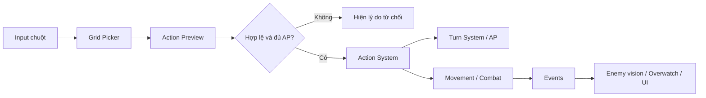
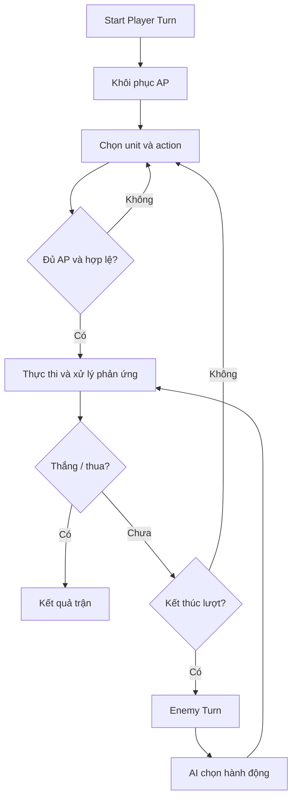
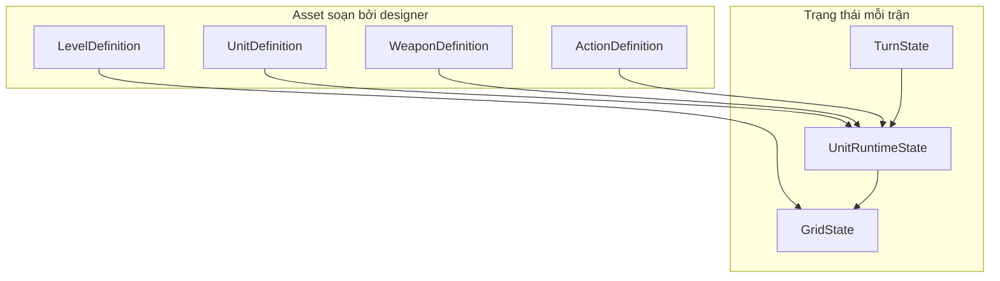

# Sơ đồ kiến trúc tham khảo

> Các sơ đồ dưới đây là đề xuất của giáo trình nhằm triển khai các ý trong video. Chúng không phải sơ đồ do tác giả video cung cấp.

## 1. Luồng phát lệnh

## 2. Một vòng chơi

## 3. Phân tầng dữ liệu

## 4. Lưu ý tính đúng

- `GridState` là nguồn sự thật về đơn vị chiếm ô.
- Dữ liệu thay đổi theo từng đơn vị (HP, AP, cooldown) không nằm trong ScriptableObject dùng chung.
- Action được xác thực trước khi commit; UI preview gọi cùng nguồn tính toán với thực thi.
- Overwatch và phát hiện cần kiểm tra theo **từng bước di chuyển** nếu luật kích hoạt theo ô.
