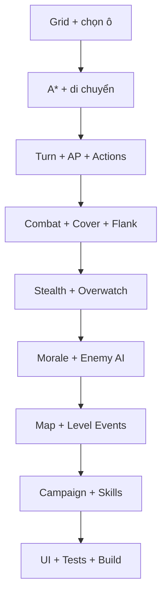

# Khóa học: Lập trình game chiến thuật theo lượt với Unity & C#

**Nền tảng:** Unity (3D nhìn từ trên xuống) • C# • Grid-based tactics

**Đầu vào:** Biết cơ bản Unity Editor, GameObject, Component, Prefab và C#. Bản ghi gốc cũng nói khóa học turn-based của tác giả phù hợp hơn với người đã có nền tảng Unity/C#.

**Sản phẩm cuối khóa:** một bản **vertical slice** chiến thuật theo lượt có lưới, di chuyển, AP, vũ khí, che chắn, Overwatch, AI và ít nhất một màn chơi hoàn chỉnh.

> **Nguồn:** được biên tập từ bản ghi tổng quan khoảng 13 phút 29 giây do người học cung cấp. Đây **không phải khóa video gốc đầy đủ**; các phần hướng dẫn xây dựng, kiến trúc, test và code minh họa là nội dung bổ sung, được ghi chú để không nhầm với lời tác giả.

## Lộ trình học

1. **[Module 01 — Thiết kế game và kiến trúc](./01-thiet-ke-va-kien-truc/README.md)** (3 bài): Nắm vòng lặp chiến thuật, phạm vi MVP và cách phân chia trách nhiệm trong dự án Unity.
2. **[Module 02 — Lưới, điều khiển và tìm đường](./02-luoi-dieu-khien-va-tim-duong/README.md)** (4 bài): Xây hệ tọa độ lưới, chuyển input thành lệnh và đảm bảo di chuyển không xuyên vật cản.
3. **[Module 03 — Lượt, điểm hành động và kỹ năng](./03-luot-diem-hanh-dong-va-ky-nang/README.md)** (3 bài): Thiết kế lượt rõ ràng, tiêu hao AP nhất quán và kỹ năng có thể tái sử dụng.
4. **[Module 04 — Tàng hình và Overwatch](./04-tang-hinh-va-overwatch/README.md)** (3 bài): Tạo tình huống phục kích, phát hiện dựa trên hướng nhìn/tiếng ồn và phản công tự động.
5. **[Module 05 — Chiến đấu, che chắn, đánh sườn, AoE](./05-chien-dau-che-chan-va-aoe/README.md)** (4 bài): Giải quyết chiến đấu theo vị trí, vật che chắn, đánh sườn và vùng sát thương.
6. **[Module 06 — Máu, tinh thần và AI địch](./06-mau-tinh-than-va-ai/README.md)** (3 bài): Kết hợp HP, tinh thần, định nghĩa archetype và hành vi AI ở lượt địch.
7. **[Module 07 — Thiết kế màn chơi và sự kiện](./07-thiet-ke-level-va-su-kien/README.md)** (3 bài): Thiết kế nội dung màn chơi bằng Prefab/marker và hệ thống sự kiện có điều kiện.
8. **[Module 08 — Chiến dịch, hội thoại và tiến trình](./08-chien-dich-hoi-thoai-va-tien-trinh/README.md)** (3 bài): Liên kết các trận đấu qua world map, hội thoại, kỹ năng và trang bị.
9. **[Module 09 — Tích hợp, kiểm thử và hoàn thiện](./09-tich-hop-kiem-thu-va-hoan-thien/README.md)** (3 bài): Tích hợp các cơ chế, thiết kế preview rõ ràng và hoàn thiện bản game có thể chơi.

## Cách học và nộp bài

1. Đọc `README.md` của module, học lần lượt các bài `.md`.
2. Chạy thử cơ chế trong một project Unity dùng chung, **không** tạo project mới cho mỗi bài.
3. Sau mỗi bài hoàn thành checklist, ghi ảnh/GIF hoặc video kết quả vào repo cá nhân.
4. Khi kết thúc module, kiểm tra lại cơ chế cũ để không phát sinh hồi quy.
5. Bài cuối nộp Unity project + bản build + video demo + `GDD.md`.

## Minh họa tuyến phát triển

## Các file bổ trợ

- [Nguồn và ghi chú biên soạn](./PHU-LUC/01-nguon-va-ghi-chu.md)
- [Sơ đồ kiến trúc Mermaid](./PHU-LUC/02-so-do-kien-truc.md)
- [Checklist dự án](./PHU-LUC/03-checklist-du-an.md)
- [Mẫu code Unity/C#](./PHU-LUC/04-bai-tap-mau-code.md)
- [Bản ghi gốc](./PHU-LUC/05-ban-ghi-goc.md)

## Quy ước

- `AP` = Action Points (điểm hành động), `HP` = Health Points (máu).
- `LOS` = Line of Sight (đường nhìn); `FOV` = Field of View (vùng nhìn).
- Thông số và công thức ví dụ **không phải** số liệu chính thức từ *Classified: France ’44*.
- Các file sử dụng đường dẫn tương đối, có thể mở bằng VS Code, Obsidian hoặc trình xem Markdown hỗ trợ Mermaid.
