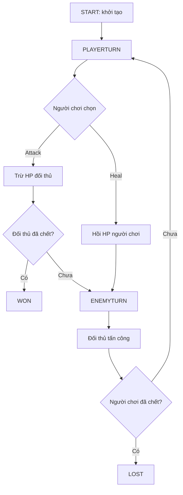

# Bài 1. Đặc tả hệ thống chiến đấu theo lượt

> **Đối chiếu video gốc:** 00:00–05:04  
> **Phạm vi:** Nội dung chính theo transcript video; phần lưu ý, kiểm thử và gợi ý được biên soạn để học dễ hơn.

## Mục tiêu học tập
- Phân biệt chiến đấu theo lượt và chiến đấu thời gian thực.
- Xác định đúng các trạng thái, thành phần và quy tắc tối thiểu của bản demo.
- Phác thảo luồng trận đấu trước khi viết mã.

## 1. Bài toán của chúng ta

Xây một trận **1 đấu 1** trong Unity: người chơi và đối thủ lần lượt hành động. Người chơi có **Attack** và **Heal**; trong phiên bản video, đối thủ **luôn Attack**. Trận kết thúc khi HP của một trong hai bên về 0.

### Bảng quy tắc

| Thành phần | Quy tắc |
|---|---|
| Đơn vị | Có tên, cấp độ, sát thương, HP hiện tại và HP tối đa |
| PlayerTurn | Người chơi chọn đúng một hành động |
| EnemyTurn | Đối thủ tự thực hiện một hành động |
| Attack | Trừ HP của mục tiêu theo damage của người đánh |
| Heal | Cộng 5 HP, không được vượt `maxHP` |
| Kết thúc | HP đối thủ = 0 → thắng; HP người chơi = 0 → thua |
| Phản hồi | HUD và thông báo thay đổi sau hành động |

## 2. Sơ đồ luồng trạng thái

## 3. Tách trách nhiệm thành ba script

- `Unit.cs`: dữ liệu và các phép thay đổi HP (`TakeDamage`, `Heal`).
- `BattleSystem.cs`: sinh nhân vật, điều khiển state, lượt, hành động và thắng/thua.
- `BattleHUD.cs`: chỉ đọc dữ liệu Unit rồi trình bày tên, cấp độ và máu lên UI.

Không đưa tất cả logic vào một script: khi có nhiều kỹ năng hoặc đơn vị, sẽ khó bảo trì.

## 4. Các phạm vi ngoài video

**Mở rộng do biên soạn:** hệ MP, nhiều kỹ năng, status effect, lựa chọn đội hình, AI chiến thuật, hoạt ảnh và hiệu ứng chỉ là hướng phát triển sau bản gốc, **chưa phải tính năng đã xây trong video**.

## 5. Sản phẩm sau bài

Viết một `Game Design Note` ngắn (5–10 dòng): ai được đi trước, mỗi lượt làm gì, cách tính HP, điều kiện kết thúc và giới hạn của bản prototype.

## Thực hành và tự kiểm tra
- [ ] Tạo tài liệu ghi lại 5 trạng thái trận đấu.
- [ ] Vẽ lại vòng lặp người chơi → địch → người chơi.
- [ ] Giải thích được vai trò Unit, BattleSystem, BattleHUD.

## Câu hỏi ôn tập
1. Thành phần vừa tạo chịu trách nhiệm gì trong hệ thống?
2. Điều gì có thể xảy ra nếu thiếu thành phần hoặc tham chiếu này?
3. Làm thế nào để tự kiểm tra kết quả mà không chỉ nhìn vào mã?

---
*Đi tiếp đến bài tiếp theo sau khi hoàn thành checklist. Mã hoàn chỉnh, đã thống nhất với các bài, nằm trong `07-phu-luc-ma-nguon/`.*
