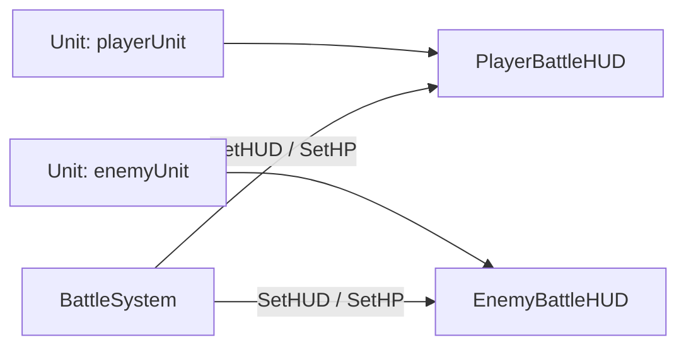

# Bài 8. BattleHUD: tên, level và thanh HP

> **Đối chiếu video gốc:** 14:11–17:07  
> **Phạm vi:** Nội dung chính theo transcript video; phần lưu ý, kiểm thử và gợi ý được biên soạn để học dễ hơn.

## Mục tiêu học tập
- Tách cập nhật giao diện khỏi luồng điều khiển trận đấu.
- Viết `SetHUD(Unit)` và `SetHP(int)`.
- Gắn HUD với các Unit được spawn tại runtime.

## 1. Tạo script BattleHUD.cs

Gắn script `BattleHUD` vào **PlayerBattleHUD** và **EnemyBattleHUD**. Mỗi HUD có ba tham chiếu:

```csharp
public Text nameText;
public Text levelText;
public Slider hpSlider;
```

## 2. SetHUD — thiết lập thông tin ban đầu

```csharp
public void SetHUD(Unit unit)
{
    nameText.text = unit.unitName;
    levelText.text = $"Lv {unit.unitLevel}";
    hpSlider.maxValue = unit.maxHP;
    hpSlider.value = unit.currentHP;
}
```

`hpSlider.maxValue` phải phản ánh HP tối đa, nếu không thanh máu sẽ hiển thị sai tỉ lệ.

## 3. SetHP — chỉ cập nhật lượng máu

```csharp
public void SetHP(int hp)
{
    hpSlider.value = hp;
}
```

Lý do có hai hàm: tên, cấp độ, maxHP thường chỉ cần thiết lập lúc xuất hiện; giá trị `currentHP` thay đổi sau mỗi hành động.

## 4. Tích hợp vào SetupBattle

```csharp
playerHUD.SetHUD(playerUnit);
enemyHUD.SetHUD(enemyUnit);
```

Trong `BattleSystem.cs`, tạo `public BattleHUD playerHUD;` và `public BattleHUD enemyHUD;`, rồi kéo đúng đối tượng HUD vào Inspector.

## 5. Mô hình dữ liệu → hiển thị



**Sai lầm phổ biến:** gọi `SetHUD()` trước khi tạo ra `playerUnit`; hoặc chỉ trừ HP mà quên gọi `SetHP()` nên logic đã thay đổi nhưng thanh máu vẫn đứng yên.

## Thực hành và tự kiểm tra
- [ ] Cả hai HUD hiện đúng name/level sau khi spawn.
- [ ] Slider phản ánh chính xác HP 20/25 và 30/30 trong dữ liệu mẫu.
- [ ] Giải thích được khác nhau giữa SetHUD và SetHP.

## Câu hỏi ôn tập
1. Thành phần vừa tạo chịu trách nhiệm gì trong hệ thống?
2. Điều gì có thể xảy ra nếu thiếu thành phần hoặc tham chiếu này?
3. Làm thế nào để tự kiểm tra kết quả mà không chỉ nhìn vào mã?

---
*Đi tiếp đến bài tiếp theo sau khi hoàn thành checklist. Mã hoàn chỉnh, đã thống nhất với các bài, nằm trong `07-phu-luc-ma-nguon/`.*
