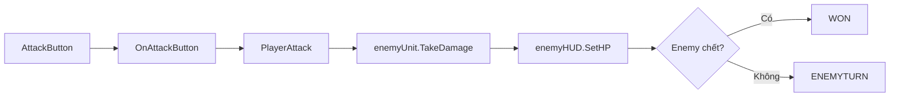

# Bài 10. Player Attack và TakeDamage

> **Đối chiếu video gốc:** 19:22–23:45  
> **Phạm vi:** Nội dung chính theo transcript video; phần lưu ý, kiểm thử và gợi ý được biên soạn để học dễ hơn.

## Mục tiêu học tập
- Gắn nút Attack với sự kiện Unity Button OnClick.
- Viết hành động Attack và cập nhật HUD của đối thủ.
- Phân nhánh: thắng hoặc chuyển sang lượt địch.

## 1. Giao diện gọi sự kiện

Tạo phương thức public trong `BattleSystem.cs`:

```csharp
public void OnAttackButton()
{
    if (state != BattleState.PLAYERTURN || isResolvingAction) return;
    isResolvingAction = true;
    StartCoroutine(PlayerAttack());
}
```

Trong Inspector: chọn `AttackButton` → On Click → `+` → kéo GameObject `BattleSystem` vào → chọn `BattleSystem.OnAttackButton`.

`isResolvingAction` là phần **gia cố của bản biên soạn**, chặn click liên tiếp khi hiệu ứng chưa xong.

## 2. Xử lý Attack

```csharp
private IEnumerator PlayerAttack()
{
    bool enemyDead = enemyUnit.TakeDamage(playerUnit.damage);
    enemyHUD.SetHP(enemyUnit.currentHP);
    dialogueText.text = "Bạn đã tấn công!";

    yield return new WaitForSeconds(2f);

    if (enemyDead)
    {
        state = BattleState.WON;
        EndBattle();
    }
    else
    {
        state = BattleState.ENEMYTURN;
        StartCoroutine(EnemyTurn());
    }
}
```

## 3. Luồng dữ liệu



## 4. Điều cần tránh

- Không cho Attack khi không phải lượt người chơi.
- Không trừ HP trong cả Unit lẫn BattleSystem hai lần.
- Luôn cập nhật enemyHUD sau khi HP đổi.
- Không chuyển EnemyTurn khi đã thắng.

## Thực hành và tự kiểm tra
- [ ] Nút Attack gọi đúng phương thức OnAttackButton.
- [ ] Nhấn Attack trừ đúng 10 HP của đối thủ (dữ liệu mẫu).
- [ ] Khi Enemy HP về 0, hệ thống không tiếp tục cho địch đánh.

## Câu hỏi ôn tập
1. Thành phần vừa tạo chịu trách nhiệm gì trong hệ thống?
2. Điều gì có thể xảy ra nếu thiếu thành phần hoặc tham chiếu này?
3. Làm thế nào để tự kiểm tra kết quả mà không chỉ nhìn vào mã?

---
*Đi tiếp đến bài tiếp theo sau khi hoàn thành checklist. Mã hoàn chỉnh, đã thống nhất với các bài, nằm trong `07-phu-luc-ma-nguon/`.*
