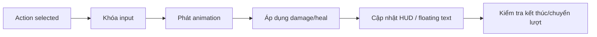

# Bài 16. Mở rộng: animation, hiệu ứng HP và phản hồi trạng thái

> **Đối chiếu video gốc:** 28:03–28:59 (định hướng mở rộng)  
> **Phạm vi:** Video nêu hướng phát triển; bảng, sơ đồ và bài tập là đề xuất mở rộng.

## Mục tiêu học tập
- Liệt kê các điểm có thể gắn animation trong pipeline.
- Thiết kế phản hồi để người chơi biết ai hành động và tác động bao nhiêu.
- Biết cách giữ đồng bộ animation với logic và state.

> **Mở rộng do biên soạn:** Video chỉ **gợi ý** thêm animation, UI overlay hiện sát thương và thay đổi giao diện theo state; không cung cấp các đoạn code hoàn chỉnh cho những hiệu ứng này.

## 1. Các điểm phát hiệu ứng

| Thời điểm | Hiệu ứng đề xuất |
|---|---|
| START | Nhân vật xuất hiện từ dưới sân đấu / fade-in |
| PLAYERTURN | Nhấn sáng hai nút hành động; nhắc người chơi chọn |
| PlayerAttack | Lunge/flash trên Enemy; số damage nổi |
| EnemyTurn | Sprite Enemy rung/di chuyển tới trước |
| Heal | Hạt sáng xanh, số HP cộng bay lên |
| WON/LOST | Màn kết quả và âm thanh ngắn |

## 2. Không để hiệu ứng làm sai logic

Trong hệ thống đơn giản, logic HP thay đổi ngay, sau đó chờ 1–2 giây để hiển thị. Nếu muốn animation chính xác, có thể đổi thứ tự thành:

Dùng `Animation Event` hoặc Coroutine chờ animation xong; tránh dùng hằng số thời gian ngẫu nhiên không khớp độ dài clip.

## 3. UI cho điện thoại

**Mở rộng:** nếu triển khai mobile, tăng vùng bấm nút, đảm bảo chữ đủ lớn, tôn trọng vùng safe area và kiểm tra cả tỷ lệ màn hình dài.

## 4. Luyện tập

Tạo một hiệu ứng đơn giản bằng cách tween scale của Sprite khi đánh và một hiệu ứng chớp màu cho Slider khi nhận damage. Chỉ làm sau khi bản core chạy ổn định.

## Thực hành và tự kiểm tra
- [ ] Thiết kế storyboard ngắn cho Attack, Heal và Finish.
- [ ] Nêu đúng thời điểm khóa input và mở lại input.
- [ ] Thử một hiệu ứng nhỏ và kiểm tra lượt không bị nhân đôi.

## Câu hỏi ôn tập
1. Thành phần vừa tạo chịu trách nhiệm gì trong hệ thống?
2. Điều gì có thể xảy ra nếu thiếu thành phần hoặc tham chiếu này?
3. Làm thế nào để tự kiểm tra kết quả mà không chỉ nhìn vào mã?

---
*Đi tiếp đến bài tiếp theo sau khi hoàn thành checklist. Mã hoàn chỉnh, đã thống nhất với các bài, nằm trong `07-phu-luc-ma-nguon/`.*
