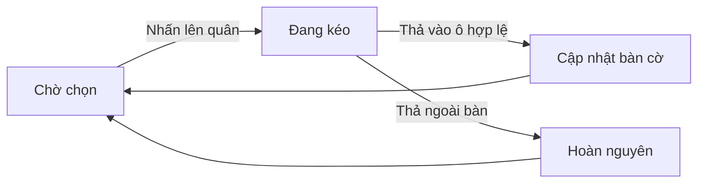

# Bài 03. Chọn, kéo thả, di chuyển mượt và ăn quân

> **Module 01: Nền tảng Unity và bàn cờ** · **Loại:** Bài học kết hợp thực hành

## 1. Tổng quan

Người chơi chọn quân bằng chuột, kéo đến ô đích và thả. Đây là lớp tương tác chưa áp dụng đầy đủ luật đi quân; điều quan trọng là quản lý trạng thái nhất quán và làm mượt chuyển động.

## 2. Mục tiêu học tập

- Xây dựng vòng đời chọn–kéo–thả quân cờ.
- Sử dụng raycast để xác định ô nguồn/ô đích.
- Cập nhật dữ liệu khi di chuyển hoặc ăn quân.
- Dùng nội suy để chuyển quân mượt và thu nhỏ quân bị bắt.

## 3. Kiến thức và cách triển khai

### 3.1. Máy trạng thái kéo thả

Lưu tham chiếu `currentlyDragging` (hoặc tương đương). Ban đầu giá trị này là `null`. Khi nhấn chuột trên quân của người đang điều khiển, bắt đầu kéo. Trong lúc giữ chuột, cập nhật vị trí hình ảnh theo ô dưới con trỏ. Khi thả, chỉ chấp nhận ô đích có thể thao tác; nếu ô đích không hợp lệ, đưa quân về vị trí nguồn.



Tại mọi thời điểm, **mảng quân trên bàn** là trạng thái logic và `Transform` chỉ thể hiện hình ảnh. Không được ghi đè ô nguồn khi chưa xác thực ô đích; nếu thất bại, cần phục hồi đủ các trường.

### 3.2. Di chuyển, thay thế và ăn quân

Giả sử `board[fromX, fromY]` chứa quân A. Khi A chuyển sang ô trống B, xóa ô nguồn, gán A vào ô đích, sửa `currentX/currentY`, sau đó cho A di chuyển mượt tới tâm ô đích. Nếu B có quân đối phương, A chiếm ô đó và quân B được đánh dấu bị bắt. Không cho di chuyển lên ô có quân cùng phe.

```csharp
// Mã minh họa cho bước cập nhật sau khi đã xác nhận nước đi.
board[fromX, fromY] = null;
board[toX, toY] = movingPiece;
movingPiece.currentX = toX;
movingPiece.currentY = toY;
movingPiece.desiredPosition = TileCenter(toX, toY, tileSize);
```

### 3.3. Nội suy hoạt ảnh

`Vector3.Lerp(current, target, Time.deltaTime * speed)` là cách đơn giản để quân tiến về vị trí mong muốn. Đặt trong `Update()` hoặc logic chuyển động của quân. Khi quân bị bắt, đặt `desiredScale` nhỏ dần và chuyển ra cạnh bàn. Nếu dùng `Lerp` lặp theo vị trí hiện thời, chuyển động tiến gần đích theo hàm mũ; gán trực tiếp target khi khoảng cách đủ nhỏ để tránh sai số còn lại.

Giai đoạn này **chưa phải luật cờ hoàn chỉnh**. Việc bắt mọi quân theo cơ chế kéo thả chỉ phục vụ kiểm tra dữ liệu và hoạt ảnh. Các nước đi của từng loại quân sẽ được kiểm tra riêng ở module luật cờ.

## 4. Thực hành có kiểm chứng

1. Viết biến giữ quân đang kéo, ô bắt đầu và ô đang hover.
2. Xử lý `GetMouseButtonDown(0)` để chọn, `GetMouseButtonUp(0)` để thả và raycast từng frame.
3. Cho phép di chuyển quân sang ô trống; cấm đè quân cùng phe; ăn quân khác phe.
4. Thử kéo ra ngoài bàn, nhả chuột giữa chừng và kéo nhanh qua nhiều ô.

**Checkpoint:** thao tác kết thúc luôn trả `currentlyDragging` về `null`; không tạo hai quân cùng ô; quân bị bắt không còn trong mảng bàn cờ.

## 5. Lỗi thường gặp và cách xử lý

- **Quân bị “kẹt” theo chuột:** không đặt lại trạng thái kéo sau khi thả.
- **Hai quân cùng ô:** chưa xóa ô nguồn hoặc chưa xử lý quân tại ô đích.
- **Quân giật:** đổi trực tiếp transform trong nhiều nơi, cần một nguồn `desiredPosition` duy nhất.
- **Nhả ngoài bàn gây lỗi:** kiểm tra raycast không trúng ô trước khi đọc tọa độ đích.

## 6. Câu hỏi ôn tập

### Câu 1

Biến `currentlyDragging` nên có giá trị gì khi không kéo quân?

A. Một quân bất kỳ.  
B. null.  
C. Ô (0,0).  
D. Giá trị camera.position.  

**Đáp án:** B.

**Giải thích:** Giá trị rỗng thể hiện máy trạng thái đang chờ lựa chọn mới.

### Câu 2

Sau khi xác nhận di chuyển quân A từ ô nguồn sang đích, thao tác nào đúng?

A. Chỉ cập nhật transform.  
B. Chỉ đổi vật liệu.  
C. Xóa cả hai quân.  
D. Cập nhật cả mảng bàn cờ và tọa độ logic của A.  

**Đáp án:** D.

**Giải thích:** Hình ảnh và dữ liệu phải khớp nhau sau nước đi.

### Câu 3

Điều gì cần làm khi thả quân ra ngoài bàn?

A. Hoàn nguyên quân về ô nguồn.  
B. Xóa quân.  
C. Kết thúc trận.  
D. Ghi nước đi mới vào lịch sử.  

**Đáp án:** A.

**Giải thích:** Vì không có ô đích hợp lệ nên nước đi không được cam kết.

### Câu 4

Lý do lưu `desiredPosition` là gì?

A. Để thay sprite.  
B. Để tăng số ô.  
C. Để tách tọa độ mục tiêu khỏi hoạt ảnh transform hiện thời.  
D. Để tạo scene mới.  

**Đáp án:** C.

**Giải thích:** Việc lưu vị trí mục tiêu giúp nội suy mà không làm mất trạng thái logic.

### Câu 5

Một quân có thể ăn quân cùng phe không?

A. Luôn được.  
B. Không, trường hợp này phải từ chối.  
C. Chỉ khi cùng loại.  
D. Chỉ khi nhấn hai lần.  

**Đáp án:** B.

**Giải thích:** Điểm đến có quân cùng phe không phải ô có thể chiếm trong cờ vua.

## 7. Tổng kết

Kéo thả là một máy trạng thái: chọn, cập nhật hình ảnh, xác thực đích, cam kết hoặc hoàn nguyên. Dữ liệu logic không được phụ thuộc vào hoạt ảnh.

**Điều kiện hoàn thành:** thực hiện tất cả checkpoint trong bài và lưu phiên bản chạy được vào Git.
