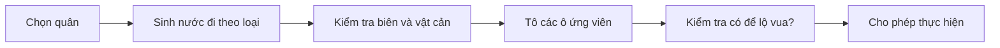

# Bài 04. Tạo nước đi hợp lệ cho sáu loại quân

> **Module 02: Luật cờ và cơ chế trận đấu** · **Loại:** Bài học kết hợp thực hành

## 1. Tổng quan

Một thao tác kéo thả chưa đủ để gọi là chơi cờ: mỗi loại quân có tập ô có thể đi khác nhau. Bài học thiết kế hàm sinh nước đi và hiển thị các ô có thể chọn, tạo nền cho kiểm tra chiếu vua.

## 2. Mục tiêu học tập

- Phân biệt nước đi tiềm năng theo hình học và nước đi hợp lệ về mặt chiếu vua.
- Cài đặt nguyên tắc di chuyển của Tốt, Xe, Mã, Tượng, Hậu và Vua.
- Loại bỏ nước đi vượt biên, bị chắn hoặc ăn quân cùng phe.
- Dùng danh sách nước đi để hiển thị highlight trên bàn.

## 3. Kiến thức và cách triển khai

### 3.1. Một giao diện chung cho các loại quân

Mỗi quân cần phương thức có thể ghi đè để trả về các ô mục tiêu từ trạng thái hiện tại:

```csharp
public virtual List<Vector2Int> GetAvailableMoves(
    ChessPiece[,] board, int tileCountX, int tileCountY)
{
    return new List<Vector2Int>();
}
```

Tạo lớp con cho từng quân để override phương thức này. Luôn kiểm tra `0 <= x < tileCountX` và `0 <= y < tileCountY` trước khi truy cập mảng. Danh sách trả về không nên tự sửa `board`; đây là thao tác truy vấn.

### 3.2. Nhóm nước đi

| Quân | Mẫu di chuyển | Vật cản |
| --- | --- | --- |
| Xe | Ngang hoặc dọc nhiều ô | Dừng trước quân đầu tiên, có thể ăn quân địch tại ô đó |
| Tượng | Chéo nhiều ô | Cũng dừng khi gặp quân |
| Hậu | Kết hợp Xe và Tượng | Không thể nhảy xuyên quân |
| Mã | Hình chữ L: (±1, ±2), (±2, ±1) | Được nhảy qua quân trên đường đi |
| Vua | Một ô mọi hướng | Không thể kết thúc ở ô bị đối thủ tấn công |
| Tốt | Tiến thẳng một ô, có thể hai ô ở lần đi đầu; ăn chéo một ô | Không thể tiến vào ô đã có quân; ăn chéo khi có quân địch |

Đối với Xe/Tượng/Hậu, duyệt lần lượt từng hướng. Gặp ô trống thì thêm, gặp quân cùng phe thì dừng không thêm, gặp quân đối phương thì thêm ô đó rồi dừng. Mã chỉ kiểm tra tám tọa độ đích, không xét vật cản trên đoạn đường bay.

**Tốt** là quân dễ nhầm: ô tiến thẳng phải trống, ô ăn nằm chéo và chỉ có thể ăn khi có quân địch; bước hai ô từ vị trí xuất phát yêu cầu cả hai ô trung gian và đích trống. Quy ước hướng tiến theo đội, chẳng hạn `+1` với trắng và `-1` với đen nếu trắng ở y=1.

### 3.3. Từ danh sách nước đi đến giao diện

Khi chọn quân, gọi `GetAvailableMoves`; tô các ô trả về bằng material riêng. Khi chọn quân khác hoặc kết thúc lượt, hoàn nguyên highlight. Khi thả quân, kiểm tra ô đích có nằm trong danh sách hay không. Chưa nên kết luận đó là nước đi hợp lệ cuối cùng: một quân bị ghim có thể di chuyển đúng hình học nhưng khiến vua mình bị chiếu. Bộ lọc này được triển khai riêng ở bài kiểm tra chiếu.



Luồng được tách rõ vì luật đi quân và luật an toàn của vua có trách nhiệm khác nhau.

## 4. Thực hành có kiểm chứng

1. Tạo `GetAvailableMoves` cho tất cả sáu loại quân.
2. Thử quân Xe giữa bàn, sau đó đặt đồng minh/địch trên cùng một cột.
3. Thử Mã đứng sau ba quân chắn đường, Tốt đi từ hàng xuất phát và Tượng ở cạnh bàn.
4. Khi nhấn quân, tô đúng danh sách ô có thể tới; khi thả, bỏ highlight.

**Checkpoint:** Mã nhảy được; Xe/Tượng/Hậu không xuyên quân; Tốt không ăn thẳng; không truy cập ngoài mảng.

## 5. Lỗi thường gặp và cách xử lý

- **Đọc chỉ số ngoài biên:** kiểm tra tọa độ trước khi lấy `board[x, y]`.
- **Xe/Tượng đi xuyên quân:** thiếu `break` khi gặp quân đầu tiên.
- **Tốt ăn sai hướng:** kiểm tra hướng tiến riêng theo phe.
- **Highlight sai lệch:** xóa danh sách và vật liệu cũ trước khi sinh danh sách mới.

## 6. Câu hỏi ôn tập

### Câu 1

Quân nào có thể nhảy qua các quân chắn đường?

A. Xe.  
B. Tượng.  
C. Mã.  
D. Hậu.  

**Đáp án:** C.

**Giải thích:** Mã di chuyển theo mẫu chữ L và không bị cản bởi quân ở các ô trung gian.

### Câu 2

Nếu Xe gặp quân đối phương trong hướng đang duyệt, nên làm gì?

A. Thêm ô địch và dừng duyệt hướng đó.  
B. Nhảy qua để xét ô tiếp theo.  
C. Loại hết nước đi của Xe.  
D. Tự động kết thúc ván.  

**Đáp án:** A.

**Giải thích:** Xe có thể ăn quân đầu tiên nhưng không thể xuyên qua nó.

### Câu 3

Một Tốt bình thường có thể ăn theo cách nào?

A. Tiến thẳng 2 ô.  
B. Lùi 1 ô.  
C. Sang ngang 1 ô.  
D. Đi chéo một ô theo hướng tiến khi có quân địch.  

**Đáp án:** D.

**Giải thích:** Di chuyển thẳng và ăn chéo là hai quy tắc tách biệt.

### Câu 4

Vì sao GetAvailableMoves không nên tự sửa mảng bàn cờ?

A. Vì mảng chỉ chứa renderer.  
B. Vì hàm đang truy vấn lựa chọn, chưa cam kết nước đi.  
C. Vì Unity cấm sửa mảng.  
D. Vì tất cả nước đi đã là chiếu hết.  

**Đáp án:** B.

**Giải thích:** Tách truy vấn khỏi thao tác biến đổi giúp mô phỏng và hoàn nguyên an toàn.

### Câu 5

Nước đi đúng hình học nhưng để lộ Vua nên được xử lý thế nào?

A. Vẫn chấp nhận.  
B. Đổi phe của Vua.  
C. Bị loại khi kiểm tra an toàn Vua.  
D. Đặt lại bàn.  

**Đáp án:** C.

**Giải thích:** Một nước đi hợp lệ cuối cùng không được khiến Vua bên đi bị chiếu.

## 7. Tổng kết

Sinh nước đi riêng theo từng loại quân, kiểm tra biên và vật cản, rồi hiển thị các ô ứng viên. Luật bảo vệ Vua là bước lọc tiếp theo trước khi cam kết.

**Điều kiện hoàn thành:** thực hiện tất cả checkpoint trong bài và lưu phiên bản chạy được vào Git.
