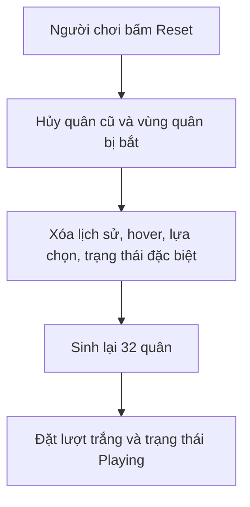

# Bài 05. Quản lý lượt chơi, màn hình thắng và đặt lại trận

> **Module 02: Luật cờ và cơ chế trận đấu** · **Loại:** Bài học kết hợp thực hành

## 1. Tổng quan

Sau khi có nước đi theo loại quân, trò chơi cần kiểm soát bên nào được chơi và trình bày trạng thái kết thúc. Bài này xây hệ thống lượt, canvas thông báo và cơ chế reset sạch toàn bộ dữ liệu.

## 2. Mục tiêu học tập

- Kiểm soát phe đi lượt hiện tại bằng trạng thái dùng chung.
- Ngăn người chơi chọn quân trái lượt.
- Thiết kế màn hình kết thúc và nút chơi lại.
- Reset chính xác quân, highlight, lịch sử và trạng thái trận.

## 3. Kiến thức và cách triển khai

### 3.1. Điều khiển lượt đi

Biến `isWhiteTurn` lưu bên tới lượt. Khởi tạo `true`. Khi một nước đi **thành công**, đảo giá trị. Không đảo khi người chơi nhấn quân, rê chuột hoặc thả ngoài bàn. Nếu hệ thống dùng `team=0` cho trắng, hãy thống nhất hàm chuyển đổi từ lượt sang phe.

```csharp
private bool isWhiteTurn = true;
private int CurrentTeam => isWhiteTurn ? 0 : 1;

void FinishAcceptedMove()
{
    isWhiteTurn = !isWhiteTurn;
}
```

Quân chỉ được chọn khi `piece.team == CurrentTeam`, ngoại trừ giai đoạn thử nghiệm hoặc chế độ xem lại ván. Luật lượt phải kiểm tra ngay trước khi cập nhật bàn, không chỉ ở bước highlight.

### 3.2. Giao diện thắng/thua

Tạo `Canvas` có panel kết quả, nội dung `TextMeshPro` và nút `Reset`. Khi có điều kiện kết thúc, khóa thao tác bàn cờ và hiển thị bên thắng. Bản dựng sơ khai của loạt hướng dẫn dùng tình huống **Vua bị bắt** làm tín hiệu kết thúc; đó là bước trung gian để kiểm tra UI, không phải điều kiện kết thúc chuẩn của cờ vua. Khi triển khai bộ lọc chiếu vua, chuyển kết thúc trận sang **chiếu hết**.

Một thiết kế dễ bảo trì phân biệt `Playing`, `WhiteWon`, `BlackWon`, `Draw`. Khi thông báo kết quả, chỉ controller trận đổi trạng thái, còn UI đọc trạng thái đó để vẽ màn hình.

### 3.3. Reset toàn bộ trạng thái

Reset không phải chỉ sinh lại quân cờ. Phải xóa quân cũ, quân đã bị bắt đang nằm bên cạnh bàn, highlight, quân đang kéo, danh sách nước đi đang tô, lịch sử nước đi và trạng thái đặc biệt. Sau đó khởi tạo đội hình chuẩn, lượt trắng, camera và menu phù hợp.



Nếu có kết nối mạng, reset cục bộ không đồng nghĩa reset trận trực tuyến; tái đấu qua mạng sẽ cần xác nhận từ cả hai bên.

## 4. Thực hành có kiểm chứng

1. Viết kiểm tra đúng phe trong thao tác chọn quân.
2. Cho nước đi hợp lệ đảo lượt, nước đi bị từ chối giữ nguyên lượt.
3. Dựng panel kết quả và nút chơi lại với Unity UI/TextMeshPro.
4. Chơi vài lượt có ăn quân, sau đó Reset và so sánh bàn với trạng thái ban đầu.

**Checkpoint:** chỉ đúng phe được chọn, trạng thái UI và bàn cờ cùng reset về ban đầu, không còn GameObject quân cũ.

## 5. Lỗi thường gặp và cách xử lý

- **Bỏ lượt khi kéo lỗi:** chỉ đảo `isWhiteTurn` sau khi cam kết nước đi.
- **Bị trùng quân khi reset:** xóa quân cũ trước khi spawn.
- **Màn hình kết quả không hiện:** kiểm tra Canvas, thứ tự layer UI, panel active và callback nút.
- **Nhầm bắt vua với chiếu hết:** coi bắt vua là logic tạm thời trong bài này.

## 6. Câu hỏi ôn tập

### Câu 1

Khi nào nên đảo `isWhiteTurn`?

A. Ngay khi nhấn quân.  
B. Sau khi một nước đi được chấp nhận.  
C. Khi hover đổi ô.  
D. Khi mở menu.  

**Đáp án:** B.

**Giải thích:** Chỉ nước đi hợp lệ đã hoàn tất mới làm thay đổi bên tới lượt.

### Câu 2

Vì sao bắt Vua không phải điều kiện kết thúc chuẩn?

A. Vì Vua không có mesh.  
B. Vì bàn cờ có 64 ô.  
C. Vì quân Vua di chuyển chéo.  
D. Vì cờ vua kết thúc bằng chiếu hết trước khi Vua bị bắt.  

**Đáp án:** D.

**Giải thích:** Luật cờ vua không cho phép thực hiện nước đi khiến Vua bị bắt.

### Câu 3

Reset trận cần xóa dữ liệu nào?

A. Cả quân cũ, quân bị bắt, lịch sử và lựa chọn.  
B. Chỉ nhãn của nút.  
C. Chỉ camera.  
D. Chỉ quân bị bắt.  

**Đáp án:** A.

**Giải thích:** Nếu giữ state cũ, ván mới sẽ có hành vi sai hoặc quân trùng.

### Câu 4

Cách làm nào giúp tách UI khỏi logic trận?

A. Đặt luật đi trong TextMeshPro.  
B. Tạo UI trực tiếp trong ChessPiece.  
C. Controller quản lý trạng thái, UI phản ánh kết quả.  
D. Cho nút Reset xử lý luật bắt qua đường.  

**Đáp án:** C.

**Giải thích:** Mỗi thành phần giữ một trách nhiệm rõ ràng.

### Câu 5

Khi chọn quân trái lượt, hành vi mong muốn là?

A. Đảo lượt.  
B. Từ chối lựa chọn và không sửa trạng thái.  
C. Xóa quân.  
D. Bắt đầu ván mới.  

**Đáp án:** B.

**Giải thích:** Lượt hiện hành chỉ thay đổi khi một bên hoàn thành nước đi hợp lệ.

## 7. Tổng kết

Chỉ nước đi hợp lệ mới đảo lượt. Màn hình kết quả và nút Reset phải dựa trên trạng thái trận nhất quán; logic bắt Vua chỉ là phép thử, không phải luật kết thúc chuẩn.

**Điều kiện hoàn thành:** thực hiện tất cả checkpoint trong bài và lưu phiên bản chạy được vào Git.
