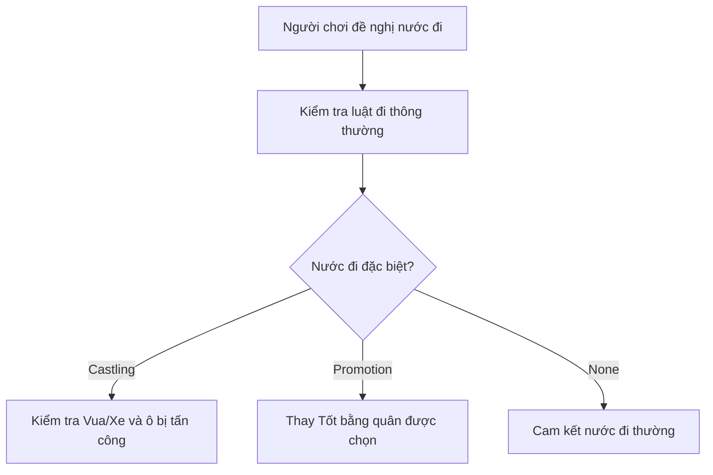

# Bài 07. Nhập thành (castling) và phong cấp (promotion)

> **Module 02: Luật cờ và cơ chế trận đấu** · **Loại:** Bài học kết hợp thực hành

## 1. Tổng quan

Hai nước đi đặc biệt còn lại thay đổi trạng thái nhiều quân hoặc thay thế một quân. Bài học xây điều kiện nhập thành, cập nhật Vua/Xe cùng lúc và phong Tốt thành Hậu khi tới hàng cuối.

## 2. Mục tiêu học tập

- Liệt kê đầy đủ điều kiện để nhập thành ở hai phía.
- Di chuyển đồng bộ Vua và Xe trong một lượt.
- Nhận diện Tốt tới hàng cuối và thực hiện phong cấp.
- Phân biệt bản tối giản chỉ phong Hậu với luật chuẩn cho chọn Hậu/Xe/Tượng/Mã.

## 3. Kiến thức và cách triển khai

### 3.1. Nhập thành: điều kiện hình học và lịch sử

Nhập thành là một nước đi của Vua kèm di chuyển Xe: Vua chuyển **hai ô về phía Xe**, Xe chuyển đến ô Vua vừa đi qua. Điều kiện bao gồm: Vua chưa từng di chuyển; Xe được dùng chưa từng di chuyển; mọi ô giữa Vua và Xe trống; Vua không đang bị chiếu, không đi xuyên ô bị tấn công và không kết thúc trên ô bị tấn công. Việc Xe đang bị tấn công không tự cấm nhập thành; điều quyết định là ba vị trí Vua cần xét.

Do đó bộ kiểm tra nhập thành dùng **lịch sử nước đi** và bộ kiểm tra **ô bị đối phương tấn công**. Chỉ kiểm tra đường trống, như trong giai đoạn đầu khi dựng hình, là chưa đủ.

```text
Nhập thành cánh Vua của trắng (tọa độ cột theo chuẩn):
Trước:  R . . . K . . R
Sau:    R . . . . R K .
Cánh Hậu: Vua sang c; Xe sang d (theo ký hiệu cờ tiêu chuẩn).
```

Để giữ dữ liệu đúng, áp dụng như một giao dịch: xác định hai ô đích, kiểm tra toàn bộ điều kiện, xóa hai ô nguồn, cập nhật tọa độ của Vua/Xe và gán lại hai ô đích. Sau đó chạy hoạt ảnh cho cả hai quân.

### 3.2. Phong cấp

Khi Tốt trắng tới hàng cuối phía đen hoặc Tốt đen tới hàng cuối phía trắng, quân Tốt phải được phong thành **Hậu, Xe, Tượng hoặc Mã cùng phe**. Giai đoạn thực hành đơn giản trong loạt hướng dẫn mặc định phong thành Hậu (queening). Đây là cách hoàn thiện cơ chế ban đầu, chưa phải UI lựa chọn quân theo luật đầy đủ.

Cách triển khai: hoàn tất kiểm tra nước đi của Tốt, phát hiện hàng cuối, loại instance Tốt và tạo quân mới đúng loại tại cùng ô, giữ phe và cập nhật mảng. Việc phong cấp không đổi thành Vua hay Tốt khác; một phe có thể có hơn một Hậu sau phong cấp.

### 3.3. Kiểm tra cạnh tranh giữa các cơ chế

Với cùng hành vi chọn–thả, bước kiểm tra có thể trả `SpecialMove.None`, `Castling` hoặc `Promotion` để bộ xử lý trung tâm biết cập nhật phụ. Đừng suy luận chỉ từ khoảng cách di chuyển: trước khi thực hiện, cần xác nhận loại quân, lịch sử và các trạng thái ràng buộc.



## 4. Thực hành có kiểm chứng

1. Tạo bàn kiểm thử có Vua và hai Xe không bị cản; thử nhập thành hai cánh.
2. Cho Vua hoặc Xe đi rồi quay về; xác nhận không thể nhập thành với quân đã di chuyển.
3. Đánh dấu ô Vua đi qua là bị tấn công; cấm nhập thành qua ô đó.
4. Đưa Tốt tới hàng cuối, phong Hậu và xác nhận danh sách quân được cập nhật.

**Checkpoint:** nhập thành chỉ hợp lệ khi đủ điều kiện; phong cấp không để lại quân Tốt trùng vị trí.

## 5. Lỗi thường gặp và cách xử lý

- **Cho nhập thành sau khi Vua quay về:** dùng vị trí hiện tại thay vì trạng thái đã từng di chuyển.
- **Cho Vua đi qua ô bị chiếu:** thiếu kiểm tra ô trung gian.
- **Xe không di chuyển cùng Vua:** chỉ cập nhật một quân trong `board`.
- **Phong cấp tạo hai quân:** chưa hủy Tốt cũ hoặc chưa thay mảng bàn cờ.

## 6. Câu hỏi ôn tập

### Câu 1

Trong nhập thành, Vua di chuyển bao nhiêu ô theo hàng ngang?

A. Một.  
B. Hai.  
C. Ba.  
D. Bốn.  

**Đáp án:** B.

**Giải thích:** Vua đi hai ô về phía Xe, khác với nước đi thông thường.

### Câu 2

Tình huống nào cấm nhập thành?

A. Xe đang bị tấn công nhưng Vua an toàn.  
B. Hai quân cùng màu.  
C. Vua đã từng di chuyển rồi quay lại ô cũ.  
D. Người chơi đang chơi cánh Hậu.  

**Đáp án:** C.

**Giải thích:** Vua mất quyền nhập thành vĩnh viễn sau khi đã từng đi.

### Câu 3

Sau khi Tốt tới hàng cuối, lựa chọn phong cấp hợp lệ theo luật chuẩn là?

A. Hậu, Xe, Tượng hoặc Mã.  
B. Chỉ Vua.  
C. Chỉ Tốt.  
D. Bất kỳ quân của đối thủ.  

**Đáp án:** A.

**Giải thích:** Phong cấp cho phép chọn bốn loại quân cùng phe, không bao gồm Vua và Tốt.

### Câu 4

Nhập thành có được đi xuyên ô đang bị đối phương tấn công không?

A. Có nếu Xe chưa đi.  
B. Có nếu đã chiếu Hậu.  
C. Có khi bấm hai lần.  
D. Không.  

**Đáp án:** D.

**Giải thích:** Vua không được đang bị chiếu, đi qua ô bị tấn công hoặc tới ô bị tấn công.

### Câu 5

Vì sao xử lý nhập thành cần cập nhật hai quân như một thao tác?

A. Vì phải thay màu bàn.  
B. Vì Vua và Xe cùng chuyển vị trí trong một nước.  
C. Vì có hai người chơi.  
D. Vì URP bắt buộc.  

**Đáp án:** B.

**Giải thích:** Nếu chỉ cập nhật một quân, dữ liệu vị trí sẽ không khớp trạng thái hợp lệ của ván.

## 7. Tổng kết

Nhập thành yêu cầu Vua/Xe chưa từng đi, đường trống và Vua không đi qua ô bị tấn công. Phong cấp thay Tốt bằng một quân hợp lệ cùng phe tại hàng cuối.

**Điều kiện hoàn thành:** thực hiện tất cả checkpoint trong bài và lưu phiên bản chạy được vào Git.
