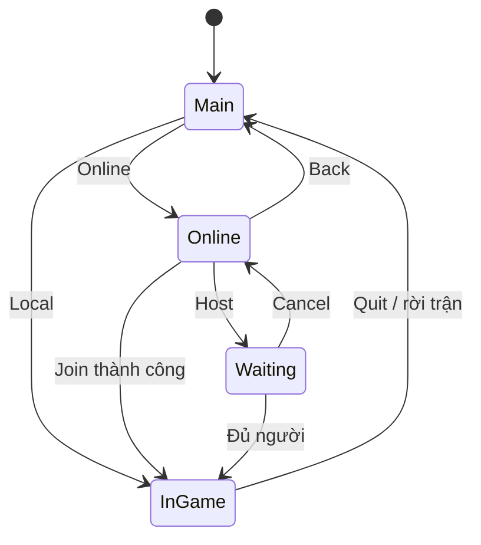

# Bài 09. Xây dựng menu Local/Online và giao diện chờ đối thủ

> **Module 03: Multiplayer: Client–Server** · **Loại:** Bài học kết hợp thực hành

## 1. Tổng quan

Multiplayer cần các màn hình định hướng người chơi trước khi có kết nối mạng. Bài này xây menu với Canvas, TextMeshPro, các nút Local/Online/Host/Connect/Back và chuyển cảnh bằng Animator.

## 2. Mục tiêu học tập

- Thiết kế luồng điều hướng giữa màn hình chính, online, chờ đối thủ và game.
- Dùng Canvas, Layout Group và TextMeshPro để dựng menu.
- Dùng Animator để chuyển trạng thái hiển thị.
- Tách thao tác UI khỏi hành động khởi động hoặc tắt kết nối mạng.

## 3. Kiến thức và cách triển khai

### 3.1. Xác định các màn hình

Các màn hình chính trong dự án gồm:

| Màn hình | Nội dung | Hành động chính |
| --- | --- | --- |
| Main | Tiêu đề cờ vua, Local, Online | Chơi hai người trên cùng máy hoặc mở menu Online |
| Online | Host, Join/Connect, Back, ô địa chỉ máy chủ | Tạo phòng, tham gia hoặc quay lại |
| Hosting/Waiting | Đang chờ đối thủ | Hủy host và tắt server |
| InGame | Bàn cờ và trạng thái đang chơi | Chơi theo phe đã được gán |

Dùng `Canvas` làm UI gốc; các panel chỉ chiếm vùng giao diện cần thiết. Dùng `Vertical Layout Group` và `RectTransform` để thiết kế khoảng cách và co giãn giữa các nút; `TextMeshPro` tạo text rõ nét. Canvas Scaler giúp thích ứng khi thay đổi độ phân giải, nhưng phải kiểm tra anchoring của từng panel.

### 3.2. Chuyển đổi bằng Animator

Có thể tạo Animator Controller cho UI, với các state tương ứng menu và trigger chuyển trang. Animator chịu trách nhiệm chuyển tiếp thị giác; lớp quản lý UI chịu trách nhiệm trạng thái logic. Khi bấm **Back** từ Waiting, phải gọi logic đóng host và trở về Online/Main, không chỉ ẩn panel.

Sơ đồ mô tả trạng thái UI; hành động chuyển sang `InGame` sau Join chỉ xảy ra khi server đã xác nhận có thể bắt đầu. Không được cho client vào trận chỉ vì vừa nhấn nút Connect.

### 3.3. Kiến trúc sự kiện UI

Viết các hàm `OnClickLocal`, `OnClickHost`, `OnClickConnect`, `OnClickCancel` trong UI controller. Các hàm này gọi tác vụ của game/network controller, rồi thay đổi màn hình theo **kết quả**. Hạn chế để Button trực tiếp thao tác `NetworkDriver` vì khó test và khó phục hồi khi kết nối lỗi.

Trong phần này, việc host/connect có thể là placeholder để chuẩn bị sẵn giao diện cho module networking. Hãy xác minh các nút và thứ tự menu trước khi nối API mạng thật.

## 4. Thực hành có kiểm chứng

1. Tạo bốn panel và nhóm nút điều khiển tương ứng.
2. Gắn `Vertical Layout Group`, `RectTransform` và TextMeshPro; kiểm tra khi đổi độ phân giải.
3. Thiết lập Animator hoặc mã chuyển màn hình tương đương.
4. Mô phỏng host, hủy host, connect thất bại và quay về menu chính.

**Checkpoint:** không có hai panel xung đột hiển thị, đường quay lại rõ ràng, button hoạt động và không tự đổi trạng thái game khi chưa kết nối.

## 5. Lỗi thường gặp và cách xử lý

- **Không thấy menu:** kiểm tra Canvas Render Mode, anchoring, thứ tự đối tượng và Alpha của CanvasGroup.
- **Button không phản hồi:** cần EventSystem, vùng raycast và sự kiện `OnClick` đúng.
- **Hủy host nhưng server vẫn chạy:** callback Cancel phải gọi hàm đóng kết nối.
- **Chuyển InGame quá sớm:** chỉ chuyển khi nhận sự kiện bắt đầu trận hợp lệ.

## 6. Câu hỏi ôn tập

### Câu 1

Khi hủy màn hình Waiting, thao tác nào bắt buộc ngoài đổi UI?

A. Tắt server/host đang chạy.  
B. Xóa tất cả prefab.  
C. Phong một quân Tốt.  
D. Đảo lượt trắng.  

**Đáp án:** A.

**Giải thích:** Ẩn panel không tự đóng socket hoặc dừng hosting.

### Câu 2

Thành phần nào phù hợp để sắp nút theo cột có khoảng cách đều?

A. MeshCollider.  
B. NetworkDriver.  
C. Vertical Layout Group.  
D. Rigidbody.  

**Đáp án:** C.

**Giải thích:** Layout Group giúp bố trí các phần tử UI theo trục dọc.

### Câu 3

Khi nào client nên chuyển sang màn hình ván đấu online?

A. Ngay lúc nhấn Connect.  
B. Sau khi server xác nhận trạng thái bắt đầu trận.  
C. Khi hover vào Host.  
D. Sau khi đổi font.  

**Đáp án:** B.

**Giải thích:** UI phải phản ánh kết quả kết nối và bắt đầu trận đã được xác nhận.

### Câu 4

Trách nhiệm chính của Animator trong luồng menu là gì?

A. Kiểm tra nước đi cờ.  
B. Gửi gói tin.  
C. Ghi lịch sử nước đi.  
D. Thực hiện chuyển tiếp hình ảnh giữa trạng thái UI.  

**Đáp án:** D.

**Giải thích:** Animator không nên là nguồn điều khiển logic mạng.

### Câu 5

Nút Local và Online khác nhau ở điểm nào?

A. Local không cần quy trình kết nối mạng hai người từ xa.  
B. Local tự động chọn server Linux.  
C. Online luôn không có bàn cờ.  
D. Online bỏ qua luật cờ.  

**Đáp án:** A.

**Giải thích:** Chơi cục bộ hai người trên cùng máy và chơi qua kết nối mạng có luồng trạng thái khác nhau.

## 7. Tổng kết

Menu là hệ thống trạng thái có điều hướng; hiển thị UI không thay thế việc bắt đầu hoặc hủy kết nối mạng. Chỉ chuyển vào ván online sau khi có tín hiệu hợp lệ.

**Điều kiện hoàn thành:** thực hiện tất cả checkpoint trong bài và lưu phiên bản chạy được vào Git.
