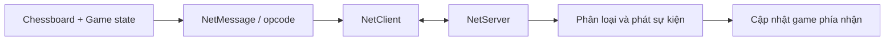

# Bài 10. Unity Transport, NetClient/NetServer và giao thức thông điệp

> **Module 03: Multiplayer: Client–Server** · **Loại:** Bài học kết hợp thực hành

## 1. Tổng quan

Để chơi cờ qua mạng, client và server cần trao đổi sự kiện có định dạng rõ ràng. Bài này tổ chức tầng kết nối, định nghĩa bản tin với opcode, serialize/deserialize và kiểm tra vòng đời socket.

## 2. Mục tiêu học tập

- Giải thích lớp transport và sự khác biệt với logic game.
- Thiết kế vai trò `NetClient`, `NetServer` và lớp bản tin cơ sở.
- Thực hiện luồng gửi, nhận, phân loại và xử lý dữ liệu.
- Xử lý khởi động/dừng kết nối và nhịp keep-alive.

## 3. Kiến thức và cách triển khai

### 3.1. Vai trò của tầng mạng

Loạt hướng dẫn sử dụng **Unity Transport** (`com.unity.transport` ở môi trường hướng dẫn) để xây hệ thống client–server ở mức tương đối thấp. **Transport** lo gửi/nhận bytes qua connection; lớp **NetMessage** lo định dạng thông tin và lớp game lo quyết định có áp dụng thay đổi bàn cờ không. Đây không phải cùng một việc với nút Host trên giao diện.



Tên package và API có thể thay đổi ở Unity mới; cần đối chiếu package đang cài. Không sao chép nguyên API cũ khi compiler báo phương thức đã thay đổi.

### 3.2. Thiết kế message

Mỗi bản tin cần một **mã loại** (opcode) để biết phần payload phải đọc theo cấu trúc nào. Cách đơn giản là enum `NetOperation` định nghĩa `KeepAlive`, `Welcome`, `StartGame`, `MakeMove`, `Rematch`. Mỗi subclass `NetMessage` có logic serialize và deserialize tương ứng. Trình đọc dữ liệu **phải dùng đúng thứ tự và đúng kiểu** với trình ghi: viết `int` trước thì phải đọc `int` trước.

```text
Gói tin trừu tượng:
+---------------+---------------------------+
| opcode        | dữ liệu theo loại bản tin |
+---------------+---------------------------+
        |                      |
        v                      v
  định tuyến xử lý       giải mã đúng thứ tự
```

Hãy ưu tiên `int`, `byte`, `bool` và các kiểu dữ liệu cơ bản khi thiết kế payload. Nếu gửi `Vector2/Vector3`, phải có quy ước serialize riêng; với cờ vua, gửi tọa độ nguyên nhỏ gọn thường đủ.

### 3.3. Vòng đời kết nối

`NetServer` bind và lắng nghe kết nối, `NetClient` kết nối tới endpoint; mỗi bên polling hoặc cập nhật các sự kiện đến, giải mã bản tin rồi phát sự kiện cho game. Khi object bị hủy hoặc người dùng hủy host, phải dọn resources mạng; các callback không nên tồn tại trỏ tới đối tượng đã bị phá hủy.

**Keep-alive** là bản tin nhẹ để duy trì/kiểm tra tình trạng kết nối khi không có nước đi nào trong thời gian dài. Không nên nhầm keep-alive với việc xác nhận trạng thái ván cờ. Trong quá trình thử nghiệm, trước hết đảm bảo có thể kết nối `localhost` và ghi log nhận bản tin thành công rồi mới lắp game logic.

### 3.4. Quy tắc nhất quán dữ liệu

Trong trò chơi hai người, một request đi quân cần được kiểm tra quyền và tính hợp lệ, sau đó mới phát lại kết quả cho hai phía. Một server chỉ chuyển tiếp không kiểm tra có thể chấp nhận input sai lệch; đây là điểm cần gia cố nếu phát triển thành sản phẩm công khai.

## 4. Thực hành có kiểm chứng

1. Cài package transport tương thích với phiên bản Unity đang dùng.
2. Tạo `NetClient`, `NetServer`, `NetMessage` và enum opcode.
3. Thử bản tin `KeepAlive` không payload, xác nhận server nhận và ghi log.
4. Tắt Host trong khi chưa có người nối; xác minh không còn connection đang lắng nghe.

**Checkpoint:** client và server kết nối qua localhost, gửi/nhận bản tin được, phân loại đúng opcode, đóng resources sạch.

## 5. Lỗi thường gặp và cách xử lý

- **Gửi được nhưng đọc sai:** thứ tự hoặc kiểu trường serialize/deserialize không khớp.
- **Mất bản tin vì chưa polling:** đảm bảo vòng cập nhật networking chạy đều.
- **Không thể host lần hai:** socket/driver cũ chưa dispose.
- **Package lỗi compile:** phiên bản Unity Transport của project khác bản dùng trong hướng dẫn; kiểm tra API thực tế.

## 6. Câu hỏi ôn tập

### Câu 1

Transport có nhiệm vụ chính là gì?

A. Vẽ mesh quân cờ.  
B. Điều khiển Animator.  
C. Duy trì kênh gửi/nhận dữ liệu giữa endpoint.  
D. Kiểm tra phong cấp.  

**Đáp án:** C.

**Giải thích:** Transport quản lý kết nối và việc truyền bytes, không phải luật cờ.

### Câu 2

Opcode trong thông điệp có tác dụng gì?

A. Phân biệt loại message cần giải mã.  
B. Thay texture quân.  
C. Giảm số ô bàn cờ.  
D. Chọn camera.  

**Đáp án:** A.

**Giải thích:** Bộ nhận dựa trên opcode để chọn đúng logic deserialize và xử lý.

### Câu 3

Khi serialize tọa độ cờ vua, lựa chọn nào thường đơn giản nhất?

A. Ảnh PNG của ô.  
B. Một Mesh đầy đủ.  
C. Đối tượng Camera.  
D. Các chỉ số tọa độ nguyên có quy ước rõ ràng.  

**Đáp án:** D.

**Giải thích:** Tọa độ x,y của ô là số nguyên nhỏ, dễ đóng gói và kiểm tra.

### Câu 4

Bản tin KeepAlive chủ yếu dùng để làm gì?

A. Bắt quân Vua.  
B. Giữ/kiểm tra kết nối khi ít dữ liệu trao đổi.  
C. Phong Tốt.  
D. Đếm ô sáng.  

**Đáp án:** B.

**Giải thích:** KeepAlive nhằm theo dõi kết nối, không chứa nước đi.

### Câu 5

Điều gì cần làm khi người chơi hủy hosting?

A. Giữ server ở nền.  
B. Đảo lượt.  
C. Dừng driver/kết nối và giải phóng tài nguyên.  
D. Xóa Unity Editor.  

**Đáp án:** C.

**Giải thích:** Giải phóng tài nguyên giúp host lại mà không lỗi cổng/kết nối.

## 7. Tổng kết

Transport quản lý kết nối và truyền dữ liệu; opcode và message quản lý cấu trúc payload. Gửi/nhận đúng thứ tự, đóng resources sạch và không tin đầu vào chưa xác thực.

**Điều kiện hoàn thành:** thực hiện tất cả checkpoint trong bài và lưu phiên bản chạy được vào Git.
