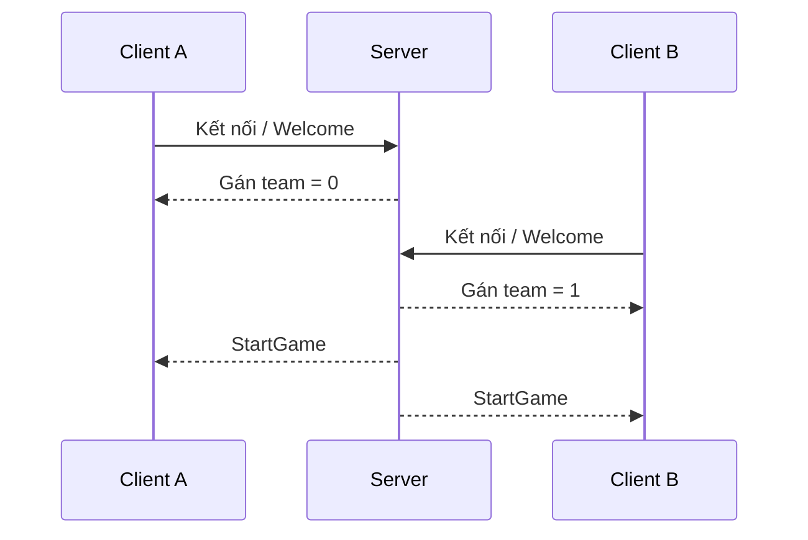

# Bài 11. Handshake, gán phe, camera và bắt đầu ván online

> **Module 03: Multiplayer: Client–Server** · **Loại:** Bài học kết hợp thực hành

## 1. Tổng quan

Kết nối mạng thành công chưa đồng nghĩa trận đấu đã bắt đầu. Bài này định nghĩa bản tin chào mừng/gán phe, bản tin khởi động khi có đủ người chơi và giữ chế độ Local hoạt động song song.

## 2. Mục tiêu học tập

- Mô tả trình tự handshake client–server.
- Gán phe trắng/đen cho đúng kết nối.
- Chỉ bắt đầu ván khi hai bên đã sẵn sàng.
- Thiết lập góc camera theo phe và giữ tùy chọn Local hoạt động.

## 3. Kiến thức và cách triển khai

### 3.1. Phân biệt kết nối và vào trận

Khi client gửi yêu cầu tham gia, server trả lời bản tin kiểu `NetWelcome` chứa thông tin cần thiết, chẳng hạn id phe `0` (trắng) hoặc `1` (đen). Khi lobby có đủ hai người chơi, server phát `NetStartGame`. **Welcome** trả lời “bạn là ai trong phòng”; **StartGame** trả lời “ván đấu bắt đầu”. Đó là hai sự kiện độc lập.

Trong mã thực tế, có thể gói handshake thành request/response riêng, nhưng thứ tự ý nghĩa phải giữ nguyên. Chỉ gán phe từ **phản hồi hợp lệ của server**, không tự chọn ngẫu nhiên phía client.

### 3.2. Camera và quyền điều khiển

Sau khi nhận team, camera của người chơi có thể xoay để quân bên mình nằm gần phía dưới màn hình. Đây là thay đổi góc nhìn, **không đổi** tọa độ logic và chiều di chuyển của quân. Lớp xử lý input chặn việc điều khiển quân khác phe, đồng thời vẫn cập nhật nước đi của đối thủ khi nhận bản tin mạng.

### 3.3. Sự kiện, vòng đời và Local mode

Phân tách `OnClientConnected`, `OnWelcomeReceived`, `OnStartGameReceived` (tên minh họa) và bộ xử lý UI, camera, game state. Nếu dùng event C#, cần hủy đăng ký khi controller bị destroy để tránh callback gọi vào đối tượng không tồn tại.

Chế độ **Local** phải tiếp tục hoạt động sau khi thêm networking. Local không cần chờ `NetStartGame` từ server; nó khởi tạo một bàn cờ và cho hai phe lần lượt thao tác tại cùng máy. Đừng để điều kiện khởi tạo phụ thuộc sự có mặt của `NetClient` khiến Local thất bại.

### 3.4. Khởi tạo theo đúng thứ tự

Một lỗi thường gặp là `Chessboard.Awake()` sử dụng UI controller trước khi UI sẵn sàng. Có thể khởi tạo phụ thuộc ở `Start()` hoặc tổ chức bootstrap rõ ràng. Không nên dựa vào thứ tự đối tượng trong scene một cách ngẫu nhiên. Khi bắt đầu trận, reset trạng thái, đặt đúng phe và chỉ sau đó mới mở quyền nhập liệu.

## 4. Thực hành có kiểm chứng

1. Tạo hai message: `NetWelcome` và `NetStartGame` (hoặc tên tương đương).
2. Kết nối hai client, kiểm tra mỗi client nhận id phe khác nhau.
3. Chỉ phát StartGame khi hai client đã tham gia; xác nhận camera quay đúng theo phe.
4. Thử quay lại menu và chơi Local sau khi thoát online.

**Checkpoint:** gán phe nhất quán, không bắt đầu khi mới có một client, Local không bị hỏng khi có hệ thống mạng.

## 5. Lỗi thường gặp và cách xử lý

- **Hai client cùng phe:** server không quản lý slot hoặc client tự chọn team.
- **Khởi động ván trước khi đủ người:** nhầm handshake kết nối với StartGame.
- **Camera đúng nhưng quân đi ngược:** đã đổi tọa độ logic khi chỉ cần xoay camera.
- **NullReference khi start:** phụ thuộc Unity lifecycle/đăng ký event trước khi đối tượng tồn tại.

## 6. Câu hỏi ôn tập

### Câu 1

Vai trò của `NetWelcome` là gì?

A. Chuyển quân Mã.  
B. Chào mừng và cung cấp thông tin người tham gia, như id phe.  
C. Yêu cầu tái đấu.  
D. Reset server Linux.  

**Đáp án:** B.

**Giải thích:** Welcome xác định người chơi và phe, chưa có nghĩa ván đã bắt đầu.

### Câu 2

Khi nào nên phát `NetStartGame`?

A. Ngay khi một nút được hover.  
B. Khi host mới khởi động.  
C. Khi board dựng xong nhưng chưa có client.  
D. Khi server xác nhận đủ người chơi và sẵn sàng.  

**Đáp án:** D.

**Giải thích:** StartGame là tín hiệu đồng bộ chuyển cả hai phía vào ván đấu.

### Câu 3

Khi xoay camera theo phe, điều gì nên được giữ nguyên?

A. Tọa độ logic của bàn cờ và quân.  
B. Bất kỳ hướng tiến nào của Tốt.  
C. Luôn đổi hai quân Vua.  
D. Tất cả các opcode.  

**Đáp án:** A.

**Giải thích:** Camera là lớp trình bày, không phải thay đổi trạng thái cờ.

### Câu 4

Cách nào phòng tránh callback nhận mạng sau khi đối tượng bị hủy?

A. Đổi URP.  
B. Tăng kích thước bàn.  
C. Unsubscribe các event trong lifecycle thích hợp.  
D. Xóa folder Materials.  

**Đáp án:** C.

**Giải thích:** Hủy đăng ký giúp ngăn callback giữ tham chiếu tới đối tượng không hợp lệ.

### Câu 5

Vì sao chế độ Local phải có đường khởi tạo riêng?

A. Vì Local luôn dùng WAN.  
B. Vì Local không cần chờ bản tin bắt đầu từ server.  
C. Vì Local không có Vua.  
D. Vì Local cần máy chủ Linux.  

**Đáp án:** B.

**Giải thích:** Hai người trên cùng máy phải chơi được ngay cả khi không có kết nối mạng.

## 7. Tổng kết

Welcome dùng để gán danh tính/phe; StartGame đồng bộ thời điểm vào trận. Góc camera có thể đổi theo phe nhưng trạng thái logic của bàn cờ không đổi.

**Điều kiện hoàn thành:** thực hiện tất cả checkpoint trong bài và lưu phiên bản chạy được vào Git.
