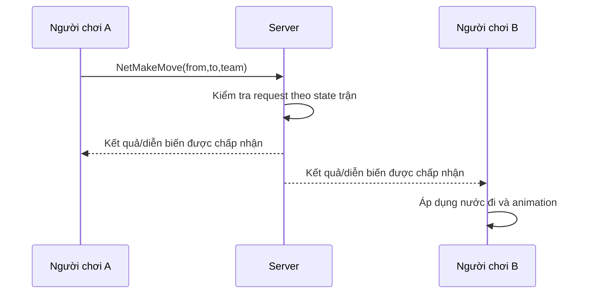

# Bài 12. Đồng bộ nước đi, kết thúc trận và tái đấu online

> **Module 03: Multiplayer: Client–Server** · **Loại:** Bài học kết hợp thực hành

## 1. Tổng quan

Trò chơi online chỉ hoàn thiện khi nước đi được đồng bộ giữa hai máy, kể cả nước đi đặc biệt, và cả hai bên có thể chấp nhận tái đấu. Bài học thiết kế `NetMakeMove` và `NetRematch`, cập nhật UI và xử lý người chơi rời trận.

## 2. Mục tiêu học tập

- Xây payload chứa quân đi từ ô nào đến ô nào và phe thực hiện.
- Nhận–xác minh–áp dụng nước đi trên cả hai phía.
- Đồng bộ en passant, castling và promotion qua cùng quy trình.
- Tạo cơ chế tái đấu dựa trên đề nghị/chấp thuận của hai người.

## 3. Kiến thức và cách triển khai

### 3.1. Bản tin NetMakeMove

Một nước đi cần tối thiểu `(fromX, fromY, toX, toY)` và thông tin phe (nếu giao thức yêu cầu); lượt và trạng thái bàn đang được cả hai phía lưu. Dữ liệu cờ vua là ô nguyên, nên ưu tiên kiểu số nguyên hoặc byte có kiểm tra biên thay vì serialize cả `ChessPiece` hoặc `Vector3` Unity.

```text
NetMakeMove
  opcode     : MakeMove
  team       : 0 hoặc 1
  fromX/fromY: tọa độ nguồn
  toX/toY    : tọa độ đích
```

Giải mã phải đọc đúng thứ tự đã ghi. Sau khi nhận, xác minh tọa độ trong khoảng 0–7, ô nguồn có quân thuộc phe phù hợp, và nước đi được chấp nhận theo trạng thái ván. Tùy thiết kế, server có thể relay nước đi hoặc quản lý state có thẩm quyền; giải pháp có kiểm chứng server an toàn hơn khi muốn chống gửi nước sai.

### 3.2. Luồng gửi và áp dụng



Nếu client đã tạm áp dụng để phản hồi nhanh, cần tránh **áp dụng hai lần** khi nhận echo từ server. Một hướng đơn giản là không cập nhật state thật trước khi có xác nhận; hướng tối ưu hơn dùng prediction và reconciliation, nhưng chưa cần cho game cờ vua theo lượt.

Với nước đi đặc biệt, từ–đến cùng trạng thái ván thường đủ để xác định `en passant` hoặc `castling`. Riêng **promotion có lựa chọn** thì bản tin cần bổ sung loại quân được chọn; bản hướng dẫn tối giản chỉ tự động phong Hậu thì chưa cần trường đó.

### 3.3. Đồng bộ tái đấu

Bản tin `NetRematch` chứa thông tin phe đề nghị/chấp nhận tái đấu. Khi bên A xin tái đấu, bên B thấy thông báo và có nút Accept/Decline; chỉ khi hai phía đồng ý, server thông báo reset trận cho tất cả. Trạng thái sẵn sàng cần reset sau khi trận mới bắt đầu hoặc người chơi rời phòng. Khi đối thủ ngắt kết nối, ẩn nút Rematch và cho người còn lại quay về menu, tránh chờ vô hạn.

### 3.4. Các trường hợp cần kiểm thử

Di chuyển thường, ăn quân, bắt qua đường, nhập thành, phong cấp, chiếu hết, request tái đấu, chấp nhận/từ chối tái đấu, rời phòng giữa chừng. Mỗi bài test phải so sánh mảng quân, phe đang đi và trạng thái kết thúc trên cả hai client — không chỉ quan sát hoạt ảnh.

## 4. Thực hành có kiểm chứng

1. Tạo `NetMakeMove`, serialize các tọa độ và team; deserialize đúng thứ tự.
2. Gửi một nước Tốt từ client trắng; xác minh cả hai phía hiện cùng state.
3. Thử nhập thành hoặc en passant; kiểm tra **mọi** quân chịu ảnh hưởng đồng bộ.
4. Tạo `NetRematch`; chỉ reset khi đủ hai xác nhận. Kiểm tra đối thủ rời phòng.

**Checkpoint:** hai client cho kết quả giống nhau qua nhiều lượt; tái đấu không tự kích hoạt một phía; rời trận không để màn hình lỗi.

## 5. Lỗi thường gặp và cách xử lý

- **Nước đi bị chạy hai lần:** cả client tự cam kết lẫn xử lý echo từ server.
- **Phong cấp lệch loại quân:** bản tin thiếu lựa chọn phong cấp khi UI cho phép chọn nhiều loại.
- **Lượt bị lệch:** không chặn cập nhật khi request sai hoặc trạng thái không đồng bộ.
- **Tái đấu khi chỉ một người đồng ý:** chưa có state đồng thuận cho hai team.

## 6. Câu hỏi ôn tập

### Câu 1

Trường tối thiểu nào xác định một nước đi trên bàn cờ?

A. Hai tọa độ nguồn và đích.  
B. Tên prefab và mesh.  
C. Màu URP.  
D. Thời gian chạy Unity.  

**Đáp án:** A.

**Giải thích:** Cặp ô nguồn–đích xác định quân và hành động theo trạng thái ván.

### Câu 2

Vì sao nên tránh truyền nguyên GameObject qua mạng?

A. Vì GameObject luôn nhỏ hơn byte.  
B. Vì không thể chơi cục bộ.  
C. Vì dữ liệu Unity phức tạp, không cần thiết cho giao thức nước đi.  
D. Vì Unity không có prefab.  

**Đáp án:** C.

**Giải thích:** Truyền tọa độ và các trường đơn giản dễ giải mã và xác minh hơn.

### Câu 3

Tình huống nào có thể gây đồng bộ một nước đi hai lần?

A. Chỉ gửi từ client.  
B. Chỉ nhận từ server.  
C. Gán camera.  
D. Client đã cập nhật ngay rồi xử lý bản tin echo như nước mới.  

**Đáp án:** D.

**Giải thích:** Cần quy ước rõ khi nào state được cam kết để tránh double-apply.

### Câu 4

Khi nào trận tái đấu được bắt đầu?

A. Khi một người yêu cầu.  
B. Khi cả hai bên đã chấp thuận theo giao thức.  
C. Khi nhấn ESC.  
D. Khi máy chủ khởi động.  

**Đáp án:** B.

**Giải thích:** Tái đấu là thỏa thuận của hai người, không thể reset đơn phương.

### Câu 5

Nếu promotion cho phép chọn nhiều loại quân, nên bổ sung gì vào message?

A. Kích thước camera.  
B. Tên scene.  
C. Loại quân được chọn để phong.  
D. Địa chỉ router.  

**Đáp án:** C.

**Giải thích:** Tọa độ không đủ diễn đạt lựa chọn Hậu/Xe/Tượng/Mã khi có nhiều khả năng.

## 7. Tổng kết

Đồng bộ nước đi cần áp dụng một lần trên trạng thái nhất quán giữa hai máy. Tái đấu phải chờ cả hai người đồng ý và xử lý đầy đủ trường hợp đối thủ rời phòng.

**Điều kiện hoàn thành:** thực hiện tất cả checkpoint trong bài và lưu phiên bản chạy được vào Git.
