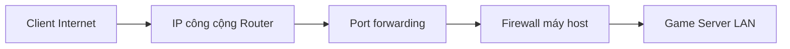

# Bài 13. Hosting trên localhost, LAN và Internet (WAN)

> **Module 04: Hosting và triển khai** · **Loại:** Bài học kết hợp thực hành

## 1. Tổng quan

Từ cùng một hệ thống client–server, ta có thể thử trên một máy, trong mạng nội bộ và qua Internet. Bài này giải thích địa chỉ endpoint, IP nội bộ/công cộng, chuyển tiếp cổng và firewall.

## 2. Mục tiêu học tập

- Phân biệt localhost, LAN và WAN theo đường đi kết nối.
- Lựa chọn IP/port đúng cho server và client.
- Giải thích NAT, port forwarding và vai trò của firewall.
- Tự xác minh các kết nối mà không mở quá nhiều cổng.

## 3. Kiến thức và cách triển khai

### 3.1. Ba phạm vi kết nối

| Chế độ | Địa chỉ client thường dùng | Điều kiện |
| --- | --- | --- |
| Cùng một máy | `127.0.0.1` hoặc `localhost` | Client và server chạy trên cùng thiết bị |
| LAN | IP nội bộ của máy host, ví dụ `192.168.x.x` | Hai máy cùng mạng nội bộ, firewall cho phép |
| WAN | IP công cộng hoặc tên miền tới host | Router/NAT có đường chuyển tiếp cổng đến server |

Một **endpoint** là cặp `(địa chỉ IP, cổng)` mà client kết nối. Server phải lắng nghe đúng cổng, và mọi rule firewall/port forward phải tương ứng. Đừng nhầm IP bên trong mạng gia đình với địa chỉ công cộng nhìn từ Internet.

### 3.2. Quy trình thử từng tầng

Bước đầu tiên luôn là localhost: chạy server và client trên cùng PC, thử gửi bản tin. Nếu thành công, thử LAN trên hai thiết bị. Lấy IP nội bộ của máy host qua cấu hình mạng hệ điều hành. Sau đó kiểm tra firewall của host có cho phép ứng dụng hoặc cổng nhận kết nối đến hay không.

WAN thường phức tạp hơn vì router thực hiện **NAT**. Khi có IP công cộng trực tiếp và quyền cấu hình router, tạo quy tắc chuyển tiếp đúng cổng/giao thức từ router tới IP nội bộ của máy host. Với **CGNAT**, một IP công cộng không thuộc riêng router, nên port forwarding thông thường có thể không hoạt động; khi đó cần giải pháp khác như máy chủ công cộng hoặc relay.

### 3.3. Các vấn đề bảo mật và mạng

Không tắt toàn bộ firewall chỉ để kiểm thử. Chỉ mở cổng cần thiết, với giao thức mà transport dùng. Không công khai IP và cổng cho người lạ khi máy cá nhân không được cấu hình bảo vệ. Một số nhà mạng hoặc Wi-Fi khách chặn kết nối từ ngoài; nên kiểm tra cơ sở mạng trước khi quy lỗi cho code.

Nếu hai chương trình đều chạy trên một máy, sử dụng loopback để cô lập lỗi network; nếu LAN chạy nhưng WAN không chạy, ưu tiên kiểm tra router, NAT, IP công cộng và firewall. Đây là cách chia nhỏ vấn đề có thể tái lập.

## 4. Thực hành có kiểm chứng

1. Chạy hai instance game trên cùng máy với `localhost`.
2. Chạy server trên một máy và client trên máy khác cùng Wi-Fi/LAN, nhập IP nội bộ host.
3. Kiểm tra cổng/protocol server lắng nghe và rule firewall tương ứng.
4. Nếu có quyền quản trị router, thử WAN bằng endpoint công cộng trong môi trường kiểm thử an toàn.

**Checkpoint:** nhận biết chính xác phạm vi kết nối, có log server/client, mô tả được vì sao localhost hoạt động nhưng WAN có thể thất bại.

## 5. Lỗi thường gặp và cách xử lý

- **Dùng localhost từ máy khác:** `localhost` luôn chỉ về máy hiện tại của mỗi thiết bị.
- **LAN thất bại:** kiểm tra IP, subnet, firewall, cổng và transport protocol.
- **WAN thất bại dù LAN tốt:** xem port forwarding, CGNAT, ISP và firewall máy chủ.
- **Mở toàn bộ firewall:** không cần thiết và tạo rủi ro bảo mật; chỉ mở rule tối thiểu.

## 6. Câu hỏi ôn tập

### Câu 1

Client trên một máy khác trong LAN có nên dùng `127.0.0.1` để kết nối host không?

A. Có, localhost luôn là host.  
B. Không, localhost chỉ tới chính máy client.  
C. Có, nếu mở trình duyệt.  
D. Có, nếu thay màu quân.  

**Đáp án:** B.

**Giải thích:** Loopback trỏ về thiết bị hiện tại, không phải máy khác trong mạng.

### Câu 2

Endpoint mạng thường gồm thành phần nào?

A. IP và port.  
B. Mesh và material.  
C. Canvas và camera.  
D. X và Y của Tốt.  

**Đáp án:** A.

**Giải thích:** Hai thông tin này xác định nơi client cần kết nối.

### Câu 3

Khi LAN chạy nhưng WAN không chạy, nên ưu tiên kiểm tra gì?

A. Prefab quân Hậu.  
B. Độ sáng bàn cờ.  
C. Animator.  
D. NAT, port forwarding, IP công cộng và firewall.  

**Đáp án:** D.

**Giải thích:** Những thành phần này quyết định lưu lượng từ Internet có tới được server nội bộ hay không.

### Câu 4

CGNAT có thể gây khó khăn gì?

A. Không cho dùng Unity UI.  
B. Làm mất MeshFilter.  
C. Ngăn mở cổng inbound trực tiếp bằng port forwarding thông thường.  
D. Làm Tốt đi hai ô mãi mãi.  

**Đáp án:** C.

**Giải thích:** Nhiều thuê bao chia sẻ IP công cộng; router cá nhân không tự điều khiển NAT phía nhà mạng.

### Câu 5

Cách cấu hình firewall an toàn hơn là?

A. Tắt hoàn toàn firewall.  
B. Chỉ cho phép cổng/giao thức cần dùng.  
C. Mở mọi cổng 1–65535.  
D. Bỏ cấu hình bảo vệ router.  

**Đáp án:** B.

**Giải thích:** Quy tắc tối thiểu giảm bề mặt tấn công khi host game.

## 7. Tổng kết

Localhost, LAN và WAN là ba đường kết nối khác nhau. Để đi tới Internet, cần hiểu địa chỉ IP, cổng, firewall, NAT và giới hạn do CGNAT.

**Điều kiện hoàn thành:** thực hiện tất cả checkpoint trong bài và lưu phiên bản chạy được vào Git.
