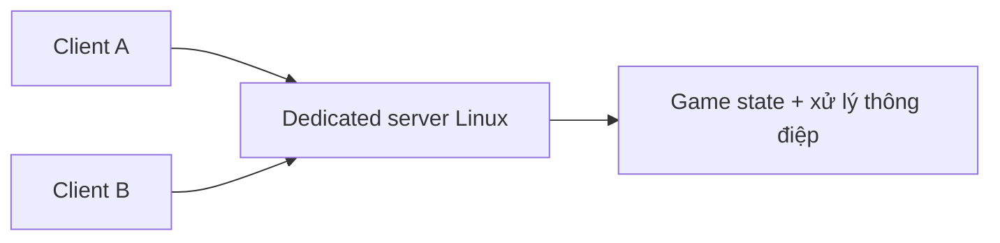

# Bài 14. Build và vận hành dedicated server Unity trên Linux

> **Module 04: Hosting và triển khai** · **Loại:** Bài học kết hợp thực hành

## 1. Tổng quan

Một server chuyên dụng chạy độc lập trên máy Linux/VPS, không cần người nhấn Host qua giao diện. Bài này chuẩn bị chế độ khởi động server tự động, chuyển build qua SSH/SCP và kiểm tra cổng mạng trên máy chủ.

## 2. Mục tiêu học tập

- Giải thích mô hình dedicated server khác host trên máy người chơi.
- Chuẩn bị bản build Unity có khả năng tự chạy vai trò server.
- Sử dụng SSH/SCP để đưa build lên máy Linux.
- Kiểm tra tiến trình server, log, cổng và kết nối từ client.

## 3. Kiến thức và cách triển khai

### 3.1. Tại sao cần server chạy độc lập?

Khi game host trực tiếp trên máy người chơi, server dừng nếu máy tắt hoặc người chơi rời đi. Dedicated server là tiến trình đứng riêng, nhận kết nối của các client. Bài hướng dẫn minh họa bằng máy Linux trên DigitalOcean; mô hình tương tự có thể triển khai ở các VPS/Linux host khác.

Server chuyên dụng không có người ngồi nhấn nút trên giao diện. Vì vậy phải tách vai trò server khỏi thao tác UI: khi bản build khởi chạy với cấu hình server, tự khởi tạo transport, bind cổng và bắt đầu listening. Bản build client vẫn giữ menu để người dùng nhập địa chỉ và kết nối.

### 3.2. Chuẩn bị build

Tại Unity, tạo bản build cho nền tảng Linux phù hợp. Các phiên bản Unity mới có thể hỗ trợ Dedicated Server Build Target riêng; cần chọn đúng tùy phiên bản. Nếu chạy ứng dụng không có giao diện đồ họa, chế độ headless thường dùng tham số dòng lệnh như `-batchmode` và `-nographics` khi phù hợp với build.

```text
Game project
    ├── Client build: menu + camera + nhập địa chỉ
    └── Server build: khởi tạo listener tự động, không chờ click UI
```

Không giả định mọi loại build Linux đều tự hỗ trợ headless hoặc chạy server; mã cần tự đọc cấu hình vai trò.

### 3.3. Kết nối Linux và truyền file

Chuẩn bị một máy Linux, tài khoản SSH và terminal hỗ trợ `ssh`, `scp`. Các lệnh dưới đây là **mẫu**, thay `USER`, `SERVER_IP`, `BUILD_DIR` và đường dẫn binary theo môi trường thực tế:

```bash
ssh USER@SERVER_IP
scp -r BUILD_DIR USER@SERVER_IP:~/chess-server/
ssh USER@SERVER_IP
cd ~/chess-server
chmod +x ChessServer.x86_64
./ChessServer.x86_64 -batchmode -nographics -logFile server.log
```

Với bản build có thư mục dữ liệu hoặc UnityPlayer đi kèm, copy **toàn bộ** artefact cần thiết, không chỉ một binary. Chạy server dưới tài khoản quyền hạn tối thiểu; không cần dùng root cho tác vụ hằng ngày. Kiểm tra `server.log` để chắc chắn listener được khởi động và không có lỗi package/shader quan trọng.

### 3.4. Kết nối từ Internet và vận hành

Cấu hình firewall tại **máy Linux** và (nếu có) **firewall của nhà cung cấp VPS** cho đúng cổng/giao thức đang bind. Không cần port forwarding router gia đình nếu server có IP công cộng phù hợp. Từ máy client, nhập IP/tên miền VPS; quan sát log phía server để biết có nhận kết nối hay không.



Đối với vận hành lâu dài, nên có giải pháp quản lý tiến trình tự khởi động, log rotation và giám sát trạng thái, nhưng đó là các bước mở rộng sau khi chứng minh build có thể host thành công. Đừng ngầm khẳng định game chạy ổn định chỉ vì một lần kết nối thành công.

## 4. Thực hành có kiểm chứng

1. Thêm một cơ chế chọn vai trò client/server lúc khởi chạy để server không cần nút Host.
2. Xuất bản build Linux phù hợp với môi trường VPS.
3. Dùng `ssh` kết nối máy, `scp` tải bản build và chạy tiến trình server.
4. Kiểm tra log và kết nối từ hai client ở hai máy; kiểm tra đóng/mở firewall đúng cổng.

**Checkpoint:** server chạy không cần tương tác màn hình, có thể thấy log listener và hai client kết nối tới cùng endpoint.

## 5. Lỗi thường gặp và cách xử lý

- **VPS không chạy file:** sai kiến trúc CPU, thiếu quyền execute hoặc thiếu file build kèm.
- **Chạy server nhưng không nhận client:** listener không bind đúng IP/port, firewall VPS chưa mở, client trỏ sai endpoint.
- **Process dừng khi đóng terminal:** cần cơ chế quản lý tiến trình trước khi đưa vào vận hành lâu dài.
- **Cảnh báo shader/URP trên headless:** phân biệt cảnh báo render với lỗi server logic bằng log và thử kết nối thực tế.

## 6. Câu hỏi ôn tập

### Câu 1

Đặc điểm chính của dedicated server là gì?

A. Luôn cần người bấm Host tại màn hình game.  
B. Chỉ chạy trên Windows Editor.  
C. Chạy độc lập và nhận kết nối client mà không cần thao tác UI.  
D. Không dùng network transport.  

**Đáp án:** C.

**Giải thích:** Server chuyên dụng tồn tại như tiến trình riêng, không lệ thuộc màn hình người chơi.

### Câu 2

Lệnh nào dùng để kết nối shell tới máy Linux qua mạng?

A. ssh.  
B. chmod.  
C. ls.  
D. git status.  

**Đáp án:** A.

**Giải thích:** SSH tạo kết nối terminal bảo mật tới máy từ xa.

### Câu 3

Công cụ nào thường dùng để sao chép build lên VPS qua SSH?

A. MeshRenderer.  
B. Animator.  
C. TextMeshPro.  
D. scp.  

**Đáp án:** D.

**Giải thích:** SCP hỗ trợ truyền tệp giữa máy cục bộ và máy chủ SSH.

### Câu 4

Tại sao server cần tự khởi động listener?

A. Vì không có Tốt.  
B. Vì máy server không có người nhấn nút Host.  
C. Vì mọi client đều là localhost.  
D. Vì camera phải xoay.  

**Đáp án:** B.

**Giải thích:** Tiến trình không tương tác phải tự khởi tạo vai trò mạng khi start.

### Câu 5

Cần kiểm tra gì trước khi kết luận server triển khai thành công?

A. Chỉ thấy icon trên máy.  
B. Chỉ compile thành công.  
C. Server lắng nghe, log hợp lệ và client thực sự kết nối được.  
D. Chỉ bật URP.  

**Đáp án:** C.

**Giải thích:** Build và start chưa đảm bảo kết nối mạng hoạt động thực tế.

## 7. Tổng kết

Dedicated server chạy như tiến trình độc lập, tự mở listener mà không cần UI. Build Linux, truyền qua SSH/SCP và kiểm thử kết nối thật trước khi coi hệ thống triển khai thành công.

**Điều kiện hoàn thành:** thực hiện tất cả checkpoint trong bài và lưu phiên bản chạy được vào Git.
