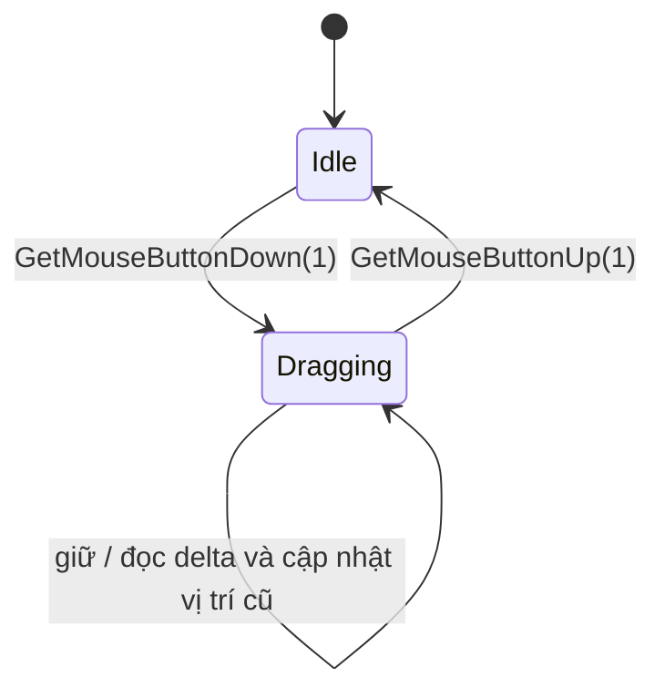

# Drag pan: giữ chuột phải và kéo bản đồ

**Loại bài:** Bài giảng và thực hành  |  **Công nghệ:** Unity / C#  |  **Bản chính:** Cinemachine 3.1

> **Yêu cầu đầu vào:** Biết mở Unity Editor, tạo GameObject, gắn MonoBehaviour và lưu Scene. Các ví dụ sử dụng Legacy `UnityEngine.Input` để dễ theo dõi; nếu dùng Input System mới, cần chuyển lớp đọc input tương ứng. Nội dung camera 3D dùng Unity 3D (mặt phẳng XZ) trừ khi tiêu đề nêu rõ 2D.

**Tóm tắt:** Di chuyển CameraTarget theo độ thay đổi pixel của chuột trong khi giữ nút phải.

**Mục tiêu học tập**

- Theo dõi trạng thái nhấn/giữ/thả nút phải.
- Tính delta giữa hai vị trí chuột liên tiếp.
- Phân biệt tốc độ theo frame với delta vị trí.

## 1. Mô hình trạng thái

Nút chuột phải có index `1` trong Legacy Input API. Khi vừa nhấn, lưu điểm xuất phát để **frame đầu không bị nhảy**.

## 2. Code cơ bản
```csharp
[SerializeField] private bool useDragPan = true;
[SerializeField] private float dragUnitsPerPixel = 0.04f;
private bool dragging;
private Vector2 previousMouse;

private void HandleDragPan() {
    if (!useDragPan) { dragging = false; return; }
    if (Input.GetMouseButtonDown(1)) {
        dragging = true;
        previousMouse = Input.mousePosition;
    }
    if (Input.GetMouseButtonUp(1)) dragging = false;
    if (!dragging || !Input.GetMouseButton(1)) return;

    Vector2 current = Input.mousePosition;
    Vector2 delta = current - previousMouse;
    previousMouse = current;

    Vector3 worldDelta = transform.right * delta.x + transform.forward * delta.y;
    transform.position += worldDelta * dragUnitsPerPixel;
}
```

## 3. Đơn vị và hướng kéo
`delta` là **pixel thay đổi giữa frame**, không phải vận tốc đơn vị/giây. Vì vậy không nhân thêm `Time.deltaTime` như WASD; nhân với `dragUnitsPerPixel` để đổi pixel thành đơn vị world. Nếu muốn cảm giác "nắm bản đồ kéo" (kéo chuột phải, camera di chuyển ngược chiều) đổi `+=` thành `-=`.

## 4. Điều cần kiểm tra
- Bấm và giữ chuột phải nhưng không di chuyển: camera không đổi.
- Thả chuột: camera dừng ngay.
- Xoay target 90° rồi kéo: hướng kéo vẫn tương đối theo target.
- Kéo từ góc sang góc: cảm giác mượt, không nhảy vị trí ở frame đầu.

## 5. Mở rộng
Ở màn hình cảm ứng, có thể tái sử dụng cùng nguyên lý `delta = currentTouch - previousTouch` khi một ngón đang kéo; đồng thời khóa hành vi khi đang pinch zoom. Input System mới cung cấp API riêng cho pointer/touch và không được thay thế 1:1 bằng `Input.GetMouseButton`.

## 6. Câu hỏi ôn tập trắc nghiệm

### Câu 1

Vì sao lưu previousMouse ngay khi nhấn nút phải?

A. Tránh delta cực lớn ở frame đầu  
B. Tự kích hoạt zoom  
C. Đổi màu con trỏ  
D. Để CameraTarget reset về zero  

**Đáp án:** A

**Giải thích:** Điểm tham chiếu đúng giúp drag không giật.

### Câu 2

Delta kéo chuột được tính như thế nào?

A. currentMouse + Screen.width  
B. Screen.height / FOV  
C. currentMouse - previousMouse  
D. previousMouse * deltaTime  

**Đáp án:** C

**Giải thích:** Chênh lệch tọa độ giữa hai frame là chuyển động chuột.

### Câu 3

Với pixel delta, nên nhân thêm deltaTime như vận tốc liên tục không?

A. Không, dùng hệ số đổi pixel sang world units  
B. Luôn bắt buộc nhân 2 lần  
C. Chỉ nhân khi đang zoom  
D. Chỉ nhân ở màn 1080p  

**Đáp án:** A

**Giải thích:** Delta là khoảng dịch trong frame đã tích lũy.

### Câu 4

Trong Input.GetMouseButton, index nút chuột phải là gì?

A. 0  
B. 2  
C. 1  
D. -1  

**Đáp án:** C

**Giải thích:** Unity Legacy Input định nghĩa 0 trái, 1 phải, 2 giữa.

### Câu 5

Để đảo chiều cảm giác kéo bản đồ nên sửa gì?

A. Đổi dấu worldDelta khi cộng vào position  
B. Đổi shader  
C. Đổi Projection sang Orthographic  
D. Tăng timeScale  

**Đáp án:** A

**Giải thích:** Hướng kéo là quy ước UI và có thể đảo dấu.

## 7. Tổng kết

Di chuyển CameraTarget theo độ thay đổi pixel của chuột trong khi giữ nút phải. Hãy tự chạy scene để xác nhận hành vi trước khi mở bài tiếp theo.
