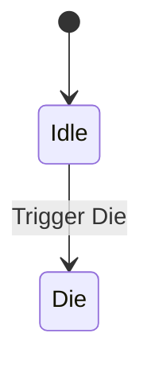

# Chuẩn bị nhân vật Mixamo và hoạt ảnh Idle/Die

**Loại bài:** Bài giảng và thực hành  |  **Công nghệ:** Unity / C#  |  **Bản chính:** Cinemachine 3.1

> **Yêu cầu đầu vào:** Biết mở Unity Editor, tạo GameObject, gắn MonoBehaviour và lưu Scene. Các ví dụ sử dụng Legacy `UnityEngine.Input` để dễ theo dõi; nếu dùng Input System mới, cần chuyển lớp đọc input tương ứng. Nội dung camera 3D dùng Unity 3D (mặt phẳng XZ) trừ khi tiêu đề nêu rõ 2D.

**Tóm tắt:** Nhập nhân vật FBX, cấu hình Humanoid, tạo Animator Controller và xử lý root motion.

**Mục tiêu học tập**

- Chuẩn bị FBX có skin và animation không có skin.
- Thiết lập Avatar Humanoid dùng chung.
- Tạo chuyển trạng thái Idle → Die bằng trigger.

## 1. Pipeline nhân vật
Hiệu ứng tan rã muốn thuyết phục phải tương tác đúng với **Skinned Mesh Renderer** và animation hiện tại. Ta dùng một nhân vật kiểu zombie có animation Idle và Die; tên nhân vật không ảnh hưởng kỹ thuật.

## 2. Tải và nhập tài nguyên
1. Trong Mixamo, chọn nhân vật (ví dụ Drake), tải FBX **with skin** kèm animation Idle.
2. Tải animation Die **without skin**; hai animation phải dùng skeleton tương thích.
3. Import FBX vào Unity; trong `Materials`, chọn extract textures/materials khi cần. Nếu normal map được Unity hỏi sửa import, xác nhận kiểu Normal map.
4. Với file nhân vật, tab `Rig > Animation Type = Humanoid`, `Avatar Definition = Create From This Model`, `Apply`.
5. Với animation Die, `Rig > Humanoid > Copy From Other Avatar`, chọn Avatar từ nhân vật chính.

## 3. Animator Controller
Tạo `DrakeAnimator.controller`, tạo 2 state `Idle` và `Die`. Chọn Idle làm default state. Tạo parameter **Trigger** tên đúng `Die`, thêm transition `Idle -> Die`, điều kiện `Die`. Để chết ngay khi kích hoạt, cân nhắc bỏ `Has Exit Time` ở transition (tùy desired timing).

## 4. Khắc phục nhân vật trượt khỏi chỗ
Nếu animation nhập có root movement khiến nhân vật nhảy khỏi mặt đất hoặc lùi xa, xem lại `Root Transform Rotation`, `Root Transform Position (Y)`, `Root Transform Position (XZ)` và các tùy chọn `Bake Into Pose`. Thử offset Y nhỏ (ví dụ -0.3 trong một mô hình cụ thể) **chỉ khi mô hình đó thực sự lệch sàn**, không dùng làm chuẩn cho mọi asset.

## 5. Tạo prefab
Tạo `Enemy_Drake` là empty GameObject, thêm model con với `Animator` và `SkinnedMeshRenderer`; giữ transform root tại `(0,0,0)` để script va chạm dễ truy cập. Gán Animator Controller. Tạo prefab và chạy thử trigger trong Animator Inspector.

## 6. Checkpoint
Khi chuyển Idle → Die, model phải dùng chung Avatar và không bị co rút hay chân di chuyển bất thường. Nếu không animation, kiểm tra tên Trigger và transition condition trước.

## 7. Câu hỏi ôn tập trắc nghiệm

### Câu 1

Animation Die tải without skin có lợi ích gì?

A. Tái sử dụng skeleton và mesh nhân vật gốc  
B. Bắt buộc tạo material mới cho mỗi frame  
C. Thay thế Animator Controller  
D. Làm mất Avatar  

**Đáp án:** A

**Giải thích:** Một nhân vật có thể dùng nhiều clip cùng skeleton.

### Câu 2

Cấu hình Rig phù hợp nhân vật người Mixamo là gì?

A. Legacy UI  
B. Audio  
C. Humanoid  
D. ParticleSystem  

**Đáp án:** C

**Giải thích:** Avatar Humanoid hỗ trợ remapping animation humanoid.

### Câu 3

Để Die clip dùng Avatar của nhân vật, chọn gì?

A. Copy From Other Avatar  
B. Create New Camera  
C. Convert to Sprite  
D. No Animation  

**Đáp án:** A

**Giải thích:** Clip without skin cần tham chiếu Avatar thích hợp.

### Câu 4

Transition Idle → Die sử dụng parameter loại gì?

A. Color  
B. Texture2D  
C. Trigger  
D. Transform  

**Đáp án:** C

**Giải thích:** Trigger phát sự kiện chuyển trạng thái một lần.

### Câu 5

Nhân vật bị trượt chân do clip cần kiểm tra gì?

A. Root Transform và Bake Into Pose  
B. Cinemachine FOV  
C. Tilemap Collider  
D. Lens Dutch  

**Đáp án:** A

**Giải thích:** Root motion và root transform thường gây lệch vị trí.

## 8. Tổng kết

Nhập nhân vật FBX, cấu hình Humanoid, tạo Animator Controller và xử lý root motion. Hãy tự chạy scene để xác nhận hành vi trước khi mở bài tiếp theo.
