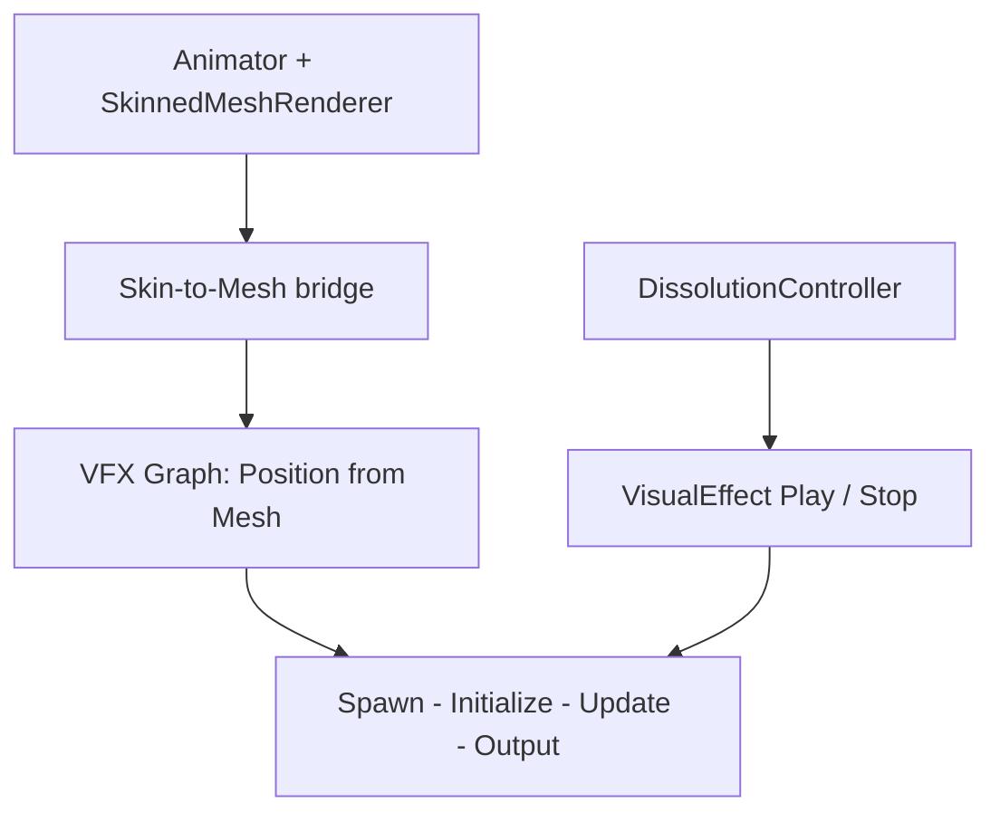

# Tạo hạt phát ra từ Skinned Mesh bằng VFX Graph

**Loại bài:** Bài giảng và thực hành  |  **Công nghệ:** Unity / C#  |  **Bản chính:** Cinemachine 3.1

> **Yêu cầu đầu vào:** Biết mở Unity Editor, tạo GameObject, gắn MonoBehaviour và lưu Scene. Các ví dụ sử dụng Legacy `UnityEngine.Input` để dễ theo dõi; nếu dùng Input System mới, cần chuyển lớp đọc input tương ứng. Nội dung camera 3D dùng Unity 3D (mặt phẳng XZ) trừ khi tiêu đề nêu rõ 2D.

**Tóm tắt:** Phối hợp chuyển động animation với VFX particle bay ra từ bề mặt nhân vật.

**Mục tiêu học tập**

- Xác định dữ liệu mesh cần cho particle spawn.
- Tổ chức VisualEffect dưới prefab nhân vật.
- Đồng bộ thời gian phát hạt với dissolve.

## 1. Vấn đề: model đang biến dạng
`SkinnedMeshRenderer` liên tục thay đổi vertex theo xương và Animator. Nếu spawn hạt từ **mesh gốc không bị skin**, hạt sẽ không nằm đúng trên tư thế nhân vật đang chết. Cần cung cấp hình dạng mesh đã được skin hiện tại (hoặc dữ liệu sampling tương đương) cho VFX Graph.

## 2. Thành phần hệ thống

`Skin-to-Mesh bridge` là một thành phần chuyên biệt. Cách cấp dữ liệu từ skinned mesh cho VFX Graph **phụ thuộc phiên bản Unity/VFX Graph**. Tài liệu hướng dẫn sử dụng một script kiểu `Skin Mesh To Mesh`; source code cụ thể của script đó không có trong nội dung bài giảng này, vì vậy không nên coi việc chỉ kéo `SkinnedMeshRenderer` vào một VFX Graph bất kỳ là đủ.

## 3. Thiết kế VFX Graph
1. Đảm bảo project đang dùng URP và cài package **Visual Effect Graph** phiên bản tương thích.
2. Tạo `VFX_EnemyDissolve` từ VFX Graph, thêm các context `Spawn`, `Initialize`, `Update`, `Output Particle`.
3. Nguồn vị trí phát: lấy điểm sample trên mesh **đã cập nhật animation** từ bridge phù hợp.
4. Tạo vận tốc ban đầu hướng hơi ra khỏi bề mặt, thêm noise/turbulence và độ rơi/mờ theo lifetime.
5. Dùng gradient màu phối với `_DissolveColor`, chỉnh size, lifetime, spawn rate.
6. Cấu hình spawn một đợt ngắn, ví dụ khoảng 1 giây, **không lặp liên tục** khi nhân vật chưa chết.

## 4. Đặt trong prefab và thử nghiệm
Đặt GameObject `DissolveVFX` làm child của `Enemy_Drake`, reset local Transform, gắn `VisualEffect` chứa graph. Thử Play VFX riêng, xác minh hạt spawn bám body ở trạng thái Idle và Die. Nếu hạt chỉ xuất hiện ở mesh tư thế T, bridge chưa truyền mesh đã skin.

## 5. Hiệu năng
Baking toàn bộ skinned mesh bằng CPU mỗi frame có thể tốn tài nguyên nếu hàng chục kẻ địch cùng chạy. Chỉ cập nhật khi sắp chết, giảm tần suất cập nhật (ví dụ 0.04 giây là **tham số thử** trong bài), giảm số lượng particle và tối ưu theo thiết bị đích.

## 6. Checkpoint
Chọn nhân vật đang diễn animation Die, VFX phải xuất phát từ đúng silhouette hiện tại; tắt VFX ở trạng thái bình thường, chỉ bật sau khi kích hoạt chết.

## 7. Câu hỏi ôn tập trắc nghiệm

### Câu 1

Vì sao không nên sample mesh gốc bất biến khi nhân vật đang animation?

A. Hạt có thể phát từ sai tư thế cơ thể  
B. Vì mesh gốc luôn là 2D  
C. Vì camera không render được  
D. Vì Animator chỉ chạy khi có VFX  

**Đáp án:** A

**Giải thích:** Skinned mesh đã biến dạng theo animation.

### Câu 2

Vai trò của skin-to-mesh bridge là gì?

A. Đổi FOV camera  
B. Chỉnh dữ liệu audio  
C. Cấp hình dạng mesh đang skin cho vị trí phát hạt  
D. Lưu điểm số  

**Đáp án:** C

**Giải thích:** Bridge cập nhật nguồn vị trí theo animation.

### Câu 3

Nên cho hiệu ứng hạt tan rã phát lúc nào?

A. Khi quá trình chết/tan rã bắt đầu  
B. Luôn lặp cả khi sống  
C. Chỉ khi UI đang đóng  
D. Mỗi lần nhấn WASD  

**Đáp án:** A

**Giải thích:** Particle được đồng bộ với dissolve sequence.

### Câu 4

Thông số nào có thể giảm chi phí VFX?

A. Tăng vô hạn sample rate  
B. Tạo thêm material cho mỗi frame  
C. Giảm spawn rate và số particle  
D. Luôn bake mọi mesh trong scene  

**Đáp án:** C

**Giải thích:** Giảm lượng xử lý hạt cải thiện hiệu năng.

### Câu 5

Nếu hạt phát ra theo T-pose dù nhân vật đang chết, cần kiểm tra gì?

A. Dữ liệu skinned mesh truyền cho VFX có cập nhật chưa  
B. Field Of View  
C. EdgeSize  
D. Cursor lock  

**Đáp án:** A

**Giải thích:** T-pose cho thấy dữ liệu nguồn chưa theo animation.

## 8. Tổng kết

Phối hợp chuyển động animation với VFX particle bay ra từ bề mặt nhân vật. Hãy tự chạy scene để xác nhận hành vi trước khi mở bài tiếp theo.
