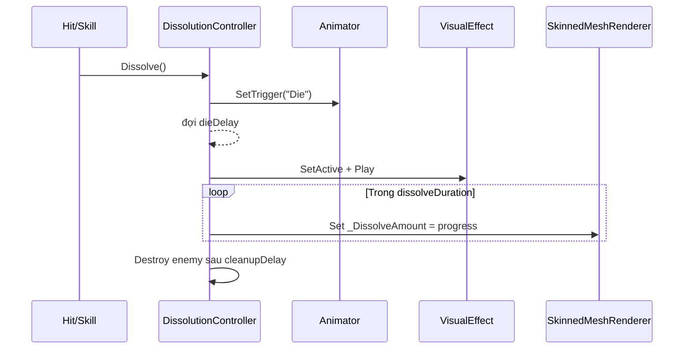

# DissolutionController: đồng bộ Animator, VFX và Material

**Loại bài:** Bài giảng và thực hành  |  **Công nghệ:** Unity / C#  |  **Bản chính:** Cinemachine 3.1

> **Yêu cầu đầu vào:** Biết mở Unity Editor, tạo GameObject, gắn MonoBehaviour và lưu Scene. Các ví dụ sử dụng Legacy `UnityEngine.Input` để dễ theo dõi; nếu dùng Input System mới, cần chuyển lớp đọc input tương ứng. Nội dung camera 3D dùng Unity 3D (mặt phẳng XZ) trừ khi tiêu đề nêu rõ 2D.

**Tóm tắt:** Điều khiển tiến trình chết bằng coroutine và tăng dissolve amount đều theo thời gian.

**Mục tiêu học tập**

- Thiết kế sequence Die → delay → VFX → dissolve.
- Cập nhật shader property cho mọi material slot.
- Ngăn gọi chết lặp và kết thúc vòng đời enemy.

## 1. Trình tự hiệu ứng


## 2. Script ví dụ có thể triển khai
```csharp
using System.Collections;
using UnityEngine;
using UnityEngine.VFX;

public class DissolutionController : MonoBehaviour {
    [SerializeField] private Animator animator;
    [SerializeField] private SkinnedMeshRenderer meshRenderer;
    [SerializeField] private VisualEffect vfx;
    [SerializeField, Min(0f)] private float dieDelay = 0.2f;
    [SerializeField, Min(0.01f)] private float dissolveDuration = 1.5f;
    [SerializeField, Min(0f)] private float cleanupDelay = 1f;

    private static readonly int DissolveId = Shader.PropertyToID("_DissolveAmount");
    private MaterialPropertyBlock propertyBlock;
    private bool hasDied;

    private void Awake() {
        propertyBlock = new MaterialPropertyBlock();
        SetDissolve(0f);
        if (vfx != null) { vfx.Stop(); vfx.gameObject.SetActive(false); }
    }
    public void Dissolve() {
        if (hasDied || meshRenderer == null) return;
        hasDied = true;
        StartCoroutine(DieSequence());
    }
    private IEnumerator DieSequence() {
        if (animator != null) animator.SetTrigger("Die");
        yield return new WaitForSeconds(dieDelay);
        if (vfx != null) { vfx.gameObject.SetActive(true); vfx.Play(); }
        float elapsed = 0f;
        while (elapsed < dissolveDuration) {
            elapsed += Time.deltaTime;
            SetDissolve(Mathf.Clamp01(elapsed / dissolveDuration));
            yield return null;
        }
        SetDissolve(1f);
        yield return new WaitForSeconds(cleanupDelay);
        Destroy(gameObject);
    }
    private void SetDissolve(float value) {
        if (meshRenderer == null) return;
        int count = meshRenderer.sharedMaterials.Length;
        for (int i = 0; i < count; i++) {
            meshRenderer.GetPropertyBlock(propertyBlock, i);
            propertyBlock.SetFloat(DissolveId, value);
            meshRenderer.SetPropertyBlock(propertyBlock, i);
        }
    }
}
```

## 3. Tại sao dùng MaterialPropertyBlock?
Có thể dùng `renderer.materials` và gọi `SetFloat` cho mỗi material instance như bài hướng dẫn truyền thống, nhưng truy cập material instances có thể tạo bản sao và tăng quản lý bộ nhớ khi nhiều kẻ địch. `MaterialPropertyBlock` cho phép thay property ở cấp renderer/material index mà không nhân bản toàn bộ material. Cách này hoạt động khi shader thực sự khai báo `_DissolveAmount` và graph/material pipeline nhận property đúng tên.

## 4. Thử nghiệm
Gán Animator, Renderer và VFX trong Inspector. Tạo một nút debug hoặc script tạm gọi `Dissolve()` khi nhấn Space. Kiểm tra mỗi enemy chỉ xử lý chết **một lần**, đủ hai material slot, và GameObject tự hủy sau khi hoàn thành.

## 5. Điểm dễ sai
Không gán Renderer, trigger `Die` sai tên, property Reference sai, VFX GameObject không bật, material thứ hai không cập nhật, hoặc animation đẩy model ra khỏi vị trí spawn hạt.

## 6. Câu hỏi ôn tập trắc nghiệm

### Câu 1

Vì sao cần biến hasDied?

A. Ngăn kích hoạt coroutine chết nhiều lần  
B. Thay tính chất metallic  
C. Tự đổi camera  
D. Tắt Animator vĩnh viễn  

**Đáp án:** A

**Giải thích:** Guard chống nhiều phát đạn gọi cùng một sequence.

### Câu 2

DissolveAmount dùng giá trị nào để thể hiện hoàn tất?

A. -1  
B. 10  
C. 1  
D. Screen.width  

**Đáp án:** C

**Giải thích:** Mức 1 là ngưỡng clip tối đa trong thiết kế.

### Câu 3

MaterialPropertyBlock giúp gì khi nhiều enemy?

A. Chỉnh property cho renderer mà không buộc tạo bản sao material  
B. Tự cung cấp animation  
C. Tạo hitbox  
D. Tăng số trục tọa độ  

**Đáp án:** A

**Giải thích:** Giảm nhu cầu material instance riêng.

### Câu 4

Tại sao phải lặp qua các material index?

A. Vì mỗi pixel là một material  
B. Để mở CameraTarget  
C. Model có thể chứa nhiều slot cần tan đồng bộ  
D. Để điều khiển audio  

**Đáp án:** C

**Giải thích:** Tất cả submesh cần nhận cùng tiến trình tan rã.

### Câu 5

VFX nên được Play ở vị trí nào trong trình tự?

A. Sau trigger Die và delay mong muốn  
B. Trước khi GameObject được tạo  
C. Trong mọi frame Awake  
D. Chỉ sau Destroy  

**Đáp án:** A

**Giải thích:** VFX đồng bộ với khoảnh khắc animation bắt đầu chết.

## 7. Tổng kết

Điều khiển tiến trình chết bằng coroutine và tăng dissolve amount đều theo thời gian. Hãy tự chạy scene để xác nhận hành vi trước khi mở bài tiếp theo.
