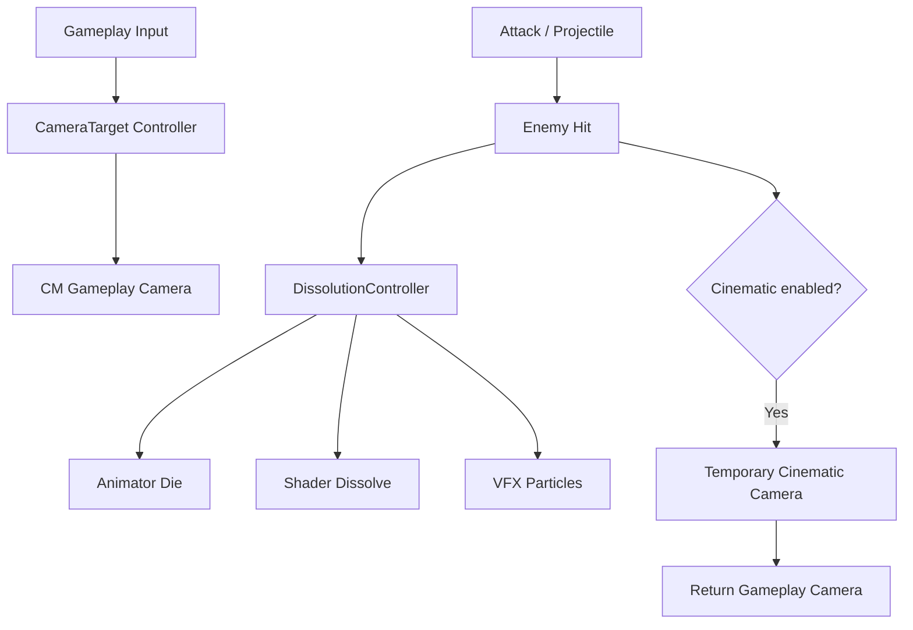

# Lab: camera chiến thuật và hiệu ứng kết liễu

**Loại bài:** Bài giảng và thực hành  |  **Công nghệ:** Unity / C#  |  **Bản chính:** Cinemachine 3.1

> **Yêu cầu đầu vào:** Biết mở Unity Editor, tạo GameObject, gắn MonoBehaviour và lưu Scene. Các ví dụ sử dụng Legacy `UnityEngine.Input` để dễ theo dõi; nếu dùng Input System mới, cần chuyển lớp đọc input tương ứng. Nội dung camera 3D dùng Unity 3D (mặt phẳng XZ) trừ khi tiêu đề nêu rõ 2D.

**Tóm tắt:** Kết nối hệ thống camera điều hướng với trận chiến có enemy dissolve, kịch bản kết liễu và quay về gameplay.

**Mục tiêu học tập**

- Tạo demo có camera điều khiển được và enemy có hiệu ứng chết.
- Định nghĩa trạng thái Gameplay/Cinematic.
- Gắn camera shake, slow motion hoặc cận cảnh dưới dạng nâng cấp tùy chọn.

## 1. Bài toán và sản phẩm
Xây scene chiến thuật 3D có camera WASD/QE/edge/drag/zoom. Người chơi bắn một enemy; enemy chạy Die animation, shader tan rã, hạt thoát ra và bị hủy. Để phục vụ game sưu tầm quân cờ, có thể coi event `Dissolve()` là hiệu ứng kết liễu kỹ năng của quân cờ.

## 2. Kiến trúc tích hợp

## 3. Quy trình triển khai
1. Hoàn thiện scene CameraSandbox có camera di chuyển/zoom.
2. Thêm prefab Enemy (Animator, SkinnedMeshRenderer, VFX Graph, DissolutionController, Collider).
3. Tạo hệ thống projectile và kiểm tra hit.
4. Xây state nhỏ `Gameplay` và `Finisher`; trong `Finisher`, khóa các input camera cần thiết, nhưng không ngăn Cinemachine cập nhật.
5. (Tùy chọn) Dùng một Cinemachine Camera riêng ưu tiên cao hơn hoặc blend sang góc cận cảnh của enemy. Có thể thêm Impulse cho camera shake; nhớ tránh rung quá mức.
6. Kết thúc hiệu ứng, phục hồi priority/state và điều khiển người chơi.

## 4. Tiêu chí hoàn thành
- WASD/QE chạy đúng ngay cả sau khi camera đã xoay.
- Edge và drag có thể bật/tắt, không làm camera drift.
- Một trong ba phương thức zoom hoạt động và có giới hạn.
- Hit một enemy tạo đúng **một** chuỗi Die → VFX → dissolve → remove.
- Sau kết liễu, camera trở về góc điều khiển, không bị khóa.

## 5. Điểm dễ sai khi tích hợp
Mất target khi enemy bị Destroy, chồng hai script zoom, UI nhận input đồng thời với camera, animation làm nhân vật lệch mesh VFX, bắn lặp khiến nhiều coroutine chạy. Kiểm tra theo pipeline từ input tới output từng bước.

## 6. Deliverables
Một scene demo, prefab enemy, prefab projectile, hai camera gameplay/cinematic nếu triển khai chế độ quay cảnh, một file README ghi rõ phím điều khiển và các gói Unity đang dùng.

## 7. Câu hỏi ôn tập trắc nghiệm

### Câu 1

Điểm kích hoạt chung cho hệ thống kết liễu là gì?

A. Sự kiện enemy bị hit dẫn đến Dissolve()  
B. Mỗi frame mousePosition  
C. Main Camera tự Destroy  
D. Chỉ khi shader được import  

**Đáp án:** A

**Giải thích:** Hit gọi controller để chạy chuỗi chết.

### Câu 2

Khi chuyển sang góc finisher nên quản lý input thế nào?

A. Xóa toàn bộ controller  
B. Tắt camera vĩnh viễn  
C. Khóa những điều khiển gameplay gây xung đột rồi mở lại khi xong  
D. Đổi texture của đạn  

**Đáp án:** C

**Giải thích:** State gameplay/cinematic kiểm soát input hợp lý.

### Câu 3

Sau khi enemy bị Destroy, điều gì cần tránh?

A. Camera cinematic còn bám tham chiếu target đã mất  
B. Dùng nhiều Cube  
C. Giảm giá trị metallic  
D. Dùng Play Mode  

**Đáp án:** A

**Giải thích:** Tham chiếu target chết cần giải phóng/khôi phục.

### Câu 4

Một enemy bị trúng nhiều đạn liên tiếp cần hành vi nào?

A. Tạo nhiều coroutine chồng lên nhau  
B. Reset animation liên tục  
C. Chỉ thực hiện một sequence kết liễu  
D. Sinh vô hạn particle  

**Đáp án:** C

**Giải thích:** hasDied bảo vệ luồng chết.

### Câu 5

Một deliverable tối thiểu cho lab là gì?

A. Scene có camera điều khiển và enemy tan rã khi bị trúng  
B. Ảnh thumbnail duy nhất  
C. Một font  
D. Bảng tính doanh thu  

**Đáp án:** A

**Giải thích:** Lab cần chứng minh chức năng trong scene chạy thực tế.

## 8. Tổng kết

Kết nối hệ thống camera điều hướng với trận chiến có enemy dissolve, kịch bản kết liễu và quay về gameplay. Hãy tự chạy scene để xác nhận hành vi trước khi mở bài tiếp theo.
