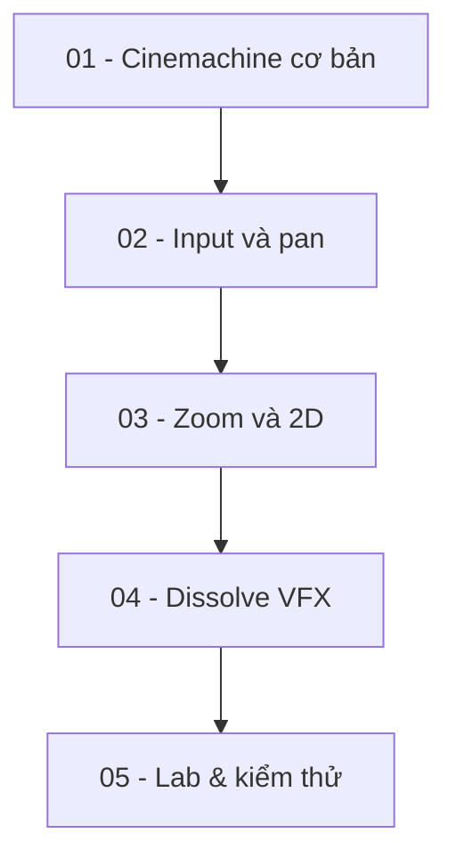

# Khóa học Unity: Camera Controller & Enemy Dissolve VFX

## Mục tiêu khóa học

Xây một camera chiến thuật linh hoạt (3D và 2D), rồi tạo và kích hoạt hiệu ứng kẻ địch tan rã với Shader Graph, VFX Graph, Animator và projectile. Bài học diễn giải bằng tiếng Việt, kèm mã C#, checkpoint, trắc nghiệm có đáp án.

## Lộ trình

Từng module có mục lục riêng. Ưu tiên học phần camera trước, sau đó thực hành animation/VFX rồi tích hợp thành demo.

## Module và bài học

### Module 01 — Kiến trúc Cinemachine và camera 3D
[Module 01 — Kiến trúc Cinemachine và camera 3D](01-cinemachine-va-camera-3d/README.md) — 3 bài.  

- [Kiến trúc hệ thống camera và chuẩn bị dự án](01-cinemachine-va-camera-3d/001-kien-truc-va-chuan-bi.md)
- [Tạo Cinemachine Camera và đối tượng mục tiêu](01-cinemachine-va-camera-3d/002-tao-camera-follow-target.md)
- [Tinh chỉnh damping, tốc độ đáp ứng và lens](01-cinemachine-va-camera-3d/003-damping-va-lens.md)

### Module 02 — Điều khiển camera bằng bàn phím và chuột
[Module 02 — Điều khiển camera bằng bàn phím và chuột](02-dieu-khien-camera/README.md) — 5 bài.  

- [Di chuyển WASD theo hệ tọa độ của camera](02-dieu-khien-camera/004-wasd-local-space.md)
- [Xoay camera quanh trục Y bằng Q/E](02-dieu-khien-camera/005-xoay-q-e.md)
- [Edge scrolling: rê chuột đến mép màn hình](02-dieu-khien-camera/006-edge-scrolling.md)
- [Drag pan: giữ chuột phải và kéo bản đồ](02-dieu-khien-camera/007-drag-pan.md)
- [Refactor: tách input, tính toán chuyển động và cấu hình](02-dieu-khien-camera/008-refactor-va-settings.md)

### Module 03 — Ba phương pháp zoom và chuyển đổi sang 2D
[Module 03 — Ba phương pháp zoom và chuyển đổi sang 2D](03-zoom-va-camera-2d/README.md) — 4 bài.  

- [Zoom bằng Field of View (FOV)](03-zoom-va-camera-2d/009-zoom-fov.md)
- [Zoom bằng khoảng cách Follow Offset](03-zoom-va-camera-2d/010-zoom-follow-offset.md)
- [Zoom bằng thay đổi độ cao Y](03-zoom-va-camera-2d/011-zoom-ha-do-cao-y.md)
- [Chuyển hệ thống điều khiển từ 3D sang 2D](03-zoom-va-camera-2d/012-chuyen-doi-sang-camera-2d.md)

### Module 04 — Nhân vật, Shader Graph và hiệu ứng tan rã
[Module 04 — Nhân vật, Shader Graph và hiệu ứng tan rã](04-dissolve-vfx/README.md) — 6 bài.  

- [Chuẩn bị nhân vật Mixamo và hoạt ảnh Idle/Die](04-dissolve-vfx/013-mixamo-rig-animator.md)
- [Tạo URP Lit Shader Graph giữ chất liệu PBR](04-dissolve-vfx/014-shader-graph-urp-pbr.md)
- [Tạo hiệu ứng Dissolve với Noise, Threshold và viền sáng](04-dissolve-vfx/015-noise-threshold-emission.md)
- [Tạo hạt phát ra từ Skinned Mesh bằng VFX Graph](04-dissolve-vfx/016-vfx-graph-hat-tu-nhan-vat.md)
- [DissolutionController: đồng bộ Animator, VFX và Material](04-dissolve-vfx/017-dissolution-controller.md)
- [Đạn, Raycast ngắm bắn và kích hoạt tan rã khi trúng đích](04-dissolve-vfx/018-projectile-va-hit-trigger.md)

### Module 05 — Hoàn thiện, tích hợp và kiểm thử
[Module 05 — Hoàn thiện, tích hợp và kiểm thử](05-tich-hop-va-kiem-thu/README.md) — 2 bài.  

- [Lab: camera chiến thuật và hiệu ứng kết liễu](05-tich-hop-va-kiem-thu/019-lab-tich-hop-camera-va-hieu-ung-ket-lieu.md)
- [Checklist kiểm thử, debug, tối ưu và đánh giá cuối khóa](05-tich-hop-va-kiem-thu/020-kiem-thu-debug-va-toi-uu.md)

## Mã mẫu và ghi chú phiên bản

- [Camera Controller 3D — Script hoàn chỉnh](06-tai-lieu-tham-khao/camera-controller-3d-full.md)
- [Tương thích Cinemachine và nguồn tham khảo](06-tai-lieu-tham-khao/tuong-thich-va-nguon.md)

## Tiêu chí hoàn thành khóa học

Hoàn thiện scene với camera WASD, Q/E, edge scroll, drag, zoom, một scene 2D để đối chiếu và một enemy có Animator Die, shader dissolve, VFX particle, projectile hit trigger. Nộp prefab và video ngắn xác nhận các test cases ở bài 020.

**Lưu ý:** Để code camera chạy cần Cinemachine 3.1, scene thiết lập đúng và chế độ Legacy Input được bật; để chạy module hiệu ứng cần URP/Shader Graph/VFX Graph. Những bài về VFX mesh bridge hướng dẫn tích hợp, nhưng không cung cấp source bridge vì phần đó không có trong nội dung hướng dẫn đã cung cấp.
