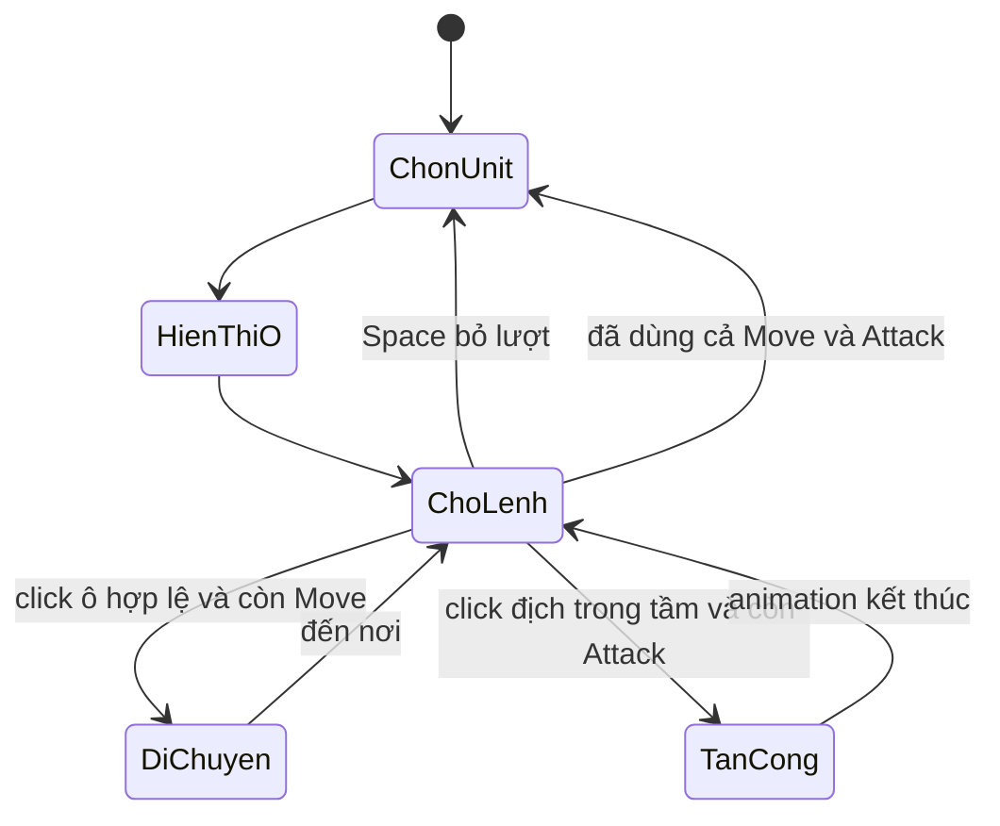

# Bài 01.01 — Hệ thống chiến đấu trên lưới theo lượt

**Mốc video:** 00:00–02:12. **Mục tiêu:** hiểu toàn bộ gameplay trước khi viết C#.

## 1. Cơ chế cốt lõi [Theo video]

Chiến trường có **hai đội Xanh và Đỏ** trên một lưới. Một Unit được chọn làm **Unit đang hoạt động**; các ô có thể đi được sẽ hiện rõ. Người chơi click ô để đi, click địch để đánh. Mỗi lượt unit có tối đa **một lần di chuyển và một lần tấn công**; có thể bỏ lượt bằng Space. Video hiển thị lượt **xen kẽ theo từng Unit giữa hai đội**.

Chướng ngại (thùng) khiến vùng đi được không phải hình vuông/bán kính hình học đơn thuần: phải có **đường đi hợp lệ** đến ô đích. Khi mục tiêu ngoài tầm đánh, không thể tấn công.

## 2. Các khái niệm

| Thuật ngữ | Ý nghĩa |
|---|---|
| Grid cell | Ô logic có tọa độ nguyên `(x, y)` |
| Unit | Nhân vật có vị trí, đội, khả năng di chuyển/tấn công |
| Active unit | Unit duy nhất được phép ra lệnh ở lượt hiện tại |
| Move range | Số bước/độ dài đường tối đa của lượt đi |
| Attack range | Khoảng cách để đòn đánh được phép thực hiện |
| Turn | Khoảng thời gian một unit sử dụng hai quyền hành động |
| Pathfinding | Thuật toán tìm đường né vật cản |

## 3. Vòng lặp gameplay

## 4. Thiết kế trò chơi nhỏ trước khi code [Ví dụ biên soạn]

Tạo scene 12×10 ô, 2 Unit Xanh, 2 Unit Đỏ, 3 thùng chắn, mỗi Unit di chuyển tối đa 5 bước, tấn công cự ly gần. Định nghĩa rõ điều kiện `win/lose` nếu muốn mở rộng, nhưng **video gốc chưa triển khai mục này**.

## Bài thực hành

Vẽ trên giấy một bản đồ có vật cản; chỉ ra ô có thể đến trong 5 bước và một mục tiêu quá xa để đánh. Tự trả lời: Vì sao khoảng cách Euclid không đủ để quyết định ô đi được?

**Hoàn thành khi:** có mô tả gameplay, biết chính xác thao tác click ô/click địch/Space và cơ chế từng Unit đổi lượt.
