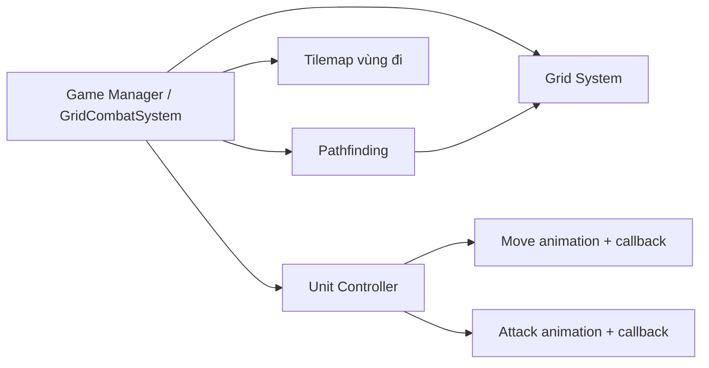

# Bài 01.02 — Chuẩn bị Unity Scene và các hệ thống nền

**Mốc video:** 02:13–03:35. **Mục tiêu:** nhận ra những thành phần được cung cấp sẵn, tránh hiểu lầm rằng video viết lại tất cả.

## 1. Những thứ đã tồn tại [Theo video]

Video bắt đầu bằng một scene có bản đồ, các nhân vật và vật cản. Tác giả nhắc đến **Grid System**, **Pathfinding**, **Tilemap** để tô vùng di chuyển và **Modular Character Controller** được xây trong các video khác. Các script được thiết kế có thể tái sử dụng.



## 2. Cấu trúc Scene đề xuất [Ví dụ biên soạn]

```text
BattleScene
├── World
│   ├── FloorTilemap
│   ├── Obstacles
│   └── Units
│       ├── BlueUnits
│       └── RedUnits
├── Gameplay
│   ├── GridSetup
│   ├── Pathfinding
│   └── GridCombatSystem
├── MoveHighlightTilemap
├── Main Camera
└── UI
```

## 3. Các interface tối thiểu cần có [Ví dụ biên soạn]

```csharp
public interface IGridCoordinates {
    Vector2Int WorldToCell(Vector3 worldPosition);
    Vector3 CellToWorldCenter(Vector2Int cell);
    bool InBounds(Vector2Int cell);
}

public interface IPathService {
    // null = không có đường đi; danh sách có cả ô đầu và ô cuối.
    System.Collections.Generic.List<Vector2Int> FindPath(
        Vector2Int start, Vector2Int goal);
    bool IsWalkable(Vector2Int cell);
}
```

Đây là **hợp đồng minh họa**, không phải lớp/API được trích nguyên văn từ dự án gốc.

## 4. Checklist Inspector

- Đã kéo thả các tham chiếu `GridSetup`, `Unit`, `Tilemap`.
- Grid và Pathfinding dùng cùng kích thước ô, cùng gốc tọa độ.
- Obstacles được đánh dấu không đi qua được.
- Unit có thành phần nhận lệnh Move/Attack và callback kết thúc.

## Bài thực hành

Đặt hai Unit và hai thùng lên bản đồ. Bật debug Grid, chuyển tọa độ thế giới ↔ lưới để kiểm tra ô nào đang chứa Unit. Chưa triển khai chiến đấu ở bước này.
