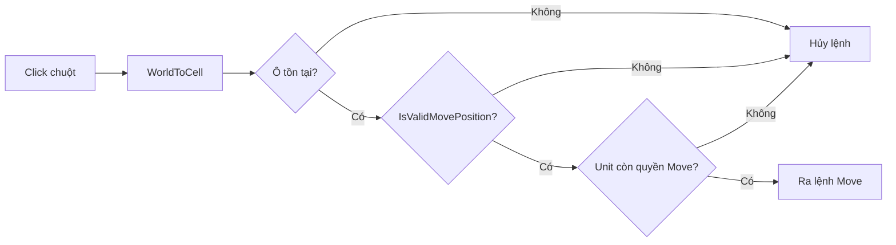

# Bài 02.03 — GridObject và xác thực lệnh click

**Mốc video:** 09:33–12:10. **Mục tiêu:** chống việc click ô ngoài phạm vi khiến Unit vẫn di chuyển.

## 1. Vấn đề [Theo video]

Ở giai đoạn đầu, người chơi có thể **nhìn** các ô hợp lệ nhưng vẫn click ô khác để ra lệnh. Giải pháp trong video là thay đối tượng Grid rỗng bằng một **GridObject chuyên biệt** lưu trạng thái `isValidMovePosition` cho mỗi ô, sau đó kiểm tra trước khi gọi Move.

## 2. Data model [Ví dụ biên soạn]

```csharp
public sealed class BattleCell {
    public Vector2Int Position { get; }
    public bool IsWalkable { get; set; }
    public bool IsValidMovePosition { get; set; }
    public UnitCombat Occupant { get; set; }

    public BattleCell(Vector2Int position) => Position = position;
}
```

`UnitCombat` là tên lớp **minh họa**; có thể dùng component Unit thực tế của bạn.

## 3. Chu trình xác thực



Mỗi khi đổi Unit hoặc tính lại vùng đi, **xóa toàn bộ cờ cũ trước**, sau đó đặt `true` cho tập ô hiện tại. Có thể thay cờ boolean bằng `HashSet<Vector2Int>` của hệ thống quản lý nếu muốn tránh trạng thái lưu trùng.

## 4. Phòng ngừa lỗi

- Đừng tin dữ liệu hiển thị như nguồn xác thực; hàm kiểm tra lệnh cần chạy độc lập.
- Đừng giữ cờ hợp lệ của Unit trước trong lượt của Unit sau.
- Đừng cho đi tới ô đang có quân nếu luật game cấm chiếm chung ô.

## Bài tập

Click một ô rất xa, click vào thùng, click vào ô hợp lệ. Chỉ trường hợp cuối thực hiện Move. Đổi sang Unit khác và đảm bảo những ô hợp lệ cũ bị xóa.
