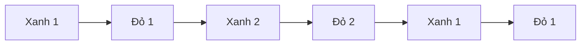

# Bài 04.01 — Chia hai đội và chọn Unit đang hoạt động

**Mốc video:** 19:23–22:12. **Mục tiêu:** từ demo điều khiển một Unit sang hệ thống nhiều Unit luân phiên.

## 1. Cơ chế [Theo video]

Các Unit được phân vào hai danh sách **Đội Xanh** và **Đội Đỏ**. Hệ thống lưu Unit hiện tại cùng index của mỗi đội. Một hàm chọn **Unit tiếp theo của đội còn lại**; lúc bắt đầu chọn một Unit Xanh, sau đó Đỏ, rồi Xanh, v.v.

## 2. Minh họa thuật toán chọn [Ví dụ biên soạn]

```csharp
public enum Team { Blue, Red }

// Lược đồ; kiểm tra danh sách rỗng và Unit chết trong triển khai thật.
private UnitCombat SelectNextUnit() {
    if (activeUnit == null || activeUnit.Team == Team.Red) {
        blueIndex = (blueIndex + 1) % blueUnits.Count;
        return blueUnits[blueIndex];
    }
    redIndex = (redIndex + 1) % redUnits.Count;
    return redUnits[redIndex];
}
```

Khởi tạo `blueIndex = -1`, `redIndex = -1`. Điều kiện vòng modulo chỉ dùng được khi đội còn Unit. Hệ thống đầy đủ cần xử lý Unit bị hạ và điều kiện kết thúc trận.

## 3. Sơ đồ luân phiên



Đây là cách *round robin* theo từng đội. **Không** tương đương với một lượt cả đội có quyền điều khiển mọi Unit.

## 4. Khi chọn Unit mới

Làm mới biến `activeUnit`, đặt quyền Move/Attack phù hợp, cập nhật vùng đi, UI chỉ báo lượt, và camera (bài 04.03).

## Bài tập

Thử 2 Unit Xanh và 3 Unit Đỏ. In chuỗi Unit hoạt động trong 8 lượt, so sánh với kỳ vọng xen kẽ đội. Thử đánh dấu một Unit chết và quyết định chính sách bỏ qua.
