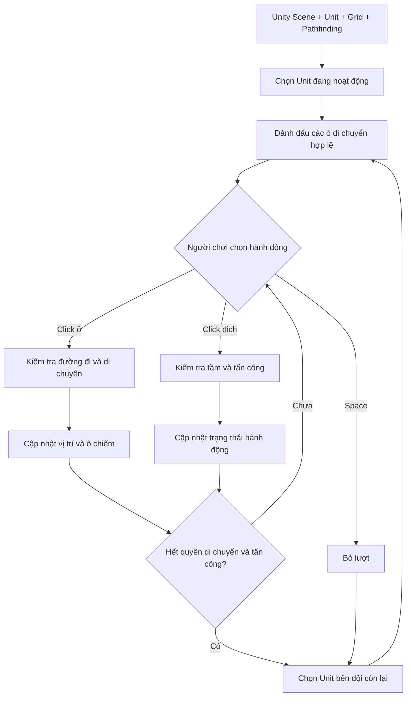

# Khóa học Unity C# — Xây dựng hệ thống chiến đấu trên lưới theo lượt

> **Nguồn:** Bản chép lời tiếng Việt của video hướng dẫn do **Code Monkey** trình bày (khoảng **26 phút 31 giây**). Tài liệu này được biên soạn lại thành một lộ trình học thực hành; không phải bản sao nguyên văn mã nguồn trong video.

## Bạn sẽ làm được gì?

Tạo một nguyên mẫu (*prototype*) chiến đấu chiến thuật trên lưới gồm hai đội Xanh/Đỏ: di chuyển theo ô hợp lệ và đường đi thật, đánh dấu vùng có thể đến, chọn quân địch để tấn công trong tầm, luân phiên từng đơn vị, mỗi lượt tối đa một lần di chuyển và một lần tấn công, bỏ lượt bằng phím Space, và chuyển camera đến quân đang hoạt động.

## Yêu cầu đầu vào

- Biết thao tác với **Unity Editor**, GameObject, Component, Inspector và **C# cơ bản**.
- Có một scene 2D nhìn từ trên xuống, các **Unit**, hệ thống **Grid**, **Pathfinding** và một **Tilemap** để tô vùng di chuyển.
- Video đã **tái sử dụng** Grid, Pathfinding, Tilemap và Unit Controller từ các dự án/video khác. Bản chép lời **không** cung cấp mã nguồn đầy đủ của các hệ thống phụ thuộc đó.

## Lộ trình

| Module | Nội dung | Bài | Phạm vi video |
|---|---|---:|---|
| 01 | Giới thiệu và kiến trúc nền | 3 | 00:00–05:35 |
| 02 | Di chuyển theo lưới | 4 | 05:36–14:25 |
| 03 | Tấn công và chiếm ô | 3 | 14:26–19:22 |
| 04 | Quản lý lượt, input, camera | 3 | 19:23–25:39 |
| 05 | Kiểm thử, tối ưu, mở rộng | 2 | 25:40–26:31 và tổng hợp |

**Tổng cộng:** 5 module, **15 bài học**, thư mục `99-tai-nguyen/` và tài liệu điều hướng.

## Cách học

1. Đọc `00-huong-dan/01-lo-trinh-hoc.md` và `00-huong-dan/02-moc-thoi-gian-video.md`.
2. Học theo thứ tự module. Ở mỗi bài: hiểu cơ chế → đối chiếu mốc video → viết mã/triển khai trong Unity → tự kiểm thử.
3. Dùng `99-tai-nguyen/01-khung-ma-csharp-minh-hoa.md` làm **ví dụ tham khảo**, không thay cho package hoặc mã gốc của tác giả.
4. Hoàn thành bài tổng kết ở `99-tai-nguyen/02-bai-tap-va-tieu-chi-nghiem-thu.md`.

## Quy ước quan trọng

- **[Theo video]**: thông tin được bản chép lời hỗ trợ trực tiếp.
- **[Ví dụ biên soạn]**: giải thích, thuật toán, mẫu C# hoặc quy tắc kiểm thử do tài liệu bổ sung để dễ học. Không được coi là mã nguyên bản của Code Monkey.
- Tên API từ bản chép lời có chỗ bị nhận dạng tiếng nói sai; mã C# trong tài liệu được **chuẩn hóa mang tính minh họa**.
- Video mô tả hệ thống có tính *từng đơn vị lần lượt* (một quân Xanh, một quân Đỏ), **không phải** tất cả quân Xanh cùng hành động rồi mới tới Đỏ.

## Sơ đồ tổng quan

> Nội dung gốc chỉ mô tả hành vi hệ thống và các bước thực hiện; vì vậy sơ đồ này là **tổng hợp sư phạm**, không khẳng định cấu trúc mã chính xác của dự án gốc.
