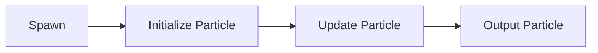

# Bài 01 — Chuẩn bị dự án và hiểu cấu trúc VFX Graph

## 1. Tóm tắt

Visual Effect Graph cho phép dựng hiệu ứng hạt bằng các context và block trực quan. Trong hiệu ứng va chạm, ta ưu tiên **phát hạt theo đợt** thay vì phát liên tục: sự kiện va chạm diễn ra tức thời, còn mỗi lớp hạt có vòng đời riêng.

## 2. Mục tiêu học tập

- Xác định được vai trò của `Spawn`, `Initialize Particle`, `Update Particle` và `Output Particle`.
- Cài đặt gói Visual Effect Graph trong môi trường tham chiếu dùng URP.
- Tạo một asset Visual Effect Graph và đưa nó vào Scene.
- Phân biệt `Constant Spawn Rate` với `Single Burst` trong ngữ cảnh hiệu ứng va chạm.

## 3. Chuẩn bị môi trường

Bài học tham chiếu **Unity 2020.1.14**, sử dụng **Universal Render Pipeline (URP)**. Mở `Window > Package Manager`, tìm và cài **Visual Effect Graph** tương thích với dự án. Trong phiên bản tham chiếu, phần cấu hình VFX của Editor có tùy chọn liên quan đến **experimental operators/blocks**; bật khi cần thử các block mở rộng, đồng thời lưu ý tính năng thử nghiệm có thể thay đổi giữa các phiên bản.

Tạo asset từ menu `Create > Visual Effects > Visual Effect Graph` (vị trí lệnh có thể thay đổi theo bản cài). Đặt tên dễ hiểu, chẳng hạn `Impact_VFX`, rồi kéo asset vào Scene để tạo đối tượng dùng Visual Effect. Mở trình chỉnh sửa Graph qua thao tác **Edit** trên asset hoặc component.

## 4. Cấu trúc của một hệ thống hạt

- **Spawn** quyết định số lượng và thời điểm tạo hạt.
- **Initialize Particle** ấn định tuổi thọ, vị trí, kích thước, góc ban đầu.
- **Update Particle** xử lý sự thay đổi theo thời gian hoặc ảnh hưởng của lực.
- **Output Particle** quyết định cách hình ảnh hạt được render và hòa trộn.

Một graph có thể chứa nhiều hệ thống, mỗi hệ thống phục vụ một lớp hiệu ứng. Có thể nhóm và đặt tên để tránh nhầm lẫn khi sao chép.

## 5. Chọn cơ chế phát hạt cho va chạm

`Constant Spawn Rate` tạo hạt theo tốc độ liên tục, phù hợp một hiệu ứng duy trì. `Single Burst` sinh một lượng hạt tại thời điểm phát. Va chạm cần một cú chớp tức thời nên bắt đầu với **Single Burst**.

**Thao tác:** loại bỏ hoặc tắt `Constant Spawn Rate` mặc định; thêm `Single Burst` trong `Spawn`. Ban đầu đặt **Count = 1** để kiểm chứng trước khi bổ sung các lớp khác. Với hạt Flash, bỏ `Set Velocity` nếu không muốn hạt di chuyển.

## 6. Lỗi thường gặp

| Hiện tượng | Nguyên nhân cần kiểm tra | Cách xử lý |
| --- | --- | --- |
| VFX không xuất hiện | Asset chưa được đặt vào Scene hoặc context chưa nối | Kiểm tra Visual Effect component và luồng context |
| Hạt sinh liên tục | Vẫn còn `Constant Spawn Rate` | Dùng `Single Burst` cho lớp va chạm |
| Hạt Flash trôi khỏi điểm va chạm | Vẫn có vận tốc ban đầu | Bỏ `Set Velocity` hoặc đưa vận tốc về 0 |
| Không thấy block cần thiết | Khác phiên bản/gói hoặc tính năng thử nghiệm | Kiểm tra khả năng hỗ trợ và cài đặt VFX |

## 7. Thực hành ngắn

Tạo một graph chỉ có **một hạt** trong mỗi burst, không dịch chuyển. Quan sát sự khác biệt khi bật/tắt cơ chế phát liên tục, sau đó khôi phục `Single Burst`.

## 8. Câu hỏi ôn tập

### Câu 1

Context nào quyết định số hạt sinh ra khi hiệu ứng bắt đầu?

A. Output Particle  
B. Update Particle  
C. Spawn  
D. Color Over Life

**Đáp án:** C. **Giải thích:** Context Spawn kiểm soát thời điểm và số lượng hạt được tạo.

### Câu 2

Vì sao `Single Burst` phù hợp hơn `Constant Spawn Rate` cho một cú va chạm ngắn?

A. Vì tạo một đợt hạt tức thời  
B. Vì tự chiếu texture lên mesh  
C. Vì tự đặt màu hạt thành đen  
D. Vì chỉ hoạt động trên 2D

**Đáp án:** A. **Giải thích:** Một cú va chạm cần điểm nhấn tức thời thay vì phát hạt liên tục.

### Câu 3

Flash vẫn di chuyển dù bạn chỉ cần chớp sáng tại chỗ. Nên kiểm tra trước tiên điều gì?

A. Thứ tự render  
B. Texture decal  
C. Soft Particles  
D. `Set Velocity`

**Đáp án:** D. **Giải thích:** Block vận tốc có thể làm hạt rời khỏi vị trí khởi tạo.

### Câu 4

Trong một hệ thống VFX, phần nào thường đặt tuổi thọ ban đầu của hạt?

A. Spawn  
B. Initialize Particle  
C. Output Particle  
D. Scene View

**Đáp án:** B. **Giải thích:** `Initialize Particle` thiết lập các thuộc tính khởi tạo, trong đó có lifetime.

### Câu 5

Khi không tìm thấy một block thử nghiệm trên bản Unity khác, cách xử lý hợp lý nhất là gì?

A. Xem lại phiên bản VFX Graph và khả năng hỗ trợ tính năng  
B. Tăng mọi giá trị lifetime  
C. Đổi tên Scene  
D. Xóa toàn bộ asset texture

**Đáp án:** A. **Giải thích:** Giao diện và block của VFX Graph có thể khác nhau giữa các bản phát hành.

## 9. Tổng kết

Bước đầu tiên của một impact effect ổn định là một graph có cơ chế phát hạt đúng, các context được nối chính xác và mỗi lớp có mục đích rõ ràng.
