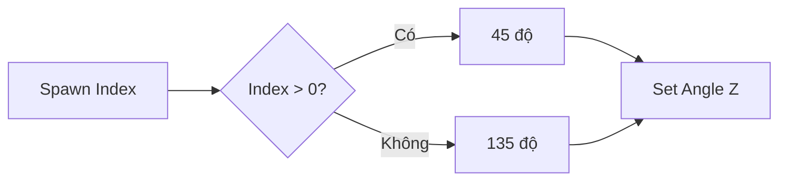

# Bài 03 — Tạo Cross bằng hai hạt và Spawn Index

## 1. Tóm tắt

Một dấu chéo chữ X có thể được dựng **không cần texture hình chữ X riêng**: chỉ cần hai quad mảnh, cùng tâm và xoay theo hai góc khác nhau. Đây là ví dụ trực quan về cách dùng **thuộc tính của từng hạt** để chọn hành vi.

## 2. Mục tiêu học tập

- Nhân bản hệ thống Flash mà không làm mất cấu hình gốc.
- Dùng `Set Scale` tạo quad mảnh.
- Dùng `Spawn Index` để phân biệt hai hạt trong cùng một burst.
- Thiết lập góc xoay khác nhau qua phép so sánh và nhánh.

## 3. Tạo lớp Cross

Nhân bản nhóm Flash và đổi tên thành `Cross`. Thay đổi **Single Burst Count = 2**, vì cần hai vệt cắt nhau. Ở phần tỷ lệ, giảm trục **X xuống khoảng 0.1** để mỗi quad trông như một tia mảnh, không còn là đĩa tròn. Giữ màu và vòng đời ngắn; với lớp Cross, lifetime cố định là một lựa chọn có thể cho đường nét ổn định hơn khi thử nghiệm.

## 4. Điều khiển từng hạt theo chỉ số

Mỗi hạt sinh trong burst có thuộc tính **Spawn Index**. Với hai hạt, chỉ số có thể dùng để chọn hai góc:

$$
\theta(i) =
\begin{cases}
45^\circ, & i > 0 \\
135^\circ, & i = 0
\end{cases}
$$

Dùng operator so sánh `Spawn Index > 0`, đưa kết quả vào `Branch`, rồi nối nhánh chọn góc với thành phần **Z** của block `Set Angle` trong cách tổ chức của ví dụ. Hai vệt xoay 45° và 135° sẽ tạo ra hình chữ X.

Đây là minh họa cho kỹ thuật phân nhánh theo hạt, không phải mã C#. Nếu trục xoay trong graph của bạn không tạo ra chữ X như mong muốn, kiểm tra không gian tọa độ và cách quad hướng về camera.

## 5. Vì sao dùng hai hạt thay vì texture?

Cách này giúp thử nhanh tỉ lệ, màu, kích thước và góc trên graph mà không cần sản xuất texture riêng. Đổi lại, chất lượng hình ảnh phụ thuộc vào dạng quad và blending đang dùng. Khi cần hình dạng phức tạp, texture vẫn là lựa chọn phù hợp.

## 6. Lỗi thường gặp

- Chỉ thấy một đường: cả hai hạt đang nhận cùng góc hoặc Count chưa bằng 2.
- Đường quá rộng: kiểm tra tỷ lệ X trong `Set Scale`.
- Chữ X lệch tâm: kiểm tra vị trí khởi tạo của hai hạt.
- Cross xoay sai mặt phẳng: xác nhận trục và không gian xoay thực tế của Output.

## 7. Thực hành

Giữ Count = 2 và thử cặp góc 45°/135°. Sau đó thay Scale X trong khoảng khác nhau và quan sát độ đậm/độ mảnh của Cross; khôi phục bản dễ đọc nhất.

## 8. Câu hỏi ôn tập

### Câu 1

Muốn tạo chữ X bằng hai vệt thẳng cắt nhau, cần bao nhiêu hạt?

A. 1  
B. 4  
C. 2  
D. 20

**Đáp án:** C. **Giải thích:** Hai quad mảnh với hai góc khác nhau đủ tạo hình chữ X.

### Câu 2

Thuộc tính nào giúp phân biệt hai hạt trong cùng burst?

A. Spawn Index  
B. Alpha  
C. Lifetime  
D. Texture Size

**Đáp án:** A. **Giải thích:** Spawn Index phản ánh vị trí chỉ số của hạt được sinh ra.

### Câu 3

Hai hạt cùng xoay 45° thì kết quả thường là gì?

A. Một decal hình tròn  
B. Tự tạo lực hấp dẫn  
C. Hai đường vuông góc  
D. Hai vệt chồng hướng, không thành chữ X

**Đáp án:** D. **Giải thích:** Cần hai góc khác nhau để hai vệt cắt nhau.

### Câu 4

Tác dụng của việc giảm Scale X về khoảng 0.1 là gì?

A. Tăng lifetime  
B. Làm quad mảnh hơn  
C. Tăng số hạt  
D. Tự đổi màu

**Đáp án:** B. **Giải thích:** Scale không đồng đều kéo dài/thu hẹp hình hạt theo các trục.

### Câu 5

Tại sao nên nhân bản Flash trước khi chỉnh Cross?

A. Để tận dụng cấu hình vòng đời, màu và output, vẫn giữ lớp Flash riêng  
B. Vì không thể có nhiều hệ thống trong VFX Graph  
C. Để bật physics 3D  
D. Vì chỉ Cross hỗ trợ Single Burst

**Đáp án:** A. **Giải thích:** Nhân bản giúp tái sử dụng thiết lập đã hoạt động và tách chức năng các lớp.

## 9. Tổng kết

Cross minh họa cách tạo hình phức hợp từ các hạt rất đơn giản. Hãy dùng `Spawn Index` khi cần biến thiên thuộc tính có kiểm soát trong cùng đợt phát hạt.
