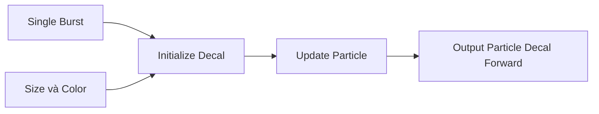

# Bài 06 — Tạo vết va chạm với Output Particle Decal Forward

## 1. Tóm tắt

Một vết trúng đạn trên nền gồ ghề sẽ thiếu tự nhiên nếu chỉ đặt quad phẳng ở vị trí tiếp xúc. Trong workflow đang học, **Output Particle Decal Forward** dùng để hiển thị dấu vết theo hình học trong phạm vi tác động, giúp kết quả phù hợp hơn với bề mặt không đều.

## 2. Mục tiêu học tập

- Xác định được khi nào nên dùng Decal thay vì quad thông thường.
- Tạo hệ thống Decal bằng cách tận dụng cấu hình hạt đã có.
- Nối các block kích thước và màu tới output decal.
- Kiểm tra lifetime và size khi decal chưa thấy xuất hiện.

## 3. Tạo hệ thống Decal

1. Nhân bản nhóm **Flash**, đổi tên thành `Decal`.
2. Từ luồng context hạt, tạo output **`Output Particle Decal Forward`** (tên và hỗ trợ tùy phiên bản).
3. Chuyển/thiết lập các block liên quan đến **Set Size** và **Set Color** để hệ thống Decal tiếp tục được điều khiển bằng kích thước và màu như mong muốn.
4. Bỏ output quad cũ khi output decal đã được nối và thử hiển thị chính xác.
5. Chọn màu tối cho vết đạn hoặc màu năng lượng phù hợp vật liệu.

Trước khi sửa texture, ưu tiên dùng các giá trị dễ quan sát. Trong bài thực nghiệm, **lifetime khoảng 3 giây** giúp kiểm tra decal có xuất hiện hay không. Nếu quy mô decal quá lớn và không được hiển thị như mong muốn, thử **giảm kích thước về khoảng 1**.

## 4. Vì sao thay output lại quan trọng?

`Output Particle Quad` thể hiện hạt như một mặt phẳng. Output decal được thiết kế cho cách biểu diễn vết trên hình học được chiếu, giúp dấu va chạm nhìn đúng hơn trên bề mặt cong hoặc gồ ghề. Lớp decal không nhất thiết phải chuyển động: nó tạo cảm giác **dấu để lại** sau khi Flash và Sparks tắt.

Sơ đồ nêu luồng chức năng; vị trí cụ thể của từng block phụ thuộc graph đang chỉnh. Hãy dùng output decal đúng với các ngữ cảnh và cổng kết nối hỗ trợ của phiên bản đang cài.

## 5. Texture và màu

Với vết trúng đạn thông thường, dùng một **texture impact/bullet mark có alpha**, gán vào thuộc tính texture của output. Không cần dùng bất kỳ asset trả phí cụ thể nào; có thể tự vẽ dấu nứt/lỗ cháy có nền trong suốt. Màu đen hoặc tối giúp vết hằn trên bề mặt. Với phép nhân màu, chú ý texture và màu gốc đều có thể làm kết quả quá tối.

## 6. Cách kiểm tra khi không thấy decal

- Giữ lifetime vài giây để có đủ thời gian quan sát.
- Giảm kích thước thử nghiệm thay vì chỉ liên tục phóng to.
- Di chuyển decal tới gần đối tượng hình học có thể nhận hiệu ứng.
- Kiểm tra **góc xoay** và hướng chiếu (bài kế tiếp).
- Xác minh output và renderer hiện tại thực sự hỗ trợ loại decal này.

## 7. Thực hành

Dựng decal màu tối trên hai mesh: một mặt phẳng và một hình dạng gồ ghề. Thử texture có alpha với một màu khác nhau rồi kiểm tra mức độ bám bề mặt.

## 8. Câu hỏi ôn tập

### Câu 1

Decal phù hợp nhất để biểu diễn đối tượng nào?

A. Tốc độ sinh hạt liên tục  
B. Ánh sáng Flash 0.1 giây  
C. Tâm camera  
D. Dấu vết còn lại trên bề mặt va chạm

**Đáp án:** D. **Giải thích:** Decal thể hiện vết tác động theo hình học bề mặt.

### Câu 2

Muốn thấy rõ decal trong lúc debug, nên chỉnh gì trước?

A. Tăng lifetime lên vài giây  
B. Đặt Count bằng 0  
C. Xóa mesh  
D. Tắt Output

**Đáp án:** A. **Giải thích:** Lifetime lâu hơn giúp quan sát vị trí, kích thước và hướng chiếu.

### Câu 3

Decal không hiển thị khi kích thước quá lớn. Cách thử phù hợp là gì?

A. Chỉ tăng độ sáng vô hạn  
B. Tăng Spawn Rate  
C. Giảm size về giá trị nhỏ hơn và thử lại  
D. Xóa Color Property

**Đáp án:** C. **Giải thích:** Kích thước không phù hợp có thể khiến projection/output không như mong đợi.

### Câu 4

Output nào là trọng tâm của lớp dấu vết trong bài?

A. Output Particle Quad  
B. Output Particle Decal Forward  
C. Constant Spawn Rate  
D. Soft Particle Fade

**Đáp án:** B. **Giải thích:** Output decal được dùng thay quad để tạo vết trên hình học.

### Câu 5

Texture impact có alpha hữu ích vì sao?

A. Có thể định hình vùng vết nhìn thấy, phần nền trong suốt không che bề mặt  
B. Tự tạo vận tốc cho hạt  
C. Tự phát hiện va chạm vật lý  
D. Tự thay đổi Count

**Đáp án:** A. **Giải thích:** Kênh alpha giúp phân biệt vùng vết với vùng nền trong suốt.

## 9. Tổng kết

Decal là lớp để lại dấu sau tác động. Đầu ra decal, kích thước hợp lý, lifetime đủ quan sát và texture có alpha là những điều kiện khởi đầu để tạo vết thuyết phục.
