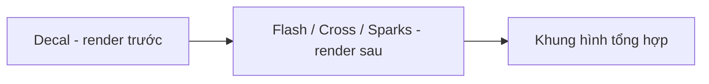

# Bài 07 — Chỉnh hướng Decal và thứ tự kết xuất

## 1. Tóm tắt

Sau khi tạo decal, hai lỗi dễ gặp là **decal hướng sai** và **dấu vết nổi trước các hạt khác**. Cần giải quyết từng nhóm lỗi: xoay để chiếu đúng mặt, sau đó thay đổi thứ tự render giữa các output.

## 2. Mục tiêu học tập

- Chẩn đoán lỗi decal chỉ hiển thị khi xoay đối tượng.
- Chỉnh trục X khoảng **−90°** trong cấu hình khởi tạo của ví dụ.
- Hiểu vai trò của Render Order giữa Decal, Flash, Cross và Sparks.
- Giữ màu và texture tương thích với thứ tự render mong muốn.

## 3. Sửa hướng chiếu

Nếu decal hiện méo, không nhìn thấy hoặc chỉ xuất hiện sau khi xoay GameObject, hãy kiểm tra hướng local của phần tử decal. Trong bố cục tham chiếu, chỉnh **góc X = −90° trong `Initialize Particle`** đã giúp decal hướng đúng để chiếu lên mặt đất.

Lưu ý: **−90° là một cấu hình minh họa, không phải quy tắc phổ quát.** Góc đúng phụ thuộc hướng surface, local/world space, orientation của output và chuyển động đối tượng. Nếu decal cho tường hoặc trần, phải căn hướng theo bề mặt tương ứng.

## 4. Kiểm tra texture

Trước khi áp texture impact thật, dùng texture hạt mặc định để xác minh phần projection có hoạt động. Sau đó chuyển sang texture vết đạn có alpha. Cách này tách bạch lỗi **hướng chiếu** khỏi lỗi **asset/vật liệu**.

## 5. Thứ tự render

Khi decal đang xuất hiện phía trước mọi hạt, cảm giác các lớp bị đảo: vết hằn lại nổi trên Flash. Trong cấu hình VFX Graph của ví dụ, thay đổi **Output Render Order** để **Decal render trước**, các lớp Flash/Cross/Sparks được render tiếp theo, mang lại kết quả tự nhiên hơn.

Thứ tự này là hướng tổ chức của hiệu ứng mẫu. Trên pipeline khác, kết quả còn phụ thuộc depth test, blending, sorting của transparent output và vật liệu. Cần kiểm chứng tại Scene thực tế.

## 6. Debug có thứ tự

| Vấn đề | Kiểm tra trước | Kiểm tra tiếp |
| --- | --- | --- |
| Decal không nhìn thấy | Lifetime, size, mesh nhận decal | Orientation, khả năng hỗ trợ output |
| Decal hiện méo/ngược | Góc X và hệ tọa độ | Hướng bề mặt, texture UV |
| Decal luôn nổi lên trên | Output Render Order | Sorting/depth và material |
| Vết quá sáng/tối | Texture alpha, Color Property | Blend/material intensity |

Không chỉnh đồng thời size, rotation, texture và render order: nếu hiệu ứng thay đổi, bạn sẽ không biết nguyên nhân nào đã giải quyết vấn đề.

## 7. Thực hành

Tạo một Scene với nền và một vật thể có góc cạnh. Giữ nguyên các lớp Flash/Cross/Sparks, chỉnh decal lần lượt theo **orientation → texture → render order**. Ghi lại ảnh ở mỗi bước, sau đó chọn cấu hình cuối.

## 8. Câu hỏi ôn tập

### Câu 1

Decal hiện ra khi xoay đối tượng nhưng không thấy ở hướng ban đầu. Yếu tố cần kiểm tra là gì?

A. Count của Sparks  
B. Spawn Rate của Flash  
C. Hướng/orientation của decal  
D. Số nhóm trong graph

**Đáp án:** C. **Giải thích:** Hướng chiếu quyết định decal tương tác thế nào với bề mặt.

### Câu 2

Góc X = −90° trong bài có ý nghĩa gì?

A. Một mốc thử nghiệm để căn hướng chiếu cho bố cục cụ thể  
B. Hằng số đúng với mọi bề mặt  
C. Một giá trị alpha  
D. Giá trị lifetime

**Đáp án:** A. **Giải thích:** Góc xoay đúng phụ thuộc hệ tọa độ và hướng bề mặt.

### Câu 3

Vì sao nên dùng texture mặc định trong bước đầu debug decal?

A. Để tăng Count  
B. Để tắt Render Order  
C. Để tự tạo Mesh  
D. Để phân biệt lỗi projection với lỗi texture riêng

**Đáp án:** D. **Giải thích:** Texture đơn giản giúp kiểm chứng hệ thống render trước khi xử lý asset.

### Câu 4

Trong hiệu ứng mẫu, lớp nào được ưu tiên render trước để các hạt còn lại xuất hiện phía trên?

A. Sparks  
B. Decal  
C. Cross  
D. Flash

**Đáp án:** B. **Giải thích:** Render decal trước giúp các lớp chớp/tia ở phía trên theo bố cục mong muốn.

### Câu 5

Vì sao không nên đổi nhiều tham số cùng lúc khi debug?

A. Vì phải chuyển sang C#  
B. Vì Unity chỉ cho sửa một block  
C. Vì khó xác định nguyên nhân của sự thay đổi  
D. Vì sẽ xóa VFX asset

**Đáp án:** C. **Giải thích:** Thay một biến mỗi lần giúp xác định đúng lỗi và tác động của tham số.

## 9. Tổng kết

Để decal thuyết phục, không chỉ cần texture đẹp: **hướng chiếu, kích thước, lifetime và thứ tự render** phải phối hợp đúng với hình học và các lớp hạt của cảnh.
