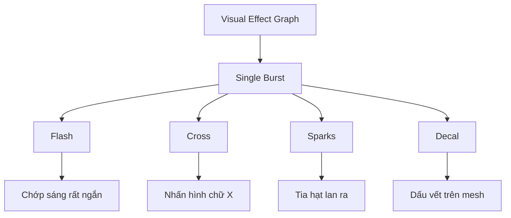

# Khóa học Unity VFX Graph: Hiệu ứng va chạm, tia lửa và Decal

## 1. Giới thiệu khóa học

Một hiệu ứng trúng đạn hoặc va chạm có sức thuyết phục thường không chỉ là một hình ảnh phát sáng. Nó gồm nhiều lớp xuất hiện theo nhịp khác nhau: **Flash** chớp rất nhanh, **Cross** tạo nhấn mạnh hình dạng, **Sparks** bắn ra xung quanh và **Decal** để lại dấu vết trên bề mặt. Khóa học này hướng dẫn xây dựng từng lớp bằng **Unity Visual Effect Graph (VFX Graph)** trong dự án sử dụng **Universal Render Pipeline (URP)**.

Các thao tác được trình bày theo môi trường tham chiếu **Unity 2020.1.14**. Tên block, đường dẫn menu hoặc hỗ trợ tính năng có thể thay đổi ở phiên bản Unity/VFX Graph khác. Vì thế hãy kiểm tra khả năng hỗ trợ của bản đang dùng trước khi áp dụng y nguyên.

## 2. Kết quả học tập

Sau khóa học, người học có thể:

1. Tạo và cấu hình VFX Graph dùng cơ chế **Single Burst**.
2. Xây dựng Flash với vòng đời ngắn và màu sắc được điều khiển bằng thuộc tính.
3. Tạo Cross từ **hai hạt** bằng `Spawn Index` và phép chọn nhánh.
4. Tạo Sparks với vị trí hình cầu, chuyển động và hướng theo vận tốc.
5. Giảm đường cắt cứng khi hạt giao với hình học bằng **Soft Particles**.
6. Dùng **Output Particle Decal Forward** để chiếu vết va chạm lên bề mặt không phẳng.
7. Chẩn đoán vấn đề về kích thước, hướng xoay và thứ tự kết xuất.

## 3. Lộ trình

| Module | Nội dung | Bài học |
| --- | --- | --- |
| [01 — Nền tảng và Flash](01-nen-tang-va-flash/README.md) | Chuẩn bị VFX Graph, dựng chớp sáng | 2 |
| [02 — Cross và Sparks](02-cross-sparks-va-tiep-xuc/README.md) | Dấu chéo, tia lửa, Soft Particles | 3 |
| [03 — Decal và render](03-decal-va-render/README.md) | Chiếu dấu trúng đạn, xử lý hướng và thứ tự render | 2 |
| [04 — Hoàn thiện và đánh giá](04-thuc-hanh-va-danh-gia/README.md) | Lab ghép hệ thống, đánh giá cuối khóa | 2 |

## 4. Cách học

Đọc lần lượt từng bài, thực hành ngay trong VFX Graph và kiểm tra hiệu ứng ở **cảnh có mesh phẳng lẫn mesh gồ ghề**. Các con số là **mốc thực nghiệm minh họa** để bắt đầu, không phải giá trị bắt buộc cho mọi trò chơi. Sau mỗi bài, trả lời câu hỏi ôn tập và so sánh kết quả khi đổi một tham số.

## 5. Sản phẩm cuối khóa

Một prefab/GameObject chứa Visual Effect hiển thị hiệu ứng va chạm nhiều lớp, có thể chỉnh màu, gồm chớp sáng, hình chữ thập, tia lửa và dấu decal bám lên hình học phù hợp. Kèm ảnh hoặc video kiểm chứng trên các bề mặt khác nhau và bảng ghi tham số.

## 6. Sơ đồ cấu trúc hiệu ứng

Bốn hệ thống dùng các cấu hình khởi tạo, cập nhật và đầu ra khác nhau. Điều này cho phép chỉnh một lớp mà không làm thay đổi trực tiếp những lớp còn lại.

## 7. Lưu ý tương thích

- `Output Particle Decal Forward` và một số block thử nghiệm có thể cần tùy chọn hỗ trợ phù hợp trong phiên bản tham chiếu; không mặc định mọi phiên bản Unity đều có cùng tính năng.
- Asset texture vết đạn là tài nguyên phải tự chuẩn bị hoặc tự tạo. Khóa học không đính kèm texture thương mại.
- Mục tiêu là quy trình chế tác VFX, không bao gồm logic phát hiện trúng đích, gameplay sát thương hoặc mã C# kích hoạt theo sự kiện.
