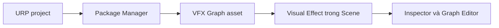

# Chuẩn bị Unity, URP và tạo Visual Effect Graph

> **Loại:** Bài học lý thuyết kết hợp thực hành

## 1. Tóm tắt

Hiệu ứng quả cầu năng lượng được dựng bằng **Visual Effect Graph (VFX Graph)** trong dự án sử dụng **Universal Render Pipeline (URP)**. Bài này chuẩn bị môi trường, tạo asset đồ thị và đưa hiệu ứng vào Scene. Các bước gắn nhãn *theo bài thực hành gốc* sử dụng **Unity 2019.3.7**; giao diện Package Manager và cách hiển thị gói có thể khác trên phiên bản mới.

## 2. Mục tiêu học tập

- Xác định vai trò của URP, VFX Graph và Shader Graph trong hiệu ứng.
- Tạo được asset Visual Effect Graph và mở trình biên tập.
- Kiểm tra được một Visual Effect được gắn đúng vào Scene.

## 3. Bài toán và các thành phần cần dùng

Một quả cầu năng lượng đẹp không nhất thiết được tạo bằng mesh phức tạp. Có thể ghép **vệt sáng chạy quanh mặt cầu**, **xung sáng phát tán theo chu kỳ** và **những hạt nhỏ chuyển động liên tục**. VFX Graph cho phép điều khiển số lượng hạt, vị trí, vòng đời, màu và lực chuyển động ngay bằng đồ thị.

| Thành phần | Vai trò trong dự án |
| --- | --- |
| URP | Cấu hình đường dựng hình (render pipeline) của dự án thực hành |
| Visual Effect Graph | Tạo và cập nhật những hệ hạt trên đồ thị |
| Shader Graph | Công cụ tạo vật liệu/shader; được chuẩn bị cùng môi trường thực hành |
| Scene và Inspector | Quan sát hiệu ứng và tinh chỉnh tham số đã được Expose |

Đây là bài tập thiên về **VFX**, không phải bài học về viết script C# hoặc mô phỏng vật lý thật của plasma.

## 4. Chuẩn bị project và cài gói

1. Mở project Unity cấu hình URP. Trong buổi thực hành tham chiếu, phiên bản được dùng là `2019.3.7`.
2. Mở **Window → Package Manager**.
3. Tìm và cài **Visual Effect Graph**. Trong giao diện cũ, nếu không nhìn thấy gói, mở tùy chọn nâng cao để hiển thị **Preview Packages**.
4. Kiểm tra **Shader Graph** cũng đã được cài đặt.
5. Lưu Scene và chọn một vùng đủ thoáng để kiểm tra hiệu ứng.

**Lưu ý phiên bản:** tùy chọn `Show Preview Packages` là đặc trưng của giao diện cũ. Trên Unity mới, cách cài đặt và tính tương thích giữa phiên bản Unity, URP và VFX Graph cần được kiểm tra trực tiếp trong Package Manager. Không mặc định mọi dự án URP đều hỗ trợ cùng một tập node.

## 5. Tạo asset và quan sát đồ thị

Trong cửa sổ Project, nhấp chuột phải và tìm mục tạo **Visual Effect Graph**. Đặt tên dễ hiểu, ví dụ `EnergyOrb_VFX`. Kéo asset vào Scene để tạo đối tượng trình bày hiệu ứng, sau đó chọn **Edit** để mở cửa sổ đồ thị.

Tại bước đầu, hãy xác nhận ba điểm: Scene chứa đối tượng hiệu ứng; Inspector cho thấy component Visual Effect hoặc các thuộc tính tương ứng; và cửa sổ graph cho phép chọn các node/context. Chưa cần điều chỉnh màu hay số lượng hạt — những việc đó sẽ được thực hiện sau khi hiểu cấu trúc đồ thị.

Sơ đồ biểu diễn đường đi từ cấu hình project đến lúc có thể thiết kế và xem trước hiệu ứng.

## 6. Thực hành ngắn

**Nhiệm vụ:** Tạo `EnergyOrb_VFX`, đưa vào Scene và lưu. Ghi lại phiên bản Unity, trạng thái URP và các gói đã cài trong ghi chú dự án.

**Tự kiểm tra:** Có thể mở graph từ asset và chọn được đối tượng Visual Effect trong Inspector. Nếu không, sửa phần cài đặt trước khi sang bài tiếp theo.

## 7. Lỗi thường gặp và cách xử lý

- **Không thấy VFX Graph:** kiểm tra Package Manager, bộ lọc và cách hiển thị gói tương ứng phiên bản Unity.
- **Tạo asset nhưng Scene chưa có hiệu ứng:** bảo đảm asset đã được kéo vào Scene hoặc liên kết với đối tượng dùng để phát VFX.
- **Không thấy ánh sáng hạt:** ở bước này đồ thị có thể chưa được cấu hình; chưa kết luận có lỗi render chỉ vì Scene trống.

## 8. Câu hỏi ôn tập

### Câu 1
Vai trò chính của Visual Effect Graph trong bài này là gì?

A. Tạo animation xương nhân vật  
B. Tạo và điều khiển các hệ hạt bằng đồ thị  
C. Lưu dữ liệu người chơi  
D. Xử lý input bàn phím  

**Đáp án:** B
**Giải thích:** VFX Graph phụ trách phát sinh, cập nhật và kết xuất hệ hạt.

### Câu 2
Bước nào giúp đưa asset VFX vào môi trường có thể xem trước?

A. Chỉ đổi tên file  
B. Xuất file PNG  
C. Kéo asset vào Scene  
D. Xóa URP  

**Đáp án:** C
**Giải thích:** Đồ thị cần được liên kết với đối tượng Visual Effect trong Scene để hiển thị.

### Câu 3
Khi không thấy Preview Packages ở Unity mới nên làm gì?

A. Luôn hạ cấp về 2019.3.7  
B. Kiểm tra Package Manager theo phiên bản đang dùng  
C. Tự viết lại engine  
D. Bỏ qua mọi package  

**Đáp án:** B
**Giải thích:** Tùy chọn và giao diện cài gói đã thay đổi theo phiên bản.

### Câu 4
Trong bài thực hành tham chiếu, render pipeline được sử dụng là gì?

A. URP  
B. Built-in bắt buộc  
C. HDRP bắt buộc  
D. Không có render pipeline  

**Đáp án:** A
**Giải thích:** Quy trình bắt đầu từ một dự án dùng Universal Render Pipeline.

## 9. Tổng kết

Kết quả cần có là một project URP với asset VFX Graph và Scene sẵn sàng xây dựng. Nếu môi trường chưa đúng, các bước nối node và điều chỉnh thông số ở bài sau sẽ khó kiểm chứng.
