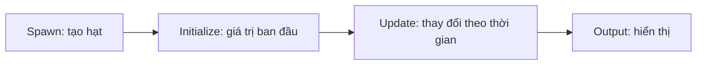

# Hiểu Spawn, Initialize, Update, Output và Blackboard

> **Loại:** Bài học lý thuyết kết hợp thực hành

## 1. Tóm tắt

Mọi hệ hạt trong khóa học sẽ được nhìn như một vòng đời gồm phát sinh, khởi tạo, cập nhật và hiển thị. Blackboard là nơi khai báo tham số giúp điều khiển hiệu ứng từ Inspector thay vì cố định mọi giá trị trong graph.

## 2. Mục tiêu học tập

- Phân biệt được bốn context cơ bản của một hệ hạt.
- Giải thích được tác dụng của Capacity và Spawn Rate.
- Tạo được các thuộc tính Float/Color có thể điều chỉnh trong Inspector.

## 3. Bốn giai đoạn của một hệ hạt

**Spawn** quyết định khi nào và với tốc độ nào hạt được sinh ra. **Initialize** thiết lập vị trí, màu, kích thước, tuổi thọ hay vận tốc ban đầu. **Update** áp dụng lực và chuyển động trong thời gian sống. **Output** biến trạng thái hạt thành hình ảnh: hạt dạng quad, strip/trail, chế độ hòa trộn, kích thước và màu.

Một thuộc tính có thể được điều khiển ở nhiều giai đoạn; vì vậy cần hiểu **thứ tự áp dụng**. Ví dụ màu cố định ở Initialize có thể bị block màu theo tuổi ở Output ghi đè nếu cấu hình composition không đúng.

## 4. Capacity, Spawn Rate và Lifetime

Ba khái niệm dễ nhầm là:

| Thuộc tính | Ý nghĩa | Ví dụ sử dụng |
| --- | --- | --- |
| `Capacity` | Số hạt tối đa hệ thống có thể chứa cùng lúc | Tăng lên khoảng `1000` để vệt sáng có đủ hạt |
| `Spawn Rate` | Tốc độ sinh hạt, thường tính theo hạt/giây | Mức thử nghiệm `30` cho hệ vệt sáng |
| `Lifetime` | Thời gian mỗi hạt tồn tại | Dùng giá trị tham số `1` làm mốc tham chiếu |

Không coi Capacity là Spawn Rate: tăng sức chứa không tự động tăng số hạt thực sự được sinh ra. Ngược lại, Spawn Rate rất lớn với Capacity thấp có thể làm hiệu ứng không phản ánh đúng số hạt mong muốn.

## 5. Blackboard và thuộc tính Exposed

Blackboard là danh sách thuộc tính dùng lại trong nhiều vị trí của graph. Quy trình chung:

1. Tạo thuộc tính `Float` hoặc `Color`.
2. Đặt tên có nghĩa, chẳng hạn `SpawnRate`, `OrbSize`, `TrailLifetime`, `OrbColor`.
3. Bật **Exposed** để tham số xuất hiện trong Inspector.
4. Kéo thuộc tính từ Blackboard lên graph và nối vào cổng tương ứng.

Trong chuỗi thực hành này, các giá trị bắt đầu thường gặp là `SpawnRate = 30`, `OrbSize = 1`, `TrailLifetime = 1` và màu xanh dương. Các giá trị là **điểm khởi đầu để quan sát**, không phải tiêu chuẩn bắt buộc cho mọi hiệu ứng.

Tái sử dụng cùng `OrbSize` trong nhiều hệ hạt giúp toàn bộ quả cầu cùng co giãn. Đây là ưu điểm của cách dùng Blackboard thay vì nhập nhiều số rời rạc.

## 6. Thực hành ngắn

Tạo bốn thuộc tính trên Blackboard và Expose chúng. Trong Inspector, chỉnh `OrbSize` từ `1` sang một giá trị khác rồi trả về `1`. Nếu chưa có hệ hạt dùng thuộc tính, thay đổi sẽ chưa tác động tới Scene; mục tiêu hiện tại là kiểm tra đường truyền tham số.

## 7. Lỗi thường gặp và cách xử lý

- **Tham số không xuất hiện trong Inspector:** kiểm tra cờ `Exposed` và đối tượng VFX đang được chọn.
- **Sửa Capacity nhưng không thấy dày hơn:** xem Spawn Rate và Lifetime; đây là ba thông số khác nhau.
- **Đổi tên property nhưng mất kết nối:** kiểm tra lại các node/property đang tham chiếu trong graph.

## 8. Câu hỏi ôn tập

### Câu 1
Context nào chịu trách nhiệm thay đổi vị trí hạt theo thời gian?

A. Output  
B. Initialize  
C. Update  
D. Spawn  

**Đáp án:** C
**Giải thích:** Update thực hiện các thay đổi trạng thái trong suốt vòng đời hạt.

### Câu 2
Muốn chỉnh màu trực tiếp từ Inspector cần ưu tiên cách nào?

A. Đặt màu hard-code ở nhiều node  
B. Tạo Color property và bật Exposed  
C. Chỉ tăng Capacity  
D. Xóa Blackboard  

**Đáp án:** B
**Giải thích:** Property Exposed tạo điểm điều khiển từ Inspector.

### Câu 3
Thông số nào giới hạn số hạt đồng thời?

A. Lifetime  
B. Spawn Rate  
C. Capacity  
D. Alpha  

**Đáp án:** C
**Giải thích:** Capacity là dung lượng tối đa của hệ hạt.

### Câu 4
Một hệ có Capacity cao nhưng Spawn Rate thấp sẽ như thế nào?

A. Chắc chắn sinh nhiều hạt ngay  
B. Có thể vẫn sinh ít hạt  
C. Không thể chạy  
D. Luôn cho màu sáng hơn  

**Đáp án:** B
**Giải thích:** Dung lượng tối đa không quyết định trực tiếp tốc độ sinh hạt.

## 9. Tổng kết

VFX Graph được cấu trúc theo các giai đoạn Spawn → Initialize → Update → Output. Blackboard nối các tham số thiết kế vào Inspector, giúp những phần được dựng ở các module sau thống nhất và dễ điều chỉnh.
