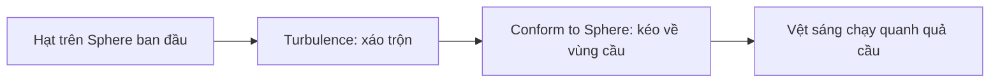

# Tạo chuyển động và ràng buộc Trails bằng Conform to Sphere

> **Loại:** Bài học lý thuyết kết hợp thực hành

## 1. Tóm tắt

Để vệt sáng có cảm giác đang sống, các hạt cần di chuyển liên tục nhưng vẫn duy trì đường nét hình cầu. Có thể phối hợp `Turbulence` để tạo biến thiên và `Conform to Sphere` để kéo các hạt về vùng mặt cầu.

## 2. Mục tiêu học tập

- Giải thích được sự khác nhau giữa nhiễu chuyển động và lực bám hình cầu.
- Thực hiện được kết nối bán kính theo `OrbSize`.
- Điều chỉnh Attraction và Stick Force để tránh tụ hạt hoặc văng khỏi sphere.

## 3. Không dùng một vận tốc cố định cho tất cả hạt

Trong `Initialize Particle`, bỏ thiết lập vận tốc cố định khi nó làm tất cả hạt đi cùng một hướng hoặc tạo chuyển động cứng. Chuyển sang `Update Particle`, dùng **Turbulence** để mỗi hạt nhận chuyển động biến thiên. Nhiễu giúp vệt sáng xoắn và chuyển dịch thay vì chỉ đứng trên bề mặt.

Nhưng turbulence một mình thường khiến hạt tản ra xa vùng mong muốn. Phải có cơ chế ràng buộc chúng vào hình dạng cầu.

## 4. Thêm Conform to Sphere

Trong `Update Particle`, bổ sung **Conform to Sphere**. Block này áp dụng xu hướng đưa vị trí của hạt về bề mặt hoặc vùng ràng buộc hình cầu. Trong bài thực hành, bán kính được liên kết bằng công thức:

$$
r_{\text{conform}} = \text{OrbSize} \times 1.5
$$

Bán kính cập nhật lớn hơn bán kính khởi tạo (`OrbSize × 1`) làm lớp vệt có không gian chuyển động. Khi đổi `OrbSize`, cả vùng spawn và vùng mà hệ hạt cố gắng bám theo đều thay đổi.

Sơ đồ mô tả quan hệ chức năng, không yêu cầu các node xuất hiện theo một thứ tự giao diện cố định ở mọi phiên bản Unity.

## 5. Tinh chỉnh Attraction và Stick Force

Nếu hạt bị kéo mạnh đến mức đứng cứng trên mặt cầu, giảm cường độ hút. Trong ví dụ, **Attraction khoảng 10** và **Stick Force khoảng 5** là những giá trị thử nghiệm giúp hình dạng dễ quan sát hơn.

- **Attraction**: lực đưa hạt trở lại vùng cầu; quá thấp làm hệ tản, quá cao dễ làm chuyển động ít tự nhiên.
- **Stick Force**: mức ràng buộc giữ hạt gần vùng cầu khi các lực khác tác động; cần tinh chỉnh cùng nhiễu.

Giá trị cụ thể chỉ phù hợp trong ngữ cảnh graph minh họa. Với bán kính, tốc độ hạt hay phiên bản khác, hãy ưu tiên quan sát hình ảnh trước khi quyết định thông số.

## 6. Thực hành ngắn

Thiết lập `Turbulence` và `Conform to Sphere`, bán kính `OrbSize × 1.5`. Thử giảm/tăng Attraction quanh giá trị `10` và Stick Force quanh `5`. So sánh ba trạng thái: chỉ có Turbulence, chỉ có Conform to Sphere, và kết hợp cả hai.

**Checkpoint:** Hạt chuyển động không hoàn toàn ngẫu nhiên trong không gian; vẫn giữ được dấu hiệu của một lớp vỏ cầu.

## 7. Lỗi thường gặp và cách xử lý

- **Hạt tản ra khắp Scene:** kiểm tra đã bật Conform to Sphere và kết nối Radius.
- **Hạt trông bất động:** Attraction/Stick Force có thể quá mạnh hoặc Turbulence quá yếu.
- **Quả cầu méo khi đổi size:** kiểm tra mọi node dùng cùng `OrbSize`, không bỏ sót một bán kính hard-code.

## 8. Câu hỏi ôn tập

### Câu 1
Turbulence đóng vai trò chính nào?

A. Tạo chuyển động biến thiên  
B. Cố định màu đỏ  
C. Giảm độ phân giải màn hình  
D. Tạo âm thanh  

**Đáp án:** A
**Giải thích:** Turbulence gây ra chuyển động nhiều hướng theo thời gian.

### Câu 2
Conform to Sphere được dùng để làm gì?

A. Bật Post Processing  
B. Kéo hạt về vùng hình cầu  
C. Thay shader sang opaque  
D. Xóa Lifetime  

**Đáp án:** B
**Giải thích:** Đây là lực ràng buộc hình học cho các hạt.

### Câu 3
Trong ví dụ, bán kính Conform được lấy như thế nào?

A. OrbSize chia 10  
B. OrbSize nhân 1.5  
C. SpawnRate nhân 30  
D. Lifetime nhân 5  

**Đáp án:** B
**Giải thích:** Bán kính ràng buộc được đặt bằng 1.5 lần kích thước dùng chung.

### Câu 4
Nếu hạt bay quá xa khỏi quả cầu, bước kiểm tra hợp lý là gì?

A. Giảm độ sáng màn hình  
B. Đổi tên object  
C. Kiểm tra lực Conform và bán kính  
D. Xóa toàn bộ Spawn  

**Đáp án:** C
**Giải thích:** Vấn đề nằm ở cân bằng chuyển động với ràng buộc không gian.

## 9. Tổng kết

Trails đạt hiệu ứng xoáy quanh một hình cầu nhờ sự phối hợp giữa nhiễu và lực ràng buộc. Cường độ lực là thông số tinh chỉnh bằng mắt, không có một bộ số dùng được cho tất cả cảnh.
