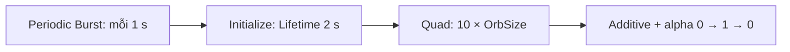

# Tạo xung sáng phát định kỳ (Periodic Burst và Additive)

> **Loại:** Bài học lý thuyết kết hợp thực hành

## 1. Tóm tắt

Lớp thứ hai là một quầng sáng xuất hiện theo nhịp, tạo cảm giác năng lượng phát xung. Ta dùng một hệ hạt riêng, phát ít hạt nhưng kích thước lớn và thay đổi độ trong suốt theo vòng đời.

## 2. Mục tiêu học tập

- Thiết lập được `Periodic Burst` sinh một hạt theo chu kỳ.
- Chọn được Output Particle Quad, texture và chế độ Additive.
- Tạo đường cong alpha xuất hiện–sáng lên–mờ đi.

## 3. Một hệ hạt riêng cho xung sáng

Thêm **Empty Particle System** vào graph. Trong context `Spawn`, thêm **Periodic Burst**; cấu hình **một hạt mỗi chu kỳ**, khoảng cách **1 giây**. Sang `Initialize Particle`, đặt **Lifetime = 2 giây**.

Hai khái niệm khác nhau: chu kỳ phát (`1 s`) xác định nhịp xuất hiện của hạt mới, còn vòng đời (`2 s`) là thời gian một xung tồn tại. Vì Lifetime dài hơn chu kỳ, các xung có thể chồng nhau nhẹ, tạo chuyển tiếp thay vì bật–tắt thô.

## 4. Quad, texture và kích thước

Dùng **Output Particle Quad** với texture hạt mặc định được dùng trong bài thực hành. Ban đầu, quad có thể khó thấy vì quá nhỏ. Tận dụng `OrbSize` và tạo tỷ lệ:

$$
s_{\text{pulse}}=10\times\text{OrbSize}
$$

Kết nối giá trị này vào kích thước quad. Vì quad khá lớn, kiểm soát màu và alpha là bắt buộc để tránh một tấm ảnh sáng che kín cả cảnh.

## 5. Additive và đường cong alpha

Dùng property màu `OrbColor` cho hệ xung. Chuyển kiểu hòa trộn của Output từ **Alpha** sang **Additive** như bài thực hành. Với Additive, ánh sáng các hạt chồng nhau tạo cảm giác phát sáng mạnh hơn, đặc biệt trên nền tối.

Thêm **Color/Alpha over Life** hoặc block tương đương để điều khiển alpha theo tuổi. Đặt các mốc khái niệm:

| Tuổi chuẩn hóa | Alpha mong muốn | Vai trò |
| --- | --- | --- |
| `0` | `0` | Xung bắt đầu trong suốt |
| Giữa vòng đời | Cao (gần `1`) | Xung sáng rõ nhất |
| `1` | `0` | Xung mờ đi trước khi kết thúc |

Đường cong là **mờ → sáng → mờ**, không phải hạt xuất hiện ngay ở độ sáng tối đa rồi biến mất đột ngột. Mức `1` đại diện cho alpha tối đa trong ví dụ chuẩn hóa, không phải cường độ HDR cố định.

## 6. Nhóm node để dễ bảo trì

Chọn các context, block, node của hệ xung và tạo Group đặt tên `Beam` hoặc `Pulse`. Một phần mềm có thể gọi xung này là beam theo cách đặt nhóm của bài thực hành; về mặt hình ảnh nó là **quầng sáng phát xung**, không nhất thiết là tia thẳng.

Các giai đoạn nối với nhau tạo ra những xung sáng có nhịp thay vì một mặt phẳng phát sáng cố định.

## 7. Thực hành ngắn

Tạo hệ xung với `1 hạt / 1 giây`, `Lifetime = 2 giây`, quad `10 × OrbSize`, màu dùng chung và Additive. Quan sát ít nhất ba chu kỳ. Nếu hiệu ứng quá gắt, giảm cường độ màu/độ sáng chứ không nhất thiết xóa xung.

## 8. Lỗi thường gặp và cách xử lý

- **Quad chiếm toàn màn hình:** xem kích thước so với OrbSize và góc nhìn Camera.
- **Xung bật/tắt quá gắt:** kiểm tra điểm đầu và cuối của đường cong alpha có về `0` không.
- **Xung trông đục:** xem lại blend mode và texture.
- **Các xung chồng quá nhiều:** cân nhắc chu kỳ phát so với Lifetime; hai giá trị không đồng nghĩa.

## 9. Câu hỏi ôn tập

### Câu 1
Periodic Burst trong ví dụ được cấu hình thế nào?

A. 1000 hạt mỗi frame  
B. Một hạt mỗi giây  
C. Không bao giờ sinh hạt  
D. Một hạt mỗi 50 giây  

**Đáp án:** B
**Giải thích:** Một chu kỳ một giây sinh một hạt để tạo nhịp phát xung.

### Câu 2
Lifetime của hạt xung được đặt là bao lâu?

A. 2 giây  
B. 30 giây  
C. 0 giây  
D. 5000 giây  

**Đáp án:** A
**Giải thích:** Bài thực hành chọn vòng đời hai giây.

### Câu 3
Mục đích của đường cong alpha 0 → 1 → 0 là gì?

A. Giữ sáng tối đa liên tục  
B. Làm quad biến thành mesh  
C. Tạo chuyển tiếp vào/ra mềm  
D. Thay Spawn Rate  

**Đáp án:** C
**Giải thích:** Alpha tăng rồi giảm khiến xung xuất hiện và biến mất mượt hơn.

### Câu 4
Khi muốn các xung chồng ánh sáng theo cách minh họa, chọn mode nào?

A. Opaque  
B. Additive  
C. Cutout  
D. Wireframe  

**Đáp án:** B
**Giải thích:** Additive cộng đóng góp ánh sáng của các hạt.

## 10. Tổng kết

Hệ xung làm quả cầu có nhịp năng lượng. Độ sáng phụ thuộc không chỉ màu mà còn vào kích thước quad, blend mode và đường cong alpha theo tuổi.
