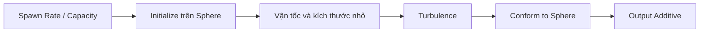

# Tạo lớp hạt năng lượng nền: Spawn, Sphere và Turbulence

> **Loại:** Bài học lý thuyết kết hợp thực hành

## 1. Tóm tắt

Lớp thứ ba làm quả cầu có bề mặt dày những điểm sáng nhỏ. Bằng cách phát nhiều hạt có vận tốc khởi tạo ngẫu nhiên, gò chúng về vùng hình cầu và khuấy bằng Turbulence, hiệu ứng có cảm giác sống và biến thiên.

## 2. Mục tiêu học tập

- Tạo được hệ hạt nền độc lập với Trails và Pulse.
- Dùng khoảng vận tốc `-0.5` đến `0.5` và kích thước nhỏ `0.01–0.02`.
- Giải thích được vì sao cần cân bằng Spawn Rate, Capacity và hiệu năng GPU.

## 3. Tạo hệ Simple Particle

Thêm một **Simple Particle System** riêng. Sử dụng texture hạt mặc định như đã dùng cho xung sáng, nhưng chọn blend mode **Additive**. Đây là lớp hạt li ti — không phải các đường vệt dài và cũng không phải quầng xung cỡ lớn.

Trong `Initialize`, dùng **Set Position (Sphere)** hoặc block vị trí hình cầu tương ứng. Bán kính minh họa:

$$
r_{\text{particles}}=2\times\text{OrbSize}
$$

Nhờ dùng cùng property, toàn bộ lớp hạt co giãn khi người thiết kế đổi kích thước quả cầu.

## 4. Vận tốc và kích thước ban đầu

Cấu hình vận tốc ban đầu thành khoảng từ **-0.5 đến 0.5** theo các cổng giá trị mà graph cung cấp, để hạt không đồng loạt dịch chuyển cùng một hướng. Đồng thời đặt kích thước hạt ngẫu nhiên trong khoảng **0.01–0.02** theo tỷ lệ minh họa.

Các kích thước này nhỏ hơn rất nhiều so với quad của xung sáng. Điều đó giữ ba lớp có vai trò rõ ràng: hạt nền tạo kết cấu, trail tạo đường chuyển động, và xung tạo nhịp sáng.

Sử dụng `Set Color` nối với `OrbColor`. Nếu có block Color over Life mặc định không phục vụ mục tiêu, cân nhắc bỏ nó để tránh ghi đè màu chung.

## 5. Tốc độ phát và Capacity

Tạo một property Float riêng, ví dụ `ParticleSpawnRate`, bật `Exposed`. Mức khởi đầu trong bài thực hành là **5000 hạt/giây**. Capacity cần đủ lớn tương ứng để lượng hạt sống không bị giới hạn đột ngột.

Buổi thực hành còn tăng đến khoảng **50000 hạt/giây** để minh họa độ dày mạnh và đồng thời cảnh báo khả năng làm GPU quá tải. Đây là ví dụ **mức tải cao để thử nghiệm**, **không phải giá trị khuyên dùng** cho mọi máy hoặc thiết bị di động.

Hãy tăng dần thông số và quan sát số hạt, độ mượt trong Game view; đừng đánh đồng nhiều hạt với hình ảnh luôn đẹp hơn.

## 6. Turbulence và Conform to Sphere

Trong `Update Particle`, thêm **Turbulence** để tạo chuyển động đa hướng, sau đó thêm **Conform to Sphere** nhằm giữ những hạt nhỏ gần vùng cầu. Đặt bán kính conform theo `OrbSize × 2` để trùng với vùng kích thước nền đang xây dựng.

Nếu chỉ có Turbulence, hạt có xu hướng tản. Nếu chỉ có Conform với lực quá mạnh, chuyển động có thể thiếu tự nhiên. Sự cân bằng giữa hai hiệu ứng mới mang đến kết quả.

Mỗi phần của đồ thị giải quyết một vai trò riêng; thay đổi một thông số nên đi kèm quan sát kết quả cụ thể.

## 7. Thực hành ngắn

Tạo hệ hạt nền, `ParticleSpawnRate` khởi đầu `5000`, bán kính `OrbSize × 2`, khoảng vận tốc `[-0.5,0.5]`, kích thước `0.01–0.02`. Quan sát trước và sau khi thêm Turbulence/Conform. Không cần tăng lên `50000` nếu máy đã hiển thị rõ lớp hạt.

## 8. Lỗi thường gặp và cách xử lý

- **GPU chậm hoặc giật:** giảm ParticleSpawnRate, giảm Capacity tương ứng và kiểm tra các lớp đang hoạt động.
- **Hạt nền quá sáng:** giảm màu/cường độ hoặc số lượng hạt, tránh chồng alpha quá dày.
- **Hạt không còn dáng cầu:** xem Conform to Sphere và Radius.
- **Hạt lớn như quầng xung:** kiểm tra ngẫu nhiên size `0.01–0.02`, không dùng nhầm `10 × OrbSize`.

## 9. Câu hỏi ôn tập

### Câu 1
Mức Spawn Rate khởi đầu cho hạt nền trong bài là bao nhiêu?

A. 1  
B. 30  
C. 5000  
D. 500000  

**Đáp án:** C
**Giải thích:** Buổi thực hành chọn 5000 làm điểm xuất phát cho lớp hạt dày.

### Câu 2
Tại sao không nên coi 50000 hạt/giây là mặc định tốt?

A. Vì có thể gây tải GPU lớn  
B. Vì làm mất hoàn toàn ánh sáng  
C. Vì Unity luôn cấm giá trị này  
D. Vì không hỗ trợ Float  

**Đáp án:** A
**Giải thích:** Tốc độ phát rất cao có thể làm giảm hiệu năng rõ rệt.

### Câu 3
Khoảng vận tốc ban đầu nào được nhắc tới?

A. 10–20  
B. -0.5 đến 0.5  
C. 100–500  
D. 1–2  

**Đáp án:** B
**Giải thích:** Khoảng -0.5 đến 0.5 được dùng để tạo chuyển động nhẹ, đa hướng.

### Câu 4
Tác dụng của Conform to Sphere trong hệ hạt nền là gì?

A. Phát xung mỗi giây  
B. Đổi shader sang Cutout  
C. Giữ hạt gần cấu trúc hình cầu  
D. Tạo camera  

**Đáp án:** C
**Giải thích:** Ràng buộc không gian hạn chế hạt bị Turbulence tản quá xa.

## 10. Tổng kết

Lớp hạt nền làm năng lượng có mật độ và chuyển động không đều. Điểm quan trọng là phân biệt vai trò các lớp và giữ số lượng hạt trong ngưỡng phần cứng chịu được.
