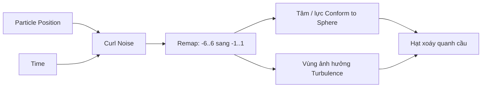

# Tạo chuyển động hữu cơ bằng Curl Noise, Position, Time và Remap

> **Loại:** Bài học lý thuyết kết hợp thực hành

## 1. Tóm tắt

Sau khi có hệ hạt hình cầu, bước tinh chỉnh mạnh nhất là dùng trường nhiễu kiểu `Curl Noise` để định hình chuyển động. Kết hợp vị trí hạt hiện tại, thời gian và `Remap` giúp hiệu ứng uốn xoáy mà không bị lệch tâm quá lớn.

## 2. Mục tiêu học tập

- Mô tả được vì sao Curl Noise cần tọa độ đầu vào phù hợp.
- Kết hợp được Position và Time để trường nhiễu thay đổi theo không gian/thời gian.
- Sử dụng Remap để hạn chế biên độ biến dạng của quả cầu.

## 3. Vì sao Curl Noise cần Position

Dùng `Curl Noise` trong graph để tạo vector chuyển động biến thiên. Nếu trực tiếp lấy giá trị nhiễu sai hệ tọa độ hoặc không cung cấp vị trí hạt hợp lý, vị trí tâm mà Conform to Sphere sử dụng có thể bị lệch rõ rệt.

Bài thực hành khắc phục bằng cách lấy **Position hiện tại của hạt** làm một phần đầu vào tọa độ của trường nhiễu. Khi đó, hạt ở các vị trí khác nhau nhận ảnh hưởng khác nhau, giúp những cụm sáng xoắn thay vì cả quả cầu dịch chuyển đồng loạt.

## 4. Tạo chuyển động liên tục với Time

Bổ sung thành phần **Time** vào phép xây dựng tọa độ trường nhiễu. Khi thời gian thay đổi, giá trị nhiễu thay đổi liên tục, tạo cảm giác bề mặt năng lượng đang vận động. Buổi thực hành mô tả việc sử dụng các thành phần X và Y của tọa độ để đưa tới input của Curl Noise.

Không cần ép người học thuộc một vị trí node duy nhất: cấu trúc quan trọng là **Position + thành phần thay đổi theo thời gian → Curl Noise → đầu ra ảnh hưởng lực/vị trí**. Cách lắp chính xác phụ thuộc kiểu dữ liệu từng node và phiên bản VFX Graph.

## 5. Remap để giảm biến dạng và giữ bố cục

Đầu ra nhiễu có thể quá rộng, khiến tâm cầu lệch hoặc các hạt tản ra. Thêm `Remap` để chuyển một miền giá trị đầu vào về miền giới hạn:

$$
\operatorname{remap}(x; a,b,c,d)=c+\frac{x-a}{b-a}(d-c)
$$

Bài thực hành thử **miền vào `[-3,3]` và miền ra `[-1,1]`**, sau đó mở rộng miền vào thành **`[-6,6]`** nhưng vẫn đưa về `[-1,1]`. Với cùng giá trị x quanh trung tâm, miền đầu vào rộng hơn thường tạo độ biến thiên đầu ra nhỏ hơn, giúp chuyển động gọn và ít phá dáng cầu.

**Quan trọng:** Remap là phép biến đổi thang đo, không nhất thiết chặn giá trị vượt miền nếu node không được cấu hình clamp. Nếu cần giới hạn cứng, phải kiểm tra chế độ thực tế của graph đang dùng.

## 6. Dùng chung trường nhiễu cho nhiều tác động

Khi nhận được trường chuyển động phù hợp, có thể tái sử dụng đầu ra Curl Noise/Remap để ảnh hưởng **tâm của Conform to Sphere** và **vị trí trường của Turbulence**. Bài thực hành tăng cường độ tác động lên tới khoảng **5** để tạo nhóm hạt uốn lượn xung quanh cầu.

Khi tinh chỉnh, tăng ảnh hưởng từng bước. Nếu quầng sáng đã đẹp ở mức nhẹ, không cần bắt chước cường độ cao.

## 7. Thực hành ngắn

1. Quan sát lớp hạt chỉ dùng Turbulence + Conform.
2. Thêm Curl Noise với dữ liệu Position hiện tại và thành phần Time.
3. Thử Remap `[-3,3] → [-1,1]`, rồi `[-6,6] → [-1,1]`.
4. Gắn ảnh hưởng vào tâm/vùng lực thích hợp và thử tăng cường độ một cách có kiểm soát.

**Checkpoint:** Hệ hạt vẫn đọc được dáng quả cầu, nhưng từng cụm sáng biến dạng và chuyển động hữu cơ.

## 8. Lỗi thường gặp và cách xử lý

- **Toàn bộ quả cầu bị dời tâm:** kiểm tra input tọa độ của Curl Noise và biên độ sau Remap.
- **Chuyển động quá hỗn loạn:** thử tăng miền đầu vào của Remap hoặc giảm hệ số ảnh hưởng.
- **Hạt không thay đổi theo thời gian:** kiểm tra đã kết nối thành phần Time vào đúng chỗ.
- **Kết quả khác máy hướng dẫn:** xác nhận tên node, kiểu dữ liệu và cách tính Remap của phiên bản hiện tại.

## 9. Câu hỏi ôn tập

### Câu 1
Vì sao dùng Position hiện tại của hạt làm đầu vào Curl Noise?

A. Để trường nhiễu biến đổi theo vị trí không gian  
B. Để tạo UI button  
C. Để giảm số màu xuống 1  
D. Để xóa Time  

**Đáp án:** A
**Giải thích:** Position giúp các vị trí khác nhau trên cầu nhận nhiễu khác nhau.

### Câu 2
Thành phần Time giúp điều gì?

A. Giữ hạt đứng yên  
B. Làm nhiễu biến thiên theo thời gian  
C. Tắt màu hạt  
D. Khóa Shader Graph  

**Đáp án:** B
**Giải thích:** Time khiến trường nhiễu thay đổi liên tục.

### Câu 3
Thử nghiệm Remap nào giúp phạm vi chuyển động gọn hơn trong bài?

A. [-6,6] sang [-1,1]  
B. [-1,1] sang [-100,100]  
C. [0,1] sang [0,1000]  
D. Không sử dụng Remap  

**Đáp án:** A
**Giải thích:** Dải vào rộng nhưng dải ra hẹp làm biên độ biến đổi đầu ra nhỏ hơn quanh tâm.

### Câu 4
Khi hạt bị tản quá rộng, bước nào hợp lý?

A. Tăng mọi cường độ lên vô hạn  
B. Tắt Inspector  
C. Giảm biên độ nhiễu hoặc điều chỉnh Remap  
D. Chuyển sang project mới  

**Đáp án:** C
**Giải thích:** Cần điều chỉnh thang đo của trường chuyển động để giữ bố cục.

## 10. Tổng kết

Curl Noise tạo cảm giác chuyển động hữu cơ khi được cấp tọa độ và thời gian phù hợp. Remap là công cụ giữ nhiễu ở mức hữu ích cho nghệ thuật, giúp các hạt biến thiên nhưng không mất hình khối chính.
