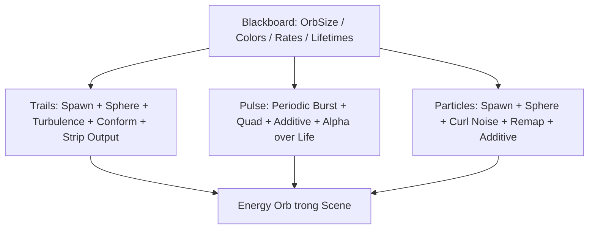

# Đồ án: Tự dựng một quả cầu năng lượng hoàn chỉnh

> **Loại:** Bài học lý thuyết kết hợp thực hành

## 1. Tóm tắt

Đồ án cuối khóa yêu cầu kết hợp ba hệ hạt thành một asset VFX Graph có thể đặt vào Scene, tùy chỉnh bằng Inspector và tạo ra hai biến thể màu. Đây là bài thực hành tổng hợp; không cung cấp sẵn toàn bộ graph để người học tự xây dựng và kiểm tra.

## 2. Mục tiêu học tập

- Hoàn thành được một asset VFX Graph có Trails, Pulse và Particles.
- Thiết lập các thuộc tính dùng lại và các nhóm node rõ ràng.
- Kiểm thử được hình dáng, vòng đời, chuyển động và mức tải khi thay đổi thông số.

## 3. Đầu bài và yêu cầu sản phẩm

Xây dựng hiệu ứng **Energy Orb** gồm ba lớp độc lập:

1. **Trails**: đường sáng mảnh chuyển động và bám gần một vùng cầu.
2. **Pulse**: quầng sáng cỡ lớn phát theo chu kỳ và mờ dần tự nhiên.
3. **Particles**: hạt nền nhỏ dày có Turbulence, Conform to Sphere và Curl Noise.

Mỗi lớp phải có lý do hình ảnh rõ ràng, tránh chồng ba hệ hạt có cùng vai trò. Asset cuối có thể đổi màu, kích thước và mật độ từ Inspector mà không bắt buộc mở graph.

## 4. Kiến trúc hiệu ứng cần xây dựng

Sơ đồ là bản đồ triển khai. Các output độc lập cùng đóng góp vào hình ảnh của một đối tượng hiệu ứng, còn Blackboard là nơi quản lý tham số tổng thể.

## 5. Các mốc triển khai

**Mốc 1 — Khung project:** Kiểm tra URP, VFX Graph, asset và đối tượng trong Scene.

**Mốc 2 — Trails:** Phát hạt trên Sphere, bổ sung Turbulence và Conform, cấu hình kích thước theo tuổi.

**Mốc 3 — Pulse:** Periodic Burst, quad lớn, Additive, alpha mờ–sáng–mờ.

**Mốc 4 — Particles:** Hạt nhỏ số lượng lớn vừa phải, chuyển động từ Turbulence/Conform và Curl Noise điều khiển qua Remap.

**Mốc 5 — Điều khiển và thẩm mỹ:** Expose `OrbSize`, màu và các Spawn Rate; thử hai phối màu khác nhau.

**Mốc 6 — Kiểm thử:** Quan sát khi thay kích thước, tuổi thọ, tốc độ phát, cường độ nhiễu và Camera.

## 6. Bộ thông số tham chiếu để bắt đầu

| Thành phần | Thông số khởi đầu trong bài thực hành |
| --- | --- |
| Trails | Capacity khoảng `1000`; Spawn Rate `30`; `OrbSize = 1` |
| Trails — bán kính | Initialize `1 × OrbSize`; Conform `1.5 × OrbSize` |
| Trails — lực | Attraction khoảng `10`; Stick Force khoảng `5` |
| Trails — bề dày | Ngẫu nhiên `0.01–0.02 × OrbSize` |
| Pulse | 1 hạt mỗi `1 giây`; Lifetime `2 giây`; kích thước `10 × OrbSize` |
| Pulse — alpha | Bắt đầu `0`, cao ở giữa, kết thúc `0` |
| Particles | Spawn Rate `5000`; vận tốc `[-0.5,0.5]` |
| Particles — vị trí | Sphere và Conform Radius `2 × OrbSize` |
| Particles — size | Ngẫu nhiên `0.01–0.02` |
| Curl Noise | Remap thử `[-3,3] → [-1,1]` rồi `[-6,6] → [-1,1]` |

Đây là các giá trị được dùng để **thử nghiệm hoặc minh họa**, không phải thông số được đo là tối ưu. Tốc độ `50000` hạt/giây từng được thử để tăng mật độ nhưng có thể gây quá tải GPU.

## 7. Tiêu chí chấm và Definition of Done

| Nhóm tiêu chí | Điều kiện hoàn thành |
| --- | --- |
| Cấu trúc | Có đủ ba hệ hạt và nhóm node rõ ràng |
| Chuyển động | Trails và hạt nền xoáy, vẫn giữ dáng cầu |
| Hiển thị | Xung có độ sáng thay đổi theo vòng đời, không bật/tắt đột ngột |
| Điều khiển | Có thể đổi kích thước, màu và mật độ chính trong Inspector |
| Tái sử dụng | Lưu asset và dùng được trong Scene kiểm tra |
| Hiệu năng | Có phương án giảm mật độ khi hệ hạt quá nặng |

**Sản phẩm nộp:** asset/đồ thị VFX trong project Unity, một Scene minh họa, ảnh chụp hai biến thể màu, và ghi chú một lỗi đã gặp cùng cách khắc phục. Không yêu cầu phải triển khai shader hoặc C# mới ngoài phạm vi bài thực hành.

## 8. Thực hành ngắn

**Bài thực hành chính:** Dựng lại hệ thống theo sáu mốc ở trên mà không sao chép nguyên vẹn hình đồ thị. Sau mỗi mốc, chụp ảnh trạng thái và lưu project. Kết thúc bằng việc kiểm tra `OrbSize`, đổi màu trail và giảm/tăng nhẹ ParticleSpawnRate để bảo đảm graph vẫn ổn định.

## 9. Lỗi thường gặp và cách xử lý

- **Quên một lớp:** đối chiếu sơ đồ và danh sách ba hệ hạt.
- **Tham số trong Inspector không có tác dụng:** kiểm tra Exposed và các connection.
- **Bị ngập sáng:** thử giảm alpha/intensity hoặc mật độ hạt trước khi thay vật liệu.
- **Hiệu năng thấp:** không dùng tốc độ phát hạt cực cao như thông số mặc định; điều chỉnh dần theo thiết bị thử nghiệm.

## 10. Câu hỏi ôn tập

### Câu 1
Đồ án yêu cầu mấy lớp hiệu ứng độc lập?

A. Một  
B. Hai  
C. Ba  
D. Bốn  

**Đáp án:** C
**Giải thích:** Có ba lớp Trails, Pulse và Particles.

### Câu 2
Đầu ra nào chứng tỏ có thể tái sử dụng hiệu ứng?

A. Một screenshot duy nhất  
B. Asset graph có thể đưa vào Scene và chỉnh bằng Inspector  
C. Chỉ file âm thanh  
D. Chỉ một biến số hard-code  

**Đáp án:** B
**Giải thích:** Asset có tính tái sử dụng khi đưa vào Scene và điều chỉnh qua property.

### Câu 3
Khi Pulse bật/tắt quá gắt nên kiểm tra gì?

A. Alpha over Life  
B. Tên folder Unity  
C. Ngôn ngữ lập trình  
D. Đường dẫn Git  

**Đáp án:** A
**Giải thích:** Đường cong alpha quyết định chuyển tiếp độ trong suốt.

### Câu 4
Nếu hiệu ứng tụt FPS sau khi tăng particle rate, xử lý nào đúng nhất?

A. Tăng lên cao hơn ngay  
B. Xóa mọi property  
C. Giảm rate và kiểm tra tải theo từng lớp  
D. Chỉ đổi màu nền  

**Đáp án:** C
**Giải thích:** Mật độ hạt cao là nguyên nhân cần kiểm tra sớm nhất.

## 11. Tổng kết

Đồ án hoàn chỉnh khi ba lớp đóng góp rõ vào cùng một quả cầu năng lượng, có điều khiển từ Inspector, có biến thể màu và đã được kiểm tra hiệu năng trong Scene.
