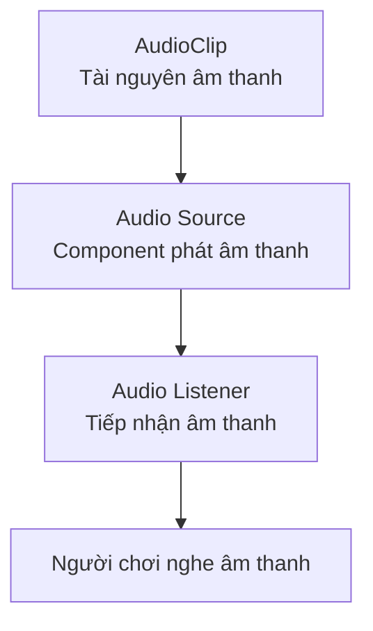
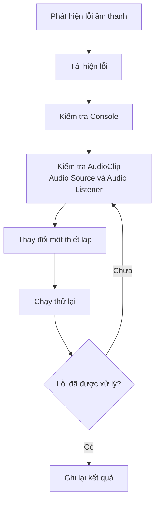

# Bài 01 — Giới thiệu Unit 3: Âm thanh và hiệu ứng (Sound and Effects)

> **Lộ trình:** Junior Programmer  
> **Học phần:** Unit 3 — Sound and Effects  
> **Bài học:** 01 — Unit 3: Introduction  
> **Loại bài:** Hướng dẫn (Tutorial)  
> **Phiên bản:** Unity 6.3  
> **Ngày đối chiếu:** 21/10/2026

**Nguồn tham khảo:** [Unity Learn — Sound and Effects](https://learn.unity.com/pathway/junior-programmer/unit/sound-and-effects?version=6.3)

**Lưu ý:** Đây là bài học tiếng Việt tự biên soạn dựa trên đề mục công khai của Unity Learn, không phải bản dịch chính thức hoặc bản ghi đầy đủ nội dung video. Các bước thực hành được xây dựng để người học tự luyện tập và kiểm chứng trong Unity Editor.

---

## 1. Tổng quan bài học

### 1.1. Giới thiệu

Âm thanh và hiệu ứng đóng vai trò quan trọng trong việc tạo ra trải nghiệm tương tác trong trò chơi.

Một trò chơi có thể hoạt động đúng về mặt lập trình nhưng vẫn thiếu cảm giác sống động nếu không có âm thanh và phản hồi phù hợp.

Ví dụ:

- **Khi nhân vật di chuyển:** Phát âm thanh bước chân.
- **Khi nhặt vật phẩm:** Phát âm thanh xác nhận.
- **Khi xảy ra va chạm:** Phát âm thanh tương ứng với sự kiện.
- **Khi hoàn thành nhiệm vụ:** Phát nhạc hoặc âm thanh thông báo.
- **Khi khám phá môi trường:** Phát âm thanh không gian như tiếng gió, tiếng mưa hoặc tiếng động từ các vật thể.

Trong Unit 3 — *Sound and Effects*, người học bắt đầu tìm hiểu cách tổ chức và kiểm tra những thành phần tạo nên phản hồi âm thanh trong Unity.

### 1.2. Vai trò của âm thanh

| Thành phần | Chức năng | Ví dụ |
|---|---|---|
| Background Music | Tạo bầu không khí xuyên suốt trò chơi | Nhạc nền màn chơi |
| Sound Effects (SFX) | Phản hồi khi một sự kiện xảy ra | Tiếng nhảy, va chạm |
| Ambient Sound | Mô phỏng âm thanh môi trường | Tiếng mưa, tiếng gió |
| Spatial Audio | Tạo cảm giác âm thanh phát ra từ một vị trí | Tiếng động phía xa |

**Kết quả mong đợi:** Người học hiểu được vì sao âm thanh cần thiết, nhận biết các Component cơ bản và có thể tự tạo một ví dụ âm thanh đơn giản trong Unity.

---

## 2. Mục tiêu học tập

Sau khi hoàn thành bài học, người học có thể:

1. **Hiểu kiến thức:** Trình bày được vai trò của âm thanh và phản hồi giác quan trong trò chơi.
2. **Nhận biết thành phần:** Phân biệt AudioClip, Audio Source và Audio Listener.
3. **Sử dụng Unity Editor:** Xác định các Component cần thiết để phát và tiếp nhận âm thanh.
4. **Thực hành:** Thiết lập một đối tượng phát âm thanh trong Scene.
5. **Kiểm chứng:** Quan sát sự thay đổi khi điều chỉnh thuộc tính âm thanh.
6. **Debug:** Phát hiện và xử lý ít nhất một lỗi âm thanh cơ bản.

---

## 3. Kiến thức trọng tâm

### 3.1. Các thành phần cơ bản trong hệ thống âm thanh

#### AudioClip

`AudioClip` là tài nguyên chứa dữ liệu âm thanh được sử dụng trong Unity.

Ví dụ:

- Nhạc nền.
- Âm thanh bước chân.
- Âm thanh va chạm.
- Âm thanh nhặt vật phẩm.

AudioClip thường được nhập vào dự án dưới dạng tệp âm thanh tương thích với Unity.

#### Audio Source

`Audio Source` là Component chịu trách nhiệm phát âm thanh.

Một Audio Source có thể được gắn vào GameObject và sử dụng AudioClip để phát âm thanh trong trò chơi.

Các thuộc tính cần biết:

| Thuộc tính | Chức năng |
|---|---|
| AudioClip | Âm thanh sẽ được phát |
| Play On Awake | Tự động phát khi đối tượng được kích hoạt và bắt đầu hoạt động |
| Loop | Phát lặp lại âm thanh |
| Volume | Điều chỉnh âm lượng |
| Spatial Blend | Điều chỉnh mức độ âm thanh 2D hoặc 3D |
| Min Distance | Khoảng cách tối thiểu dùng trong mô hình suy giảm âm thanh 3D |
| Max Distance | Khoảng cách tối đa dùng trong mô hình suy giảm âm thanh 3D |

#### Audio Listener

`Audio Listener` đại diện cho vị trí tiếp nhận âm thanh trong Scene.

Trong nhiều dự án Unity, Component này được gắn vào **Main Camera**.

Unity sử dụng vị trí và hướng của Audio Listener để tính toán cách người chơi nghe âm thanh không gian.

**Lưu ý:** Thông thường, Scene chỉ nên có một Audio Listener đang hoạt động.

### 3.2. Phân biệt âm thanh 2D và 3D

| Đặc điểm | Âm thanh 2D | Âm thanh 3D |
|---|---|---|
| Phụ thuộc vị trí | Không theo khoảng cách trong Scene | Có |
| Spatial Blend | 0 | 1 |
| Ứng dụng | Nhạc nền, âm thanh giao diện | Âm thanh môi trường, vật thể |
| Suy giảm theo khoảng cách | Không theo mô hình âm thanh 3D | Phụ thuộc thiết lập suy giảm |
| Ví dụ | Nhạc nền menu | Tiếng động cơ ở xa |

**Ví dụ minh họa:**

Một chiếc xe đang chạy trong Scene:

- Khi Audio Source được thiết lập là **2D**, âm thanh không tự thay đổi theo khoảng cách giữa xe và Camera.
- Khi Audio Source được thiết lập là **3D**, âm thanh có thể thay đổi khi khoảng cách giữa xe và Audio Listener thay đổi.

Kết quả cụ thể phụ thuộc vào thiết lập Audio Source, đặc biệt là mô hình suy giảm âm thanh.

### 3.3. Những thuật ngữ Unity cần nhớ

| Khái niệm | Giải thích |
|---|---|
| Scene | Không gian chứa các đối tượng trong trò chơi |
| GameObject | Đối tượng cơ bản trong Unity |
| Component | Thành phần bổ sung dữ liệu hoặc hành vi cho GameObject |
| Inspector | Cửa sổ hiển thị và chỉnh sửa thuộc tính |
| Hierarchy | Danh sách các GameObject trong Scene |
| Project | Cửa sổ quản lý tài nguyên dự án |
| Play Mode | Chế độ chạy thử trò chơi |
| Console | Cửa sổ hiển thị thông báo, cảnh báo và lỗi |

---

## 4. Sơ đồ nguyên lý âm thanh trong Unity

Sơ đồ sau mô tả mối quan hệ cơ bản giữa tài nguyên âm thanh, đối tượng phát âm và đối tượng tiếp nhận âm thanh.

**Diễn giải:**

1. AudioClip chứa dữ liệu âm thanh.
2. Audio Source sử dụng AudioClip để phát âm thanh.
3. Audio Listener tiếp nhận âm thanh trong Scene.
4. Hệ thống âm thanh của Unity xử lý kết quả để phát tới thiết bị đầu ra.

Với âm thanh 3D, vị trí tương đối giữa Audio Source và Audio Listener ảnh hưởng đến cách âm thanh được nghe.

---

## 5. Thực hành từng bước

### Bài thực hành: Tạo hệ thống âm thanh đơn giản

**Mục tiêu:** Tạo một Scene có âm thanh nền và một đối tượng phát âm thanh 3D để kiểm tra tác động của khoảng cách.

### Bước 1 — Chuẩn bị Scene

1. Mở Unity Editor.
2. Tạo một Scene mới hoặc sử dụng Scene hiện có.
3. Kiểm tra GameObject `Main Camera`.
4. Xác nhận Camera có Component `Audio Listener`.
5. Chuẩn bị một AudioClip được phép sử dụng.

**Kết quả:** Scene đã có vị trí tiếp nhận âm thanh và tài nguyên âm thanh để thử nghiệm.

### Bước 2 — Tạo đối tượng phát âm thanh

1. Trong Hierarchy, tạo một GameObject rỗng bằng **GameObject → Create Empty**.
2. Đổi tên GameObject thành `BackgroundAudio`.
3. Chọn GameObject vừa tạo.
4. Trong Inspector, nhấn **Add Component**.
5. Tìm và thêm `Audio Source`.
6. Kéo AudioClip vào trường `Audio Resource` hoặc trường tương ứng trong phiên bản Unity đang sử dụng.

Thiết lập thử nghiệm:

| Thuộc tính | Giá trị gợi ý |
|---|---|
| Play On Awake | Bật |
| Loop | Bật |
| Volume | 0.5 |
| Spatial Blend | 0 (2D) |

Nhấn **Play** để chạy thử.

**Kết quả mong đợi:** Âm thanh nền phát khi Scene bắt đầu và lặp lại liên tục.

### Bước 3 — Thử nghiệm các thuộc tính

Lần lượt thay đổi:

- **Play On Awake:** Kiểm tra sự khác biệt khi bật và tắt.
- **Loop:** Quan sát âm thanh có lặp lại hay không.
- **Volume:** Thay đổi âm lượng từ thấp đến cao.
- **Spatial Blend:** Chuyển từ 2D sang 3D để quan sát sự khác biệt.

Chỉ thay đổi một thuộc tính tại một thời điểm để dễ so sánh.

### Bước 4 — Thử nghiệm âm thanh 3D

1. Tạo GameObject mới và đặt tên `SoundEmitter`.
2. Thêm Component `Audio Source`.
3. Gán một AudioClip phù hợp.
4. Thiết lập `Spatial Blend = 1`.
5. Đặt SoundEmitter cách Main Camera một khoảng nhất định.
6. Kiểm tra các thuộc tính suy giảm âm thanh, bao gồm Min Distance, Max Distance và Rolloff.
7. Chạy Scene.
8. Thay đổi khoảng cách giữa SoundEmitter và Main Camera rồi quan sát âm lượng.

**Kết quả mong đợi:** Khi sử dụng mô hình suy giảm phù hợp, âm thanh thay đổi theo khoảng cách.

### Bước 5 — Phát âm thanh theo sự kiện

Tạo một sự kiện gameplay đơn giản hoặc sử dụng nút bấm để phát âm thanh.

Ví dụ:

- Người chơi nhấn nút tương tác.
- GameObject phát âm thanh xác nhận.
- Âm thanh dừng sau khi phát xong.

Kiểm tra trường hợp người chơi kích hoạt nhiều lần liên tiếp để tránh âm thanh chồng lặp ngoài ý muốn.

### Bước 6 — Ghi lại kết quả

Sau khi hoàn thành, ghi lại thông tin:

| Nội dung | Ghi chép |
|---|---|
| Kết quả mong đợi | Âm thanh phát đúng thời điểm |
| Kết quả thực tế | Ghi nhận kết quả đã quan sát |
| Tham số thay đổi | Volume, Loop, Spatial Blend... |
| Lỗi phát hiện | Nếu có |
| Cách xử lý | Giải thích bước sửa lỗi |
| Minh chứng | Ảnh Inspector, Console hoặc video |

---

## 6. Bài tập củng cố

### Bài tập A — Cơ bản

Tạo một GameObject phát nhạc nền.

Yêu cầu:

- Có Audio Source.
- AudioClip được gán chính xác.
- Âm thanh tự động phát khi chạy Scene.
- Âm thanh có thể lặp lại.
- Điều chỉnh được Volume.

**Câu hỏi:** Nếu tắt Play On Awake, điều gì xảy ra khi nhấn Play?

### Bài tập B — Vận dụng

Tạo hai GameObject:

- `Audio2D`: Phát âm thanh 2D.
- `Audio3D`: Phát âm thanh 3D.

Thay đổi vị trí của các GameObject so với Audio Listener.

Trước khi chạy, dự đoán kết quả.

Sau khi chạy, so sánh kết quả thực tế với dự đoán.

**Câu hỏi:** Vì sao âm thanh 2D và 3D có thể cho trải nghiệm khác nhau?

### Bài tập C — Mở rộng

Tạo một tương tác nhỏ:

- Người chơi điều khiển nhân vật.
- Khi nhân vật tiếp xúc với vật phẩm, âm thanh được phát.
- Âm thanh xác nhận việc thu thập vật phẩm.

Bài tập này kết hợp kiến thức về GameObject, Component, sự kiện gameplay và Audio Source.

---

## 7. Lỗi thường gặp và cách khắc phục

| Hiện tượng | Nguyên nhân có thể | Cách kiểm tra |
|---|---|---|
| Không nghe thấy âm thanh | AudioClip chưa được gán | Kiểm tra Audio Source |
| Không nghe thấy âm thanh | Không có Audio Listener hoạt động | Kiểm tra Main Camera |
| Âm thanh quá nhỏ | Volume thấp hoặc bị suy giảm | Kiểm tra Volume và khoảng cách |
| Âm thanh không phát tự động | Play On Awake đã tắt | Kiểm tra Inspector |
| Âm thanh không lặp | Loop chưa được bật | Kiểm tra thuộc tính Loop |
| Âm thanh 3D khó nghe | Khoảng cách hoặc Rolloff chưa phù hợp | Kiểm tra Spatial Blend, Min/Max Distance |
| Âm thanh chồng lặp | Sự kiện phát được kích hoạt nhiều lần | Kiểm tra logic gameplay |

### Quy trình Debug nhanh

**Nguyên tắc:** Mỗi lần chỉ thay đổi một nguyên nhân giả định, sau đó chạy thử để đánh giá kết quả.

---

## 8. Câu hỏi tự kiểm tra

**Câu 1.** Audio Source có chức năng gì trong Unity?

**Câu 2.** AudioClip và Audio Source khác nhau như thế nào?

**Câu 3.** Audio Listener thường được đặt ở đâu?

**Câu 4.** Spatial Blend có tác dụng gì?

**Câu 5.** Vì sao âm thanh 3D có thể nhỏ dần khi Camera di chuyển ra xa đối tượng?

**Câu 6.** Khi thay đổi một thuộc tính trong Inspector nhưng kết quả Game view khác dự đoán, cần kiểm tra những yếu tố nào?

### Gợi ý trả lời

1. Audio Source là Component dùng để phát âm thanh.
2. AudioClip chứa dữ liệu âm thanh, còn Audio Source sử dụng dữ liệu đó để phát.
3. Audio Listener thường được gắn trên Main Camera.
4. Spatial Blend điều chỉnh mức độ âm thanh 2D và 3D.
5. Vì âm thanh 3D có thể được xử lý suy giảm theo khoảng cách.
6. Kiểm tra GameObject, Component, AudioClip, trạng thái kích hoạt, thiết lập âm thanh, Console và logic gameplay.

---

## 9. Checklist hoàn thành

- [ ] Hiểu vai trò của âm thanh trong trò chơi.
- [ ] Phân biệt được AudioClip, Audio Source và Audio Listener.
- [ ] Tạo được GameObject phát âm thanh.
- [ ] Thiết lập được Play On Awake, Loop và Volume.
- [ ] Hiểu sự khác biệt giữa âm thanh 2D và 3D.
- [ ] Thực hiện được thử nghiệm âm thanh theo khoảng cách.
- [ ] Phát được âm thanh thông qua một sự kiện.
- [ ] Phát hiện và giải thích được ít nhất một lỗi.
- [ ] Lưu ảnh chụp hoặc video minh chứng.
- [ ] Đọc bài học gốc trên Unity Learn để đối chiếu.

---

## 10. Tổng kết bài học

Qua bài học mở đầu Unit 3, người học đã làm quen với những thành phần cơ bản của hệ thống âm thanh trong Unity.

Ba thành phần cần ghi nhớ:

- **AudioClip:** Chứa dữ liệu âm thanh.
- **Audio Source:** Phát âm thanh.
- **Audio Listener:** Tiếp nhận âm thanh trong Scene.

Khi phát triển trò chơi, cần lựa chọn cách phát âm thanh phù hợp với từng tình huống, kiểm tra kết quả trong Play Mode và xử lý các lỗi phát sinh.

**Kiến thức quan trọng nhất:** Để xây dựng phản hồi âm thanh hiệu quả, cần hiểu mối quan hệ giữa tài nguyên âm thanh, đối tượng phát âm thanh, vị trí tiếp nhận và sự kiện gameplay.

### Tài liệu tham khảo

[Unity Learn — Junior Programmer: Sound and Effects](https://learn.unity.com/pathway/junior-programmer/unit/sound-and-effects?version=6.3)

*Ghi chú phiên bản:* Unity có thể thay đổi giao diện, tên trường, menu và package giữa các phiên bản. Những bước thực hành trên là hướng dẫn học tập độc lập; cần đối chiếu với Unity 6.3 và tài liệu chính thức khi áp dụng.