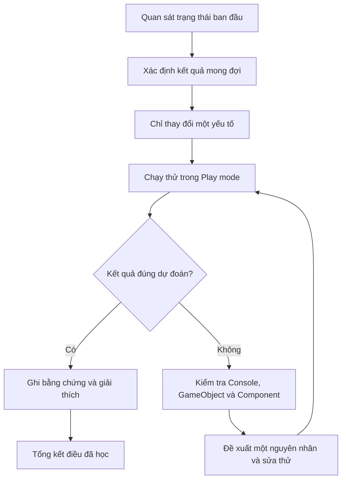

# Bài 01 — Giới thiệu Unit 4: Gameplay Mechanics

> **Lộ trình:** Junior Programmer  
> **Học phần:** Gameplay Mechanics  
> **Môi trường thực hành:** Unity 6.3  
> **Hình thức:** Học kiến thức kết hợp thực hành và kiểm chứng trực tiếp trong Unity Editor

## 1. Tổng quan bài học

Một trò chơi không chỉ gồm các mô hình, hình ảnh hay âm thanh. Người chơi cần có khả năng thực hiện hành động và nhận được phản hồi từ hệ thống. Đó là lý do **gameplay mechanics** (cơ chế chơi) trở thành một phần quan trọng trong quá trình phát triển trò chơi.

Ở bài giới thiệu này, mục tiêu chưa phải xây dựng một cơ chế phức tạp. Người học sẽ hình thành **phương pháp thực hành có kiểm chứng**: quan sát trạng thái ban đầu của dự án, xác định điều muốn đạt được, thay đổi từng yếu tố, chạy thử và giải thích kết quả.

Điểm cốt lõi là chuyển từ cách học *làm theo từng cú nhấp chuột* sang cách học *hiểu mục đích của thao tác và biết cách xác minh nó hoạt động*.

**Sau khi hoàn thành, người học cần có một ví dụ nhỏ chạy được trong Unity và một bản ghi chú cho thấy mình đã quan sát, thử nghiệm và kiểm tra kết quả như thế nào.**

## 2. Mục tiêu học tập

Sau bài học, người học có thể:

1. **Giải thích** vai trò của việc đặt mục tiêu kiểm chứng được khi học một kỹ thuật Unity.
2. **Nhận diện** các thành phần cơ bản của Unity Editor cần quan sát trước khi thực hành.
3. **Thiết lập và chạy thử** một thay đổi nhỏ trên GameObject trong Scene.
4. **So sánh** kết quả mong đợi với kết quả quan sát trong Game view và Console.
5. **Áp dụng** quy trình debug từng bước khi thay đổi không tạo ra kết quả đúng như dự đoán.

## 3. Bối cảnh: Học cơ chế chơi bằng thử nghiệm

Giả sử cần làm cho một đối tượng xuất hiện tại vị trí mong muốn. Có thể thay đổi các giá trị trong Inspector ngay lập tức, nhưng việc nhập số mà không quan sát kết quả chưa đủ để xác nhận thao tác đúng.

Trước khi chỉnh sửa, hãy trả lời ba câu hỏi:

- **Trạng thái ban đầu là gì?** Đối tượng đang nằm ở đâu, có được kích hoạt không và những Component nào đang gắn trên nó?
- **Kết quả mong đợi là gì?** Ví dụ: đối tượng xuất hiện lệch sang bên phải so với vị trí ban đầu và vẫn nhìn thấy trong Game view.
- **Làm thế nào để xác nhận?** So sánh giá trị `Transform`, quan sát bằng camera khi chạy thử và kiểm tra Console nếu có dấu hiệu lỗi.

Cách làm này giúp nhận biết sự khác biệt giữa **đã thao tác** và **đã tạo ra kết quả đúng**.

## 4. Các khái niệm cốt lõi

| Thuật ngữ | Vai trò | Điều cần quan sát |
| --- | --- | --- |
| `Scene` | Không gian tổ chức các đối tượng và môi trường của trò chơi. | Những đối tượng hiện diện và cách chúng được bố trí. |
| `GameObject` | Đối tượng trong Scene; có thể chứa nhiều Component. | Tên, trạng thái kích hoạt và vị trí trong Hierarchy. |
| `Component` | Thành phần cung cấp dữ liệu hoặc hành vi cho GameObject. | Các trường thiết lập tương ứng trong Inspector. |
| `Transform` | Component xác định vị trí, góc xoay và tỉ lệ của đối tượng. | `Position`, `Rotation`, `Scale`. |
| `Hierarchy` | Bảng thể hiện những GameObject trong Scene theo cấu trúc phân cấp. | Đã chọn đúng đối tượng hay chưa. |
| `Inspector` | Bảng xem và chỉnh sửa thuộc tính của đối tượng đang chọn. | Giá trị trước và sau khi thay đổi. |
| `Scene view` | Khung nhìn dùng để bố trí và quan sát Scene khi chỉnh sửa. | Vị trí tương quan giữa các đối tượng. |
| `Game view` | Khung nhìn mô phỏng hình ảnh trò chơi qua camera khi chạy hoặc xem trước. | Điều người chơi có thể nhìn thấy. |
| `Play mode` | Chế độ chạy thử Scene. | Hành vi và kết quả lúc chạy. |
| `Console` | Bảng hiển thị thông báo, cảnh báo và lỗi từ Unity. | Thông tin hữu ích khi tìm nguyên nhân sự cố. |

### 4.1. Mối quan hệ giữa Scene, GameObject và Component

Một Scene chứa các GameObject. Mỗi GameObject có `Transform` và có thể được bổ sung những Component phù hợp với chức năng mong muốn. Khi chọn GameObject trong Hierarchy, Inspector hiển thị các Component và thuộc tính có thể chỉnh sửa.

Ví dụ, cùng một GameObject có thể có `Transform` để xác định vị trí và một `Mesh Renderer` để hiển thị hình dạng của nó. Vì vậy, nếu đối tượng không xuất hiện như dự đoán, cần xem xét cả **vị trí**, **khả năng hiển thị** và **góc nhìn của camera**, thay vì chỉ thay đổi một giá trị ngẫu nhiên.

### 4.2. Phân biệt kết quả trong Scene view và Game view

`Scene view` phục vụ việc biên tập, nên người học có thể quan sát đối tượng từ nhiều góc độ. `Game view` phụ thuộc vào camera đang được dùng để hiển thị trò chơi. Do đó, một GameObject có thể nhìn thấy trong Scene view nhưng nằm ngoài khung hình của Game view.

**Lưu ý:** Thay đổi một giá trị trong Inspector không mặc nhiên tạo ra chuyển động hay tương tác. Muốn quan sát một hành vi theo thời gian, dự án phải có logic hoặc thành phần thực sự gây ra hành vi đó.

## 5. Quy trình thực hành có kiểm chứng

Mỗi lần thực hành nên đi theo cùng một chu trình:



Sơ đồ trên thể hiện một nguyên tắc quan trọng: **mỗi lần thử phải mang lại thông tin**. Nếu kết quả đúng, cần biết vì sao đúng. Nếu kết quả sai, cần kiểm tra từng giả thuyết trước khi tiếp tục chỉnh sửa.

Một bản ghi chép ngắn nên gồm bốn trường:

| Nội dung | Ví dụ |
| --- | --- |
| Kết quả mong đợi | Cube di chuyển sang phải trên Scene và vẫn nằm trong khung hình camera. |
| Kết quả thực tế | Cube đã đổi vị trí nhưng không xuất hiện trong Game view. |
| Bằng chứng | Ảnh Inspector và Game view; thông báo Console nếu có. |
| Nhận xét / giả thuyết | Cube có thể nằm ngoài phạm vi quan sát của camera; cần kiểm tra góc nhìn. |

## 6. Thực hành: Quan sát tác động của Transform

Bài thực hành này dùng một Scene nhỏ để luyện kỹ năng **thay đổi — dự đoán — kiểm chứng**, không yêu cầu viết script.

### 6.1. Chuẩn bị

- Mở một dự án Unity có thể chỉnh sửa.
- Mở một Scene để thực hành; nếu cần, tạo Scene trống riêng nhằm tránh ảnh hưởng tới phần đang làm.
- Bảo đảm Scene có một camera đang hoạt động.
- Mở các bảng `Hierarchy`, `Inspector`, `Game` và `Console` để thuận tiện quan sát.

### 6.2. Bước 1 — Tạo đối tượng thử nghiệm

1. Trong `Hierarchy`, tạo một **3D Object → Cube** bằng menu tạo đối tượng của Unity.
2. Đổi tên Cube thành `PracticeCube` để dễ nhận biết.
3. Chọn đối tượng và xác định Component `Transform` trong Inspector.
4. Ghi lại giá trị `Position`, `Rotation` và `Scale` hiện tại.
5. Quan sát đối tượng trong Scene view; kiểm tra xem camera có hướng về khu vực chứa Cube không.

**Checkpoint 1:** Có thể tìm thấy `PracticeCube` trong Hierarchy và đọc được các giá trị Transform của nó.

### 6.3. Bước 2 — Dự đoán và thay đổi

1. Chọn trường `Position X` trong `Transform` của `PracticeCube`.
2. Tăng giá trị X thêm một lượng nhỏ, chẳng hạn **2 đơn vị** so với giá trị ban đầu.
3. Trước khi chạy thử, dự đoán vị trí mới của Cube trong Scene view và khả năng nó còn nằm trong Game view hay không.
4. Chỉ chỉnh sửa `Position X`; giữ nguyên các trường khác để dễ xác định nguyên nhân nếu kết quả không như dự kiến.

**Checkpoint 2:** Giá trị `Position X` đã thay đổi; các giá trị còn lại chưa bị chỉnh sửa ngoài ý muốn.

### 6.4. Bước 3 — Chạy và quan sát

1. Nhấn **Play** để vào Play mode.
2. Quan sát vị trí Cube trong Game view.
3. So sánh kết quả với dự đoán; nếu Cube không xuất hiện, kiểm tra xem nó có nằm ngoài khung hình camera không.
4. Mở Console để xem có thông báo cần xử lý không. Không có lỗi Console **không đồng nghĩa** với việc kết quả hình ảnh chắc chắn đúng.
5. Chụp ảnh hoặc ghi lại giá trị Transform và trạng thái Game view làm bằng chứng.
6. Thoát Play mode và lưu Scene khi đã hoàn tất các thay đổi cần giữ lại.

> **Quan trọng:** Các thay đổi thực hiện *trong* Play mode thường được hoàn nguyên khi thoát chế độ này. Vì vậy, nên chỉnh sửa Scene ở chế độ biên tập và dùng Play mode để kiểm tra, trừ khi đang cố ý thử nghiệm giá trị lúc chạy.

**Checkpoint 3:** Có thể giải thích sự thay đổi vị trí của Cube và chỉ ra kết quả kiểm tra thực tế.

### 6.5. Bước 4 — Viết nhật ký thực hành

Sử dụng mẫu sau và điền bằng kết quả thực tế:

```text
Đối tượng: PracticeCube
Trạng thái ban đầu: ...
Thay đổi duy nhất: Position X từ ... thành ...
Dự đoán trước khi thử: ...
Kết quả trong Scene view: ...
Kết quả trong Game view: ...
Thông báo Console (nếu có): ...
Nguyên nhân / giải thích: ...
Điều sẽ kiểm tra ở lần thử tiếp theo: ...
```

**Sản phẩm hoàn thành:** Scene thực hành chạy được, ít nhất một ảnh chụp minh chứng và bản ghi chép có dự đoán, kết quả, giải thích.

## 7. Xử lý lỗi và các tình huống thường gặp

| Hiện tượng | Nguyên nhân có thể xảy ra | Cách kiểm tra |
| --- | --- | --- |
| Cube có trong Scene view nhưng không có trong Game view. | Cube ở ngoài khung hình camera hoặc camera không hướng tới nó. | Chọn Cube, kiểm tra Transform của Cube và camera; quan sát vùng nhìn của camera. |
| Thay đổi Inspector nhưng không thấy tác động lên đối tượng mong muốn. | Đã chọn nhầm GameObject hoặc chỉnh nhầm Component. | Đối chiếu tên trong Hierarchy với Inspector. |
| Vào Play mode thấy một kết quả, thoát Play mode lại trở về giá trị cũ. | Đã thay đổi thuộc tính khi đang chạy thử. | Lặp lại thay đổi ở Edit mode, lưu Scene rồi kiểm tra lần nữa. |
| GameObject không hiển thị. | Đối tượng bị tắt kích hoạt hoặc Component hiển thị không hoạt động. | Kiểm tra trạng thái Active của GameObject và Component liên quan. |
| Không xác định được nguyên nhân lỗi. | Đã thay đổi nhiều giá trị liên tiếp nên khó truy vết. | Quay về trạng thái đã biết là đúng, sau đó thử từng thay đổi riêng lẻ. |

### Quy tắc debug năm bước

1. **Tái hiện lỗi:** Xác định thao tác tối thiểu để lỗi xuất hiện lại.
2. **Thu thập bằng chứng:** Quan sát Game view, Scene view, Inspector và Console.
3. **Lập giả thuyết:** Nêu một nguyên nhân cụ thể có thể kiểm tra được.
4. **Thử một thay đổi:** Chỉnh đúng thành phần liên quan, không sửa nhiều nơi cùng lúc.
5. **Kiểm chứng và ghi lại:** Chạy lại, so sánh với kết quả mong đợi, lưu kết luận.

Đừng chỉ ghi “đã sửa được”. Hãy ghi **đã sửa thành phần nào, kiểm tra bằng cách nào và dấu hiệu nào chứng minh lỗi không còn xuất hiện**.

## 8. Bài tập củng cố

**Bài 1 — Cơ bản:** Tạo một GameObject khác và thay đổi duy nhất `Rotation Y`. Dự đoán hướng xoay trước khi thao tác, sau đó quan sát trong Scene view. Giải thích kết quả bằng ngôn ngữ của mình.

**Bài 2 — Vận dụng:** Thay đổi lần lượt `Position X` và `Scale X` trong **hai lượt thử độc lập**. Với mỗi lượt, ghi lại dự đoán và kết quả, sau đó so sánh sự khác nhau giữa *dịch chuyển* và *thay đổi kích thước*.

**Bài 3 — Mở rộng:** Trong một Scene thực hành riêng, tạo một tình huống Cube nhìn thấy trong Scene view nhưng không nhìn thấy trong Game view. Tìm nguyên nhân và đưa Cube trở lại khung hình. Ghi lại tối thiểu một ảnh trước/sau và giải thích bước kiểm tra đã dẫn đến cách sửa.

**Câu hỏi suy ngẫm:** Khi thay đổi một giá trị trong Inspector mà Game view không giống dự đoán, nên kiểm tra đối tượng nào và Component nào trước? Vì sao không nên điều chỉnh nhiều giá trị cùng lúc?

## 9. Câu hỏi ôn tập trắc nghiệm

### Câu 1

Vì sao nên xác định kết quả mong đợi trước khi chỉnh sửa một GameObject?

A. Để bỏ qua bước chạy thử.  
B. Để mọi Scene có cùng cách bố trí.  
C. Để có tiêu chí so sánh giữa dự đoán và kết quả thực tế.  
D. Để Unity tự động sửa tất cả lỗi.

**Đáp án: C.** Có dự đoán cụ thể mới biết thay đổi đã đạt mục tiêu hay chưa và dễ chỉ ra điểm khác biệt.

### Câu 2

Một Cube xuất hiện trong Scene view nhưng không có trong Game view. Bước kiểm tra nào hợp lý nhất?

A. Kiểm tra vị trí Cube và góc nhìn camera.  
B. Xóa toàn bộ GameObject trong Hierarchy.  
C. Cài lại Unity ngay lập tức.  
D. Chỉnh ngẫu nhiên tất cả giá trị Transform.

**Đáp án: A.** Scene view và Game view không dùng cùng một góc nhìn; Cube có thể nằm ngoài phạm vi camera.

### Câu 3

Khi muốn tìm nguyên nhân một kết quả không đúng dự đoán, cách thử nghiệm nào giúp cô lập lỗi tốt nhất?

A. Thay đổi nhiều Component một lúc.  
B. Chỉ kiểm tra tên GameObject.  
C. Bỏ qua kết quả thực tế.  
D. Thay đổi một yếu tố, chạy thử rồi ghi kết quả.

**Đáp án: D.** Chỉ thay đổi một yếu tố mỗi lần giúp xác định quan hệ giữa thao tác và kết quả quan sát.

### Câu 4

Một người chỉnh vị trí GameObject khi đang ở Play mode và thấy giá trị trở lại như cũ sau khi thoát. Giải thích phù hợp nhất là gì?

A. Transform không thể chỉnh sửa trong Unity.  
B. Thay đổi trong Play mode thường không được giữ lại khi kết thúc chạy thử.  
C. Game view không hỗ trợ GameObject 3D.  
D. Inspector luôn hiển thị sai vị trí.

**Đáp án: B.** Play mode phục vụ chạy thử; các thay đổi phát sinh lúc chạy thường được hoàn nguyên khi thoát.

### Câu 5

Bản ghi chép thực hành nào có giá trị nhất cho việc học và debug?

A. “Đã hoàn thành” mà không có mô tả nào khác.  
B. Danh sách các nút đã nhấn nhưng không có kết quả.  
C. Dự đoán, thay đổi đã thực hiện, kết quả thực tế, bằng chứng và giải thích.  
D. Chỉ một ảnh chụp Scene mà không có thông tin bổ sung.

**Đáp án: C.** Các thông tin này giúp kiểm chứng kết quả, tái hiện lỗi và rút ra nguyên tắc áp dụng cho lần thực hành tiếp theo.

## 10. Tổng kết và checklist

Điều quan trọng nhất của bài mở đầu là **hình thành thói quen làm việc dựa trên quan sát và kiểm chứng**. Với mỗi thao tác trong Unity, hãy xác định trạng thái ban đầu, dự đoán điều sẽ xảy ra, thay đổi có kiểm soát, chạy thử và ghi lại kết quả. Quy trình này áp dụng được khi tiếp cận nhiều cơ chế gameplay khác nhau.

**Checklist hoàn thành**

- [ ] Giải thích được mục đích của phương pháp học thông qua thử nghiệm.
- [ ] Phân biệt được Scene, GameObject, Component, Inspector và Play mode.
- [ ] Chạy được một ví dụ nhỏ trong Unity Editor.
- [ ] Ghi lại ít nhất một ảnh chụp hoặc video minh chứng.
- [ ] So sánh được kết quả mong đợi với kết quả thực tế.
- [ ] Trình bày được một tình huống lỗi và cách kiểm tra nguyên nhân.
- [ ] Trả lời được năm câu hỏi ôn tập.
- [ ] Đối chiếu bài học trong [Unity Learn — Gameplay Mechanics](https://learn.unity.com/pathway/junior-programmer/unit/gameplay-mechanics?version=6.3) nếu đang học theo lộ trình chính thức.

---

*Ghi chú:* Đây là bài học tiếng Việt **tự biên soạn** phục vụ luyện kỹ năng nền tảng, không phải bản dịch toàn văn hay transcript chính thức của Unity Learn. Tên menu, cách bố trí giao diện và một số tính năng có thể khác nhau theo phiên bản Unity và cấu hình dự án.
