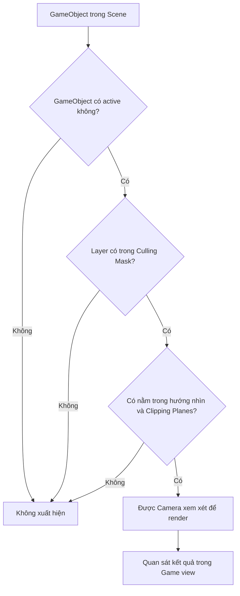

# Bài 02 — Lesson 4.1: Watch Where You're Going

**Chủ đề:** Camera và bố cục hình ảnh trong Unity  
**Lộ trình:** Junior Programmer · **Mission:** Gameplay Mechanics · **Phiên bản tham chiếu:** Unity 6.3

> **Mục tiêu của bài:** Tạo một góc nhìn giúp người chơi quan sát đúng những gì đang diễn ra, điều chỉnh vùng hiển thị bằng Camera và kiểm tra chất lượng chuyển động khi Camera bám theo nhân vật.
>
> **Phạm vi:** Đây là bài thực hành tự biên soạn, không phải bản dịch hoặc transcript chính thức. Có thể đối chiếu bài gốc và tài nguyên đính kèm tại [Unity Learn — Gameplay Mechanics](https://learn.unity.com/pathway/junior-programmer/unit/gameplay-mechanics?version=6.3).

## 1. Tổng quan bài học

Trong game 3D, việc đặt nhân vật, môi trường và chướng ngại vật vào **Scene** chưa đủ để tạo ra trải nghiệm tốt. Người chơi chỉ nhìn thấy phần thế giới được **Camera** hiển thị trong **Game view**. Nếu góc nhìn quá hẹp, người chơi khó phát hiện vật cản; nếu quá rộng, chủ thể có thể trở nên nhỏ và khó nhận biết.

Vì vậy, thiết lập Camera không chỉ là chỉnh vị trí. Người phát triển cần lựa chọn **kiểu phép chiếu**, xác định **vùng nhìn**, kiểm soát **đối tượng được render**, sắp xếp **bố cục hình ảnh** và, khi cần, tổ chức Camera theo dõi nhân vật một cách mượt mà.

Kết thúc bài học, bạn sẽ tự tạo một Scene thử nghiệm, thay đổi từng tham số Camera, quan sát kết quả và giải thích được nguyên nhân của những hiện tượng thường gặp.

## 2. Mục tiêu học tập

Sau khi hoàn thành, bạn có thể:

1. **Giải thích** vai trò của Camera, Scene view và Game view.
2. **Phân biệt** phép chiếu `Perspective` và `Orthographic` qua kết quả quan sát.
3. **Cấu hình** `Field of View`, `Clipping Planes` và `Culling Mask` để kiểm soát vùng hiển thị.
4. **Thiết kế** các bố cục toàn cảnh, trung cảnh và cận cảnh cho cùng một chủ thể.
5. **Kiểm thử** Camera bám theo đối tượng, nhận diện hiện tượng rung và đề xuất cách khắc phục.
6. **Ghi lại** giả thuyết, kết quả thực tế và bằng chứng khi thay đổi tham số trong Inspector.

## 3. Kiến thức cốt lõi về Camera

### 3.1. Scene, GameObject, Component và Game view

Một **Scene** là không gian chứa những đối tượng cần thiết cho một màn chơi, chẳng hạn nhân vật, vật thể, nguồn sáng và Camera. Mỗi đối tượng thường là một **GameObject** có các **Component** xác định dữ liệu hoặc hành vi.

Camera là một GameObject có `Camera` Component. `Transform` quyết định vị trí và hướng nhìn của nó; `Camera` Component quyết định cách khung cảnh được hiển thị.

| Thành phần | Vai trò | Điều cần quan sát |
| --- | --- | --- |
| `Scene view` | Không gian biên tập để sắp xếp đối tượng | Có thể nhìn thấy những vị trí mà Camera game chưa ghi hình |
| `Game view` | Hình ảnh game từ Camera đang render | Đây là kết quả cần đánh giá khi thử Camera |
| `GameObject` | Đối tượng trong Scene | Có đang active và ở đúng vị trí không? |
| `Transform` | Lưu vị trí, góc xoay và tỉ lệ | Camera có hướng về phía chủ thể không? |
| `Camera` Component | Điều khiển phép chiếu và vùng render | Các tham số có phù hợp với mục tiêu không? |
| `Inspector` | Nơi kiểm tra, thay đổi Component | Có đang chỉnh đúng đối tượng không? |
| `Play mode` | Chạy thử hành vi trong game | Camera có hoạt động đúng khi đối tượng chuyển động không? |

**Điểm quan trọng:** Một đối tượng xuất hiện trong `Scene view` không có nghĩa là người chơi sẽ thấy nó trong `Game view`.

### 3.2. Perspective và Orthographic

**Perspective (phối cảnh)** mô phỏng cảm giác nhìn của mắt người: vật ở xa thường hiển thị nhỏ hơn vật ở gần. Kiểu chiếu này phù hợp với nhiều game 3D cần cảm giác chiều sâu.

**Orthographic (trực giao)** không làm vật nhỏ đi chỉ vì khoảng cách đến Camera tăng lên. Kiểu chiếu này hữu ích khi cần thể hiện kích thước nhất quán, chẳng hạn một số game chiến thuật, 2D hoặc góc nhìn kỹ thuật.

| Tiêu chí | `Perspective` | `Orthographic` |
| --- | --- | --- |
| Hiệu ứng xa – gần | Rõ: vật xa nhỏ hơn | Kích thước hiển thị không phụ thuộc riêng vào khoảng cách |
| Tham số chính để thay đổi độ rộng góc nhìn | `Field of View` | `Orthographic Size` |
| Cảm giác hình ảnh | Có chiều sâu phối cảnh | Phẳng, đều và dễ so sánh kích thước |
| Tình huống ứng dụng | Nhiều game 3D | Game 2D, một số góc nhìn chiến thuật hoặc kỹ thuật |

Lưu ý: `Field of View` là thiết lập của `Perspective`; khi chuyển sang `Orthographic`, hãy dùng `Size` để điều chỉnh vùng nhìn. `Orthographic Size` biểu thị **một nửa chiều cao vùng nhìn** theo đơn vị thế giới, không phải khoảng cách từ Camera đến vật thể.

### 3.3. Các tham số quyết định nội dung nhìn thấy

- **Field of View (FOV):** Góc nhìn theo chiều dọc của Camera phối cảnh. FOV lớn cho khung cảnh rộng hơn nhưng làm đối tượng trông nhỏ hơn; FOV nhỏ thu hẹp góc nhìn, khiến chủ thể trông lớn hơn khi Camera giữ nguyên vị trí.
- **Near Clipping Plane:** Giới hạn khoảng cách gần nhất để Camera render. Vật thể quá gần, hoặc phần hình học nằm trước mặt phẳng gần, có thể bị cắt.
- **Far Clipping Plane:** Giới hạn khoảng cách xa nhất được render. Vật thể nằm ngoài giới hạn này có thể biến mất khỏi hình ảnh.
- **Culling Mask:** Xác định Camera có render các GameObject thuộc những Layer nào. Bỏ chọn một Layer sẽ khiến các đối tượng thuộc Layer đó không được Camera này hiển thị.
- **Camera Transform:** Vị trí và hướng xoay cũng ảnh hưởng trực tiếp đến bố cục. Một vật thể nằm trong phạm vi Clipping Planes nhưng ở ngoài hướng nhìn vẫn không xuất hiện trong ảnh.

Các tham số này cần được xem xét **cùng nhau**, không điều chỉnh độc lập một cách ngẫu nhiên.

## 4. Sơ đồ: Vì sao một đối tượng có thể không xuất hiện?



Sơ đồ là quy trình kiểm tra nhanh, không phải mô tả toàn bộ Render Pipeline. Một đối tượng thỏa các điều kiện trên vẫn có thể bị **vật khác che khuất** hoặc bị ảnh hưởng bởi vật liệu và các thiết lập render khác. Khi debug, hãy bắt đầu từ những nguyên nhân dễ kiểm chứng nhất.

## 5. Chuẩn bị Scene thực hành

### 5.1. Tạo không gian thử nghiệm

1. Mở Unity và tạo hoặc sử dụng một Scene 3D đơn giản.
2. Kiểm tra có `Main Camera` trong `Hierarchy`.
3. Tạo ba `Cube` bằng `GameObject > 3D Object > Cube` và đổi tên thành `Cube_Near`, `Cube_Middle`, `Cube_Far`.
4. Đặt `Scale` của cả ba Cube thành `(1, 1, 1)`.
5. Chọn `Main Camera` và đặt các giá trị thử nghiệm ở bảng dưới.

| GameObject | Position `(X, Y, Z)` | Rotation `(X, Y, Z)` |
| --- | --- | --- |
| `Main Camera` | `(0, 2, -10)` | `(0, 0, 0)` |
| `Cube_Near` | `(-2, 2, 0)` | `(0, 0, 0)` |
| `Cube_Middle` | `(0, 2, 5)` | `(0, 0, 0)` |
| `Cube_Far` | `(2, 2, 10)` | `(0, 0, 0)` |

Trong cách đặt này, Camera nhìn theo chiều **Z dương** và ba Cube lần lượt cách Camera khoảng 10, 15 và 20 đơn vị theo chiều sâu. Các vị trí là **cấu hình ví dụ để thực hành**, không phải thông số bắt buộc của bài học Unity chính thức.

### 5.2. Kiểm tra trạng thái ban đầu

Trong `Inspector` của `Main Camera`, chọn `Projection = Perspective`, `Field of View = 60`, `Near = 0.3` và `Far = 100` để tạo mốc thử nghiệm. Chọn một tỉ lệ hiển thị cố định trong `Game view` để tránh việc thay đổi khung hình làm sai lệch kết quả so sánh.

Nhấn **Play** và kiểm tra cả ba Cube đều xuất hiện. Nếu không nhìn thấy, hãy dừng Play và kiểm tra `Transform`, `Camera` Component cùng trạng thái active của các GameObject.

> **Checkpoint 1:** Chụp một ảnh `Game view` khi cả ba Cube cùng hiển thị. Đây là ảnh mốc để so sánh các thử nghiệm tiếp theo.

## 6. Thử nghiệm các thiết lập Camera

### 6.1. Thử nghiệm A — So sánh Perspective và Orthographic

1. Chọn `Main Camera`.
2. Giữ nguyên vị trí của Camera và ba Cube.
3. Chụp ảnh với `Projection = Perspective`.
4. Chuyển sang `Orthographic`, sau đó điều chỉnh `Size` đủ lớn để có thể quan sát các Cube.
5. Chụp ảnh thứ hai, so sánh kích thước hiển thị của ba Cube.

**Dự đoán:** Ở `Perspective`, Cube gần thường trông lớn hơn Cube xa. Ở `Orthographic`, những Cube có cùng kích thước thật sẽ có kích thước hình chiếu tương đương, nếu chúng không bị che khuất.

**Cần giải thích:** Vì sao chỉ thay đổi phép chiếu mà cảm giác khoảng cách giữa các vật thể đã khác đi?

### 6.2. Thử nghiệm B — Điều chỉnh Field of View

1. Chuyển Camera về `Perspective`.
2. Lần lượt thử FOV `30`, `60` và `90` độ, giữ nguyên `Transform`.
3. Quan sát vùng cảnh xuất hiện ở rìa khung hình và kích thước hiển thị của Cube trung tâm.

| FOV thử nghiệm | Dự đoán trước khi chạy |
| --- | --- |
| `30°` | Góc nhìn hẹp, chủ thể xuất hiện lớn hơn |
| `60°` | Mốc tham chiếu để so sánh |
| `90°` | Góc nhìn rộng, chủ thể xuất hiện nhỏ hơn |

Đây là **giá trị thực nghiệm đề xuất**, không phải khuyến nghị FOV chung cho mọi trò chơi. FOV phù hợp phụ thuộc vào thể loại game, khoảng cách Camera, tỉ lệ màn hình và cảm giác điều khiển mong muốn.

### 6.3. Thử nghiệm C — Kiểm tra Near và Far Clipping Planes

1. Giữ `Projection = Perspective`, FOV `60°`.
2. Đặt `Near = 0.3`, `Far = 100`: xác nhận ba Cube xuất hiện.
3. Đổi `Far = 16`: dự đoán Cube nào không còn xuất hiện.
4. Đặt lại `Far = 100`, sau đó tăng `Near = 12`: dự đoán Cube nào bị cắt khỏi vùng nhìn.
5. Hoàn nguyên `Near = 0.3`, `Far = 100`.

**Kết quả dự kiến:** Với cách đặt Scene trong mục 5, khi `Far = 16`, Cube ở xa nhất sẽ vượt quá giới hạn render. Khi `Near = 12`, Cube gần nhất sẽ không còn được hiển thị đầy đủ; tùy kích thước hình học, nó có thể biến mất hoặc bị cắt.

**Lưu ý:** Các mặt phẳng Near/Far được xét theo chiều sâu trong hệ tọa độ Camera, không đơn giản là khoảng cách Euclid đến tâm GameObject.

### 6.4. Thử nghiệm D — Kiểm tra Culling Mask

1. Tạo một Layer mới, ví dụ `CameraTest`, trong phần thiết lập Layer của Unity.
2. Gán `Cube_Middle` vào Layer này.
3. Chọn `Main Camera > Camera > Culling Mask`.
4. Bỏ chọn Layer `CameraTest`.
5. Quan sát `Game view`, sau đó chọn lại Layer để khôi phục đối tượng.

**Dự đoán:** Cube trung tâm biến mất khi Layer của nó không được Camera render, dù GameObject vẫn có thể xuất hiện trong `Scene view`.

> **Checkpoint 2:** Có ít nhất bốn cặp ảnh hoặc ghi chú so sánh: phép chiếu, FOV, Clipping Planes và Culling Mask.

## 7. Bố cục hình ảnh: toàn cảnh, trung cảnh và cận cảnh

Bố cục Camera cần hướng sự chú ý của người chơi vào thông tin quan trọng. Có thể tạo ba cách thể hiện cùng một nhân vật hoặc một Cube trung tâm:

| Bố cục | Mục tiêu | Cách thử |
| --- | --- | --- |
| **Toàn cảnh** (Wide shot) | Cho thấy chủ thể và phần lớn môi trường xung quanh | Đặt Camera xa hơn hoặc tăng FOV trong `Perspective` |
| **Trung cảnh** (Medium shot) | Cân bằng độ rõ của chủ thể và bối cảnh | Giảm khoảng cách hoặc điều chỉnh FOV ở mức trung gian |
| **Cận cảnh** (Close-up) | Tập trung vào chi tiết và cảm xúc/hành động của chủ thể | Đưa Camera gần hơn hoặc thu hẹp FOV |

Khi so sánh, hãy chọn **một biến để thay đổi mỗi lần**. Ví dụ, nếu đang đánh giá ảnh hưởng của FOV, đừng đồng thời di chuyển Camera, bởi bạn sẽ khó xác định yếu tố nào gây ra sự khác biệt.

**Bài tập ngắn:** Chọn `Cube_Middle` làm chủ thể, tạo ba bố cục, lưu ba ảnh và ghi nhận ở bố cục nào người chơi dễ nhìn thấy đường đi hoặc chướng ngại vật nhất.

## 8. Thực hành mở rộng — Camera bám theo nhân vật

Camera cố định phù hợp với một số loại game, nhưng ở game có nhân vật di chuyển, Camera có thể cần cập nhật vị trí để giữ nhân vật trong khung hình. Một cách đơn giản là cập nhật Camera sau khi đối tượng đã hoàn tất chuyển động trong frame, thường bằng `LateUpdate()`.

### 8.1. Tạo script Camera Follow

Tạo C# script tên `SimpleCameraFollow.cs`, sau đó gắn script vào `Main Camera`:

```csharp
using UnityEngine;

public class SimpleCameraFollow : MonoBehaviour
{
    [SerializeField] private Transform target;
    [SerializeField] private Vector3 offset = new Vector3(0f, 3f, -8f);
    [SerializeField] private float followSpeed = 5f;

    private void LateUpdate()
    {
        if (target == null) return;

        Vector3 desiredPosition = target.position + offset;
        float t = Mathf.Clamp01(followSpeed * Time.deltaTime);

        transform.position = Vector3.Lerp(
            transform.position,
            desiredPosition,
            t
        );

        transform.LookAt(target.position + Vector3.up);
    }
}
```

**Giải thích:**

- `target`: Tham chiếu đến `Transform` của nhân vật hoặc đối tượng cần theo dõi.
- `offset`: Khoảng cách tương đối giữa Camera và mục tiêu, tính theo trục thế giới trong ví dụ này.
- `LateUpdate()`: Cập nhật sau các lệnh `Update()` thông thường của frame, thường phù hợp cho Camera theo dõi đối tượng di chuyển bằng `Update()`.
- `Vector3.Lerp()`: Nội suy vị trí hiện tại về vị trí mong muốn, giúp chuyển động đỡ đột ngột.
- `Time.deltaTime`: Điều chỉnh bước nội suy theo thời gian frame. Phép nội suy trên là giải pháp đơn giản để luyện tập, không phải hệ thống Camera hoàn chỉnh.
- `transform.LookAt(...)`: Hướng Camera về phía mục tiêu với độ cao quan sát bổ sung.

### 8.2. Chạy thử và quan sát độ mượt

1. Trong `Inspector`, kéo GameObject nhân vật (hoặc Cube dùng làm mục tiêu) vào trường `Target`.
2. Nhấn **Play** và di chuyển mục tiêu bằng công cụ hoặc bằng script điều khiển đã có trong dự án.
3. Thử thay đổi `Follow Speed`; quan sát Camera phản ứng chậm hay nhanh.
4. Nếu nhân vật sử dụng `Rigidbody` và được di chuyển bằng physics trong `FixedUpdate()`, kiểm tra `Interpolation` của Rigidbody khi quan sát thấy rung hình.

Cần phân biệt hai trường hợp:

- **Camera chậm bám theo:** Có thể do tốc độ nội suy quá thấp; đây chưa chắc là lỗi.
- **Camera rung/giật:** Có thể do thời điểm cập nhật Camera và thời điểm cập nhật vị trí nhân vật không đồng bộ; cần kiểm tra cách nhân vật chuyển động, Rigidbody interpolation và nơi cập nhật Camera.

> **Checkpoint 3:** Ghi một đoạn video ngắn cho thấy Camera theo mục tiêu đang di chuyển. Kèm nhận xét về độ mượt và phản ứng khi thay đổi `Follow Speed`.

## 9. Kiểm chứng kết quả và debug

### 9.1. Mẫu nhật ký thí nghiệm

| Thử nghiệm | Kết quả mong đợi | Kết quả thực tế | Minh chứng | Nhận xét |
| --- | --- | --- | --- | --- |
| `Perspective` → `Orthographic` | Cảm giác xa – gần thay đổi | Điền sau khi chạy | Ảnh A1/A2 | Vì sao? |
| FOV `30°` → `90°` | Vùng nhìn rộng hơn | Điền sau khi chạy | Ảnh B1/B2 | Ảnh hưởng chủ thể? |
| Giảm `Far` | Vật thể xa không được render | Điền sau khi chạy | Ảnh C | Giá trị nào gây ra? |
| Bỏ một Layer khỏi `Culling Mask` | Đối tượng thuộc Layer biến mất | Điền sau khi chạy | Ảnh D | Cách khôi phục? |
| Camera theo nhân vật | Camera giữ chủ thể trong khung hình | Điền sau khi chạy | Video E | Có rung không? |

### 9.2. Những lỗi thường gặp

| Hiện tượng | Nguyên nhân có thể | Cách kiểm tra hoặc xử lý |
| --- | --- | --- |
| `Game view` không thấy đối tượng | Camera quay sai hướng, đối tượng nằm ngoài khung hình | Kiểm tra Camera `Transform`, đối tượng `Transform` và khung nhìn |
| Có đối tượng trong `Scene view` nhưng không thấy trong game | `Culling Mask` không chứa Layer tương ứng | Kiểm tra Layer của đối tượng và Culling Mask của Camera |
| Đối tượng ở gần/xa bị cắt | `Near`/`Far Clipping Plane` không phù hợp | Đặt lại giới hạn và thay đổi từng giá trị |
| Thay FOV nhưng không thấy tác dụng như dự kiến | Camera đang dùng `Orthographic` | Kiểm tra `Projection`, điều chỉnh `Size` khi dùng Orthographic |
| Camera Follow không chuyển động | `Target` chưa được gán | Kiểm tra tham chiếu trong Inspector và Console |
| Camera rung khi nhân vật di chuyển bằng physics | Cập nhật chuyển động và Camera khác nhịp | Xem `FixedUpdate`, `LateUpdate` và Rigidbody `Interpolation` |
| Chỉnh trong Play mode rồi mất cấu hình | Thay đổi tạm trong Play mode không được lưu như chỉnh sửa Scene thông thường | Thoát Play mode rồi áp dụng lại cấu hình mong muốn |

**Quy trình debug có thể lặp lại:** Tái hiện hiện tượng → kiểm tra `Console` → xác định GameObject và Component liên quan → thay đổi đúng một yếu tố → chạy lại → lưu bằng chứng. Không sửa nhiều tham số cùng lúc khi chưa xác định nguyên nhân.

## 10. Bài tập củng cố

**Bài 1 — Cơ bản:** Dùng ba Cube ở các khoảng cách khác nhau để minh họa sự khác nhau giữa `Perspective` và `Orthographic`. Viết 3–5 câu giải thích dựa trên ảnh chụp của bạn.

**Bài 2 — Vận dụng:** Thiết kế một góc Camera cho trò chơi vượt chướng ngại vật. Chọn FOV phù hợp và giải thích vì sao người chơi nhìn thấy đường đi mà nhân vật không quá nhỏ. Trước khi nhấn Play, dự đoán tác động của việc tăng FOV thêm một mức.

**Bài 3 — Mở rộng:** Tạo một đối tượng chuyển động và gắn `SimpleCameraFollow`. Thử ít nhất hai giá trị `Follow Speed`. Nếu có Rigidbody, kiểm tra chuyển động khi bật/tắt `Interpolation` và ghi nhận sự khác nhau (nếu quan sát được).

**Sản phẩm cần nộp:** Một Scene thực hành, các ảnh so sánh, một video Camera Follow (nếu thực hiện bài 3) và một bảng kết quả có nhận xét.

## 11. Checklist hoàn thành

- [ ] Giải thích được sự khác nhau giữa `Scene view` và `Game view`.
- [ ] Phân biệt được `Perspective` và `Orthographic` bằng quan sát thực tế.
- [ ] Thay đổi FOV và dự đoán đúng ảnh hưởng đến bố cục.
- [ ] Kiểm tra được `Near`/`Far Clipping Planes` và `Culling Mask`.
- [ ] Tạo được ba bố cục toàn, trung, cận cho một chủ thể.
- [ ] Chạy thử Camera bám đối tượng hoặc giải thích được quy trình kiểm thử.
- [ ] Ghi ít nhất một lỗi, nguyên nhân giả định và cách xác minh.
- [ ] Có ảnh/video minh chứng và nhật ký kết quả.
- [ ] Đối chiếu hướng dẫn chính thức tại [Unity Learn — Gameplay Mechanics](https://learn.unity.com/pathway/junior-programmer/unit/gameplay-mechanics?version=6.3).

## 12. Câu hỏi ôn tập trắc nghiệm

### Câu 1

Ba Cube có cùng kích thước nhưng nằm ở những khoảng cách khác nhau. Muốn chúng có kích thước hiển thị gần như nhau khi không bị che khuất, nên dùng kiểu chiếu nào?

A. `Orthographic`  
B. `Perspective` với FOV lớn  
C. `Perspective` với FOV nhỏ  
D. Bất kỳ kiểu chiếu nào, chỉ cần tăng `Far Clip`

**Đáp án: A.** `Orthographic` không làm vật thể nhỏ đi chỉ vì chúng cách Camera xa hơn; FOV và Far Clip không thay thế tính chất của phép chiếu.

### Câu 2

Giữ nguyên vị trí Camera và các GameObject trong chế độ `Perspective`. Điều gì thường xảy ra khi tăng FOV từ `30°` lên `90°`?

A. Camera tự di chuyển lùi  
B. Camera render thêm mọi Layer  
C. Vùng nhìn rộng hơn và chủ thể trông nhỏ hơn  
D. Đối tượng ở xa được đưa lại gần Camera

**Đáp án: C.** FOV điều chỉnh góc nhìn của phép chiếu phối cảnh, không tự thay đổi vị trí Camera hay Layer được render.

### Câu 3

Một Cube vẫn có trong `Scene view` nhưng biến mất khỏi `Game view` sau khi bạn thay đổi `Culling Mask`. Việc nào nên kiểm tra trước?

A. Tăng `Follow Speed`  
B. Đổi `Field of View`  
C. Thay đổi `Orthographic Size`  
D. Kiểm tra Layer của Cube có được Camera render không

**Đáp án: D.** `Culling Mask` lọc các Layer mà Camera render, vì vậy thay đổi Layer hoặc mặt nạ có thể khiến đối tượng không còn được hiển thị.

### Câu 4

Khi nhân vật dùng `Rigidbody` và di chuyển theo physics, Camera theo nhân vật có hiện tượng rung. Cách kiểm tra phù hợp là gì?

A. Chỉ thay màu vật liệu nhân vật  
B. Kiểm tra nhịp cập nhật của Camera và `Rigidbody Interpolation`  
C. Tăng `Far Clipping Plane` lên rất lớn  
D. Bỏ mọi Layer khỏi `Culling Mask`

**Đáp án: B.** Chênh lệch giữa nhịp cập nhật physics và render có thể gây rung hình; cần kiểm tra thời điểm cập nhật và nội suy trước khi điều chỉnh các tham số không liên quan.

### Câu 5

Bạn thay đổi đồng thời FOV, vị trí Camera và Clipping Planes; sau đó không biết nguyên nhân khiến một đối tượng biến mất. Quy trình nào giúp xác định lỗi đáng tin cậy hơn?

A. Hoàn nguyên các thay đổi, rồi thử từng tham số một và ghi kết quả  
B. Tiếp tục thay nhiều tham số ngẫu nhiên  
C. Chỉ quan sát `Scene view`, không mở `Game view`  
D. Xóa toàn bộ Scene rồi tạo lại

**Đáp án: A.** Thử từng biến riêng biệt giúp liên kết một nguyên nhân với một kết quả cụ thể và tạo bằng chứng rõ ràng khi debug.

---

**Tổng kết:** Camera là công cụ quyết định **người chơi nhìn thấy gì và nhìn thấy theo cách nào**. Khi thiết lập Camera, hãy kiểm tra phép chiếu, vùng nhìn, Layer được render và bố cục; sau đó chạy thử với chuyển động thực tế. Một Camera được cấu hình tốt phải không chỉ hiển thị đúng, mà còn giúp người chơi nắm bắt tình huống trong game một cách rõ ràng.
