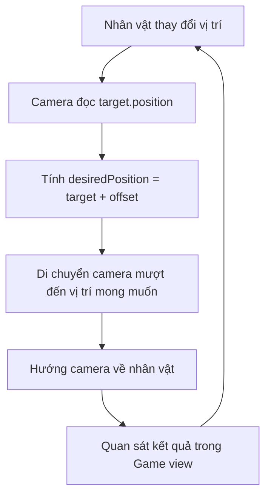

# Bài 03 — Lesson 4.2: Follow the Player

> **Lộ trình:** Junior Programmer  
> **Học phần:** Gameplay Mechanics  
> **Chủ đề:** Camera theo nhân vật và bố cục khung hình  
> **Phiên bản tham chiếu:** Unity 6.3  
> **Nguồn đối chiếu:** [Unity Learn — Gameplay Mechanics](https://learn.unity.com/pathway/junior-programmer/unit/gameplay-mechanics?version=6.3)

## 1. Tổng quan bài học

Trong một trò chơi, người chơi cần nhìn thấy nhân vật và không gian xung quanh để có thể di chuyển, né chướng ngại vật hoặc tương tác với môi trường. Nếu nhân vật di chuyển ra khỏi khung hình nhưng camera đứng yên, người chơi sẽ mất dấu vị trí của nhân vật.

**Follow the Player** là cơ chế giúp camera thay đổi vị trí theo một đối tượng mục tiêu, thường là nhân vật chính (`Player`). Camera không nhất thiết phải nằm trùng vị trí với nhân vật: một khoảng cách tương đối (`offset`) được dùng để lựa chọn góc nhìn thích hợp. Khi cần, camera cũng có thể di chuyển mượt thay vì nhảy tức thời đến vị trí mới.

**Sản phẩm thực hành:** một scene 3D đơn giản có nhân vật chuyển động qua lại, camera bám theo nhân vật và liên tục giữ nhân vật trong khung hình.

## 2. Mục tiêu học tập

Sau bài học, người học có thể:

1. **Giải thích** vai trò của `Camera`, `Transform`, `Projection`, `Field of View`, `Clipping Planes` và `Culling Mask`.
2. **Phân biệt** cách hiển thị của `Perspective` và `Orthographic`.
3. **Xây dựng** script C# để camera theo vị trí của nhân vật bằng `Transform`, `LateUpdate()` và `Vector3.Lerp()`.
4. **Điều chỉnh** `offset`, tốc độ bám và hướng nhìn để tạo bố cục toàn cảnh, trung cảnh hoặc cận cảnh.
5. **Kiểm thử và sửa lỗi** khi camera không theo mục tiêu, không thấy đối tượng hoặc bị rung.

## 3. Kiến thức cốt lõi

### 3.1. Camera quyết định người chơi nhìn thấy gì?

Trong Unity, mỗi đối tượng của scene là một `GameObject`. Một `GameObject` có thể chứa nhiều `Component`, chẳng hạn `Transform`, `Camera` hoặc `Rigidbody`. `Transform` lưu vị trí, góc xoay và tỉ lệ của đối tượng.

`Main Camera` thường là camera chính dùng để dựng hình ảnh hiển thị trong **Game view**. Khác với **Scene view** — nơi người phát triển quan sát và chỉnh sửa thế giới — **Game view** cho thấy kết quả camera sẽ hiển thị khi chạy trò chơi.

| Khái niệm | Vai trò trong bài |
| --- | --- |
| `Scene` | Không gian chứa nhân vật, môi trường và camera. |
| `GameObject` | Đối tượng trong scene, ví dụ `Player` hoặc `Main Camera`. |
| `Component` | Thành phần bổ sung dữ liệu và hành vi cho `GameObject`. |
| `Transform` | Cung cấp vị trí để camera biết mục tiêu đang ở đâu. |
| `Camera` | Quy định góc nhìn và vùng không gian được dựng hình. |
| `Inspector` | Nơi điều chỉnh thuộc tính của `GameObject` và `Component`. |
| `Play mode` | Chế độ chạy thử để quan sát hành vi thực tế. |

### 3.2. Perspective và Orthographic

Hai chế độ chiếu ảnh thường dùng trong Unity là:

| Tiêu chí | `Perspective` | `Orthographic` |
| --- | --- | --- |
| Cảm giác chiều sâu | Vật xa nhìn nhỏ hơn vật gần. | Kích thước vật không giảm theo khoảng cách chỉ vì xa camera. |
| Tham số khung nhìn chính | `Field of View` (FOV). | `Orthographic Size`. |
| Ứng dụng phổ biến | Game 3D, góc nhìn thứ ba, góc nhìn thứ nhất. | Game 2D, góc nhìn chiến thuật, phong cách isometric. |

Với `Perspective`, **FOV lớn** cho cảm giác khung hình rộng hơn, còn **FOV nhỏ** khiến đối tượng có vẻ được phóng lớn hơn nếu giữ nguyên khoảng cách camera. Với `Orthographic`, kích thước vùng nhìn thấy được điều chỉnh bằng `Orthographic Size`, không phải FOV.

### 3.3. Framing, Culling Mask và Clipping Planes

**Framing** là cách đặt đối tượng trong khung hình. Có thể thực hành với ba mức:

- **Toàn cảnh:** camera ở xa hơn để thấy nhân vật và nhiều môi trường.
- **Trung cảnh:** cân bằng giữa kích thước nhân vật và không gian xung quanh.
- **Cận cảnh:** camera gần hơn hoặc điều chỉnh góc nhìn để nhấn mạnh nhân vật.

`Culling Mask` xác định **những layer nào camera được phép dựng hình**. Nếu layer của nhân vật không được chọn, nhân vật có thể biến mất khỏi Game view dù vẫn tồn tại trong scene.

`Near Clipping Plane` và `Far Clipping Plane` xác định vùng khoảng cách mà camera dựng hình. Đối tượng nằm ngoài vùng cắt có thể không xuất hiện. Chẳng hạn, đặt `Far` quá nhỏ có thể làm vật ở xa biến mất; đặt `Near` quá lớn có thể làm phần thân nhân vật ở sát camera bị cắt.

### 3.4. Nguyên lý camera theo nhân vật

Camera cần biết ba yếu tố:

1. **Mục tiêu (`target`):** `Transform` của nhân vật cần bám theo.
2. **Độ lệch (`offset`):** vị trí mong muốn của camera so với nhân vật.
3. **Tốc độ bám (`followSpeed`):** mức độ camera tiến về vị trí mong muốn.

Công thức vị trí mong muốn rất đơn giản:

$$
\text{desiredPosition} = \text{target.position} + \text{offset}
$$

Nếu gán ngay vị trí camera bằng `desiredPosition`, camera sẽ bám sát mục tiêu. Nếu nội suy từng khung hình, camera sẽ bám với chuyển động êm hơn nhưng có thể hơi trễ phía sau.



Sơ đồ mô tả vòng lặp diễn ra trong quá trình chạy game: nhân vật thay đổi vị trí, camera tính toán vị trí mới rồi cập nhật khung hình. `LateUpdate()` phù hợp với nhiều tình huống camera bám theo nhân vật vì nó được gọi sau các lệnh `Update()` trong cùng một khung hình. Với nhân vật sử dụng physics, có thể cần bổ sung `Rigidbody Interpolation` để hạn chế rung.

## 4. Thực hành: tạo camera theo nhân vật

### 4.1. Chuẩn bị scene

Mở một scene 3D trong Unity, sau đó thiết lập:

1. Tạo một `Plane` làm mặt đất.
2. Tạo một `Capsule`, đặt tên **Player**; đặt vị trí tham khảo `(0, 1, 0)`.
3. Tạo ba `Cube` làm vật mốc tại các khoảng cách khác nhau để dễ nhận thấy thay đổi góc nhìn.
4. Giữ lại `Main Camera` và bảo đảm camera đang bật (`Enabled`).
5. Lưu scene trước khi chạy thử.

> **Lưu ý:** Các tọa độ và tham số bên dưới là giá trị **minh họa cho bài thực hành tự tạo**, không phải cấu hình bắt buộc của dự án Unity Learn.

### 4.2. Tạo chuyển động mẫu cho Player

Để dễ kiểm chứng camera, cho nhân vật chuyển động qua lại tự động. Tạo file `Assets/Scripts/PlayerAutoMove.cs`:

```csharp
using UnityEngine;

public class PlayerAutoMove : MonoBehaviour
{
    [SerializeField] private float amplitude = 4f;
    [SerializeField] private float frequency = 0.6f;

    private Vector3 initialPosition;

    private void Start()
    {
        initialPosition = transform.position;
    }

    private void Update()
    {
        float horizontal = Mathf.Sin(Time.time * frequency) * amplitude;
        transform.position = initialPosition + Vector3.right * horizontal;
    }
}
```

Gắn `PlayerAutoMove` vào `Player`. Khi nhấn **Play**, nhân vật sẽ di chuyển qua lại theo trục X. Đây chỉ là **chuyển động thử nghiệm** để kiểm tra camera; ví dụ không dựa vào hệ thống nhập liệu hay `Rigidbody`.

### 4.3. Viết script CameraFollow

Tạo file `Assets/Scripts/CameraFollow.cs` và nhập mã sau:

```csharp
using UnityEngine;

public class CameraFollow : MonoBehaviour
{
    [SerializeField] private Transform target;
    [SerializeField] private Vector3 offset = new Vector3(0f, 3f, -7f);
    [SerializeField, Min(0f)] private float followSpeed = 6f;
    [SerializeField] private Vector3 lookAtOffset = new Vector3(0f, 1f, 0f);

    private void Start()
    {
        if (target == null) return;

        transform.position = target.position + offset;
        transform.LookAt(target.position + lookAtOffset);
    }

    private void LateUpdate()
    {
        if (target == null) return;

        Vector3 desiredPosition = target.position + offset;
        float t = 1f - Mathf.Exp(-followSpeed * Time.deltaTime);

        transform.position = Vector3.Lerp(
            transform.position,
            desiredPosition,
            t
        );

        transform.LookAt(target.position + lookAtOffset);
    }
}
```

**Giải thích các thành phần:**

| Thành phần | Tác dụng |
| --- | --- |
| `Transform target` | Tham chiếu đến nhân vật để lấy vị trí. |
| `offset` | Giữ camera ở một khoảng cách và độ cao so với nhân vật. |
| `followSpeed` | Điều chỉnh tốc độ camera tiến về vị trí cần bám. |
| `lookAtOffset` | Điều chỉnh điểm camera hướng tới, ví dụ phần thân trên thay vì chân nhân vật. |
| `Start()` | Đưa camera về vị trí ban đầu, tránh chuyển động đuổi theo từ vị trí quá xa. |
| `LateUpdate()` | Cập nhật camera sau phần lớn chuyển động nhân vật trong `Update()`. |
| `Vector3.Lerp()` | Nội suy giữa vị trí hiện tại và vị trí mong muốn. |
| `Time.deltaTime` | Giúp việc làm mượt phụ thuộc vào thời gian khung hình. |
| `Mathf.Exp()` | Dùng để tính hệ số nội suy mượt theo thời gian. |
| `transform.LookAt()` | Hướng camera về vị trí được chỉ định. |

Trong mã, `t = 1 - exp(-followSpeed × deltaTime)` cho hệ số nội suy trong khoảng phù hợp khi `followSpeed` không âm. `followSpeed` càng lớn thì camera càng bắt kịp nhanh; `followSpeed = 0` khiến camera không tiến thêm tới mục tiêu sau khi khởi tạo. Đây là một **cách hiện thực chuyển động mượt**, không phải yêu cầu bắt buộc cho mọi hệ thống camera.

### 4.4. Kết nối camera với nhân vật

1. Chọn **Main Camera** trong `Hierarchy`.
2. Gắn component `CameraFollow` vào camera.
3. Trong `Inspector`, kéo `Player` từ `Hierarchy` vào trường **Target**.
4. Giữ giá trị `Offset = (0, 3, -7)` và `Follow Speed = 6` để thử nghiệm.
5. Nhấn **Play**, chọn tab **Game** và quan sát.

**Checkpoint 1:** Khi `Player` di chuyển sang trái hoặc phải, camera cũng di chuyển theo và giữ nhân vật trong khung hình. Những khối lập phương đứng yên trong thế giới sẽ dịch chuyển tương đối trong hình ảnh.

Nếu nhân vật chuyển động nhưng camera đứng yên, hãy kiểm tra trường `Target` trước khi sửa mã.

### 4.5. Thử các kiểu bố cục hình ảnh

Thay đổi một tham số ở mỗi lần thử:

| Lần thử | Thao tác | Kết quả cần quan sát |
| --- | --- | --- |
| A | Tăng độ lớn khoảng cách `offset` | Nhân vật thường nhỏ hơn và thấy nhiều không gian hơn. |
| B | Giảm khoảng cách `offset` | Nhân vật thường lớn hơn; chú ý nguy cơ camera cắt vào mô hình. |
| C | Giảm `followSpeed` | Camera bám trễ hơn. |
| D | Tăng `followSpeed` | Camera đuổi mục tiêu nhanh hơn. |
| E | Đổi `Projection` thành `Orthographic` | Cảm giác chiều sâu thay đổi; dùng `Orthographic Size` để điều chỉnh vùng nhìn. |
| F | Với `Perspective`, điều chỉnh `Field of View` | Khung hình rộng hoặc hẹp hơn. |

**Checkpoint 2:** Tạo được ba bố cục toàn cảnh, trung cảnh và cận cảnh cho cùng một nhân vật. Mỗi cấu hình phải giữ nhân vật đủ dễ nhìn trong lúc di chuyển.

> Những thay đổi thực hiện trong `Inspector` khi đang **Play** thường không được giữ lại sau khi thoát Play mode. Hãy ghi lại giá trị phù hợp rồi áp dụng lại ở Edit mode.

### 4.6. Thử Culling Mask và Clipping Planes

Để hiểu lý do một đối tượng có thể biến mất khỏi màn hình, thực hiện thử nghiệm có kiểm soát:

1. Chọn một `Cube`, chuyển nó sang một layer riêng (có thể tạo layer mới).
2. Chọn `Main Camera`, tìm `Culling Mask` và bỏ chọn layer đó.
3. Quan sát **Game view**: khối lập phương không còn được camera này dựng hình. Chọn lại layer để khôi phục.
4. Điều chỉnh `Near` hoặc `Far` trong `Clipping Planes` và quan sát các vật ở gần hoặc xa.
5. Khôi phục thông số phù hợp trước khi tiếp tục.

**Checkpoint 3:** Giải thích được đối tượng nào biến mất do **lọc layer**, đối tượng nào biến mất do **khoảng cắt camera**.

## 5. Kiểm tra kết quả và ghi nhận

Với mỗi thử nghiệm, ghi lại bằng mẫu sau:

| Trường cần ghi | Nội dung |
| --- | --- |
| **Kết quả mong đợi** | Ví dụ: camera theo `Player` và giữ nhân vật gần trung tâm. |
| **Kết quả thực tế** | Camera theo mượt / bám trễ / đứng yên / giật. |
| **Thông số đã thay đổi** | Ví dụ: `followSpeed`, `offset`, `FOV` hoặc `Culling Mask`. |
| **Minh chứng** | Ảnh Game view, video ngắn hoặc ảnh Console. |
| **Nhận xét** | Nguyên nhân quan sát được và điều chỉnh dự kiến. |

Sự khác biệt giữa dự đoán và hình ảnh thực tế không nhất thiết là lỗi script. Cần xét cả vị trí đối tượng, góc camera, projection, layer và khoảng cắt.

## 6. Lỗi thường gặp và cách debug

| Hiện tượng | Nguyên nhân có thể | Cách kiểm tra / khắc phục |
| --- | --- | --- |
| Camera không di chuyển theo nhân vật | `Target` chưa được gán hoặc script chưa gắn đúng camera. | Kiểm tra `CameraFollow` trên `Main Camera`, trường `Target` và trạng thái `Enabled`. |
| Nhân vật không xuất hiện trong Game view | Camera nhìn sai hướng, `Culling Mask` loại layer, hoặc clipping không phù hợp. | Kiểm tra `Look At Offset`, các layer và `Near/Far`. |
| Camera giật khi theo nhân vật có `Rigidbody` | Vị trí vật lý cập nhật theo `FixedUpdate()`, còn camera cập nhật theo khung hình. | Thử bật `Interpolation` trên `Rigidbody` và theo dõi kết quả với camera chạy ở `LateUpdate()`. |
| Camera đuổi theo quá chậm | `followSpeed` nhỏ. | Tăng dần `followSpeed`, kiểm chứng trong Game view. |
| Camera gần như chạm vào nhân vật | `offset` chưa phù hợp với kích thước mô hình. | Tăng khoảng cách camera hoặc điều chỉnh `lookAtOffset`. |
| Console báo lỗi script | Sai tên file/class, lỗi cú pháp hoặc thiếu tham chiếu khác. | Mở Console, đọc thông báo và sửa lỗi biên dịch trước khi chạy lại. |

**Quy trình debug 5 bước:** tái hiện lỗi → đọc Console → kiểm tra `GameObject` và `Component` liên quan → chỉ thay đổi một yếu tố nghi vấn → chạy lại và ghi kết quả. Tránh thay đổi đồng thời nhiều tham số vì sẽ khó xác định nguyên nhân thực sự.

## 7. Bài tập củng cố

**Bài 1 — Cơ bản:** Cho camera theo một `Player` di chuyển tự động. Chụp hai hình: một hình khi nhân vật ở bên trái, một hình khi nhân vật ở bên phải. Giải thích vì sao nhân vật vẫn còn trong khung hình.

**Bài 2 — Vận dụng:** Thử ít nhất ba giá trị `followSpeed`. Dự đoán độ trễ trước khi bấm Play, sau đó so sánh với kết quả. Chọn giá trị phù hợp cho một trò chơi vượt chướng ngại vật giả định và giải thích lựa chọn.

**Bài 3 — Mở rộng:** Tạo hai cấu hình camera cho cùng scene: góc nhìn toàn cảnh và góc nhìn gần nhân vật. Điều chỉnh `offset`, `lookAtOffset` và các thiết lập camera, rồi ghi lại ưu và nhược điểm của từng bố cục khi nhân vật chuyển động.

## 8. Checklist hoàn thành

- [ ] Giải thích được vai trò của `Camera` và `Transform`.
- [ ] Phân biệt được `Perspective` và `Orthographic`.
- [ ] Tạo scene có `Player`, mặt đất và đối tượng làm mốc.
- [ ] Gắn script di chuyển thử nghiệm vào `Player`.
- [ ] Gắn `CameraFollow` vào `Main Camera` và gán đúng `Target`.
- [ ] Điều chỉnh được `offset` và `followSpeed`.
- [ ] Kiểm tra được tác động của `Field of View`, `Culling Mask` hoặc `Clipping Planes`.
- [ ] Lưu tối thiểu một ảnh hoặc video kiểm chứng và ghi kết quả quan sát.
- [ ] Nêu được một lỗi đã kiểm tra và cách sửa.
- [ ] Đối chiếu với [bài học trên Unity Learn](https://learn.unity.com/pathway/junior-programmer/unit/gameplay-mechanics?version=6.3) nếu sử dụng project thực hành chính thức.

## 9. Câu hỏi ôn tập trắc nghiệm

### Câu 1

Vì sao script camera theo nhân vật thường cần tham chiếu đến `Transform` của `Player`?

A. Để lấy vị trí của nhân vật làm cơ sở tính vị trí camera.  
B. Để thay đổi màu sắc nhân vật.  
C. Để tự động tạo thêm camera mới.  
D. Để thay thế hoàn toàn `Camera` component.

**Đáp án: A.** `Transform` cung cấp vị trí mục tiêu; camera dùng vị trí ấy cùng `offset` để tính vị trí bám theo.

### Câu 2

Camera bị bám trễ quá lâu sau khi nhân vật di chuyển. Tham số nào trong ví dụ cần thử điều chỉnh đầu tiên?

A. `Culling Mask`.  
B. `Far Clipping Plane`.  
C. `followSpeed`.  
D. `Projection`.

**Đáp án: C.** Tăng `followSpeed` giúp camera tiến đến vị trí mong muốn nhanh hơn trong đoạn mã đang sử dụng.

### Câu 3

Một `Cube` xuất hiện trong Scene view nhưng biến mất khỏi Game view sau khi thay đổi layer. Cần kiểm tra gì trước tiên?

A. Giá trị `Time.deltaTime`.  
B. Tên class `PlayerAutoMove`.  
C. Tốc độ di chuyển của nhân vật.  
D. `Culling Mask` của camera.

**Đáp án: D.** Camera có thể không dựng hình layer của `Cube`, dù đối tượng vẫn hiện diện trong scene.

### Câu 4

Khi đổi camera từ `Perspective` sang `Orthographic`, tham số nào thích hợp để điều chỉnh kích thước vùng nhìn thấy?

A. `Field of View`.  
B. `Orthographic Size`.  
C. `Rigidbody Mass`.  
D. `Time.fixedDeltaTime`.

**Đáp án: B.** `Orthographic Size` điều khiển vùng nhìn của camera trực giao; FOV gắn với cách chiếu Perspective.

### Câu 5

Nhân vật sử dụng `Rigidbody` chuyển động có hiện tượng giật trong Game view, dù camera đã chạy ở `LateUpdate()`. Phương án nào nên được thử?

A. Bật `Interpolation` trên `Rigidbody` và kiểm tra lại.  
B. Xóa `Transform` khỏi nhân vật.  
C. Tắt toàn bộ camera trong scene.  
D. Chỉ đổi màu vật liệu mặt đất.

**Đáp án: A.** `Rigidbody Interpolation` có thể làm mượt vị trí hiển thị giữa các bước cập nhật vật lý, giúp camera bám theo ổn định hơn.

## 10. Tổng kết

Một camera theo nhân vật hoạt động bằng cách **lấy vị trí mục tiêu, cộng độ lệch mong muốn và cập nhật vị trí camera theo thời gian**. `LateUpdate()` và nội suy vị trí là cách đơn giản để tạo cảm giác bám theo mượt trong một scene 3D thông thường.

Tuy vậy, một camera hoạt động đúng về mã chưa chắc đã có bố cục tốt. Cần kiểm thử trong **Game view**, so sánh `Perspective` với `Orthographic`, điều chỉnh `FOV` hoặc `Orthographic Size`, kiểm tra `Culling Mask` và `Clipping Planes`, đồng thời quan sát độ rung khi nhân vật chuyển động.

---

*Ghi chú phiên bản:* Bài học là nội dung hướng dẫn tự biên soạn theo chủ đề công khai của **Junior Programmer — Gameplay Mechanics**, không phải bản dịch chính thức hay transcript của Unity. Giao diện và vị trí các tùy chọn có thể thay đổi giữa các phiên bản Unity; đối chiếu project và hướng dẫn chính thức nếu thao tác khác với môi trường thực tế.
