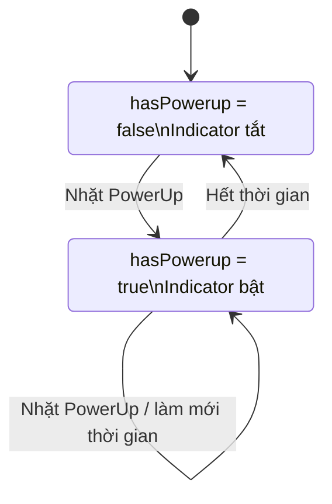

# Bài 04 — Lesson 4.3: PowerUp and CountDown

> **Pathway:** Junior Programmer · **Mission:** Gameplay Mechanics · **Unity:** 6.3 · **Loại:** Tutorial  
> **Bài gốc:** [Lesson 4.3 — PowerUp and CountDown](https://learn.unity.com/pathway/junior-programmer/unit/gameplay-mechanics/tutorial/67558a5bedbc2a0f6d3697ec?version=6.3)  
> **Phạm vi:** Hướng dẫn thực hành tự biên soạn; mã C# bên dưới là ví dụ độc lập, không phải bản chép mã chính thức của Unity.

## 1. Tổng quan

Trong trò chơi đối kháng kiểu *Sumo*, người chơi cần đẩy đối thủ ra khỏi đấu trường. Một **PowerUp** (vật phẩm tăng sức mạnh) cho nhân vật lợi thế tạm thời: khi nhặt vật phẩm, nhân vật có thể đẩy kẻ địch mạnh hơn trong một khoảng thời gian nhất định. Khi hết thời gian, sức mạnh tăng cường biến mất và dấu hiệu trực quan cũng tắt.

Bài học xây dựng cơ chế gồm bốn hành vi kết nối với nhau: **nhặt vật phẩm → kích hoạt trạng thái → tăng lực đẩy → tự động kết thúc hiệu ứng**. Việc hiện hoặc ẩn *indicator* giúp người chơi nhận ra hiệu ứng đang còn hoạt động.

### Kết quả cần đạt

- Nhân vật đi vào vùng vật phẩm và vật phẩm biến mất.
- Trạng thái `hasPowerup` chuyển sang `true`.
- Khi va chạm với đối thủ trong lúc có PowerUp, nhân vật gây thêm lực đẩy.
- Sau thời gian cấu hình, `hasPowerup` trở về `false` và biểu tượng sức mạnh bị ẩn.

## 2. Mục tiêu học tập

Hoàn thành bài học, người học có thể:

1. **Cấu hình** một GameObject làm vật phẩm có `Collider` ở chế độ `Is Trigger`.
2. **Phân biệt** phát hiện vật phẩm bằng `OnTriggerEnter` với phát hiện va chạm vật lý bằng `OnCollisionEnter`.
3. **Sử dụng** `CompareTag`, biến `bool` và `if` để xác định khi nào nhân vật được tăng sức mạnh.
4. **Áp dụng** `Rigidbody.AddForce` để tăng lực đẩy đối thủ.
5. **Xây dựng** bộ đếm thời gian với `Coroutine` và `WaitForSeconds`.
6. **Kiểm thử và sửa lỗi** trạng thái PowerUp và hiệu ứng hiển thị trong Unity Editor.

## 3. Kiến thức nền tảng

### 3.1. PowerUp là gì?

PowerUp là cơ chế trao lợi thế tạm thời cho nhân vật: tăng tốc độ, tăng sát thương, tạo khiên hoặc tăng lực đẩy. Trong ví dụ này, PowerUp **không cộng điểm và không thay đổi vĩnh viễn** các thuộc tính của người chơi; nó chỉ bật một trạng thái trong thời gian ngắn.

Một biến `bool` phù hợp để biểu diễn trạng thái hai giá trị:

```csharp
private bool hasPowerup = false;
```

| Giá trị | Ý nghĩa | Hành vi |
|---|---|---|
| `false` | PowerUp chưa hoạt động | Không có lực đẩy tăng cường |
| `true` | PowerUp đang hoạt động | Có thể tăng lực đẩy khi chạm Enemy |

### 3.2. Trigger và Collision khác nhau thế nào?

| Thành phần | `OnTriggerEnter(Collider other)` | `OnCollisionEnter(Collision collision)` |
|---|---|---|
| Mục đích | Phát hiện đi vào vùng kích hoạt | Phát hiện va chạm vật lý |
| Ví dụ | Nhặt PowerUp | Đụng vào Enemy |
| Collider | Một Collider bật `Is Trigger` | Collider vật lý thông thường |
| Kết quả | Không tự tạo phản lực va chạm | Có tương tác vật lý khi cấu hình hợp lệ |

Để ví dụ hoạt động ổn định, `Player` cần `Rigidbody` và `Collider`; `Powerup` cần một `Collider` bật `Is Trigger`. Đối thủ cần `Rigidbody` động để nhận lực đẩy.

### 3.3. Coroutine và bộ đếm thời gian

`Coroutine` cho phép tạm dừng một chuỗi hành động rồi tiếp tục, thay vì bắt `Update()` tự đếm từng khung hình. `WaitForSeconds(t)` tạm dừng coroutine theo **thời gian game** và chịu ảnh hưởng của `Time.timeScale`.

```csharp
IEnumerator ExampleCountdown()
{
    yield return new WaitForSeconds(7f);
    Debug.Log("Đã hết 7 giây thời gian game");
}
```

Để thực thi hàm trên, gọi `StartCoroutine(ExampleCountdown())`. Giá trị `7f` chỉ là thông số minh họa có thể thay đổi trong dự án.

### 3.4. Sơ đồ trạng thái PowerUp



Ở trạng thái `Active`, bộ đếm vẫn chạy khi nhân vật va chạm với Enemy. Nếu nhặt thêm vật phẩm, ví dụ trong bài sẽ **bắt đầu lại thời gian hiệu lực** để tránh nhiều bộ đếm tranh nhau tắt PowerUp.

## 4. Chuẩn bị dự án

Có thể dùng scene của Mission **Gameplay Mechanics** hoặc tạo một scene nhỏ để luyện tập. Nếu tạo scene mới, chuẩn bị:

| GameObject | Cấu hình gợi ý | Vai trò |
|---|---|---|
| `Ground` | Plane hoặc nền 3D có Collider | Mặt đấu trường |
| `Player` | Sphere, Collider, Rigidbody, script điều khiển | Nhân vật chính |
| `Enemy` | Sphere/Capsule, Collider, Rigidbody, tag `Enemy` | Đối thủ nhận lực |
| `Powerup` | Cylinder/Sphere, Collider bật `Is Trigger`, tag `Powerup` | Vật phẩm |
| `PowerupIndicator` | Hình trụ mỏng hoặc mô hình vòng sáng, đặt làm con của Player | Dấu hiệu đang có PowerUp |

**Lưu ý cấu hình:**

1. Tạo hai Tag chính xác là `Enemy` và `Powerup`, rồi gán đúng GameObject. Phân biệt chữ hoa/chữ thường.
2. Không bật `Is Kinematic` trên `Enemy` nếu muốn nó nhận lực từ `AddForce` theo cách thông thường.
3. Có thể bỏ Collider của `PowerupIndicator` để hình hiển thị không ảnh hưởng vật lý.
4. Đặt `PowerupIndicator` vào vị trí dễ nhìn, ví dụ dưới chân nhân vật; ban đầu cho ẩn.
5. Kiểm tra scene đang có cách điều khiển `Player` (bằng bàn phím hoặc một hệ thống khác) để thực sự đi nhặt vật phẩm.

## 5. Thực hành từng bước

### 5.1. Tạo và kiểm tra vật phẩm PowerUp

1. Trong **Hierarchy**, tạo GameObject 3D dùng làm vật phẩm; đổi tên thành `Powerup`.
2. Chỉnh hình dáng hoặc màu sắc để phân biệt với Enemy.
3. Trong **Inspector**, xác nhận vật phẩm có `Collider` và bật **Is Trigger**.
4. Gán Tag `Powerup`.
5. Đặt vật phẩm ở vị trí Player có thể đi tới.

**Checkpoint:** Khi Player đi xuyên vào vùng vật phẩm, hệ thống có thể phát hiện một sự kiện Trigger mà không dùng vật phẩm như vật cản vật lý.

### 5.2. Phát hiện nhặt vật phẩm và bật trạng thái

Hàm `OnTriggerEnter` được gọi khi Player đi vào vùng Trigger hợp lệ. Dùng `CompareTag("Powerup")` để tránh nhầm một vật thể bất kỳ thành PowerUp.

```csharp
private void OnTriggerEnter(Collider other)
{
    if (!other.CompareTag("Powerup"))
        return;

    hasPowerup = true;
    Destroy(other.gameObject);
}
```

`Destroy(other.gameObject)` xóa GameObject của vật phẩm, còn biến `hasPowerup` ghi nhận sức mạnh đã được kích hoạt. Đoạn mã này là **một phần logic**; ở mục 5.5 sẽ có script hoàn chỉnh xử lý cả thời gian và hiệu ứng.

### 5.3. Áp dụng lực đẩy bổ sung lên Enemy

Khi nhân vật chạm đối thủ, chỉ tăng lực đẩy khi `hasPowerup == true`.

```csharp
private void OnCollisionEnter(Collision collision)
{
    if (!hasPowerup || !collision.gameObject.CompareTag("Enemy"))
        return;

    Rigidbody enemyRb = collision.rigidbody;
    if (enemyRb == null)
        return;

    Vector3 direction =
        (enemyRb.position - transform.position).normalized;

    enemyRb.AddForce(direction * 15f, ForceMode.Impulse);
}
```

- `direction` là vectơ hướng từ Player về phía Enemy.
- `.normalized` giữ hướng nhưng đưa độ dài vectơ về 1, giúp kiểm soát độ lớn lực.
- `15f` là cường độ tăng lực **ví dụ**, không phải giá trị bắt buộc.
- `ForceMode.Impulse` biểu diễn một xung lực phù hợp với tình huống va chạm.

**Lưu ý:** Đoạn ví dụ chỉ thêm **lực tăng cường**. Nếu dự án đã có lực đẩy thông thường, giữ logic đó và tích hợp điều kiện PowerUp vào xử lý va chạm hiện có; không để nhiều script vô tình cộng lực trùng lặp.

### 5.4. Tạo Coroutine tự tắt PowerUp

Khi nhận vật phẩm, bật sức mạnh và bắt đầu đếm ngược:

```csharp
private IEnumerator PowerupCountdown()
{
    yield return new WaitForSeconds(powerupDuration);

    hasPowerup = false;
    powerupIndicator.SetActive(false);
}
```

Điểm quan trọng: `WaitForSeconds` không khóa toàn bộ game; các đối tượng khác vẫn tiếp tục hoạt động. Khi coroutine chạy tiếp sau khoảng thời gian chờ, sức mạnh và hình chỉ báo được tắt.

### 5.5. Script C# hoàn chỉnh: `PlayerPowerup.cs`

Tạo script tên `PlayerPowerup.cs` và gắn vào `Player`. Đoạn mã sau ghép các hành vi lại, đồng thời xử lý trường hợp nhân vật nhặt tiếp PowerUp trong lúc hiệu ứng còn hoạt động.

```csharp
using System.Collections;
using UnityEngine;

public class PlayerPowerup : MonoBehaviour
{
    [Header("PowerUp")]
    [SerializeField] private GameObject powerupIndicator;
    [SerializeField] private float powerupDuration = 7f;
    [SerializeField] private float extraKnockback = 15f;

    private bool hasPowerup = false;
    private Coroutine countdownRoutine;

    private void Start()
    {
        if (powerupIndicator != null)
            powerupIndicator.SetActive(false);
    }

    private void OnTriggerEnter(Collider other)
    {
        if (!other.CompareTag("Powerup"))
            return;

        Destroy(other.gameObject);
        hasPowerup = true;

        if (powerupIndicator != null)
            powerupIndicator.SetActive(true);

        // Nhặt thêm PowerUp sẽ làm mới thời gian hiệu lực.
        if (countdownRoutine != null)
            StopCoroutine(countdownRoutine);

        countdownRoutine = StartCoroutine(PowerupCountdown());
    }

    private void OnCollisionEnter(Collision collision)
    {
        if (!hasPowerup || !collision.gameObject.CompareTag("Enemy"))
            return;

        Rigidbody enemyRb = collision.rigidbody;
        if (enemyRb == null)
            return;

        Vector3 direction =
            (enemyRb.position - transform.position).normalized;

        enemyRb.AddForce(direction * extraKnockback, ForceMode.Impulse);
    }

    private IEnumerator PowerupCountdown()
    {
        yield return new WaitForSeconds(powerupDuration);

        hasPowerup = false;

        if (powerupIndicator != null)
            powerupIndicator.SetActive(false);

        countdownRoutine = null;
    }
}
```

**Giải thích các trường quan trọng:**

| Trường hoặc phương thức | Công dụng |
|---|---|
| `powerupIndicator` | Tham chiếu GameObject hiển thị dấu hiệu PowerUp |
| `powerupDuration` | Số giây thời gian game mà PowerUp có hiệu lực |
| `extraKnockback` | Xung lực cộng thêm khi chạm Enemy |
| `hasPowerup` | Trạng thái hiện tại của hiệu ứng |
| `countdownRoutine` | Giữ tham chiếu để dừng bộ đếm trước nếu nhặt tiếp vật phẩm |
| `StartCoroutine(...)` | Bắt đầu chuỗi đếm ngược |
| `StopCoroutine(...)` | Tránh nhiều bộ đếm cùng lúc thay nhau tắt hiệu ứng |

**Nếu đã có `PlayerController`:** Không bắt buộc tạo thêm một script xử lý va chạm. Có thể chuyển ba phần `OnTriggerEnter`, điều kiện tăng lực trong `OnCollisionEnter`, và `PowerupCountdown` vào script đang có, sau đó tránh khai báo trùng phương thức hoặc xử lý va chạm hai lần.

### 5.6. Gắn tham chiếu trong Inspector

1. Chọn `Player` rồi gắn `PlayerPowerup.cs`.
2. Kéo `PowerupIndicator` vào ô **Powerup Indicator** của script.
3. Thử đặt **Powerup Duration = 7** và **Extra Knockback = 15** làm giá trị khởi điểm minh họa.
4. Nhấn **Play** và di chuyển Player tới vật phẩm.
5. Quan sát vật phẩm biến mất, indicator xuất hiện, Enemy bị đẩy mạnh hơn và indicator tự biến mất sau khi hết thời gian.

Các thông số chỉ là ví dụ để thử nghiệm. Điều chỉnh lực theo khối lượng Rigidbody, kích thước scene và cảm giác chơi thực tế.

## 6. Kiểm tra kết quả

Thực hiện từng bài kiểm tra trong **Play mode** và ghi kết quả quan sát được:

| Ca kiểm thử | Thao tác | Kết quả mong đợi |
|---|---|---|
| T1 | Player chưa nhặt PowerUp, chạm Enemy | Không có lực tăng cường từ script PowerUp |
| T2 | Player nhặt PowerUp | Vật phẩm biến mất, indicator bật |
| T3 | Player chạm Enemy khi PowerUp đang bật | Enemy nhận thêm xung lực |
| T4 | Chờ đủ thời gian hiệu lực | Indicator tắt; va chạm sau đó không được cộng thêm lực |
| T5 | Nhặt PowerUp thứ hai trước khi hết giờ | Bộ đếm được làm mới; không bị tắt sớm bởi bộ đếm cũ |

**Mẫu nhật ký kiểm chứng:**

```text
Ca kiểm thử: T3 — Tăng lực đẩy
Kết quả mong đợi: Enemy bị đẩy mạnh hơn khi Player có PowerUp.
Kết quả thực tế: _________________________________
Bằng chứng (ảnh/video/Console): ___________________
Nhận xét nguyên nhân nếu khác mong đợi: _____________
```

## 7. Lỗi thường gặp và cách xử lý

| Hiện tượng | Nguyên nhân có thể | Cách kiểm tra |
|---|---|---|
| Chạm PowerUp nhưng không có tác dụng | Thiếu `Rigidbody`, Collider hoặc chưa bật `Is Trigger` | Kiểm tra Collider và Rigidbody của các đối tượng |
| PowerUp không biến mất | Tag vật phẩm sai hoặc script không nhận Trigger | Kiểm tra Tag `Powerup` và nơi gắn script |
| Enemy không bị đẩy | Enemy thiếu Rigidbody động; Tag `Enemy` sai; lực quá nhỏ | Kiểm tra Rigidbody, Tag, `extraKnockback` |
| Indicator không xuất hiện | Chưa gán trường tham chiếu, GameObject đặt sai vị trí | Kéo đúng đối tượng vào Inspector; xem Scene view |
| Indicator không biến mất | Coroutine không chạy hoặc script/GameObject bị vô hiệu hóa | Kiểm tra Console, trạng thái Player và luồng đếm ngược |
| Nhặt tiếp PowerUp nhưng tắt sớm | Nhiều coroutine cùng quản lý một trạng thái | Dừng coroutine cũ trước khi chạy coroutine mới |
| Va chạm bị đẩy quá mạnh | Logic lực đẩy bị thực hiện trong nhiều script | Tìm các hàm xử lý va chạm và `AddForce` đang cùng hoạt động |

**Quy trình debug:** Tái hiện lỗi → kiểm tra **Console** → xác nhận GameObject/Component/Tag → chỉ thay đổi một nguyên nhân nghi ngờ → chạy lại và ghi nhận kết quả.

## 8. Bài tập vận dụng

**Bài 1 — Thay đổi thời gian:** Cho PowerUp hoạt động trong 3 giây, sau đó 10 giây. Dự đoán thời điểm indicator tắt và kiểm thử.

**Bài 2 — Thay đổi lực:** So sánh `extraKnockback` lần lượt là `5f`, `15f`, `25f`. Giữ nguyên khối lượng Enemy và ghi nhận sự khác biệt.

**Bài 3 — Làm mới hiệu lực:** Đặt hai PowerUp trong scene. Nhặt vật phẩm thứ hai khi vật phẩm thứ nhất chưa hết giờ, rồi kiểm tra bộ đếm có được làm mới không.

**Bài 4 — Thử lỗi chủ động:** Tạm thời đổi Tag một vật phẩm thành `Untagged`; giải thích vì sao `OnTriggerEnter` có thể được gọi nhưng nhân vật không nhận PowerUp.

**Bài 5 — Mở rộng:** Tự bổ sung hiển thị thời gian PowerUp còn lại bằng UI. Đây là bài tập mở rộng, không bắt buộc đối với ví dụ cơ bản.

## 9. Checklist hoàn thành

- [ ] Chuẩn bị được Player, Enemy, Powerup và PowerupIndicator trong scene.
- [ ] Phân biệt được `OnTriggerEnter` với `OnCollisionEnter`.
- [ ] Nhặt vật phẩm làm `hasPowerup` chuyển thành `true`.
- [ ] Dùng `AddForce` để tăng lực đẩy khi trạng thái PowerUp đang bật.
- [ ] Dùng `Coroutine` và `WaitForSeconds` để kết thúc hiệu ứng.
- [ ] Indicator bật/tắt đúng theo trạng thái PowerUp.
- [ ] Có ảnh, video hoặc ghi chép chứng minh tối thiểu một ca kiểm thử.
- [ ] Nêu được ít nhất một lỗi, nguyên nhân và cách khắc phục.
- [ ] Đối chiếu với [bài gốc trên Unity Learn](https://learn.unity.com/pathway/junior-programmer/unit/gameplay-mechanics?version=6.3) khi cần tài nguyên và các bước thao tác chính thức.

## 10. Tổng kết

Một PowerUp hoàn chỉnh không chỉ cần *nhặt được vật phẩm*. Hệ thống còn phải quản lý trạng thái của người chơi, thay đổi hành vi va chạm trong một khoảng thời gian nhất định và cung cấp phản hồi trực quan. `OnTriggerEnter` phục vụ việc nhặt vật phẩm, `OnCollisionEnter` kết hợp `Rigidbody.AddForce` tạo lực đẩy, còn `Coroutine` kết thúc hiệu ứng sau thời gian cấu hình.

Trong quá trình tự học Unity, hãy kiểm tra theo chuỗi **kết quả mong đợi → chạy Play mode → quan sát Scene/Game/Console → giải thích → sửa một nguyên nhân → thử lại**. Cách làm này giúp phân biệt việc nắm cơ chế với việc chỉ sao chép mã.

## 11. Câu hỏi ôn tập trắc nghiệm

### Câu 1

Khi tạo vật phẩm mà Player có thể đi xuyên qua để nhặt, cấu hình Collider nào phù hợp nhất?

A. Bật `Is Trigger` trên Collider của vật phẩm.  
B. Xóa tất cả Collider của Player và vật phẩm.  
C. Đặt Rigidbody của Enemy thành `Is Kinematic`.  
D. Tắt GameObject Player khi vào vùng vật phẩm.

**Đáp án:** A.  
**Giải thích:** Collider dạng Trigger giúp Unity phát hiện sự kiện đi vào vùng kích hoạt mà không khiến vật phẩm trở thành vật cản theo va chạm vật lý thông thường.

### Câu 2

Nhân vật nhặt PowerUp thành công nhưng không đẩy Enemy mạnh hơn. Điều kiện nào cần được kiểm tra trực tiếp trước tiên trong logic tăng lực?

A. `hasPowerup == false`.  
B. Tên của Scene.  
C. `hasPowerup == true` và đối tượng va chạm có Tag `Enemy`.  
D. `powerupDuration` bằng 0.

**Đáp án:** C.  
**Giải thích:** Script chỉ thực hiện lực tăng cường khi trạng thái PowerUp còn bật và đối tượng va chạm đúng là Enemy.

### Câu 3

Dòng lệnh `yield return new WaitForSeconds(7f);` trong một Coroutine có tác dụng chính là gì?

A. Tạm dừng toàn bộ game trong 7 giây.  
B. Tạm dừng Coroutine theo thời gian game, sau đó tiếp tục thực thi.  
C. Gọi `Update()` đúng 7 lần.  
D. Tự động xóa GameObject Enemy.

**Đáp án:** B.  
**Giải thích:** `WaitForSeconds` làm Coroutine chờ mà không khóa vòng lặp hoạt động thông thường của trò chơi.

### Câu 4

Vì sao ví dụ dừng Coroutine đếm ngược cũ khi nhặt thêm PowerUp?

A. Để tắt va chạm vật lý của Player.  
B. Để xóa mọi Rigidbody trong scene.  
C. Để khiến PowerUp tồn tại mãi mãi.  
D. Để tránh bộ đếm cũ kết thúc và tắt hiệu ứng trước thời điểm mong muốn.

**Đáp án:** D.  
**Giải thích:** Nếu nhiều bộ đếm cùng chạy, một bộ đếm cũ có thể đặt `hasPowerup = false` dù người chơi vừa nhặt vật phẩm mới.

### Câu 5

Enemy có Rigidbody nhưng không di chuyển khi nhận lệnh `AddForce`. Nguyên nhân nào cần kiểm tra?

A. Rigidbody của Enemy đang bật `Is Kinematic`.  
B. Chưa đặt màu cho indicator.  
C. Chưa tạo UI điểm số.  
D. Thiếu một camera thứ hai.

**Đáp án:** A.  
**Giải thích:** Rigidbody kinematic không phản ứng với lực vật lý theo cách Rigidbody động thông thường phản ứng với `AddForce`.

---

**Ghi chú phiên bản:** Giao diện và chi tiết các gói cài đặt của Unity có thể thay đổi giữa phiên bản. Khi dùng Unity 6.3, kiểm tra lại menu/Inspector theo dự án đang mở. Hướng dẫn trên tập trung vào các API và kỹ năng cốt lõi, không thay thế trình tự thao tác chính thức của Unity Learn.

**Tài liệu tham khảo:** [Gameplay Mechanics — Unity Learn](https://learn.unity.com/pathway/junior-programmer/unit/gameplay-mechanics?version=6.3) · [OnTriggerEnter](https://docs.unity3d.com/ScriptReference/Collider.OnTriggerEnter.html) · [Rigidbody.AddForce](https://docs.unity3d.com/ScriptReference/Rigidbody.AddForce.html) · [StartCoroutine](https://docs.unity3d.com/ScriptReference/MonoBehaviour.StartCoroutine.html) · [WaitForSeconds](https://docs.unity3d.com/ScriptReference/WaitForSeconds.html)
