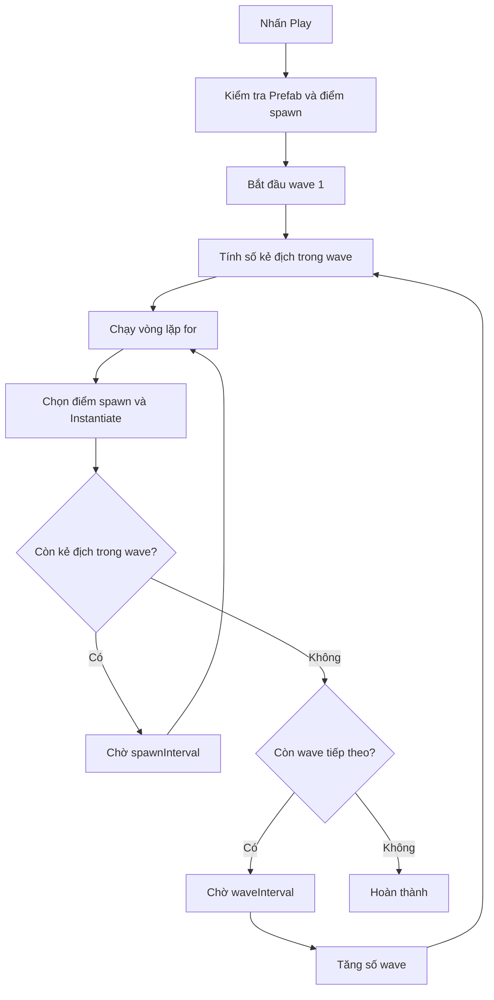

# Bài 05 — Lesson 4.4: For-Loops For Waves

> **Pathway:** Junior Programmer · **Mission:** Gameplay Mechanics · **Nội dung:** Vòng lặp `for` và tạo các đợt kẻ địch (*waves*) · **Môi trường:** Unity 6.3, C#
>
> **Nguồn đối chiếu:** [Gameplay Mechanics — Unity Learn](https://learn.unity.com/pathway/junior-programmer/unit/gameplay-mechanics?version=6.3). Đây là bài học **tự biên soạn** để thực hành chủ đề, không phải bản dịch chính thức hay bản ghi đầy đủ của Unity.

## 1. Tóm tắt bài học

Trong nhiều trò chơi, kẻ địch không xuất hiện từng con một cách thủ công mà được tạo theo **đợt (wave)**. Chẳng hạn, đợt đầu có ba kẻ địch, đợt tiếp theo có bốn và đợt thứ ba có năm. Viết một lệnh tạo kẻ địch cho từng trường hợp sẽ làm mã dài và khó bảo trì.

Vòng lặp `for` trong C# giải quyết vấn đề này: **lặp lại một hành động theo số lần xác định**. Kết hợp `for` với `Instantiate()` và `Coroutine`, ta có thể xây dựng hệ thống tạo kẻ địch theo nhiều đợt, với số lượng và khoảng nghỉ điều chỉnh được trong **Inspector**.

**Sản phẩm thực hành:** một scene có đối tượng `WaveSpawner` tự tạo ba đợt kẻ địch khi nhấn **Play**.

## 2. Mục tiêu học tập

Sau bài học, người học có thể:

1. **Giải thích** ba phần của vòng lặp `for`: khởi tạo, điều kiện và cập nhật biến đếm.
2. **Dự đoán** chính xác số lần vòng lặp được thực thi và tránh lỗi lệch một đơn vị (*off-by-one*).
3. **Sử dụng** `Instantiate()` để tạo nhiều `GameObject` từ một `Prefab`.
4. **Kết hợp** `for`, `Coroutine` và `WaitForSeconds` để tạo các đợt kẻ địch.
5. **Kiểm thử và sửa lỗi** liên quan đến `Prefab`, tham chiếu trong Inspector và số lượng đối tượng xuất hiện.

## 3. Kiến thức cốt lõi

### 3.1. Vòng lặp `for` trong C#

Cấu trúc tổng quát:

```csharp
for (khoiTao; dieuKien; capNhat)
{
    // Các lệnh được thực thi lặp lại
}
```

Ví dụ, in ra ba giá trị `0`, `1`, `2`:

```csharp
for (int i = 0; i < 3; i++)
{
    Debug.Log($"Lần lặp: {i}");
}
```

| Thành phần | Trong ví dụ | Ý nghĩa |
| --- | --- | --- |
| Khởi tạo | `int i = 0` | Tạo biến đếm, bắt đầu tại 0 |
| Điều kiện | `i < 3` | Tiếp tục khi `i` còn nhỏ hơn 3 |
| Cập nhật | `i++` | Tăng `i` thêm 1 sau mỗi vòng |
| Thân vòng lặp | `Debug.Log(...)` | Hành động được lặp lại |

Kết quả trong Console:

```text
Lần lặp: 0
Lần lặp: 1
Lần lặp: 2
```

Vì biến đếm khởi đầu ở `0` và dừng trước `3`, đoạn mã chạy **đúng ba lần**. Nếu viết `i <= 3`, vòng lặp chạy **bốn lần**.

### 3.2. Tạo kẻ địch từ `Prefab`

Trong Unity, `Prefab` là một mẫu đối tượng có thể tái sử dụng. Lệnh dưới đây tạo một bản sao từ `enemyPrefab` tại vị trí và góc xoay của điểm xuất hiện:

```csharp
Instantiate(enemyPrefab, spawnPoint.position, spawnPoint.rotation);
```

Khi đặt lệnh vào vòng lặp `for`, Unity có thể tạo nhiều bản sao mà không cần viết lặp lại câu lệnh `Instantiate()`.

### 3.3. Đợt kẻ địch (*wave*) và bộ đếm

Một **wave** là một nhóm kẻ địch được tạo theo quy tắc chung. Trong ví dụ này, số lượng tăng thêm một ở mỗi đợt:

```text
Wave 1 → 3 kẻ địch
Wave 2 → 4 kẻ địch
Wave 3 → 5 kẻ địch
Tổng   → 12 kẻ địch
```

Với `baseEnemiesPerWave = 3`, công thức áp dụng là:

$$
\text{enemyCount} = \text{baseEnemiesPerWave} + \text{wave} - 1
$$

Biến `wave` bắt đầu từ `1`, vì vậy đợt đầu giữ nguyên số lượng cơ sở.

### 3.4. Vì sao cần `Coroutine`?

Vòng lặp `for` thông thường không tự tạo khoảng nghỉ giữa các lần lặp: nhiều kẻ địch có thể xuất hiện gần như cùng lúc trong một frame. `Coroutine` cho phép tạm dừng quá trình tạo kẻ địch mà không chặn toàn bộ game:

```csharp
yield return new WaitForSeconds(0.5f);
```

Lệnh trên khiến coroutine chờ khoảng `0.5` giây theo thời gian game đã nhân với `Time.timeScale`, rồi mới tiếp tục. `WaitForSeconds` được sử dụng bên trong phương thức trả về `IEnumerator`.

### 3.5. Sơ đồ hoạt động



**Cách đọc sơ đồ:** vòng lặp `for` bên trong tạo số kẻ địch của **một wave**; vòng lặp `for` bên ngoài chuyển qua các **wave**. Đây là mô hình **vòng lặp lồng nhau**. Phần chờ giúp quan sát rõ quá trình spawn, thay vì tạo tất cả trong một frame.

## 4. Chuẩn bị trong Unity Editor

Tạo một scene 3D mới hoặc sử dụng scene thử nghiệm độc lập. Thực hiện các thao tác sau:

1. Tạo `Plane` làm mặt sàn để dễ quan sát.
2. Tạo `Capsule` hoặc `Cube`, đổi tên thành `Enemy`. Kéo đối tượng từ **Hierarchy** vào **Project** để tạo `EnemyPrefab`, sau đó xóa bản `Enemy` đang đặt trong scene. Không cần AI hay chuyển động ở bài thực hành này.
3. Tạo một `Empty GameObject`, đặt tên `WaveSpawner`.
4. Tạo ba `Empty GameObject` khác làm các điểm xuất hiện, đặt tên `SpawnPoint_A`, `SpawnPoint_B`, `SpawnPoint_C`; đưa chúng ra ba vị trí khác nhau trong scene.
5. Tạo file script **`WaveSpawner.cs`**, bảo đảm tên lớp cũng là `WaveSpawner`, và gắn script vào `WaveSpawner` trong **Hierarchy**.

> **Lưu ý:** Script là một `MonoBehaviour` gắn lên `GameObject`. Các trường có `[SerializeField]` có thể được cấu hình trong Inspector dù khai báo `private`.

## 5. Lập trình hệ thống tạo kẻ địch theo đợt

### 5.1. Kiểm tra nhanh vòng lặp cơ bản

Trước khi làm hệ thống hoàn chỉnh, hãy thử đoạn mã sau trong `Start()` của một script thử nghiệm:

```csharp
private void Start()
{
    for (int i = 0; i < 3; i++)
    {
        Debug.Log($"Tạo kẻ địch thứ {i + 1}");
    }
}
```

Console cần xuất hiện lần lượt `Tạo kẻ địch thứ 1`, `2` và `3`. Biểu thức `i + 1` chỉ điều chỉnh **số hiển thị**, không thay đổi số vòng lặp.

### 5.2. Script `WaveSpawner.cs` hoàn chỉnh

```csharp
using System.Collections;
using UnityEngine;

public class WaveSpawner : MonoBehaviour
{
    [Header("Tham chiếu")]
    [SerializeField] private GameObject enemyPrefab;
    [SerializeField] private Transform[] spawnPoints;

    [Header("Cấu hình wave")]
    [SerializeField, Min(1)] private int baseEnemiesPerWave = 3;
    [SerializeField, Min(1)] private int totalWaves = 3;
    [SerializeField, Min(0f)] private float spawnInterval = 0.5f;
    [SerializeField, Min(0f)] private float waveInterval = 2f;

    private IEnumerator Start()
    {
        if (enemyPrefab == null || spawnPoints == null || spawnPoints.Length == 0)
        {
            Debug.LogError("Thiếu Enemy Prefab hoặc Spawn Points!", this);
            yield break;
        }

        for (int wave = 1; wave <= totalWaves; wave++)
        {
            int enemyCount = baseEnemiesPerWave + wave - 1;
            Debug.Log($"Wave {wave}: {enemyCount} kẻ địch");

            for (int i = 0; i < enemyCount; i++)
            {
                int index = Random.Range(0, spawnPoints.Length);
                Transform spawnPoint = spawnPoints[index];

                if (spawnPoint == null)
                {
                    Debug.LogWarning("Một Spawn Point chưa được gán!", this);
                    continue;
                }

                Instantiate(enemyPrefab, spawnPoint.position, spawnPoint.rotation);

                if (i < enemyCount - 1 && spawnInterval > 0f)
                {
                    yield return new WaitForSeconds(spawnInterval);
                }
            }

            if (wave < totalWaves && waveInterval > 0f)
            {
                yield return new WaitForSeconds(waveInterval);
            }
        }

        Debug.Log("Đã tạo xong tất cả wave.");
    }
}
```

**Giải thích các phần quan trọng:**

- `enemyPrefab`: mẫu kẻ địch sẽ được tạo ra; phải kéo `Prefab` vào đúng trường trong Inspector.
- `spawnPoints`: mảng `Transform` chứa các vị trí sinh kẻ địch. `Random.Range(0, spawnPoints.Length)` trả về chỉ số hợp lệ từ `0` đến `Length - 1` vì cận trên của phiên bản `int` là **không bao gồm**.
- `baseEnemiesPerWave` và `totalWaves`: điều khiển số lượng cơ sở và tổng số đợt.
- `for (int wave = 1; wave <= totalWaves; wave++)`: duyệt qua từng đợt.
- `for (int i = 0; i < enemyCount; i++)`: tạo đúng số lần tương ứng với một đợt.
- `Instantiate(...)`: tạo bản sao từ `Prefab`.
- `yield return new WaitForSeconds(...)`: giãn cách giữa các kẻ địch và giữa các đợt.
- `yield break`: dừng coroutine khi thiếu tham chiếu bắt buộc để tránh lỗi lúc chạy.

**Giới hạn của ví dụ:** đợt mới xuất hiện sau khoảng nghỉ cố định, **không đợi người chơi tiêu diệt hết kẻ địch của đợt trước**. Muốn có cơ chế đợi dọn sạch đợt, cần bổ sung một bộ đếm kẻ địch còn sống hoặc hệ thống thông báo khi kẻ địch bị tiêu diệt. Đó là bài mở rộng, không phải hành vi của mã trên.

### 5.3. Cấu hình các trường trong Inspector

Chọn đối tượng `WaveSpawner` và thiết lập:

| Trường | Giá trị thử nghiệm | Ý nghĩa |
| --- | --- | --- |
| `Enemy Prefab` | `EnemyPrefab` | Mẫu để tạo kẻ địch |
| `Spawn Points` | Size = `3` | Danh sách vị trí xuất hiện |
| `Element 0–2` | Ba `SpawnPoint` | Tham chiếu tới các đối tượng trong scene |
| `Base Enemies Per Wave` | `3` | Số kẻ địch cơ sở |
| `Total Waves` | `3` | Tổng số đợt |
| `Spawn Interval` | `0.5` | Nghỉ giữa hai lần spawn trong cùng đợt |
| `Wave Interval` | `2` | Nghỉ giữa hai đợt |

Các giá trị trên là **cấu hình minh họa**, không phải thiết lập bắt buộc của Unity.

## 6. Kiểm thử và quan sát kết quả

Nhấn **Play**, mở cửa sổ **Console** và quan sát **Game view** hoặc **Scene view**.

| Trường hợp | Kết quả mong đợi | Cách kiểm chứng |
| --- | --- | --- |
| Cấu hình mặc định | Ba wave với 3, 4, 5 kẻ địch; tổng 12 | Đếm đối tượng clone trong Hierarchy và đọc Console |
| `Base Enemies Per Wave = 2` | Ba wave tạo 2, 3, 4 kẻ địch; tổng 9 | Đối chiếu công thức với số lượng thực tế |
| `Total Waves = 1` | Chỉ có một wave | Console chỉ báo `Wave 1` |
| `Spawn Interval = 0` | Các kẻ địch cùng wave sinh gần như đồng thời | Quan sát thời điểm clone xuất hiện |
| Bỏ gán `Enemy Prefab` | Console báo lỗi, không tạo kẻ địch | Kiểm tra `Debug.LogError` |

Lưu ý: nếu có một phần tử rỗng trong `Spawn Points`, lượt chọn trúng phần tử đó sẽ bị bỏ qua. Khi đó số clone thực tế có thể nhỏ hơn số lượng được thông báo cho wave. Vì vậy cần gán **đủ cả ba điểm spawn** trước khi đánh giá kết quả.

**Mẫu nhật ký thực hành:**

```text
Tham số đã chọn: __________________
Dự đoán trước khi Play: ____________
Kết quả thực tế: ___________________
Thông báo Console: ________________
Ảnh minh chứng: ____________________
Giải thích chênh lệch (nếu có): ____
```

## 7. Lỗi thường gặp và cách khắc phục

| Hiện tượng | Nguyên nhân có thể | Cách kiểm tra hoặc sửa |
| --- | --- | --- |
| Script không gắn được vào GameObject | Tên file `WaveSpawner.cs` khác tên lớp hoặc dự án đang có lỗi biên dịch | Đối chiếu tên lớp và kiểm tra lỗi đỏ trong Console |
| Không có kẻ địch xuất hiện | Chưa gán `Enemy Prefab` hoặc mảng `Spawn Points` trống | Chọn `WaveSpawner`, xem Inspector và thông báo lỗi |
| Số kẻ địch ít hơn dự kiến | Một vài phần tử `Spawn Points` bị bỏ trống | Kiểm tra toàn bộ `Element` của mảng |
| Có nhiều hơn một bản sao dự kiến | Điều kiện dùng `i <= enemyCount` thay vì `i < enemyCount` | Đếm giá trị mà biến `i` nhận được |
| Kẻ địch xuất hiện chồng vị trí | Các `SpawnPoint` trùng nhau hoặc được chọn ngẫu nhiên trùng nhau | Di chuyển các điểm spawn ra xa nhau; cân nhắc chiến lược chọn vị trí khác |
| Đợt mới xuất hiện khi đợt cũ vẫn còn | Mã chỉ chờ `waveInterval`, không theo dõi kẻ địch còn sống | Bổ sung điều kiện kết thúc wave nếu gameplay yêu cầu |
| Nhấn Play không thấy kết quả như dự đoán | Tham số Inspector khác giá trị ban đầu trong code hoặc có prefab/clone sẵn trong scene | Kiểm tra giá trị lúc bắt đầu Play, Hierarchy và Console |

**Quy trình debug nhanh:** tái hiện lỗi → đọc thông báo Console → kiểm tra `GameObject`, `Component`, `Prefab` và các trường trong Inspector → sửa một giả thuyết → nhấn **Play** kiểm chứng lại.

## 8. Bài tập củng cố

**Bài 1 — Cơ bản:** thay `baseEnemiesPerWave = 4`, `totalWaves = 2`. Dự đoán số lượng của từng đợt trước khi chạy, sau đó đối chiếu Console.

**Bài 2 — Vận dụng:** thay công thức tính `enemyCount` bằng `baseEnemiesPerWave * wave`. Với giá trị cơ sở là `2` và ba đợt, hãy dự đoán có bao nhiêu kẻ địch được tạo ở mỗi đợt. Giải thích sự khác biệt giữa **tăng tuyến tính từng đơn vị** và **tăng theo bội của số thứ tự đợt**.

**Bài 3 — Mở rộng:** thiết kế cơ chế chỉ khởi tạo wave tiếp theo khi toàn bộ kẻ địch của wave hiện tại đã bị loại bỏ. Phác thảo cách cập nhật biến đếm kẻ địch còn sống và cách kiểm tra điều kiện chuyển wave. Có thể dùng một sự kiện thông báo khi kẻ địch bị tiêu diệt để tránh phải tìm mọi kẻ địch trong scene mỗi frame.

## 9. Câu hỏi ôn tập trắc nghiệm

### Câu 1

Với đoạn mã `for (int i = 0; i < 5; i++)`, thân vòng lặp được thực thi bao nhiêu lần?

A. 4 lần  
B. 6 lần  
C. 5 lần  
D. Vô hạn

**Đáp án: C.** Biến `i` lần lượt bằng `0`, `1`, `2`, `3`, `4`, tức năm giá trị thỏa mãn `i < 5`.

### Câu 2

Muốn tạo một bản sao của `EnemyPrefab` trong scene, lời gọi nào phù hợp nhất?

A. `Instantiate(enemyPrefab, position, rotation)`  
B. `Debug.Log(enemyPrefab)`  
C. `Destroy(enemyPrefab)`  
D. `GetComponent<Transform>()`

**Đáp án: A.** `Instantiate()` dùng để khởi tạo bản sao của đối tượng hoặc Prefab; các lựa chọn còn lại không thực hiện tác vụ đó.

### Câu 3

Vì sao `yield return new WaitForSeconds(...)` được đặt trong coroutine khi tạo kẻ địch?

A. Để xóa toàn bộ kẻ địch  
B. Để buộc vòng lặp chỉ chạy một lần  
C. Để tự động tăng máu cho kẻ địch  
D. Để tạm dừng giữa các lượt spawn mà không chặn toàn bộ trò chơi

**Đáp án: D.** Coroutine cho phép thực hiện một chuỗi công việc có các khoảng chờ qua nhiều frame.

### Câu 4

Với `baseEnemiesPerWave = 3` và công thức `enemyCount = baseEnemiesPerWave + wave - 1`, wave thứ ba tạo bao nhiêu kẻ địch?

A. 3  
B. 5  
C. 6  
D. 9

**Đáp án: B.** Thay `wave = 3` vào công thức: `3 + 3 - 1 = 5`.

### Câu 5

Khi nhấn Play, Console báo thiếu `Enemy Prefab` hoặc `Spawn Points`. Việc nào nên làm đầu tiên?

A. Tăng `Total Waves`  
B. Xóa `Debug.LogError`  
C. Kiểm tra và gán lại các tham chiếu trong Inspector  
D. Đổi `for` thành `while` ngay lập tức

**Đáp án: C.** Lỗi xuất phát từ tham chiếu bắt buộc chưa được cấu hình, không phải cấu trúc vòng lặp.

## 10. Tổng kết và checklist

Vòng lặp `for` giúp thực hiện một hành động **đúng số lần mong muốn**. Khi kết hợp với `Prefab`, `Instantiate()` và `Coroutine`, nó trở thành nền tảng để xây dựng hệ thống sinh đối tượng theo đợt trong Unity. Cần phân biệt rõ **số lượng spawn**, **thời gian chờ** và **điều kiện kết thúc wave**: đây là ba quy tắc gameplay khác nhau.

- [ ] Giải thích được cấu trúc `for` và khác biệt giữa `<` với `<=`.
- [ ] Tạo được `EnemyPrefab` và ít nhất ba điểm spawn.
- [ ] Gắn script `WaveSpawner.cs` và cấu hình đủ tham chiếu trong Inspector.
- [ ] Chạy được ba wave; kiểm tra kết quả trong Console và Hierarchy.
- [ ] Tự thay đổi tham số và dự đoán đúng kết quả trước khi Play.
- [ ] Ghi lại một lỗi, nguyên nhân và bước sửa.
- [ ] Lưu ảnh hoặc video ngắn chứng minh scene hoạt động.
- [ ] Đối chiếu bài học trên [Unity Learn — Gameplay Mechanics](https://learn.unity.com/pathway/junior-programmer/unit/gameplay-mechanics?version=6.3) nếu cần kiểm tra tài nguyên hoặc các bước thuộc khóa học chính thức.

---

*Ghi chú phiên bản: Giao diện Unity và cách tổ chức tài nguyên có thể thay đổi theo phiên bản. Ví dụ trên dùng C# và các API Unity phổ biến, được trình bày cho môi trường học Unity 6.3.*
