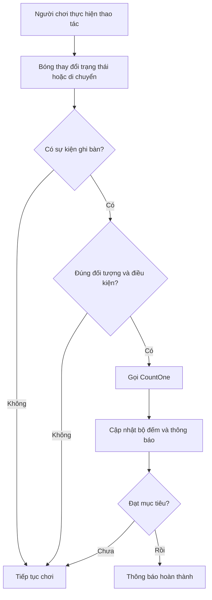

# Bài 06 — Challenge 4: Soccer Scripting

**Lộ trình:** Junior Programmer  
**Học phần:** Gameplay Mechanics  
**Hình thức:** Thử thách lập trình và kiểm thử  
**Phiên bản tham chiếu:** Unity 6.3

## 1. Tổng quan thử thách

Trong trò chơi bóng đá, một hành động đơn giản như đưa bóng vào khung thành thực chất là sự phối hợp của nhiều thành phần: `GameObject`, `Component`, va chạm, điều kiện và mã C#. Game cần xác định **khi nào một sự kiện hợp lệ xảy ra** và **phản hồi như thế nào** để người chơi nhận biết kết quả.

Thử thách này yêu cầu tạo một scene nhỏ có tương tác với bóng và một cơ chế phản hồi có thể quan sát được. Trọng tâm không phải đồ họa, mà là **tổ chức logic gameplay, kiểm thử và sửa lỗi**.

> **Phạm vi thực hành:** Scene bóng đá mini dưới đây là phương án tự luyện để thực hành các kỹ năng của bài. Đây không phải bản sao yêu cầu, mã lời giải hay từng bước chính thức của Unity Learn.

## 2. Mục tiêu học tập

Sau khi hoàn thành, người học có thể:

1. **Giải thích** vai trò của `MonoBehaviour`, `GameObject` và `Component` khi xây dựng cơ chế gameplay.
2. **Thiết lập** scene có bóng, khu vực ghi bàn và ít nhất một thao tác tương tác.
3. **Áp dụng** biến, phương thức, điều kiện và tham chiếu Component để xử lý sự kiện.
4. **Kiểm thử** cả trường hợp hợp lệ và không hợp lệ bằng `Play Mode` và `Console`.
5. **Phân tích, sửa** ít nhất một lỗi rồi lưu lại bằng chứng chạy thử.

## 3. Đề bài: Soccer Scripting

### 3.1. Bối cảnh

Hãy xây dựng một sân bóng mini với **quả bóng**, **khu vực ghi bàn** và **bộ đếm số lần ghi bàn**. Khi người chơi thực hiện thao tác tương tác, quả bóng có thể di chuyển. Khi xảy ra sự kiện ghi bàn hợp lệ, hệ thống tăng bộ đếm và phát thông báo.

### 3.2. Yêu cầu chức năng

- Scene có các đối tượng đủ để phân biệt bóng và khu vực ghi bàn.
- Có **ít nhất một thao tác tương tác** tác động lên hành vi trong game.
- Có phản hồi quan sát được, chẳng hạn chuyển động của bóng hoặc thông báo trong `Console`.
- Có biến cấu hình chỉnh được trong `Inspector`, ví dụ số bàn thắng mục tiêu.
- Có điều kiện xác nhận một sự kiện hợp lệ trước khi cộng điểm.
- Có thể tái hiện tình huống thành công và một tình huống không được tính điểm.

**Sản phẩm tối thiểu:** Một scene chạy được, có tương tác và có kết quả được kiểm chứng. Không bắt buộc sử dụng sân bóng hoặc mô hình 3D phức tạp.

## 4. Kiến thức cần vận dụng

### 4.1. Thành phần trong Unity

| Khái niệm | Vai trò trong thử thách |
|---|---|
| `Scene` | Không gian chứa sân bóng, bóng, vùng ghi bàn và đối tượng quản lý |
| `GameObject` | Đối tượng cơ bản, ví dụ `Ball`, `Goal`, `ScoreManager` |
| `Component` | Bổ sung dữ liệu hoặc hành vi cho `GameObject` |
| `MonoBehaviour` | Lớp nền thường dùng để viết script điều khiển hành vi |
| `Rigidbody` | Cho phép bóng tham gia mô phỏng vật lý |
| `Collider` | Xác định vùng va chạm hoặc vùng kích hoạt sự kiện |
| `Inspector` | Chỉnh thông số và gán tham chiếu Component |
| `Play Mode` | Chạy thử để đối chiếu kết quả với yêu cầu |
| `Console` | Quan sát thông báo, cảnh báo và ngoại lệ |

### 4.2. Biến, điều kiện và phương thức

**Biến** lưu trạng thái, chẳng hạn số lần ghi bàn hiện tại. **Điều kiện** phân biệt tình huống cần xử lý và tình huống phải bỏ qua. **Phương thức** gói một hành vi thành thao tác có tên rõ ràng, ví dụ `CountOne()`.

Một phương thức được khai báo **không tự động chạy**. Cần có một nơi gọi phương thức đó, như sự kiện tương tác hoặc sự kiện xảy ra khi bóng đi vào vùng ghi bàn. Vì vậy, không nên đặt toàn bộ logic vào `Update()` nếu có thể xử lý bằng sự kiện phù hợp.

### 4.3. Luồng xử lý gameplay



Sơ đồ tách **phát hiện sự kiện**, **kiểm tra hợp lệ** và **cập nhật kết quả** thành các trách nhiệm riêng. Nhờ đó, khi điểm bị cộng sai, người học có thể kiểm tra từng bước thay vì sửa toàn bộ script.

## 5. Chuẩn bị và thiết lập scene

### Bước 1 — Tạo scene thực hành

Tạo scene mới và lưu với tên dễ nhận biết, ví dụ `SoccerChallenge`. Đặt tên các đối tượng rõ ràng để thuận tiện khi đọc `Hierarchy` và gán tham chiếu trong `Inspector`.

### Bước 2 — Tạo các đối tượng tối thiểu

- `Ground`: mặt phẳng làm sân, có Collider.
- `Ball`: quả cầu có `Sphere Collider` và `Rigidbody`.
- `Goal`: đối tượng biểu thị khu vực ghi bàn, có `Box Collider`. Nếu xử lý bằng sự kiện vùng đi vào, bật `Is Trigger`.
- `ScoreManager`: GameObject rỗng chứa script bộ đếm.

Đảm bảo vùng ghi bàn đặt ở vị trí bóng có thể đi tới. Với các sự kiện `OnTriggerEnter`, cấu hình Collider và Rigidbody phải đáp ứng điều kiện phát sinh trigger của Unity.

### Bước 3 — Xác định thao tác tương tác

Chọn một cách đơn giản để thử thách có thể chơi được, chẳng hạn nhấn một phím để tác động lực lên bóng. Xác định trước **phím nào**, **hiệu ứng mong đợi** và **cách quan sát**.

### Bước 4 — Xác định trạng thái cần theo dõi

Lưu ít nhất hai giá trị:

- `target`: số lần ghi bàn cần đạt, chỉnh được trong `Inspector`.
- `count`: số lần ghi bàn hợp lệ đã ghi nhận.

## 6. Mã C# khởi đầu

Tạo file `SimpleCounter.cs` và gắn script vào `ScoreManager`:

```csharp
using UnityEngine;

public class SimpleCounter : MonoBehaviour
{
    [SerializeField] private int target = 3;
    private int count = 0;

    private void Start()
    {
        Debug.Log($"Mục tiêu ghi bàn: {target}");
    }

    public void CountOne()
    {
        count++;

        Debug.Log($"Số bàn đã ghi: {count}/{target}");

        if (count >= target)
        {
            Debug.Log("Đã hoàn thành mục tiêu!");
        }
    }
}
```

**Phân tích:**

- `[SerializeField]` cho phép chỉnh `target` từ `Inspector` dù trường được khai báo `private`.
- `Start()` được sử dụng để ghi thông tin khi thành phần bắt đầu hoạt động.
- `CountOne()` tăng bộ đếm mỗi khi **được gọi**.
- `if (count >= target)` kiểm tra điều kiện đạt mục tiêu.

**Điểm cần lưu ý:** Mã này mới quản lý số bàn thắng; **chưa tự phát hiện bóng vào khung thành**. Người học cần nối nó với một sự kiện trong scene. Nếu `CountOne()` tiếp tục được gọi sau khi đạt mục tiêu, thông báo hoàn thành sẽ xuất hiện nhiều lần; đây là một trường hợp có thể cải tiến.

### Phần cần tự hoàn thiện

1. Tạo một script riêng để nhận biết khi bóng đi vào `Goal`.
2. Kiểm tra đối tượng vừa đi vào có đúng là `Ball` hay không.
3. Tham chiếu tới `SimpleCounter` đã gắn ở `ScoreManager`.
4. Chỉ gọi `CountOne()` khi điều kiện ghi bàn hợp lệ.
5. Đảm bảo một lần ghi bàn không bị cộng lặp ngoài ý muốn.

**Gợi ý:** Có thể nghiên cứu `OnTriggerEnter(Collider other)`, kiểm tra `other.CompareTag(...)` và gán tham chiếu qua `Inspector`. Nếu dùng sự kiện trigger, hãy gán tag đúng cho bóng, kiểm tra `Is Trigger` và các thành phần vật lý cần thiết. Không cần viết một hệ thống quản lý trận đấu đầy đủ.

## 7. Kiểm thử và xác minh

### 7.1. Các tình huống kiểm thử

| Tình huống | Thao tác | Kết quả mong đợi |
|---|---|---|
| Tương tác | Kích hoạt thao tác điều khiển đã chọn | Bóng hoặc trạng thái game thay đổi rõ ràng |
| Ghi bàn hợp lệ | Đưa đúng bóng vào vùng ghi bàn | Bộ đếm tăng một lần |
| Sai đối tượng | Đưa đối tượng không phải bóng vào vùng ghi bàn | Bộ đếm không tăng |
| Chưa đủ mục tiêu | Mới ghi ít hơn `target` lần | Chưa thông báo hoàn thành |
| Đạt mục tiêu | Bộ đếm đạt `target` | Xuất hiện thông báo hoàn thành |
| Thay tham số | Đổi `target` trong Inspector và chạy lại | Ngưỡng hoàn thành thay đổi đúng |

### 7.2. Nhật ký kiểm thử

Sau mỗi lần chạy, ghi lại theo mẫu:

| Trường thông tin | Nội dung cần ghi |
|---|---|
| Tình huống | Mô tả thao tác thử |
| Kết quả mong đợi | Hành vi đúng theo thiết kế |
| Kết quả thực tế | Hành vi quan sát trong Play Mode hoặc Console |
| Minh chứng | Ảnh màn hình, ảnh Console hoặc video ngắn |
| Nhận xét | Nguyên nhân sai khác và điều chỉnh tiếp theo |

Không chỉ ghi “chạy thành công”. Hãy nêu cụ thể **đã làm gì, hệ thống phản hồi ra sao và vì sao kết quả đó đúng**.

## 8. Lỗi thường gặp và cách debug

| Hiện tượng | Nguyên nhân cần kiểm tra | Hướng xử lý |
|---|---|---|
| Script không gắn được vào GameObject | Tên file không khớp tên lớp `MonoBehaviour`, hoặc có lỗi biên dịch | Kiểm tra tên file, tên class và lỗi trong Console |
| `NullReferenceException` | Tham chiếu `SimpleCounter` hoặc Component khác chưa được gán | Kiểm tra các trường trong Inspector trước khi gọi phương thức |
| Bóng vào khung thành nhưng không tăng điểm | Trigger không phát sinh, sai tag hoặc chưa gọi `CountOne()` | Xem `Collider`, `Is Trigger`, `Rigidbody`, điều kiện và log |
| Mỗi bàn thắng bị cộng nhiều lần | Logic sự kiện được gọi lại hoặc thiếu kiểm soát trạng thái | Ghi log số lần sự kiện xảy ra và bổ sung điều kiện chống cộng lặp |
| Không thấy thông báo hoàn thành | `target` lớn hơn số lần đã ghi, hoặc phương thức chưa được gọi đúng | Kiểm tra biến, giá trị Inspector và Console |

**Quy trình debug:** Tái hiện lỗi → đọc `Console` → kiểm tra `GameObject` và `Component` → đưa ra một giả thuyết → chỉ sửa một nguyên nhân → chạy lại → lưu kết quả. Cách này giúp xác định thay đổi nào thực sự sửa được lỗi.

## 9. Sản phẩm cần nộp và tiêu chí hoàn thành

**Bộ sản phẩm:**

1. Scene hoặc project Unity có thể mở và chạy thử.
2. Các file script C# của cơ chế tương tác và bộ đếm.
3. Ít nhất một ảnh hoặc video cho thấy trường hợp thành công.
4. Nhật ký kiểm thử gồm trường hợp hợp lệ, trường hợp lỗi và một cải tiến sau lần thử đầu.

**Checklist nghiệm thu:**

- [ ] Scene có bóng, khu vực ghi bàn và đối tượng quản lý kết quả.
- [ ] Có một thao tác tương tác tạo ra phản hồi quan sát được.
- [ ] Script hoạt động mà không có lỗi biên dịch.
- [ ] Bộ đếm chỉ tăng khi thỏa điều kiện ghi bàn đã định nghĩa.
- [ ] Có thể điều chỉnh một tham số trong `Inspector` và giải thích ảnh hưởng của nó.
- [ ] Đã kiểm tra ít nhất một lỗi hoặc trường hợp không hợp lệ.
- [ ] Đã lưu ảnh/video minh chứng và ghi nhận một cải tiến.

**Nâng cao (không bắt buộc):** Thử thay đổi lực tác động lên bóng hoặc ngưỡng `target`, dự đoán hành vi trước khi chạy, rồi đối chiếu kết quả thực tế. Có thể bổ sung cách ngăn thông báo hoàn thành xuất hiện nhiều lần.

## 10. Câu hỏi ôn tập

### Câu 1

Mục đích chính của `[SerializeField]` trên một biến `private` trong script là gì?

A. Cho phép chỉnh biến trong `Inspector` mà không cần chuyển thành `public`.  
B. Tự động chạy phương thức mỗi frame.  
C. Tạo `Collider` cho GameObject.  
D. Tự động tăng giá trị biến khi có va chạm.

**Đáp án:** A.  
**Giải thích:** `[SerializeField]` cho phép Unity tuần tự hóa và hiển thị trường phù hợp trong `Inspector`; nó không tự tạo hành vi gameplay.

### Câu 2

Sau khi gắn `SimpleCounter` vào `ScoreManager`, không có bàn thắng nào được đếm dù đã chạy Play Mode. Nguyên nhân hợp lý nhất là gì?

A. Mọi script `MonoBehaviour` đều phải đặt trong `Update()`.  
B. Biến `count` không được phép là `private`.  
C. Chưa có sự kiện hoặc script nào gọi `CountOne()`.  
D. `Debug.Log()` không hoạt động trong Play Mode.

**Đáp án:** C.  
**Giải thích:** Khai báo phương thức không đồng nghĩa với thực thi phương thức. `CountOne()` phải được gọi từ một luồng xử lý cụ thể.

### Câu 3

Bóng đi vào `Goal`, nhưng `OnTriggerEnter` không được gọi. Nhóm thiết lập nào cần được kiểm tra trước?

A. Màu của `Material` và cường độ ánh sáng.  
B. Tên thư mục chứa scene.  
C. Độ phân giải màn hình Game View.  
D. `Collider`, `Is Trigger` và cấu hình `Rigidbody` liên quan.

**Đáp án:** D.  
**Giải thích:** Sự kiện trigger phụ thuộc cấu hình vật lý, không phụ thuộc màu sắc hay độ phân giải màn hình.

### Câu 4

Một đối tượng không phải bóng đi vào vùng ghi bàn và làm điểm tăng. Cách khắc phục phù hợp nhất là gì?

A. Tăng số lượng `Debug.Log()`.  
B. Kiểm tra đúng đối tượng hoặc tag trước khi gọi `CountOne()`.  
C. Xóa tất cả `Collider` trong scene.  
D. Chuyển toàn bộ biến thành `public`.

**Đáp án:** B.  
**Giải thích:** Sự kiện va chạm chỉ nên dẫn đến cập nhật điểm khi thỏa điều kiện ghi bàn hợp lệ.

### Câu 5

Tại sao nên thay đổi một nguyên nhân giả định mỗi lần debug?

A. Để biết chính xác thay đổi nào khiến lỗi được khắc phục.  
B. Để đảm bảo không cần chạy lại scene.  
C. Để `Inspector` tự sửa mọi tham chiếu.  
D. Để không cần xem `Console`.

**Đáp án:** A.  
**Giải thích:** Kiểm tra có kiểm soát giúp xác định quan hệ giữa nguyên nhân, thay đổi và kết quả, thay vì sửa nhiều chỗ cùng lúc mà không biết phần nào hiệu quả.

## 11. Tổng kết

Cơ chế ghi bàn đơn giản minh họa một nguyên lý quan trọng trong Unity: **sự kiện gameplay chỉ có ý nghĩa khi được kiểm tra đúng điều kiện, cập nhật đúng trạng thái và tạo ra phản hồi quan sát được**. Hãy hoàn thiện luồng **tương tác → phát hiện sự kiện → xác minh → cập nhật → kiểm thử**, sau đó thử thay đổi tham số và chủ động tìm một trường hợp lỗi.

**Tham khảo:** [Unity Learn — Gameplay Mechanics (Junior Programmer)](https://learn.unity.com/pathway/junior-programmer/unit/gameplay-mechanics?version=6.3). Các yêu cầu chi tiết của thử thách chính thức và tài nguyên đi kèm cần được đối chiếu trực tiếp tại Unity Learn.
