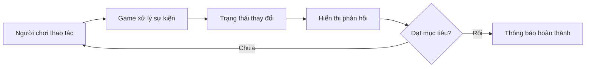
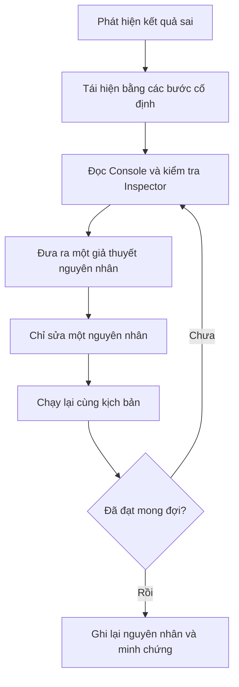

# Bài 07 — Lab 4: Basic Gameplay

> **Lộ trình:** Junior Programmer  
> **Học phần:** Gameplay Mechanics  
> **Hình thức:** Lab — thực hành theo nhiệm vụ  
> **Phiên bản tham chiếu:** Unity 6.3

## 1. Tổng quan

Một cơ chế gameplay chỉ thực sự hoàn chỉnh khi người chơi **thực hiện được hành động**, trò chơi **xử lý hành động đó** và **phản hồi bằng kết quả quan sát được**. Vì vậy, mục tiêu của lab là xây dựng một tương tác nhỏ, kiểm thử từng thay đổi và giải thích được vì sao trò chơi hoạt động hoặc phát sinh lỗi.

Thay vì xây dựng một trò chơi lớn ngay lập tức, hãy bắt đầu bằng một vòng lặp đơn giản:



**Cách đọc sơ đồ:** Mỗi thao tác phải dẫn đến một thay đổi có thể kiểm chứng. Nếu người chơi bấm nút nhưng điểm không tăng, cần xác định lỗi nằm ở bước nhận tương tác, cập nhật trạng thái hay hiển thị phản hồi.

Trong bài, ví dụ thực hành tự biên soạn là **mini-game Thu thập điểm**: nhấn nút để tăng điểm, đạt đủ điểm thì hiện thông báo hoàn thành và không thể thu thập thêm. Ví dụ này là một cách luyện kỹ năng, **không phải danh sách bước chính thức của Lab 4 trên Unity Learn**.

## 2. Mục tiêu học tập

Sau khi hoàn thành lab, người học có thể:

1. **Xác định** trạng thái ban đầu của scene, GameObject và các Component liên quan.
2. **Xây dựng** một tương tác làm thay đổi trạng thái gameplay.
3. **Kiểm thử** kết quả mong đợi và thực tế trong Play mode.
4. **Phát hiện, tái hiện và sửa** ít nhất một lỗi bằng Inspector và Console.
5. **Trình bày** minh chứng chạy thử và một cải tiến sau lần kiểm thử đầu tiên.

## 3. Chuẩn bị

**Công cụ:** Unity Editor với dự án phù hợp, một scene có thể chỉnh sửa và trình soạn thảo C#.

**Kiến thức cần dùng:**

| Thuật ngữ | Vai trò trong lab |
| --- | --- |
| `Scene` | Không gian tổ chức đối tượng và chạy thử trò chơi. |
| `GameObject` | Đối tượng trong scene, có thể gắn các Component. |
| `Component` | Thành phần cung cấp dữ liệu hoặc hành vi cho GameObject. |
| `Inspector` | Nơi xem, sửa thuộc tính và gán tham chiếu cho Component. |
| `Play mode` | Chế độ chạy thử để quan sát và kiểm chứng tương tác. |
| `Console` | Nơi đọc thông báo, cảnh báo và lỗi khi chạy. |

**Chuẩn bị sản phẩm:** Tạo hoặc mở một dự án Unity; lưu một scene mới tên `Lab4_BasicGameplay`. Nếu thực hành bằng dự án khác, có thể giữ nguyên tên scene và đối tượng đang sử dụng.

> **Nguyên tắc:** Ghi lại trạng thái trước khi sửa. Mỗi lần chỉ thay đổi một nhóm thao tác nhỏ, chạy thử rồi mới tiếp tục.

## 4. Xác định nhiệm vụ và tiêu chí thành công

### 4.1. Yêu cầu của mini-game

Tạo một giao diện có:

- Nút **Thu thập điểm** để người chơi tương tác.
- Dòng chữ cho biết số điểm hiện tại so với mục tiêu.
- Điều kiện hoàn thành khi đạt đủ điểm.
- Phản hồi khi hoàn thành: thông báo chiến thắng và nút không còn nhận lượt nhấn.

**Tiêu chí quan sát được:** Bắt đầu từ `0/5`; mỗi lần nhấn thành công điểm tăng đúng một; đến `5/5` hiển thị **Hoàn thành!** và nút được vô hiệu hóa. Giá trị `5` chỉ là thông số ví dụ và có thể đổi trong Inspector.

### 4.2. Dự đoán kết quả trước khi làm

Ghi các giả thuyết kiểm thử:

| Tình huống | Kết quả mong đợi |
| --- | --- |
| Vừa vào Play mode | Điểm bằng 0, nút có thể nhấn. |
| Nhấn một lần | Điểm tăng từ 0 lên 1. |
| Nhấn đến điểm mục tiêu | Hiện thông báo hoàn thành. |
| Tiếp tục nhấn sau khi hoàn thành | Điểm không tăng thêm. |
| Thoát và vào lại Play mode | Trạng thái gameplay được khởi tạo lại. |

## 5. Thực hành từng bước

### 5.1. Tạo scene và các đối tượng

1. Mở scene `Lab4_BasicGameplay`.
2. Trong cửa sổ **Hierarchy**, tạo một đối tượng **Canvas** nếu chưa có.
3. Bên trong Canvas, tạo **Button - TextMeshPro** và đặt tên `CollectButton`.
4. Tạo thêm **Text - TextMeshPro** và đặt tên `ScoreText`.
5. Đổi chữ trên nút thành **Thu thập điểm**; bố trí hai thành phần sao cho đều nhìn thấy trong **Game view**.
6. Tạo một **Empty GameObject** đặt tên `GameManager`.

Nếu Unity yêu cầu nhập tài nguyên thiết yếu của TextMeshPro, hãy thực hiện bước nhập tài nguyên trước khi tiếp tục. Nếu thao tác với UI không nhận chuột, kiểm tra scene có `EventSystem` và module đầu vào phù hợp cấu hình dự án hay chưa.

**Checkpoint 1:** Hierarchy có `Canvas`, `CollectButton`, `ScoreText`, `GameManager`; Game view hiển thị nút và dòng văn bản.

### 5.2. Viết hành vi điều khiển điểm

Tạo script C# tên `BasicGameplayLab.cs`, sau đó nhập nội dung:

```csharp
using TMPro;
using UnityEngine;
using UnityEngine.UI;

public class BasicGameplayLab : MonoBehaviour
{
    [SerializeField] private Button collectButton;
    [SerializeField] private TMP_Text scoreText;
    [SerializeField, Min(1)] private int targetScore = 5;

    private int score;

    private void Start()
    {
        if (collectButton == null || scoreText == null)
        {
            Debug.LogError("Chưa gán Button hoặc ScoreText trong Inspector.");
            enabled = false;
            return;
        }

        collectButton.onClick.AddListener(CollectPoint);
        UpdateUI();
    }

    private void CollectPoint()
    {
        if (score >= targetScore)
            return;

        score++;

        if (score >= targetScore)
            collectButton.interactable = false;

        UpdateUI();
    }

    private void UpdateUI()
    {
        scoreText.text = score >= targetScore
            ? $"Hoàn thành! {score}/{targetScore}"
            : $"Điểm: {score}/{targetScore}";
    }

    private void OnDestroy()
    {
        if (collectButton != null)
            collectButton.onClick.RemoveListener(CollectPoint);
    }
}
```

Các thành phần chính của script:

- `targetScore` là mục tiêu có thể thay đổi trong Inspector; `[Min(1)]` giới hạn giá trị tối thiểu khi chỉnh qua Inspector.
- `Start()` kiểm tra tham chiếu, đăng ký sự kiện nhấn nút và hiển thị trạng thái ban đầu.
- `CollectPoint()` xử lý lượt nhấn và giới hạn số điểm khi đã hoàn thành.
- `UpdateUI()` biến trạng thái `score` thành phản hồi trực quan.
- `OnDestroy()` hủy đăng ký sự kiện để tránh giữ callback không cần thiết.

**Lưu ý:** Đây là ví dụ sử dụng **uGUI** (`UnityEngine.UI.Button`), không phải `UnityEngine.UIElements.Button` của UI Toolkit. Hai loại nút này sử dụng API sự kiện khác nhau.

### 5.3. Kết nối Component trong Inspector

1. Kéo script `BasicGameplayLab` lên GameObject `GameManager`.
2. Chọn `GameManager`, tìm Component `Basic Gameplay Lab` trong Inspector.
3. Kéo GameObject `CollectButton` vào ô **Collect Button**.
4. Kéo GameObject `ScoreText` vào ô **Score Text**.
5. Đặt **Target Score** bằng `5`.
6. Lưu scene bằng **Ctrl + S** hoặc **File → Save**.

**Checkpoint 2:** Hai ô tham chiếu không còn trạng thái `None`; Unity không có lỗi biên dịch trong Console.

### 5.4. Kiểm thử bằng Play mode

1. Nhấn **Play** và quan sát màn hình ban đầu.
2. Nhấn nút một lần: đối chiếu số điểm trước và sau.
3. Nhấn đến khi đạt mục tiêu: kiểm tra thông báo và trạng thái nút.
4. Mở **Window → General → Console** để xem có lỗi hoặc cảnh báo hay không.
5. Thoát Play mode, vào lại và xác nhận trạng thái bắt đầu từ đầu.

**Checkpoint 3:** Đủ các điều kiện trong bảng dự đoán ở mục 4.2 và không có lỗi runtime chưa được giải thích.

> **Lưu ý Play mode:** Với thiết lập mặc định, những thay đổi dữ liệu được thực hiện trong khi chạy thường không được lưu lại sau khi thoát Play mode. Hãy chỉnh và lưu các thông số cần giữ ở Edit mode.

### 5.5. Cải tiến và giải thích tác động

Khi bản đầu tiên chạy đúng, đổi `Target Score` từ `5` thành `3` **ở Edit mode**, rồi thử lại.

Ghi nhận:

- Điều kiện hoàn thành xảy ra sau bao nhiêu lượt nhấn?
- UI đã cập nhật mẫu số từ `5` thành `3` chưa?
- Vì sao thay đổi đúng một thuộc tính trong Inspector lại thay đổi hành vi gameplay?

**Checkpoint 4:** Có ảnh hoặc ghi chép chứng minh hành vi thay đổi khi thay `targetScore`.

## 6. Quy trình kiểm tra và debug

Khi kết quả thực tế khác dự đoán, đừng thay đổi nhiều đối tượng cùng lúc. Sử dụng chu trình:



| Hiện tượng | Điểm cần kiểm tra | Cách xử lý |
| --- | --- | --- |
| Bấm nút nhưng điểm không tăng | `EventSystem`, trạng thái `Interactable`, tham chiếu `Collect Button` | Kiểm tra module nhập và nối lại Button đúng vào script. |
| Console báo chưa gán Button hoặc ScoreText | Hai trường serialized trong Inspector | Gán đủ hai tham chiếu, chạy lại. |
| Không thấy dòng điểm | Vị trí UI, kích thước, màu chữ, Canvas, tham chiếu TMP | Chỉnh để dòng chữ xuất hiện trong Game view. |
| Script không xuất hiện trên GameObject | Tên file, tên class, lỗi biên dịch | Bảo đảm file `BasicGameplayLab.cs` chứa class `BasicGameplayLab` và sửa các lỗi Console. |
| Nút ngừng hoạt động trước hoặc sau mốc dự đoán | `Target Score`, điểm hiện tại, nhánh điều kiện | So sánh tham số với số lần nhấn thực tế. |
| Mọi thứ khác đi sau khi thoát Play mode | Thông số có được sửa trong Play mode không? | Sửa và lưu ở Edit mode, chạy thử lại. |

**Mẫu nhật ký lỗi:**

```text
Vấn đề: Bấm nút nhưng điểm không thay đổi.
Cách tái hiện: Play → nhấn CollectButton một lần.
Mong đợi: Điểm 0/5 → 1/5.
Thực tế: Điểm vẫn là 0/5.
Bằng chứng: Ảnh Game view và Console.
Giả thuyết: Chưa gán Collect Button trong Inspector.
Thao tác sửa: Gán đúng Button rồi chạy lại.
Kết quả: Điểm tăng đúng một sau mỗi lần nhấn.
```

## 7. Sản phẩm cần nộp và tiêu chí nghiệm thu

**Sản phẩm:** Một scene hoặc dự án Unity chạy được với tối thiểu một tương tác và một phản hồi; kèm bằng chứng kiểm thử.

Cấu trúc gợi ý khi đóng gói:

```text
Lab4_BasicGameplay/
├── Project/                 # Dự án Unity hoặc bản trích cần thiết
├── Evidence/
│   ├── 01-initial.png
│   ├── 02-progress.png
│   └── 03-completed.png
└── Lab-Report.md            # Nhật ký kiểm thử và cải tiến
```

**Tiêu chí nghiệm thu:**

| Tiêu chí | Minh chứng cần có |
| --- | --- |
| Scene hoạt động | Có thể vào Play mode và nhìn thấy giao diện. |
| Tương tác hợp lệ | Nhấn nút làm điểm tăng đúng một. |
| Phản hồi rõ ràng | Điểm và thông báo hoàn thành hiển thị đúng. |
| Biết kiểm thử | Có đối chiếu kết quả mong đợi và thực tế. |
| Biết debug | Mô tả được cách tái hiện và xử lý ít nhất một lỗi. |
| Có cải tiến | Thay một tham số và giải thích ảnh hưởng. |

## 8. Checklist hoàn thành

- [ ] Mở hoặc tạo scene và ghi lại trạng thái ban đầu.
- [ ] Tổ chức được các GameObject, Component cần thiết.
- [ ] Gắn script và tham chiếu đúng trong Inspector.
- [ ] Chạy được ví dụ trong Play mode.
- [ ] Có ảnh hoặc video cho trạng thái ban đầu, đang chơi và hoàn thành.
- [ ] Kiểm tra Console và giải thích được ít nhất một lỗi.
- [ ] Có một lần thay đổi tham số, thử lại và nhận xét.
- [ ] Lưu project/scene và viết nhật ký kiểm thử.
- [ ] Đối chiếu bài và tài nguyên chính thức tại [Unity Learn — Gameplay Mechanics](https://learn.unity.com/pathway/junior-programmer/unit/gameplay-mechanics?version=6.3).

## 9. Câu hỏi ôn tập trắc nghiệm

### Câu 1

Mục tiêu quan trọng nhất khi thiết kế một tương tác cho lab gameplay là gì?

A. Có càng nhiều GameObject càng tốt.  
B. Bắt buộc phải dùng mô hình 3D phức tạp.  
C. Thao tác của người chơi dẫn tới phản hồi quan sát và kiểm chứng được.  
D. Mọi tham số đều phải viết cố định trong code.

**Đáp án: C.** Vì lab cần chứng minh được quan hệ giữa hành động, thay đổi trạng thái và kết quả hiển thị.

### Câu 2

Nhấn nút nhưng màn hình không cập nhật điểm, hành động kiểm tra ban đầu nào phù hợp nhất?

A. Kiểm tra Console, tham chiếu trong Inspector và trạng thái Button.  
B. Xóa toàn bộ scene ngay lập tức.  
C. Chỉnh nhiều script cùng lúc để thử vận may.  
D. Chỉ thay đổi màu nền của Canvas.

**Đáp án: A.** Các thành phần nhận tương tác, gọi callback và cập nhật UI cần được kiểm tra có hệ thống trước khi sửa.

### Câu 3

Vì sao nên thay đổi một nguyên nhân giả định mỗi lần debug?

A. Để giảm số GameObject bắt buộc trong scene.  
B. Để tránh phải chạy Play mode.  
C. Để Console luôn trống.  
D. Để biết thay đổi nào thực sự làm lỗi biến mất.

**Đáp án: D.** Khi thay nhiều yếu tố cùng lúc, rất khó xác định nguyên nhân và xác minh cách khắc phục.

### Câu 4

Khi `targetScore` giảm từ `5` xuống `3`, kết quả nào phù hợp với code của bài?

A. Trò chơi sẽ luôn bắt đầu từ 3 điểm.  
B. Người chơi hoàn thành sau 3 lượt nhấn hợp lệ thay vì 5.  
C. Nút sẽ tự động biến mất khỏi Hierarchy.  
D. Điểm tăng 3 sau mỗi lần nhấn.

**Đáp án: B.** `targetScore` là ngưỡng hoàn thành; mỗi lượt nhấn hợp lệ vẫn chỉ tăng `score` thêm 1.

### Câu 5

Minh chứng nào thể hiện việc hoàn thành lab thuyết phục nhất?

A. Chỉ một ảnh chụp màn hình lúc chưa chạy.  
B. Chỉ gửi tên dự án Unity.  
C. Scene chạy được, hình ảnh kết quả, kịch bản kiểm thử và nhật ký sửa lỗi.  
D. Một đoạn code chưa gắn vào GameObject.

**Đáp án: C.** Bộ minh chứng này cho thấy cả sản phẩm, khả năng kiểm tra kết quả và quá trình cải tiến.

## 10. Tổng kết

Lab 4 rèn luyện một quy trình nhỏ nhưng thiết yếu khi phát triển trò chơi: **xác định mục tiêu → xây dựng tương tác → quan sát phản hồi → kiểm thử → debug → cải tiến**. Giá trị của bài không chỉ nằm ở việc chương trình chạy được, mà còn ở khả năng giải thích trạng thái gameplay và chứng minh từng yêu cầu đã được đáp ứng.

> **Nguồn đối chiếu:** [Junior Programmer — Gameplay Mechanics, Unity Learn](https://learn.unity.com/pathway/junior-programmer/unit/gameplay-mechanics?version=6.3). Bài học và ví dụ mã được tự biên soạn để thực hành độc lập theo đề mục “Lab 4 - Basic Gameplay”; không phải bản dịch hoặc transcript chính thức. Giao diện và các package có thể thay đổi giữa các phiên bản Unity.
