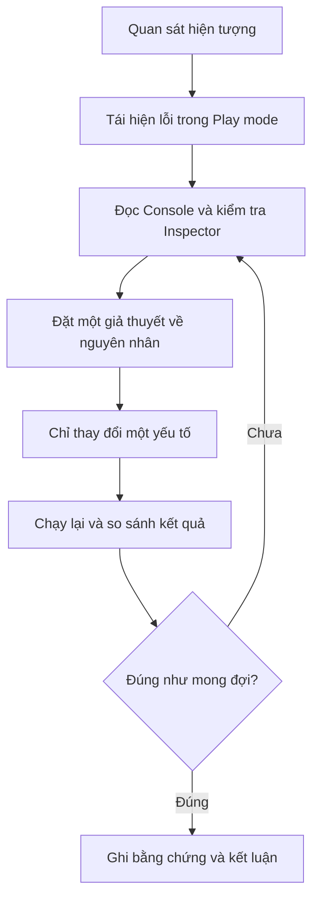

# Bài 08 — Quiz 4: Gameplay Mechanics

> **Pathway:** Junior Programmer  
> **Module:** Gameplay Mechanics  
> **Loại bài:** Bài kiểm tra và tự đánh giá  
> **Phiên bản tham chiếu:** Unity 6.3  
> **Đối chiếu chương trình:** [Gameplay Mechanics — Unity Learn](https://learn.unity.com/pathway/junior-programmer/unit/gameplay-mechanics?version=6.3)
>
> **Lưu ý:** Toàn bộ câu hỏi, tình huống và thang điểm dưới đây được **tự biên soạn để luyện tập**. Đây **không phải** nội dung Quiz 4 chính thức hoặc đáp án của Unity Learn. Để làm bài chính thức, hãy mở bài học tương ứng trong Unity Learn.

## 1. Tổng quan

Một tính năng gameplay không chỉ được xem là hoàn thành khi mã C# không báo lỗi. Nó cần tạo ra **hành vi quan sát được trong Play mode** và hoạt động đúng khi người chơi tương tác.

Bài kiểm tra này giúp người học hệ thống hóa các nhóm kỹ năng liên quan đến *Gameplay Mechanics*: điều khiển và hướng di chuyển, camera theo nhân vật, trạng thái `PowerUp`, bộ đếm thời gian, tạo nhiều đối tượng bằng vòng lặp, và quy trình kiểm tra lỗi trong Unity Editor.

Trọng tâm là khả năng **dự đoán kết quả → thực hiện → quan sát → giải thích**, thay vì chỉ ghi nhớ tên lệnh.

## 2. Mục tiêu đánh giá

Sau khi hoàn thành, người học có thể:

1. Phân biệt vai trò của `Scene`, `GameObject`, `Component` và `Play mode`.
2. Giải thích cách kiểm tra hành vi điều khiển, camera theo nhân vật và hiệu ứng tăng sức mạnh trong một scene.
3. Dự đoán số lần thực thi của một vòng lặp `for` dùng để tạo đợt đối tượng.
4. Xác định vị trí cần kiểm tra khi tham chiếu, trạng thái đối tượng hoặc logic đếm thời gian hoạt động sai.
5. Trình bày kết quả kiểm thử dựa trên bằng chứng quan sát được, không chỉ dựa trên cảm giác “đã chạy”.

## 3. Kiến thức cần ôn tập

| Chủ đề | Nội dung cần nắm | Dấu hiệu kiểm chứng |
|---|---|---|
| `Scene` và `GameObject` | Scene chứa các đối tượng; mỗi GameObject có thể gắn nhiều Component | Chọn đối tượng trong Hierarchy và xem Inspector |
| Điều khiển nhân vật | Hướng và tốc độ thay đổi dựa trên logic điều khiển | Nhân vật phản hồi đúng khi nhập lệnh |
| Camera theo nhân vật | Camera cập nhật vị trí tương ứng với mục tiêu và khoảng lệch mong muốn | Nhân vật vẫn nằm trong vùng nhìn khi di chuyển |
| `PowerUp` | Trạng thái gameplay được bật khi nhận vật phẩm và tắt khi hết điều kiện hiệu lực | Trước, trong và sau hiệu ứng có hành vi khác nhau |
| Countdown | Bộ đếm giảm theo thời gian và kích hoạt xử lý khi đạt ngưỡng | Trạng thái kết thúc xuất hiện đúng lúc |
| Vòng lặp `for` | Lặp một hành động xác định số lần, ví dụ tạo nhiều đối tượng cho một wave | Số đối tượng được tạo khớp với số lần lặp |
| Debug | Tái hiện lỗi, đọc Console, kiểm tra Inspector và thử từng giả thuyết | Lỗi có thể được tái hiện và xác nhận đã khắc phục |

**Nguyên tắc kiểm thử:** Mỗi lần thay đổi một phần nhỏ; trước khi nhấn Play, hãy mô tả kết quả mong đợi bằng một câu có thể quan sát được.

## 4. Hướng dẫn làm bài

- Phần A: 10 câu trắc nghiệm, mỗi câu chọn **một đáp án đúng nhất**.
- Phần B: 3 nhận định Đúng/Sai; với mỗi nhận định, giải thích ngắn lý do.
- Phần C: 2 câu hỏi tình huống yêu cầu mô tả cách kiểm chứng hoặc sửa lỗi.
- Phần D: 1 bài thực hành ngắn trong Unity Editor.

Nên hoàn thành toàn bộ câu hỏi trước khi xem **đáp án và hướng dẫn tự chấm ở Mục 10**. Có thể dùng một scene thử nghiệm riêng nếu dự án thực hành hiện tại chưa có đầy đủ đối tượng.

## 5. Phần A — Trắc nghiệm

### Câu 1. GameObject và Component

Trong một scene, em muốn bổ sung hành vi điều khiển cho nhân vật đã tồn tại. Cách hiểu nào đúng nhất?

A. Mỗi `GameObject` chỉ được có một `Component`.  
B. Muốn thêm hành vi, bắt buộc phải tạo `Scene` mới.  
C. Có thể gắn một script dưới dạng `Component` vào `GameObject` phù hợp.  
D. `Play mode` tự sinh mã điều khiển nhân vật.

### Câu 2. Kiểm tra trạng thái ban đầu

Trước khi sửa một scene có lỗi, thao tác nào giúp xác định nguyên nhân tốt nhất?

A. Ghi lại trạng thái các đối tượng và cách tái hiện lỗi trước khi thay đổi.  
B. Thay đổi nhiều thông số cùng lúc để tăng khả năng hết lỗi.  
C. Xóa toàn bộ script đang gắn trên nhân vật.  
D. Bỏ qua thông báo trong Console nếu scene vẫn hiển thị.

### Câu 3. Hướng di chuyển

Nhân vật di chuyển được nhưng mặt nhân vật luôn hướng sai khi điều khiển. Kết quả kiểm chứng nào phù hợp nhất sau khi sửa logic xoay?

A. Nhân vật đổi màu khi nhấn phím.  
B. Số lượng vật phẩm trong scene tăng lên.  
C. Scene không có thông báo trong Console.  
D. Nhân vật quay mặt đúng theo hướng chuyển động được thiết kế.

### Câu 4. Camera theo nhân vật

Khi nhân vật đi xa khỏi vị trí ban đầu, camera phải đi theo nhưng vẫn giữ khoảng cách quan sát mong muốn. Cách xử lý tổng quát nào phù hợp?

A. Chỉ đặt camera một lần tại vị trí khởi tạo.  
B. Cập nhật camera theo vị trí nhân vật và một khoảng lệch (`offset`) xác định.  
C. Tắt camera mỗi khi nhân vật di chuyển.  
D. Đổi tên GameObject của camera trong Hierarchy.

### Câu 5. Trạng thái PowerUp

Nhân vật nhặt vật phẩm tăng sức mạnh có hiệu lực tạm thời. Cách mô hình hóa nào dễ kiểm soát nhất?

A. Xóa vĩnh viễn script điều khiển sau khi nhặt vật phẩm.  
B. Giữ hiệu ứng luôn bật và không kiểm tra thời gian.  
C. Theo dõi trạng thái hiệu ứng, bật khi kích hoạt và tắt khi hết hiệu lực.  
D. Tạo một scene mới cho mỗi khung hình có hiệu ứng.

### Câu 6. Countdown

Một bộ đếm cần kết thúc khi thời gian còn lại đạt 0. Điều kiện nào thể hiện đúng ý tưởng đó, kể cả khi giá trị giảm vượt quá 0 trong một lần cập nhật?

A. `timeRemaining <= 0`  
B. `timeRemaining > 0`  
C. `timeRemaining == 10`  
D. `timeRemaining != 0`

### Câu 7. Vòng lặp tạo wave

Đoạn mã sau gọi `SpawnEnemy()` bao nhiêu lần, nếu vòng lặp chạy hết bình thường?

```csharp
for (int i = 0; i < 5; i++)
{
    SpawnEnemy();
}
```

A. 4 lần.  
B. 6 lần.  
C. Vô hạn lần.  
D. 5 lần.

### Câu 8. Phát hiện lỗi tham chiếu

Một script báo `NullReferenceException` khi truy cập đối tượng mục tiêu. Bước kiểm tra hợp lý là gì?

A. Chỉ đổi màu nền của Scene view.  
B. Kiểm tra đối tượng/thành phần được tham chiếu đã tồn tại và được gán đúng hay chưa.  
C. Tăng tốc độ nhân vật.  
D. Tạo thêm một vòng lặp `for`.

### Câu 9. Kiểm tra bằng chứng

Làm thế nào để chứng minh một tính năng camera theo nhân vật đã chạy đúng?

A. Chỉ cần thấy script tồn tại trong Project.  
B. Chỉ cần đổi tên GameObject camera.  
C. Di chuyển nhân vật trong Play mode và quan sát camera duy trì hành vi theo dõi mong muốn.  
D. Đảm bảo Inspector đang được mở, không cần chạy thử.

### Câu 10. Quy trình sửa lỗi

Sau khi tái hiện một lỗi, em có ba giả thuyết về nguyên nhân. Cách làm nào giúp biết chính xác giả thuyết nào đúng?

A. Sửa một nguyên nhân giả định, kiểm thử lại và ghi kết quả trước khi sửa tiếp.  
B. Sửa cả ba nguyên nhân cùng lúc, không cần lưu lại kết quả.  
C. Đóng Editor và coi như đã xử lý xong.  
D. Bỏ qua bước kiểm thử nếu mã biên dịch thành công.

## 6. Phần B — Đúng hay Sai?

**Câu 11.** Chỉ cần script không báo lỗi biên dịch thì tính năng gameplay chắc chắn hoạt động đúng với người chơi.

**Câu 12.** Khi kiểm tra một `PowerUp`, nên quan sát cả trạng thái trước khi nhặt vật phẩm, lúc hiệu ứng còn hiệu lực và sau khi hiệu ứng kết thúc.

**Câu 13.** Nếu sửa đồng thời nhiều thông số trước khi chạy lại Play mode, việc xác định nguyên nhân thực sự gây lỗi hoặc khắc phục lỗi sẽ khó hơn.

## 7. Phần C — Câu hỏi tình huống

### Câu 14. Camera không theo nhân vật

Khi nhấn Play, nhân vật di chuyển bình thường nhưng camera đứng yên.

**Yêu cầu:** Nêu ít nhất **ba bước kiểm tra** theo thứ tự, cùng dấu hiệu giúp kết luận camera đã hoạt động đúng sau khi sửa.

### Câu 15. PowerUp không kết thúc

Nhân vật nhặt được vật phẩm tăng sức mạnh. Hiệu ứng được bật nhưng không tắt khi hết thời gian mong muốn.

**Yêu cầu:** Nêu **hai giả thuyết có thể kiểm tra** và mô tả một phép thử phân biệt trạng thái còn hiệu lực với trạng thái đã hết hiệu lực.

## 8. Phần D — Thực hành trong Unity Editor

**Nhiệm vụ:** Xây dựng hoặc sử dụng một scene nhỏ để chứng minh ít nhất một cơ chế gameplay hoạt động đúng và có thể kiểm thử.

**Yêu cầu tối thiểu:**

1. Chọn một `GameObject` đại diện cho nhân vật và xác định các `Component` cần quan sát trong Inspector.
2. Chọn **một** cơ chế để kiểm tra: camera theo nhân vật, `PowerUp` có thời hạn, hoặc tạo một nhóm đối tượng bằng vòng lặp `for`.
3. Viết một câu mô tả **kết quả mong đợi** trước khi chạy Play mode.
4. Chạy thử, ghi lại **kết quả thực tế** và chụp ảnh hoặc quay đoạn video ngắn làm minh chứng.
5. Cố ý thay đổi một tham số liên quan (ví dụ: khoảng lệch camera, thời gian hiệu ứng hoặc số lần lặp), chạy lại và giải thích sự khác biệt.

**Phiếu ghi kết quả:**

| Nội dung | Ghi chép của người học |
|---|---|
| Cơ chế được kiểm tra | ... |
| Trạng thái scene trước thử nghiệm | ... |
| Kết quả mong đợi | ... |
| Kết quả thực tế | ... |
| Bằng chứng (ảnh/video/Console) | ... |
| Tham số đã thay đổi | ... |
| Kết luận | ... |

### Quy trình kiểm tra lỗi



Sơ đồ mô tả một vòng kiểm thử có phản hồi: nếu kết quả vẫn sai, người học quay lại bước kiểm tra và xây dựng giả thuyết khác. Điểm quan trọng là không thay đổi quá nhiều yếu tố trong cùng một lượt kiểm thử.

## 9. Thang tự đánh giá

Đây là **thang điểm luyện tập đề xuất**, không phải quy tắc chấm của Unity Learn.

| Phần | Điểm tối đa | Tiêu chí |
|---|---:|---|
| A — 10 câu trắc nghiệm | 10 | Mỗi câu đúng được 1 điểm |
| B — 3 câu Đúng/Sai | 3 | Mỗi nhận định đúng được 1 điểm; dùng phần giải thích để tự kiểm tra hiểu biết |
| C — 2 câu tình huống | 4 | Mỗi câu tối đa 2 điểm: lập luận hợp lý và có bước kiểm chứng cụ thể |
| D — Thực hành | 3 | Có kết quả mong đợi, kiểm thử thực tế, bằng chứng và nhận xét về thay đổi |
| **Tổng** | **20** | |

**Tiêu chuẩn quan trọng nhất:** Có thể giải thích *vì sao* tính năng hoạt động hoặc không hoạt động, bằng thao tác và bằng chứng trong Unity Editor.

## 10. Đáp án và gợi ý tự chấm

### 10.1. Đáp án phần A

| Câu | Đáp án | Giải thích |
|---|:---:|---|
| 1 | C | Một GameObject có thể có nhiều Component, trong đó script C# có thể cung cấp hành vi. |
| 2 | A | Ghi lại trạng thái đầu vào giúp so sánh trước và sau thay đổi, tránh mất dấu lỗi. |
| 3 | D | Mục tiêu của logic xoay là tạo đúng hướng nhìn khi nhân vật chuyển động. |
| 4 | B | Một cách theo dõi cơ bản là cập nhật vị trí camera tương ứng vị trí mục tiêu cộng với offset. |
| 5 | C | Trạng thái bật/tắt và điều kiện kết thúc giúp hiệu ứng có vòng đời rõ ràng. |
| 6 | A | Điều kiện `<= 0` vẫn bắt được khi thời gian trở thành số âm do bước cập nhật. |
| 7 | D | Biến `i` lần lượt là 0, 1, 2, 3, 4 nên thân vòng lặp chạy 5 lần. |
| 8 | B | `NullReferenceException` thường liên quan đến việc truy cập một tham chiếu chưa trỏ tới đối tượng hợp lệ. |
| 9 | C | Kết quả gameplay phải được kiểm chứng qua hành vi thực tế trong Play mode. |
| 10 | A | Thử từng giả thuyết giúp xác định thay đổi nào thực sự tác động đến lỗi. |

### 10.2. Đáp án phần B

- **Câu 11 — Sai.** Biên dịch thành công không bảo đảm logic hoặc trải nghiệm gameplay đúng. Phải chạy thử và quan sát hành vi.
- **Câu 12 — Đúng.** Ba mốc trước, trong và sau hiệu ứng giúp kiểm tra đủ điều kiện bật và tắt `PowerUp`.
- **Câu 13 — Đúng.** Thay nhiều yếu tố cùng lúc khiến kết quả khó quy cho một nguyên nhân cụ thể.

### 10.3. Gợi ý chấm phần C

**Câu 14:** Các bước hợp lý có thể gồm kiểm tra camera và nhân vật trong Hierarchy; xem script/theo dõi mục tiêu có được gắn, bật và gán tham chiếu đúng trong Inspector; đọc thông báo lỗi ở Console; chạy thử sau khi sửa. Đạt yêu cầu khi nhân vật di chuyển và camera phản hồi theo quy tắc theo dõi đã thiết kế.

**Câu 15:** Có thể kiểm tra logic giảm thời gian có được thực thi hay không; điều kiện kết thúc có được kiểm tra hay không; đoạn mã tắt trạng thái `PowerUp` có chạy hay không. Phép thử đạt khi hiệu ứng được bật sau khi nhặt vật phẩm và trở về trạng thái ban đầu khi điều kiện thời gian kết thúc.

### 10.4. Gợi ý chấm phần D

- **1 điểm:** Nêu được cơ chế, trạng thái ban đầu và kết quả mong đợi.
- **1 điểm:** Có kết quả chạy thử kèm bằng chứng quan sát.
- **1 điểm:** Thay một thông số, so sánh kết quả và giải thích được ảnh hưởng.

## 11. Checklist hoàn thành

- [ ] Hoàn thành 10 câu trắc nghiệm trước khi xem đáp án.
- [ ] Trả lời 3 nhận định Đúng/Sai và giải thích được lý do.
- [ ] Xử lý 2 tình huống với bước kiểm tra có thể thực hiện trong Editor.
- [ ] Chạy được một scene minh họa một cơ chế gameplay.
- [ ] Có ảnh, video hoặc bản ghi Console chứng minh kết quả.
- [ ] Phân biệt được **kết quả mong đợi** và **kết quả thực tế**.
- [ ] Có thể mô tả một lỗi, giả thuyết nguyên nhân và cách kiểm chứng.
- [ ] Đối chiếu [Quiz 4 trong Gameplay Mechanics — Unity Learn](https://learn.unity.com/pathway/junior-programmer/unit/gameplay-mechanics?version=6.3) để làm phần đánh giá chính thức.

---

**Ghi chú phiên bản:** Giao diện, menu, package và thao tác cụ thể có thể thay đổi giữa các phiên bản Unity. Bài kiểm tra này tập trung vào nguyên lý và phương pháp xác minh hành vi trong Unity 6.3; khi thao tác thực tế, hãy đối chiếu với phiên bản Editor đang sử dụng.
