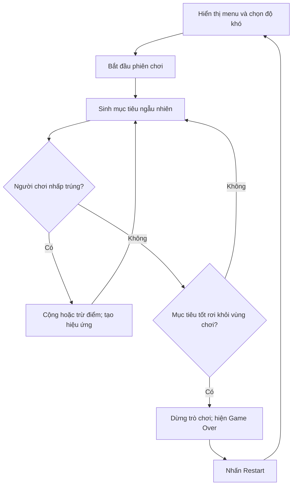
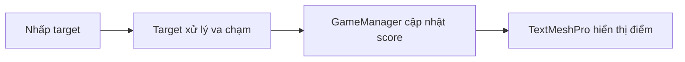

# Bài 01 — Giới thiệu Unit 5: Giao diện người dùng trong Unity

> **Lộ trình:** Junior Programmer · **Chủ đề:** User Interface · **Môi trường tham chiếu:** Unity 6.3, C# · **Hình thức:** Bài học định hướng.

## 1. Tổng quan

Một trò chơi không chỉ cần nhân vật chuyển động và va chạm đúng. Người chơi còn phải biết **phải làm gì**, **mình đang đạt kết quả nào**, **khi nào trò chơi kết thúc** và **làm sao chơi lại**. Các thành phần thể hiện, nhận và phản hồi thông tin ấy tạo nên **giao diện người dùng (User Interface — UI)**.

Trong Unit 5, sản phẩm thực hành là một trò chơi phản xạ: nhiều mục tiêu được phóng ngẫu nhiên từ cạnh dưới màn hình; người chơi nhấp chuột vào các mục tiêu có lợi trước khi chúng rơi xuống, đồng thời tránh các mục tiêu gây trừ điểm. Trò chơi có điểm số, màn hình kết thúc, nút chơi lại và ba lựa chọn độ khó.

**Đầu ra:** một vòng chơi hoàn chỉnh, từ chọn độ khó đến chơi, tính điểm, thua và khởi động lại mà không phải đóng ứng dụng.

## 2. Mục tiêu học tập

Sau khi hoàn thành Unit 5, người học có thể:

1. Phân biệt đối tượng trong **thế giới 3D** với các phần tử UI hiển thị trên `Canvas`.
2. Tạo mục tiêu có `Rigidbody`, `Collider`, `Prefab` và xử lý nhấp chuột bằng `Raycast`.
3. Xây dựng bộ đếm điểm, cập nhật `TextMeshPro` và phản hồi bằng hiệu ứng hạt.
4. Điều khiển trạng thái **Menu → Playing → Game Over → Restart**.
5. Dùng `Button` và tham số để thay đổi tần suất sinh mục tiêu.
6. Kiểm thử chức năng và thu thập phản hồi người chơi có hệ thống.

## 3. Vòng lặp tương tác của trò chơi



Sơ đồ cho thấy UI không tách biệt khỏi logic game: nhấp trúng mục tiêu làm thay đổi **dữ liệu điểm**, rồi dữ liệu đó mới được phản ánh lên màn hình. Ngược lại, nhấn nút độ khó trên UI làm thay đổi **tham số sinh mục tiêu** của game.

## 4. Kiến thức nền cần phân biệt

| Khái niệm | Công dụng trong Unit 5 | Điểm cần nhớ |
|---|---|---|
| `GameObject` | Đối tượng như target, camera, Game Manager | Là đối tượng chứa các `Component`. |
| `Rigidbody` | Chuyển động vật lý của target | Bài thực hành dùng **vật lý 3D**, dù cửa sổ Scene được bật **2D view**. |
| `Collider` | Bề mặt nhận tia nhấp chuột/va chạm | `Physics.Raycast` hoạt động với collider 3D; không nhầm với `Physics2D.Raycast`. |
| `Prefab` | Mẫu target được sinh lặp lại | Thay đổi prefab có thể ảnh hưởng các instance tạo từ nó. |
| `Coroutine` | Sinh mục tiêu theo khoảng thời gian | `WaitForSeconds` trì hoãn bước tiếp theo mà không đóng băng toàn bộ game. |
| `Canvas` / `RectTransform` | Chứa và bố trí điểm số, menu, nút | Phần tử UI không tự thay đổi điểm số; script sẽ đồng bộ dữ liệu vào UI. |
| `TextMeshPro` | Hiển thị văn bản điểm số, thông báo | Sử dụng `TextMeshProUGUI` cho văn bản uGUI trên Canvas. |
| `Button.onClick` | Chọn độ khó, chơi lại | Có thể kết nối từ Inspector hoặc bằng `AddListener`. |

### 4.1. “2D view” không đồng nghĩa “2D physics”

Unity cho phép quan sát scene ở góc nhìn thẳng bằng nút **2D** trong Scene view trong khi các mục tiêu vẫn sử dụng `Rigidbody` và `BoxCollider` 3D. Vì vậy, ví dụ dùng `Physics.Raycast`, `OnTriggerEnter(Collider)` và `ForceMode.Impulse`. Chỉ đổi sang `Rigidbody2D`, `Collider2D` khi chủ động thiết kế lại toàn bộ hệ vật lý và mã gọi tương ứng.

### 4.2. Trạng thái dữ liệu và biểu diễn giao diện

Biến `score` là **trạng thái có ý nghĩa**; dòng chữ `Điểm: 15` chỉ là **biểu diễn**. Không nên lấy điểm bằng cách phân tích ngược chữ trên UI. Mô hình đơn giản là:



Việc cập nhật giao diện đúng lúc trạng thái thay đổi thường dễ theo dõi hơn việc gán lại văn bản mỗi khung hình.

## 5. Chuẩn bị môi trường

1. Tạo dự án Unity với phiên bản phù hợp và mở scene thực hành. Có thể dùng **Prototype 5 Starter Files** từ bài 5.1 trên Unity Learn; bộ asset được phân phối theo bài học chính thức.
2. Kiểm tra `Main Camera`, `EventSystem` (khi tạo UI), `Canvas`, các target prefab và `Game Manager`.
3. Khi cần nhận chuột bằng mã mới, bảo đảm đã cài/kích hoạt **Input System**. Bài 5.1 bản Unity 6.3 sử dụng `UnityEngine.InputSystem.Mouse`.
4. Tạo thư mục `Scripts`, `Prefabs`, `Materials`, `Scenes` để tránh lẫn tài nguyên với mã.
5. Lưu scene và ghi nhận cấu hình trước khi sửa mã; bật Console để phát hiện lỗi trong Play mode.

Cấu trúc tham khảo:

```text
Assets/
├── Scenes/Prototype5.unity
├── Scripts/
│   ├── GameManager.cs
│   ├── Target.cs
│   └── DifficultyButton.cs
├── Prefabs/
│   ├── Good1.prefab
│   ├── Good2.prefab
│   ├── Good3.prefab
│   └── Bad1.prefab
└── Materials/
```

Đây là **cấu trúc gợi ý**; đường dẫn asset thực tế có thể khác tùy gói thực hành.

## 6. Tiến trình học và kết quả kiểm tra

| Phần | Câu hỏi kỹ thuật chính | Kết quả cần quan sát |
|---|---|---|
| 5.1 — Clicky Mouse | Làm sao sinh vật thể và nhận nhấp đúng collider? | Mục tiêu bay, xoay, biến mất khi nhấp/rơi khỏi ranh giới. |
| 5.2 — Keeping Score | Làm sao liên kết logic điểm với TextMeshPro? | Điểm tăng/giảm đúng và có hiệu ứng khi nhấp. |
| 5.3 — Game Over | Làm sao dừng vòng chơi và chơi lại? | Trạng thái kết thúc không tiếp tục sinh target/tính điểm. |
| 5.4 — What's the Difficulty? | Làm sao nút điều khiển tham số game? | Menu biến mất khi bắt đầu; khó hơn sinh mục tiêu nhanh hơn. |
| Challenge 5 | Có thể tự sửa lỗi trong project chưa hoàn thiện? | Các lỗi gameplay/UI được sửa và có kiểm thử hồi quy. |
| Lab 5 | Đổi hình ảnh nhưng giữ chức năng bằng cách nào? | Model, material mới không làm hỏng collider và script. |
| Quiz 5 | Phân biệt và vận dụng các khái niệm? | Trả lời được các tình huống về raycast, UI và trạng thái. |
| User feedback | Người chơi có tự hiểu và sử dụng được game không? | Có kế hoạch test, quan sát và hành động cải tiến. |

## 7. Quy tắc thực hành và kiểm thử

Trước mỗi thay đổi, hãy viết ngắn **giả thuyết → hành động → kết quả kỳ vọng → kết quả thực tế**. Ví dụ: “Tăng difficulty từ 1 lên 3 sẽ giảm thời gian giữa hai lần sinh mục tiêu nếu `spawnInterval = baseInterval / difficulty`”. Sau khi chạy, quan sát Console và thời gian phát sinh mục tiêu thay vì chỉ đánh giá bằng cảm giác.

Đặc biệt kiểm tra cả **trường hợp bình thường** lẫn **trường hợp biên**: nhấp vào khoảng trống; nhấp liên tục; target tốt rơi xuống; nhấn nút Restart; nhấn nhiều nút độ khó liên tiếp; màn hình thay đổi tỉ lệ; tham chiếu chưa được gán trong Inspector.

## 8. Câu hỏi ôn tập

**Câu 1.** Scene được bật 2D view, nhưng target có `Rigidbody` (không phải `Rigidbody2D`). Lựa chọn nào phù hợp để kiểm tra target bằng tia 3D?

A. `Physics.Raycast`  
B. `Physics2D.Raycast`  
C. `RectTransformUtility`  
D. `Button.onClick`

**Đáp án:** A. **Giải thích:** Hệ vật lý 3D dùng `Physics` và các collider 3D; 2D view chỉ thay đổi cách quan sát Scene.

**Câu 2.** Lý do nên lưu điểm trong biến `score` là gì?

A. Để tăng FPS tự động.  
B. Để khỏi tạo Canvas.  
C. Để dữ liệu là nguồn sự thật duy nhất, UI chỉ phản ánh nó.  
D. Để bỏ `GameManager`.

**Đáp án:** C. **Giải thích:** Điều này giảm nguy cơ giá trị logic và chuỗi hiển thị bị lệch nhau.

**Câu 3.** Thành phần nào dùng để sinh cùng một mẫu target nhiều lần?

A. `Canvas Scaler`  
B. `Prefab`  
C. `TMP_Text`  
D. `EventSystem`

**Đáp án:** B. **Giải thích:** Prefab lưu cấu hình đối tượng mẫu và được `Instantiate` khi chạy.

**Câu 4.** Hành vi nào thể hiện trò chơi có vòng chơi hoàn chỉnh?

A. Chỉ bay được target.  
B. Chỉ hiển thị điểm.  
C. Chỉ có màn hình Game Over.  
D. Có bắt đầu, tương tác, kết thúc và chơi lại.

**Đáp án:** D. **Giải thích:** Người dùng có thể chơi trọn một phiên và bắt đầu phiên mới không cần khởi động lại ứng dụng.

**Câu 5.** Vì sao nên kiểm tra nhiều tỉ lệ khung hình?

A. Để tăng khối lượng prefab.  
B. Để thử xem anchors, bố cục và chữ có còn đọc được không.  
C. Để thay thế raycast vật lý.  
D. Để tăng ngẫu nhiên của `Random.Range`.

**Đáp án:** B. **Giải thích:** UI có thể bị che, tràn hoặc sai vị trí ở màn hình khác.

## 9. Tổng kết

Unit 5 nối ba phần quan trọng: **tương tác vật lý** (nhấp target), **quản lý trạng thái** (điểm/độ khó/kết thúc) và **giao diện trực quan** (menu, thông báo, nút). Một UI hoạt động tốt phải hiển thị đúng dữ liệu, phản hồi đúng thao tác và hỗ trợ người chơi đi hết vòng chơi.

## 10. Tài liệu tham khảo

- [Unity Learn — User Interface, Junior Programmer (Unity 6.3)](https://learn.unity.com/pathway/junior-programmer/unit/user-interface?version=6.3).
- [Unity Learn — Unit 5: User Interface](https://learn.unity.com/course/create-with-code/unit/unit-5-user-interface?version=6.0).
- [Unity Learn — Detecting Mouse Clicks](https://learn.unity.com/tutorial/onmousedown).
- [Unity Learn — Working with UI in Unity](https://learn.unity.com/tutorial/working-with-ui-in-unity).
