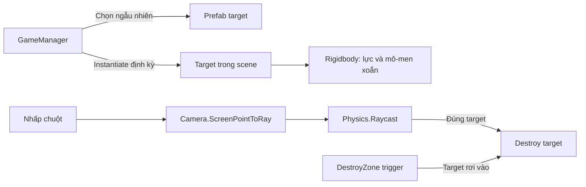

# Bài 02 — Lesson 5.1: Clicky Mouse — Nhấp chuột vào mục tiêu

> **Lộ trình:** Junior Programmer · **Chủ đề:** Unity User Interface / Prototype 5 · **Môi trường:** Unity 6.3, Input System, vật lý 3D · **Hình thức:** Bài học lập trình.

## 1. Bài toán và mục tiêu

Một trò chơi nhấp mục tiêu chỉ thú vị khi đối tượng xuất hiện không thể đoán trước, có chuyển động rõ ràng và phản hồi chính xác với con trỏ. Ta xây dựng **ba loại mục tiêu có lợi và một mục tiêu bất lợi**, phóng từ đáy màn hình với lực, mô-men xoắn và vị trí ngẫu nhiên. Người chơi nhấp vào đối tượng để làm nó biến mất; đối tượng rơi khỏi vùng chơi cũng bị dọn dẹp.

Kết thúc bài học, bạn có thể cấu hình `Rigidbody`, `Collider` và `Prefab`; dùng `List<GameObject>` để lưu loại mục tiêu; sinh đối tượng bằng coroutine; chuyển tọa độ chuột thành tia 3D; xác định đúng đối tượng được nhấp với `Physics.Raycast`; và xử lý vùng tiêu hủy bằng trigger.

## 2. Cơ chế hoạt động



**Hai cơ chế độc lập** dẫn tới cùng hành động `Destroy`: nhấp trúng bằng raycast hoặc rơi vào trigger. `Destroy` xóa instance trong scene, không xóa Prefab Asset trong Project.

## 3. Thiết lập scene và prefab

1. Tạo dự án hoặc nhập **Prototype 5 Starter Files** từ liên kết Unity Learn ở cuối bài. Mở scene `Prototype 5`, chọn **2D** trong Scene view để thuận tiện bố cục.
2. Kéo ba mẫu “good” và một mẫu “bad” từ thư viện vào scene; đặt tên phân biệt, chẳng hạn `Good 1`, `Good 2`, `Good 3`, `Bad 1`.
3. Thêm **`Rigidbody` (3D)** và **`BoxCollider` (3D)** hoặc collider phù hợp hình dạng cho từng target. Không dùng `Rigidbody2D` trong ví dụ này.
4. Gắn script `Target.cs` cho cả bốn target, kéo mỗi đối tượng vào thư mục `Prefabs` để tạo asset, sau đó xóa các instance mẫu khỏi scene.
5. Tạo Empty GameObject `Game Manager` và gắn `GameManager.cs`; kéo bốn prefab vào danh sách `Target Prefabs` trong Inspector.
6. Tạo vùng `DestroyZone` bên dưới vùng chơi với `BoxCollider` có **Is Trigger** và tag `DestroyZone` (tạo tag trước trong Tag Manager nếu chưa có). Đặt vùng rộng đủ để hứng mục tiêu rơi xuống.

> **Lưu ý vật lý:** Có thể dùng góc nhìn Scene 2D nhưng vẫn sử dụng `Rigidbody`, `Collider`, `Physics.Raycast` và `OnTriggerEnter(Collider)` của **vật lý 3D**.

## 4. Điều khiển chuyển động target

Tạo `Target.cs`:

```csharp
using UnityEngine;
using UnityEngine.InputSystem;

[RequireComponent(typeof(Rigidbody))]
public class Target : MonoBehaviour
{
    [Header("Chuyển động")]
    [SerializeField] private float minSpeed = 12f;
    [SerializeField] private float maxSpeed = 16f;
    [SerializeField] private float maxTorque = 10f;
    [SerializeField] private float xRange = 4f;
    [SerializeField] private float ySpawnPos = -6f;

    private Rigidbody targetRb;
    private Camera mainCamera;

    private void Start()
    {
        targetRb = GetComponent<Rigidbody>();
        mainCamera = Camera.main;
        transform.position = RandomSpawnPosition();
        targetRb.AddForce(RandomForce(), ForceMode.Impulse);
        targetRb.AddTorque(RandomTorque(), RandomTorque(), RandomTorque(),
            ForceMode.Impulse);
    }

    private Vector3 RandomSpawnPosition()
    {
        return new Vector3(Random.Range(-xRange, xRange), ySpawnPos, 0f);
    }

    private Vector3 RandomForce()
    {
        return Vector3.up * Random.Range(minSpeed, maxSpeed);
    }

    private float RandomTorque()
    {
        return Random.Range(-maxTorque, maxTorque);
    }

    private void Update()
    {
        Mouse mouse = Mouse.current;
        if (mouse == null || !mouse.leftButton.wasPressedThisFrame ||
            mainCamera == null) return;

        Vector2 mousePosition = mouse.position.ReadValue();
        Ray ray = mainCamera.ScreenPointToRay(mousePosition);
        Debug.DrawRay(ray.origin, ray.direction * 100f, Color.red, 2f);

        if (Physics.Raycast(ray, out RaycastHit hit) &&
            hit.collider.GetComponentInParent<Target>() == this)
        {
            Destroy(gameObject);
        }
    }

    private void OnTriggerEnter(Collider other)
    {
        if (other.CompareTag("DestroyZone"))
            Destroy(gameObject);
    }
}
```

### 4.1. Vì sao tách thành các hàm nhỏ?

`RandomSpawnPosition()`, `RandomForce()` và `RandomTorque()` mô tả ba trách nhiệm riêng. Việc đặt tên hàm rõ ràng giúp chỉnh tham số mà không phải dò một biểu thức dài trong `Start()`. Trong `Random.Range(float, float)`, giá trị được chọn trong khoảng giới hạn; `ForceMode.Impulse` áp dụng một xung lực ngay lúc target được tạo.

### 4.2. Từ vị trí chuột đến đối tượng 3D

`Mouse.current.leftButton.wasPressedThisFrame` báo trạng thái **vừa nhấn trong khung hình hiện tại**; `Mouse.current.position.ReadValue()` lấy tọa độ màn hình. `ScreenPointToRay` tạo tia từ camera đi qua pixel này; `Physics.Raycast` tìm collider đầu tiên mà tia chạm phải.

Điều kiện `hit.collider.GetComponentInParent<Target>() == this` bảo đảm **script của target A không xóa target B**. Biến thể `hit.transform == transform` ngắn hơn nhưng không bao quát trường hợp collider nằm trong GameObject con.

`Debug.DrawRay` chỉ dùng để quan sát đường tia khi debug; nó không tự thực hiện phát hiện va chạm.

> **Giới hạn của ví dụ:** Mỗi target kiểm tra chuột trong `Update`, phù hợp để học nhưng không tối ưu nếu số target lớn. Kiến trúc mở rộng nên kiểm tra chuột và raycast **một lần tại bộ điều khiển đầu vào**, rồi gửi lệnh cho target trúng tia. Ví dụ cũng chưa chặn nhấp vào thế giới khi con trỏ đang ở trên UI; có thể bổ sung kiểm tra qua `EventSystem` ở phiên bản hoàn chỉnh.

## 5. Sinh target bằng coroutine

Tạo `GameManager.cs`:

```csharp
using System.Collections;
using System.Collections.Generic;
using UnityEngine;

public class GameManager : MonoBehaviour
{
    [SerializeField] private List<GameObject> targetPrefabs = new();
    [SerializeField, Min(0.05f)] private float spawnInterval = 1f;

    private void Start()
    {
        if (targetPrefabs.Count > 0)
            StartCoroutine(SpawnTargets());
    }

    private IEnumerator SpawnTargets()
    {
        while (true)
        {
            yield return new WaitForSeconds(spawnInterval);
            int index = Random.Range(0, targetPrefabs.Count);
            if (targetPrefabs[index] != null)
                Instantiate(targetPrefabs[index]);
        }
    }
}
```

Trong `List<GameObject>`, phần tử `0 ... Count - 1` là các loại target. `Random.Range(0, targetPrefabs.Count)` với tham số **int** chọn một chỉ số hợp lệ vì giới hạn trên là **loại trừ**. `WaitForSeconds` tạm ngừng coroutine rồi tiếp tục sau một khoảng thời gian game đã co giãn theo `Time.timeScale`; nó không chặn việc render hoặc đọc input của toàn game.

**Phân biệt các lệnh dễ nhầm**

| Lệnh | Ý nghĩa |
|---|---|
| `Instantiate(prefab)` | Tạo một bản thể mới từ prefab. |
| `Destroy(gameObject)` | Đánh dấu hủy bản thể, thường được xử lý cuối vòng cập nhật. |
| `StartCoroutine(iterator)` | Khởi chạy hàm trả về `IEnumerator`. |
| `yield return new WaitForSeconds(t)` | Chờ khoảng thời gian game, không phải vòng lặp bận. |
| `Physics.Raycast(ray, out hit)` | Kiểm tra tia có chạm collider 3D và nhận dữ liệu điểm chạm. |
| `OnTriggerEnter(Collider)` | Xử lý khi các collider 3D thỏa điều kiện trigger vật lý. |

## 6. Kiểm thử có thể tái hiện

| Thao tác | Kết quả mong đợi | Nếu sai, kiểm tra |
|---|---|---|
| Play, không nhấp | Target sinh định kỳ, bay lên và xoay | Danh sách prefab; Rigidbody; gravity; khoảng sinh. |
| Nhấp chính giữa target | Chỉ target đó biến mất | Input System; MainCamera tag; collider; raycast; Console. |
| Nhấp vùng trống | Không có target nào bị xóa | So sánh target bị raycast trúng. |
| Để target rơi xuống | Target bị xóa khi chạm sensor | Tag `DestroyZone`; Is Trigger; kích thước vùng; Collider và Rigidbody. |
| Tắt một prefab khỏi danh sách | Chỉ prefab còn được chọn mới xuất hiện | Số phần tử và tham chiếu `null`. |

**Lỗi đáng chú ý:** Nếu cấu hình dự án chỉ bật New Input System mà mã lại dùng `Input.GetMouseButtonDown`, việc đọc input có thể không hoạt động như dự kiến. Bài này dùng `Mouse.current` nhất quán với Input System.

## 7. Bài tập thực hành

1. Chỉnh `minSpeed`, `maxSpeed` để chứng minh mục tiêu có vận tốc khác nhau.
2. Đổi xác suất xuất hiện bằng cách lặp prefab trong danh sách hoặc triển khai trọng số có kiểm soát (nâng cao); giải thích khác nhau giữa **đồng xác suất theo chỉ số** và **đồng xác suất theo loại**.
3. Chuyển raycast sang `GameManager` hoặc `ClickDetector` để mỗi cú nhấp chỉ phát một tia. So sánh kết quả khi có nhiều target đồng thời.
4. Bổ sung `LayerMask` để tia chỉ trúng mục tiêu, tránh collider ở nền che khuất.

## 8. Câu hỏi ôn tập

**Câu 1.** Khi `Random.Range(0, targets.Count)` dùng tham số `int`, chỉ số lớn nhất có thể trả về là gì?

A. `targets.Count`  
B. `targets.Count - 1`  
C. `-1`  
D. Bất kỳ số nguyên nào

**Đáp án:** B. **Giải thích:** Overload số nguyên loại trừ giới hạn trên, phù hợp với chỉ số cuối của `List`.

**Câu 2.** Cách nào tìm collider mà tia chuột chạm vào trong hệ vật lý 3D?

A. `Physics.Raycast`  
B. `Button.onClick`  
C. `CanvasScaler`  
D. `Physics2D.OverlapPoint`

**Đáp án:** A. **Giải thích:** `Physics.Raycast` thực hiện truy vấn va chạm tia với collider 3D.

**Câu 3.** Vì sao phải so sánh đối tượng trúng raycast với target hiện tại khi mỗi target đều đọc chuột?

A. Để tăng trọng lực.  
B. Để tạo hiệu ứng hạt.  
C. Để target không bao giờ bị xóa.  
D. Để tránh script của một target hủy nhầm target khác.

**Đáp án:** D. **Giải thích:** Tất cả target đều có thể nhận cùng một sự kiện nhấn trong một frame.

**Câu 4.** Điều kiện cốt lõi để target nhận `OnTriggerEnter(Collider)` khi rơi vào DestroyZone là gì?

A. Hai đối tượng phải có `Canvas`.  
B. Target phải là UI Button.  
C. Collider phù hợp, vùng sensor là trigger và cấu hình vật lý hỗ trợ sự kiện (chẳng hạn target có Rigidbody).  
D. Collider phải bị vô hiệu hóa.

**Đáp án:** C. **Giải thích:** Trigger là sự kiện của hệ va chạm vật lý, không phải UI.

**Câu 5.** Ưu điểm chính của coroutine `yield return WaitForSeconds` khi sinh mục tiêu là gì?

A. Bỏ qua toàn bộ collider.  
B. Sinh mục tiêu định kỳ mà không chặn vòng cập nhật chính.  
C. Bảo đảm mọi mục tiêu đều xuất hiện một lần.  
D. Làm target không chịu trọng lực.

**Đáp án:** B. **Giải thích:** Coroutine cho phép chờ theo thời gian trong khi phần khác của game vẫn chạy.

## 9. Tổng kết

Bài học hoàn thành cơ chế cốt lõi: prefab được tạo theo khoảng thời gian; mỗi target tự nhận lực và xoay; nhấp chuột được quy đổi thành tia 3D; va chạm với `DestroyZone` dọn dẹp target rơi khỏi màn hình. Đây là nền cho tính điểm và các màn hình UI.

## 10. Tài liệu tham khảo

- [Unity Learn — Lesson 5.1: Clicky Mouse, Unity 6.3](https://learn.unity.com/pathway/junior-programmer/unit/user-interface/tutorial/lesson-5-1-clicky-mouse-1?version=6.3).
- [Unity Learn — Detecting Mouse Clicks (OnMouseDown, raycast, uGUI)](https://learn.unity.com/tutorial/onmousedown).
- [Unity Scripting API — Input.GetMouseButtonDown (legacy) và hướng dẫn chuyển sang Input System](https://docs.unity3d.com/ScriptReference/Input.GetMouseButtonDown.html).
